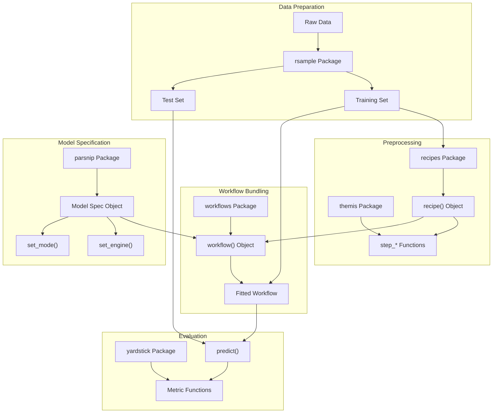
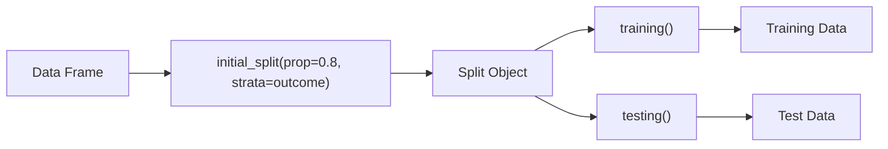
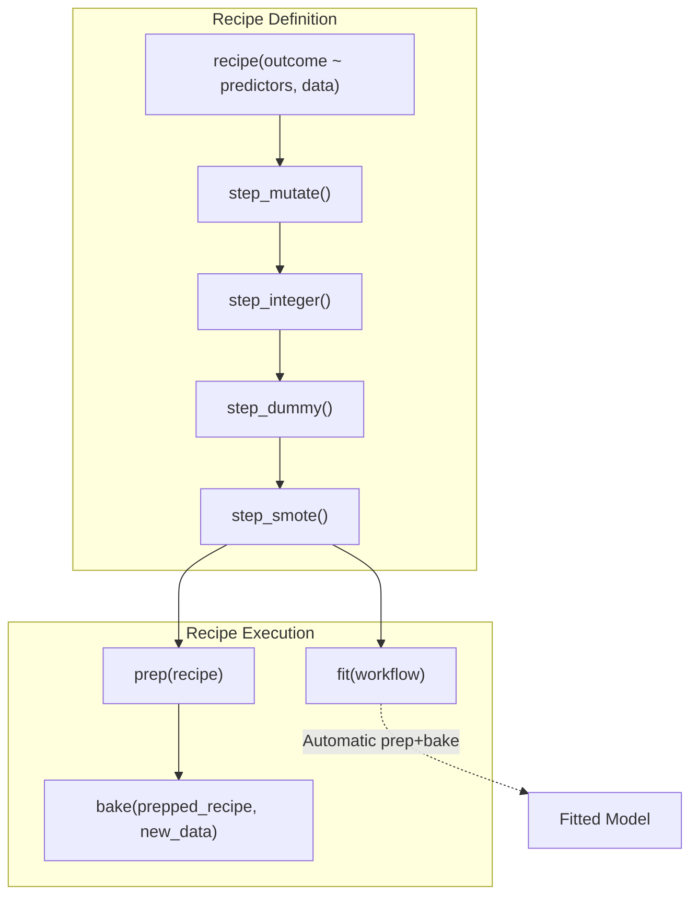
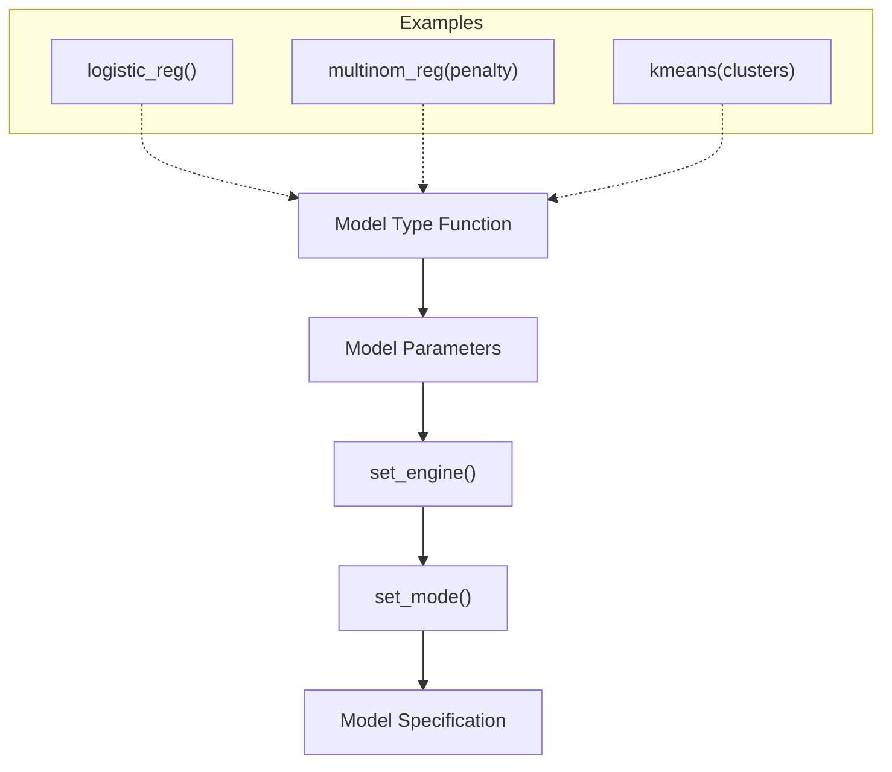
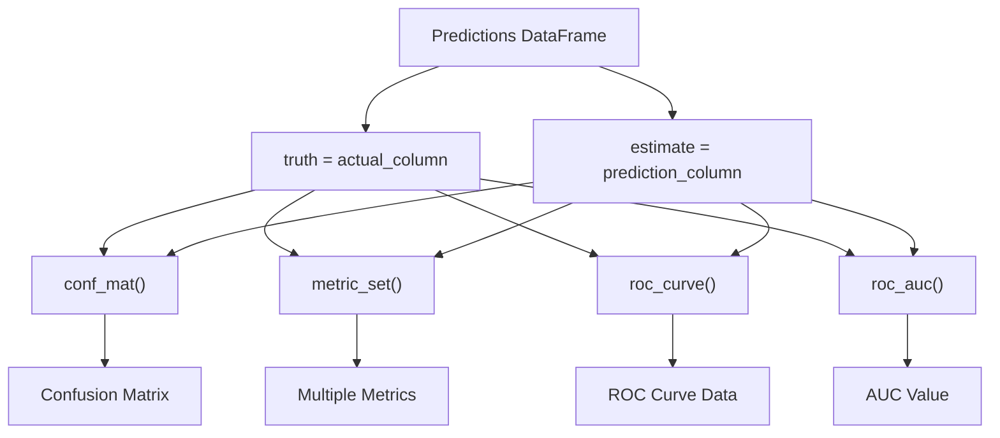
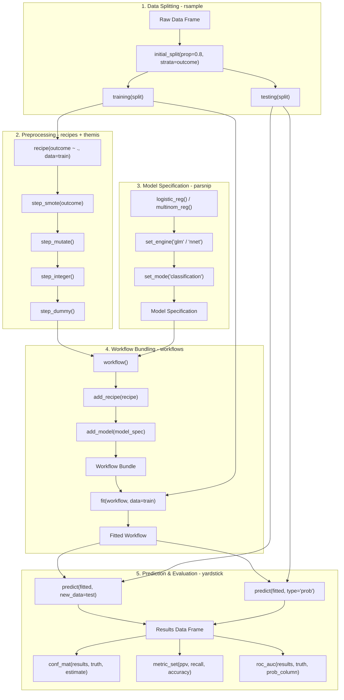

<!-- source: DeepWiki mcp.deepwiki.com · repo microsoft/ML-For-Beginners · extra page tidymodels Framework Overview · fetched 2026-10-26 -->

# tidymodels Framework Overview

<details>
<summary>Relevant source files</summary>

The following files were used as context for generating this wiki page:

- [2-Regression/4-Logistic/solution/R/lesson_4-R.ipynb](2-Regression/4-Logistic/solution/R/lesson_4-R.ipynb)
- [2-Regression/4-Logistic/solution/R/lesson_4.Rmd](2-Regression/4-Logistic/solution/R/lesson_4.Rmd)
- [2-Regression/4-Logistic/solution/R/lesson_4.html](2-Regression/4-Logistic/solution/R/lesson_4.html)
- [4-Classification/1-Introduction/solution/R/lesson_10-R.ipynb](4-Classification/1-Introduction/solution/R/lesson_10-R.ipynb)
- [4-Classification/1-Introduction/solution/R/lesson_10.Rmd](4-Classification/1-Introduction/solution/R/lesson_10.Rmd)
- [4-Classification/1-Introduction/solution/R/lesson_10.html](4-Classification/1-Introduction/solution/R/lesson_10.html)
- [4-Classification/2-Classifiers-1/solution/R/lesson_11-R.ipynb](4-Classification/2-Classifiers-1/solution/R/lesson_11-R.ipynb)
- [4-Classification/2-Classifiers-1/solution/R/lesson_11.Rmd](4-Classification/2-Classifiers-1/solution/R/lesson_11.Rmd)
- [4-Classification/data/cleaned_cuisines_R.csv](4-Classification/data/cleaned_cuisines_R.csv)
- [5-Clustering/1-Visualize/solution/R/lesson_14-R.ipynb](5-Clustering/1-Visualize/solution/R/lesson_14-R.ipynb)
- [5-Clustering/1-Visualize/solution/R/lesson_14.Rmd](5-Clustering/1-Visualize/solution/R/lesson_14.Rmd)
- [5-Clustering/2-K-Means/solution/R/lesson_15-R.ipynb](5-Clustering/2-K-Means/solution/R/lesson_15-R.ipynb)
- [5-Clustering/2-K-Means/solution/R/lesson_15.Rmd](5-Clustering/2-K-Means/solution/R/lesson_15.Rmd)

</details>


## Purpose and Scope

This document describes the **tidymodels** framework as implemented in the R-based machine learning lessons. tidymodels is a collection of R packages for modeling and machine learning that provides a consistent, composable interface parallel to Python's scikit-learn. This page covers the core packages (rsample, recipes, parsnip, workflows, yardstick) and their integration patterns for classification, regression, and clustering tasks.

For information about specific R implementations of ML algorithms, see [R Model Training and Evaluation](#6.2.3). For Python-based implementations, see [Core Python Libraries and Workflow](#6.1.1).

---

## tidymodels Ecosystem Architecture

The tidymodels framework is organized into specialized packages, each handling a distinct phase of the machine learning workflow. The following diagram shows how these packages interact:



**Sources:** [4-Classification/1-Introduction/solution/R/lesson_10.Rmd:36-73](), [2-Regression/4-Logistic/solution/R/lesson_4.Rmd:36-57]()

---

## Core Package Components

### rsample: Data Splitting

The `rsample` package provides infrastructure for data partitioning and resampling. It ensures stratified splits to maintain class proportions.

| Function | Purpose | Key Parameters |
|----------|---------|----------------|
| `initial_split()` | Create train/test split specification | `prop` (split ratio), `strata` (stratification variable) |
| `training()` | Extract training data | Split object |
| `testing()` | Extract test data | Split object |

**Implementation Pattern:**



**Code Examples:**
- Logistic regression split: [2-Regression/4-Logistic/solution/R/lesson_4.Rmd:251-264]()
- Classification split with stratification: [4-Classification/2-Classifiers-1/solution/R/lesson_11.Rmd:93-122]()

**Sources:** [4-Classification/2-Classifiers-1/solution/R/lesson_11.Rmd:88-122](), [2-Regression/4-Logistic/solution/R/lesson_4.Rmd:247-264]()

---

### recipes: Preprocessing Pipeline

The `recipes` package defines preprocessing steps as a blueprint. Recipes are specified, then estimated (`prep`), and applied (`bake`) to data.



**Key Step Functions:**

| Step | Purpose | Example Usage |
|------|---------|---------------|
| `step_mutate()` | Transform variables | Creating ordered factors [2-Regression/4-Logistic/solution/R/lesson_4.Rmd:182]() |
| `step_integer()` | Ordinal encoding | Converting ordered factors to integers [2-Regression/4-Logistic/solution/R/lesson_4.Rmd:184]() |
| `step_dummy()` | One-hot encoding | Creating binary columns from categories [2-Regression/4-Logistic/solution/R/lesson_4.Rmd:186]() |
| `step_smote()` | Synthetic oversampling | Balancing imbalanced classes [4-Classification/1-Introduction/solution/R/lesson_10.Rmd:336-337]() |

**Recipe Construction Pattern:**

[4-Classification/1-Introduction/solution/R/lesson_10.Rmd:332-340]() demonstrates the standard recipe pattern:
```r
recipe(cuisine ~ ., data = df_select) %>% 
  step_smote(cuisine)
```

[2-Regression/4-Logistic/solution/R/lesson_4.Rmd:273-278]() shows preprocessing for logistic regression:
```r
recipe(color ~ ., data = pumpkins_train) %>% 
  step_mutate(item_size = ordered(...)) %>%
  step_integer(item_size, zero_based = F) %>%  
  step_dummy(all_nominal(), -all_outcomes(), one_hot = TRUE)
```

**Sources:** [4-Classification/1-Introduction/solution/R/lesson_10.Rmd:300-397](), [2-Regression/4-Logistic/solution/R/lesson_4.Rmd:162-193](), [4-Classification/2-Classifiers-1/solution/R/lesson_11.Rmd:136-151]()

---

### parsnip: Model Specification

The `parsnip` package provides a unified interface for model specification across different computational engines.



**Model Specification Functions:**

| Model Function | Task Type | Engine Options | Usage Example |
|----------------|-----------|----------------|---------------|
| `logistic_reg()` | Binary classification | `"glm"` (default) | [2-Regression/4-Logistic/solution/R/lesson_4.Rmd:280-282]() |
| `multinom_reg()` | Multiclass classification | `"nnet"` | [4-Classification/2-Classifiers-1/solution/R/lesson_11.Rmd:230-236]() |

**Specification Pattern Example:**

[4-Classification/2-Classifiers-1/solution/R/lesson_11.Rmd:229-237]() demonstrates multinomial regression specification:
```r
multinom_reg(penalty = 1) %>% 
  set_engine("nnet", MaxNWts = 2086) %>% 
  set_mode("classification")
```

[2-Regression/4-Logistic/solution/R/lesson_4.Rmd:279-283]() shows logistic regression specification:
```r
logistic_reg() %>% 
  set_engine("glm") %>% 
  set_mode("classification")
```

**Sources:** [4-Classification/2-Classifiers-1/solution/R/lesson_11.Rmd:219-237](), [2-Regression/4-Logistic/solution/R/lesson_4.Rmd:266-283]()

---

### workflows: Bundling Components

The `workflows` package combines recipes and model specifications into a single object that can be trained and used for prediction.

```mermaid
graph LR
    workflow_init["workflow()"]
    add_recipe["add_recipe(recipe_obj)"]
    add_model["add_model(model_spec)"]
    workflow_obj["Workflow Object"]
    fit_call["fit(workflow, data=train)"]
    fitted_wf["Fitted Workflow"]
    predict_call["predict(fitted_wf, new_data=test)"]
    predictions["Predictions"]
    
    workflow_init --> add_recipe
    add_recipe --> add_model
    add_model --> workflow_obj
    workflow_obj --> fit_call
    fit_call --> fitted_wf
    fitted_wf --> predict_call
    predict_call --> predictions
```



**Workflow Construction and Usage:**

[4-Classification/2-Classifiers-1/solution/R/lesson_11.Rmd:244-252]() shows workflow bundling:
```r
workflow() %>% 
  add_recipe(cuisines_recipe) %>% 
  add_model(mr_spec)
```

[4-Classification/2-Classifiers-1/solution/R/lesson_11.Rmd:257-262]() demonstrates training:
```r
fit(object = mr_wf, data = cuisines_train)
```

[2-Regression/4-Logistic/solution/R/lesson_4.Rmd:289-309]() illustrates the complete workflow lifecycle:
1. Bundle: `workflow() %>% add_recipe() %>% add_model()`
2. Train: `fit(data = pumpkins_train)`
3. Predict: `predict(new_data = pumpkins_test)`

**Sources:** [4-Classification/2-Classifiers-1/solution/R/lesson_11.Rmd:239-263](), [2-Regression/4-Logistic/solution/R/lesson_4.Rmd:285-326]()

---

### yardstick: Model Evaluation

The `yardstick` package provides functions for calculating performance metrics from predictions.



**Classification Metrics:**

| Function | Purpose | Returns | Usage |
|----------|---------|---------|-------|
| `conf_mat()` | Confusion matrix | Cross-tabulation | [2-Regression/4-Logistic/solution/R/lesson_4.Rmd:338-341]() |
| `metric_set()` | Multiple metrics | Combined metric function | [2-Regression/4-Logistic/solution/R/lesson_4.Rmd:380-382]() |
| `ppv()` | Precision | Positive predictive value | Part of metric_set |
| `recall()` | Sensitivity | True positive rate | Part of metric_set |
| `spec()` | Specificity | True negative rate | Part of metric_set |
| `f_meas()` | F1 score | Harmonic mean of precision/recall | Part of metric_set |
| `accuracy()` | Accuracy | Overall correctness | Part of metric_set |
| `roc_curve()` | ROC curve | Data for plotting | [2-Regression/4-Logistic/solution/R/lesson_4.Rmd:390-393]() |
| `roc_auc()` | Area under ROC | Single AUC value | [2-Regression/4-Logistic/solution/R/lesson_4.Rmd:400-403]() |

**Evaluation Pattern Example:**

[4-Classification/2-Classifiers-1/solution/R/lesson_11.Rmd:283-286]() shows confusion matrix calculation:
```r
conf_mat(data = results, truth = cuisine, estimate = .pred_class)
```

[2-Regression/4-Logistic/solution/R/lesson_4.Rmd:379-383]() demonstrates metric_set usage:
```r
eval_metrics <- metric_set(ppv, recall, spec, f_meas, accuracy)
eval_metrics(data = results, truth = color, estimate = .pred_class)
```

**Sources:** [2-Regression/4-Logistic/solution/R/lesson_4.Rmd:330-407](), [4-Classification/2-Classifiers-1/solution/R/lesson_11.Rmd:267-310]()

---

### themis: Handling Imbalanced Data

The `themis` package extends recipes with additional preprocessing steps for imbalanced datasets, primarily through the SMOTE (Synthetic Minority Over-sampling Technique) algorithm.

**SMOTE Implementation:**

[4-Classification/1-Introduction/solution/R/lesson_10.Rmd:331-340]() shows SMOTE integration into recipes:
```r
recipe(cuisine ~ ., data = df_select) %>% 
  step_smote(cuisine)
```

[4-Classification/2-Classifiers-1/solution/R/lesson_11.Rmd:136-146]() demonstrates the same pattern for classification:
```r
recipe(cuisine ~ ., data = cuisines_train) %>% 
  step_smote(cuisine)
```

**Before and After SMOTE:**

The distribution transformation is documented in [4-Classification/1-Introduction/solution/R/lesson_10.Rmd:372-383](), showing balanced class counts after applying SMOTE.

**Sources:** [4-Classification/1-Introduction/solution/R/lesson_10.Rmd:300-397](), [4-Classification/2-Classifiers-1/solution/R/lesson_11.Rmd:123-151]()

---

## Complete Workflow Integration

The following diagram shows the complete tidymodels workflow from raw data to model evaluation:



**Sources:** [2-Regression/4-Logistic/solution/R/lesson_4.Rmd:247-407](), [4-Classification/2-Classifiers-1/solution/R/lesson_11.Rmd:60-310]()

---

## Usage Patterns Across ML Tasks

### Binary Classification (Logistic Regression)

**Complete Example Flow:** [2-Regression/4-Logistic/solution/R/lesson_4.Rmd:247-407]()

1. **Split data:** [2-Regression/4-Logistic/solution/R/lesson_4.Rmd:251-264]()
2. **Create recipe:** [2-Regression/4-Logistic/solution/R/lesson_4.Rmd:273-278]()
3. **Specify model:** [2-Regression/4-Logistic/solution/R/lesson_4.Rmd:279-283]()
4. **Bundle workflow:** [2-Regression/4-Logistic/solution/R/lesson_4.Rmd:289-297]()
5. **Train:** [2-Regression/4-Logistic/solution/R/lesson_4.Rmd:302-309]()
6. **Predict:** [2-Regression/4-Logistic/solution/R/lesson_4.Rmd:315-326]()
7. **Evaluate:** [2-Regression/4-Logistic/solution/R/lesson_4.Rmd:338-407]()

### Multiclass Classification

**Complete Example Flow:** [4-Classification/2-Classifiers-1/solution/R/lesson_11.Rmd:60-310]()

Key difference: Uses `multinom_reg()` instead of `logistic_reg()` and requires `nnet` engine.

1. **Preprocessing with SMOTE:** [4-Classification/2-Classifiers-1/solution/R/lesson_11.Rmd:136-146]()
2. **Model specification:** [4-Classification/2-Classifiers-1/solution/R/lesson_11.Rmd:229-237]()
3. **Workflow creation:** [4-Classification/2-Classifiers-1/solution/R/lesson_11.Rmd:244-252]()
4. **Training:** [4-Classification/2-Classifiers-1/solution/R/lesson_11.Rmd:257-262]()
5. **Prediction with probabilities:** [4-Classification/2-Classifiers-1/solution/R/lesson_11.Rmd:319-329]()

### Clustering (K-Means)

**Note:** K-Means clustering in this repository uses base R `kmeans()` function rather than tidymodels parsnip interface, but integrates with tidymodels ecosystem for evaluation.

[5-Clustering/2-K-Means/solution/R/lesson_15.Rmd:178-192]() shows direct kmeans usage:
```r
kmeans(df_numeric_select, centers = 3, nstart = 25)
```

Integration with tidymodels occurs through:
- Using tidyverse/dplyr for data manipulation
- Using `augment()` from broom/tidymodels to add cluster assignments: [5-Clustering/2-K-Means/solution/R/lesson_15.Rmd:199-203]()

**Sources:** [5-Clustering/2-K-Means/solution/R/lesson_15.Rmd:173-330]()

---

## Key Differences from Python scikit-learn

| Aspect | tidymodels (R) | scikit-learn (Python) |
|--------|----------------|----------------------|
| **Preprocessing** | `recipe()` with `step_*()` functions | `Pipeline` with transformer objects |
| **Model specification** | Separate specification and fitting (`parsnip`) | Combined in model class |
| **Workflow bundling** | Explicit `workflow()` object | `Pipeline` object |
| **Train/test split** | `initial_split()`, `training()`, `testing()` | `train_test_split()` |
| **Predictions** | `predict()` returns tibble | `predict()` returns numpy array |
| **Evaluation** | `yardstick` package functions | `.score()` methods and `sklearn.metrics` |
| **Imbalanced data** | `themis::step_smote()` in recipe | `imblearn.over_sampling.SMOTE` in pipeline |

**Sources:** Comparison based on implementation differences observed across [2-Regression/4-Logistic/solution/R/lesson_4.Rmd:1-418]() and general tidymodels documentation patterns.

---

## Common Patterns and Best Practices

### Pattern 1: Workflow Without Explicit prep/bake

When using `workflow()`, recipes are automatically prepped and baked during `fit()`:

[4-Classification/2-Classifiers-1/solution/R/lesson_11.Rmd:149-151]() notes:
> "Since we'll be using this recipe as a preprocessor for modeling, a `workflow()` will do all the prep and bake for us"

### Pattern 2: Manual prep/bake for Data Exploration

For data analysis outside of modeling, explicitly prep and bake:

[4-Classification/1-Introduction/solution/R/lesson_10.Rmd:354-368]() demonstrates:
```r
cuisines_recipe %>% 
  prep() %>% 
  bake(new_data = NULL)
```

### Pattern 3: Prediction Types

[4-Classification/2-Classifiers-1/solution/R/lesson_11.Rmd:319-329]() shows both prediction types:
- Hard class predictions: `predict(fitted_wf, new_data = test)`
- Probability predictions: `predict(fitted_wf, new_data = test, type = "prob")`

### Pattern 4: Metric Combination

[2-Regression/4-Logistic/solution/R/lesson_4.Rmd:380-383]() demonstrates efficient metric calculation:
```r
eval_metrics <- metric_set(ppv, recall, spec, f_meas, accuracy)
eval_metrics(data = results, truth = color, estimate = .pred_class)
```

**Sources:** [4-Classification/2-Classifiers-1/solution/R/lesson_11.Rmd:149-151](), [4-Classification/1-Introduction/solution/R/lesson_10.Rmd:354-397](), [2-Regression/4-Logistic/solution/R/lesson_4.Rmd:379-383]()

---

