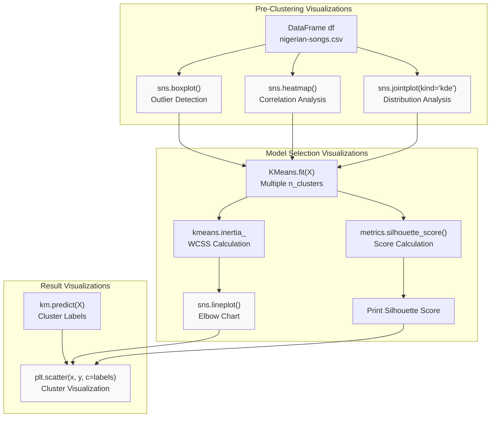
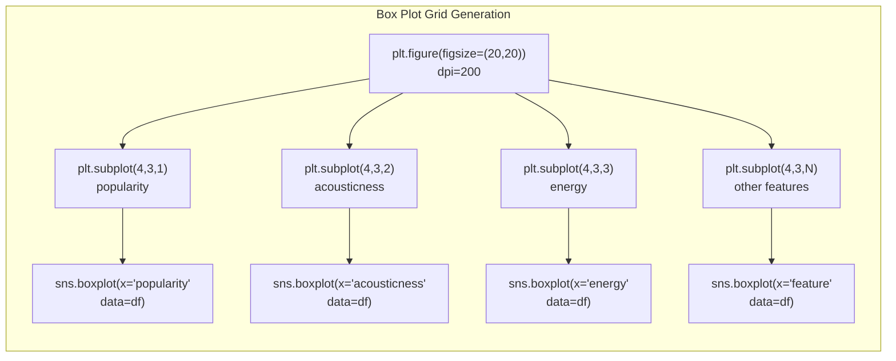
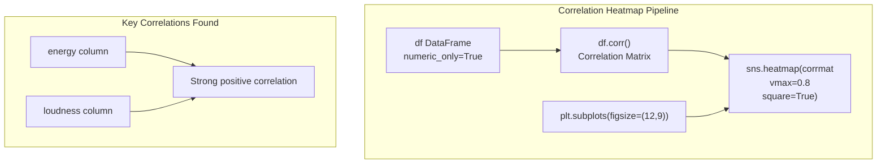
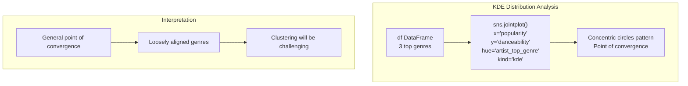
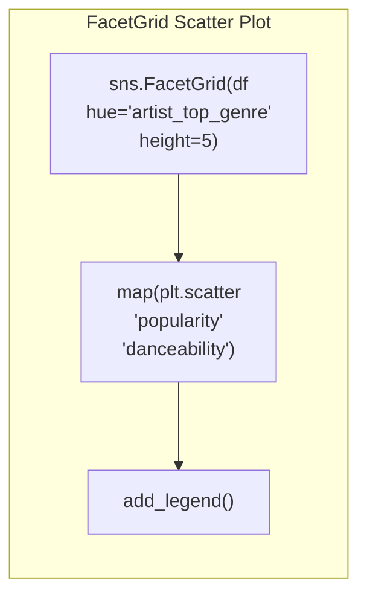
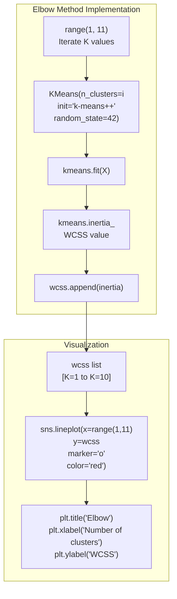
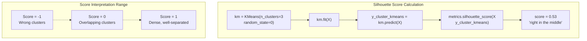
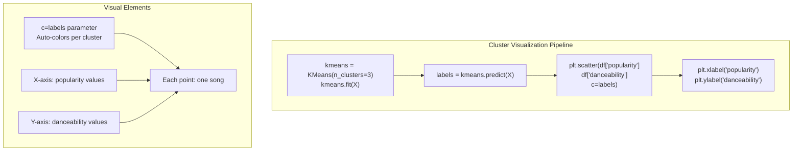
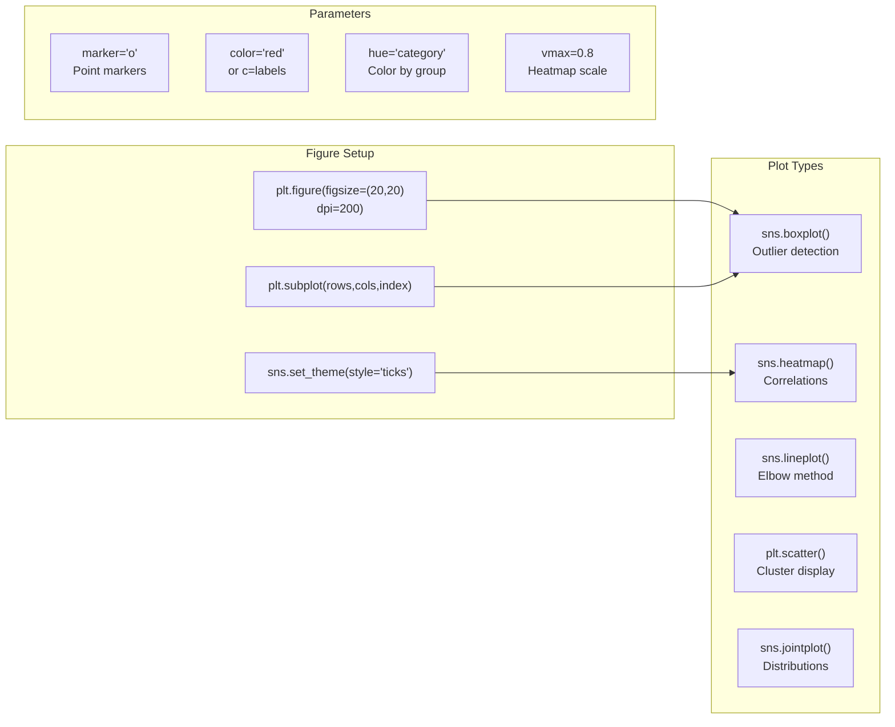

<!-- source: DeepWiki mcp.deepwiki.com · repo microsoft/ML-For-Beginners · extra page Clustering Data Visualization · fetched 2026-10-26 -->

# Clustering Data Visualization

<details>
<summary>Relevant source files</summary>

The following files were used as context for generating this wiki page:

- [5-Clustering/1-Visualize/README.md](5-Clustering/1-Visualize/README.md)
- [5-Clustering/2-K-Means/README.md](5-Clustering/2-K-Means/README.md)
- [6-NLP/1-Introduction-to-NLP/README.md](6-NLP/1-Introduction-to-NLP/README.md)
- [6-NLP/1-Introduction-to-NLP/images/comprehension.png](6-NLP/1-Introduction-to-NLP/images/comprehension.png)
- [6-NLP/2-Tasks/README.md](6-NLP/2-Tasks/README.md)
- [6-NLP/3-Translation-Sentiment/README.md](6-NLP/3-Translation-Sentiment/README.md)
- [6-NLP/3-Translation-Sentiment/images/monnaie.png](6-NLP/3-Translation-Sentiment/images/monnaie.png)
- [6-NLP/4-Hotel-Reviews-1/README.md](6-NLP/4-Hotel-Reviews-1/README.md)
- [6-NLP/5-Hotel-Reviews-2/README.md](6-NLP/5-Hotel-Reviews-2/README.md)
- [6-NLP/5-Hotel-Reviews-2/assignment.md](6-NLP/5-Hotel-Reviews-2/assignment.md)
- [6-NLP/5-Hotel-Reviews-2/solution/3-notebook.ipynb](6-NLP/5-Hotel-Reviews-2/solution/3-notebook.ipynb)
- [6-NLP/README.md](6-NLP/README.md)

</details>


## Purpose and Scope

This page documents visualization techniques used to analyze and interpret clustering results in the ML-For-Beginners curriculum. It covers visualization methods applied before clustering (outlier detection, data distribution), during model selection (elbow method, silhouette scoring), and after clustering (cluster assignment visualization). The primary implementation uses the Nigerian music dataset with K-Means clustering.

For information about the K-Means clustering algorithm mechanics and parameter selection, see [4.1.1](#4.1.1). For initial data exploration and filtering, see [4.1](#4.1).

---

## Visualization Workflow in Clustering

Clustering analysis relies heavily on visualization at three stages: pre-processing data quality assessment, model parameter selection, and result interpretation. Each stage uses different visualization techniques to inform decisions about the clustering process.



**Workflow Stages:**

| Stage | Visualization Type | Purpose | Output Format |
|-------|-------------------|---------|---------------|
| Pre-Clustering | Box plots | Identify outliers and data range | Grid of boxplots per feature |
| Pre-Clustering | Heatmap | Assess feature correlation | Correlation matrix heatmap |
| Pre-Clustering | KDE/scatter plots | Understand data distribution | Joint distribution plots |
| Model Selection | Elbow chart | Determine optimal K | Line plot of WCSS vs K |
| Model Selection | Silhouette score | Validate cluster quality | Numeric score (-1 to 1) |
| Result | Scatter plot with colors | Display cluster assignments | 2D scatter with color coding |

Sources: [5-Clustering/2-K-Means/README.md:1-248](), [5-Clustering/1-Visualize/README.md:100-314]()

---

## Outlier Detection with Box Plots

Box plots provide a visual method to identify outliers across multiple features before applying clustering algorithms. The Nigerian music dataset analysis uses `sns.boxplot()` to examine each feature's distribution and identify extreme values that could distort clustering results.

### Implementation

The box plot grid creation uses `plt.subplot()` to arrange multiple box plots:



**Features Visualized:**

| Column Name | Data Type | Outlier Characteristics |
|------------|-----------|------------------------|
| `popularity` | int64 | High variance with extreme high values |
| `acousticness` | float64 | Outliers at both extremes |
| `energy` | float64 | Right-skewed with high outliers |
| `instrumentalness` | float64 | Many low values, few extreme highs |
| `liveness` | float64 | Concentrated low, scattered high |
| `loudness` | float64 | Wide range, extreme low values |
| `speechiness` | float64 | Right-skewed distribution |
| `tempo` | float64 | Symmetric with outliers both sides |
| `danceability` | float64 | Relatively balanced distribution |
| `length` | int64 | Right-skewed with extreme long tracks |

**Interpretation Guidelines:**

- **Box boundaries**: Represent the interquartile range (IQR, 25th to 75th percentile)
- **Whiskers**: Extend to 1.5 × IQR beyond box boundaries
- **Points beyond whiskers**: Identified as outliers
- **Noisy data indication**: Multiple scattered outliers across features suggest the dataset requires careful feature selection

The visualization at [5-Clustering/2-K-Means/README.md:41-85]() reveals that the Nigerian music dataset contains "a little noisy" data with visible outliers in most features. Rather than removing outliers (which would reduce data volume), the approach focuses on selecting features with similar ranges for clustering.

Sources: [5-Clustering/2-K-Means/README.md:41-89]()

---

## Correlation Heatmap Analysis

Correlation heatmaps visualize relationships between numerical features to identify redundant or strongly correlated variables before clustering. This helps avoid feature redundancy that could bias cluster formation.

### Heatmap Generation

The correlation matrix visualization uses `sns.heatmap()` with the pandas `corr()` method:



**Correlation Findings:**

The heatmap analysis at [5-Clustering/1-Visualize/README.md:260-270]() reveals:

| Feature Pair | Correlation Strength | Interpretation |
|-------------|---------------------|----------------|
| `energy` ↔ `loudness` | Strong positive | Expected relationship (loud music tends to be energetic) |
| Other pairs | Weak correlations | Features are relatively independent |

The weak overall correlations indicate that clustering algorithms will need to identify patterns in the data without obvious linear relationships between features. This makes the dataset "interesting to see what a clustering algorithm can make of this data" but potentially challenging for cluster quality.

**Causation Note:** The documentation emphasizes that "correlation does not imply causation" - while `energy` and `loudness` correlate strongly, this doesn't prove one causes the other.

Sources: [5-Clustering/1-Visualize/README.md:260-272]()

---

## Distribution Visualization with KDE and Scatter Plots

Distribution visualizations examine how data points spread across feature spaces, helping predict clustering behavior and identify natural groupings.

### KDE Joint Plot

The Kernel Density Estimate (KDE) plot visualizes continuous probability density across two dimensions:



**Distribution Characteristics:**

The KDE analysis at [5-Clustering/1-Visualize/README.md:282-300]() shows:

- **Concentric circles**: Data points cluster around a general convergence point
- **Genre alignment**: The three genres (afro dancehall, afropop, nigerian pop) align "loosely in terms of their popularity and danceability"
- **Clustering difficulty**: "Determining clusters in this loosely-aligned data will be a challenge"

### FacetGrid Scatter Plot

The `sns.FacetGrid` provides an alternative scatter plot visualization with color-coded genres:



This visualization at [5-Clustering/1-Visualize/README.md:302-312]() confirms "a similar pattern of convergence" as the KDE plot, reinforcing that genre boundaries are not clearly separated in the popularity-danceability space.

**Visualization Purpose:** These distribution plots serve as baselines to compare against final clustering results, helping assess whether the clustering algorithm discovered meaningful patterns or simply imposed arbitrary boundaries on continuous data.

Sources: [5-Clustering/1-Visualize/README.md:274-314]()

---

## Elbow Method Visualization

The elbow method plots Within-Cluster Sum of Squares (WCSS) against the number of clusters to identify the optimal K value. The "elbow" point indicates where adding more clusters provides diminishing returns in explaining data variance.

### WCSS Calculation and Plotting



**WCSS Calculation Process:**

| Step | Code Reference | Purpose |
|------|---------------|---------|
| Initialize loop | `for i in range(1, 11):` | Test K from 1 to 10 |
| Create model | `KMeans(n_clusters=i, init='k-means++', random_state=42)` | Consistent initialization |
| Fit model | `kmeans.fit(X)` | Train on feature matrix X |
| Extract WCSS | `kmeans.inertia_` | Get sum of squared distances |
| Store value | `wcss.append(kmeans.inertia_)` | Build list for plotting |

**Key Parameters:**

- **`init='k-means++'`**: Smart initialization that places centroids distant from each other, leading to "probably better results than random initialization"
- **`random_state=42`**: Ensures reproducibility by fixing random number generation seed
- **`kmeans.inertia_`**: Measures "how internally coherent clusters are" - lower values indicate tighter clusters

### Interpreting the Elbow

The elbow chart at [5-Clustering/2-K-Means/README.md:170-181]() shows the WCSS decreasing as K increases. The optimal K occurs where:

1. **Sharp bend**: The curve transitions from steep to gradual decline
2. **Diminishing returns**: Additional clusters provide minimal WCSS reduction
3. **Dataset context**: For the Nigerian music dataset with 3 targeted genres, the elbow confirms "Maybe it **is** 3!"

The visualization helps validate that the predetermined K=3 (based on domain knowledge of 3 genres) aligns with the data-driven elbow method recommendation.

Sources: [5-Clustering/2-K-Means/README.md:137-181]()

---

## Silhouette Score Interpretation

The silhouette score quantifies cluster quality by measuring how well each data point fits within its assigned cluster compared to other clusters. Scores range from -1 (incorrect clustering) to 1 (dense, well-separated clusters).

### Calculation Process



**Silhouette Score Metrics:**

| Score Range | Interpretation | Data Suitability |
|------------|----------------|------------------|
| Close to 1 | Dense, well-separated clusters | Excellent for clustering |
| Close to 0.5 | Moderate separation, some overlap | Marginal suitability |
| Close to 0 | Overlapping clusters at boundaries | Poor clustering candidate |
| Close to -1 | Points in wrong clusters | Unsuitable for clustering |

**Nigerian Music Dataset Result:**

The silhouette score of **0.53** at [5-Clustering/2-K-Means/README.md:123-135]() indicates:

- **Position**: "right in the middle" between poor (0) and excellent (1)
- **Interpretation**: "our data is not particularly well-suited to this type of clustering"
- **Action**: Despite the mediocre score, the analysis continues to explore what patterns emerge

The score calculation uses `sklearn.metrics.silhouette_score()` which considers:
- **Cohesion**: Average distance between a point and others in its cluster
- **Separation**: Average distance between a point and points in nearest neighboring cluster
- **Formula**: (separation - cohesion) / max(separation, cohesion)

A value near 0 indicates samples are "very close to the decision boundary of the neighboring clusters," suggesting the three music genres have significant feature overlap rather than distinct boundaries.

Sources: [5-Clustering/2-K-Means/README.md:123-135]()

---

## Cluster Assignment Visualization

After model training, scatter plots with color-coded cluster assignments visualize how the algorithm grouped data points. This reveals cluster shapes, overlap, and separation quality.

### Scatter Plot Implementation



**Visualization Components:**

| Component | Code Parameter | Purpose |
|-----------|---------------|---------|
| X-coordinates | `df['popularity']` | Horizontal position |
| Y-coordinates | `df['danceability']` | Vertical position |
| Color coding | `c=labels` | Cluster assignment (0, 1, or 2) |
| Labels | `plt.xlabel()`, `plt.ylabel()` | Axis identification |

### Interpreting Cluster Shapes

The scatter plot at [5-Clustering/2-K-Means/README.md:185-212]() reveals cluster problems:

**Issue Characteristics:**

1. **Imbalanced data**: "too imbalanced" - clusters have very different sizes
2. **Low correlation**: "too little correlated" - features don't strongly define boundaries
3. **High variance**: "too much variance between the column values to cluster well"
4. **Genre influence**: "clusters that form are probably heavily influenced or skewed by the three genre categories we defined above"

**Variance Problem:**

The visualization shows a "variance problem" as documented at [5-Clustering/2-K-Means/README.md:216-224]():

- **Definition**: Variance is "the average of the squared differences from the Mean"
- **Clustering context**: "the numbers of our dataset tend to diverge a bit too much from the mean"
- **Visual indicator**: Clusters are "not very well demarcated" with unclear boundaries
- **Scikit-learn reference**: The shape matches the "variance problem" pattern in sklearn documentation

### Accuracy Assessment

The model accuracy calculation complements the visualization:

```python
labels = kmeans.labels_
correct_labels = sum(y == labels)
print("Result: %d out of %d samples were correctly labeled." % (correct_labels, y.size))
print('Accuracy score: {0:0.2f}'. format(correct_labels/float(y.size)))
```

This code at [5-Clustering/2-K-Means/README.md:198-208]() compares predicted cluster labels against the original genre categories (`y`), though "accuracy is not very good" due to the factors listed above.

**Improvement Suggestions:**

The documentation recommends at [5-Clustering/2-K-Means/README.md:225]():
- Tweaking the data
- Using different columns
- Using a different algorithm
- Scaling data to normalize ranges
- Testing other columns for better separation

Sources: [5-Clustering/2-K-Means/README.md:183-228]()

---

## Data Scaling for Visualization Improvement

Feature scaling normalizes different measurement scales to comparable ranges, improving both clustering quality and visualization interpretability. The Nigerian music dataset contains features with vastly different scales (e.g., tempo ranges from 61-206, while acousticness ranges from 0-1).

### Scaling Impact on Visualization

```mermaid
graph TB
    subgraph "Without Scaling"
        UNSCALED["Raw Features<br/>Different scales"]
        UNSCALED_CLUSTER["K-Means clustering"]
        BIAS["Features with less variance<br/>carry more weight"]
        POOR_VIZ["Poor visualization<br/>Hard to interpret axes"]
        
        UNSCALED --> UNSCALED_CLUSTER
        UNSCALED_CLUSTER --> BIAS
        BIAS --> POOR_VIZ
    end
    
    subgraph "With Scaling"
        SCALED["StandardScaler<br/>or normalization"]
        SCALED_CLUSTER["K-Means clustering"]
        EQUAL["Equal feature importance"]
        BETTER_VIZ["Clearer elbow chart<br/>More interpretable clusters"]
        
        SCALED --> SCALED_CLUSTER
        SCALED_CLUSTER --> EQUAL
        EQUAL --> BETTER_VIZ
    end
    
    subgraph "Trade-offs"
        SIL_DOWN["Silhouette score may decrease"]
        ELBOW_SMOOTH["Elbow kink smooths out"]
        UNDERSTAND["But: underlying variance<br/>is more fairly represented"]
        
        SIL_DOWN --> UNDERSTAND
        ELBOW_SMOOTH --> UNDERSTAND
    end
```



**Scaling Effects on Metrics:**

| Metric | Without Scaling | With Scaling | Explanation |
|--------|----------------|--------------|-------------|
| Silhouette score | Higher | Lower | Unscaled data allows low-variance features to dominate |
| Elbow curve | Sharp kink | Smoother | Normalized variance shows true cluster structure |
| Feature importance | Biased by scale | Equal weight | All features contribute proportionally |
| Interpretability | Misleading | Accurate | Reflects actual data relationships |

**Implementation Note:**

The documentation at [5-Clustering/2-K-Means/README.md:234-235]() mentions "commented code in the notebook that adds standard scaling" but recommends understanding the trade-off: "leaving the data unscaled allows data with less variance to carry more weight."

The resource at [stats.stackexchange.com/questions/21222/](https://stats.stackexchange.com/questions/21222/) linked in the materials explains that unscaled K-Means can produce misleading visualizations where clusters appear distinct but are actually artifacts of scale differences rather than true data patterns.

Sources: [5-Clustering/2-K-Means/README.md:225-235]()

---

## Visualization Best Practices for Clustering

Effective clustering visualization requires careful consideration of plot types, parameters, and interpretation methods to accurately represent high-dimensional data in 2D space.

### Matplotlib and Seaborn Configuration



**Key Visualization Parameters:**

| Parameter | Purpose | Example Value | Use Case |
|-----------|---------|---------------|----------|
| `figsize` | Canvas dimensions | `(20,20)` | Large multi-plot grids |
| `dpi` | Resolution | `200` | High-quality output |
| `marker` | Point shape | `'o'` | Elbow method line plot |
| `c` | Color mapping | `labels` array | Cluster assignments |
| `hue` | Category coloring | `'artist_top_genre'` | Distribution plots |
| `vmax` | Color scale max | `0.8` | Heatmap contrast |
| `square` | Equal aspect ratio | `True` | Correlation heatmaps |

### Two-Dimensional Projection Limitations

When visualizing clustering results, the choice of which two features to plot significantly impacts interpretation:

**Feature Selection for Scatter Plots:**

- The example uses `popularity` (X-axis) and `danceability` (Y-axis)
- Other feature combinations may show different cluster patterns
- High-dimensional clusters may appear overlapping when projected to 2D
- Multiple scatter plots with different feature pairs provide fuller understanding

**Alternative Approaches (not implemented in current codebase):**

- Dimensionality reduction (PCA, t-SNE) for better 2D projection
- 3D scatter plots using `mpl_toolkits.mplot3d`
- Parallel coordinates for multi-dimensional visualization
- Pair plots showing all feature combinations

### Interpretive Cautions

The documentation emphasizes several interpretation guidelines:

1. **Subjectivity**: "Do you *agree* with the scores?" - sentiment and quality metrics should be validated against domain knowledge
2. **Context**: A silhouette score of 0.53 is mediocre by statistical standards but may still reveal useful patterns
3. **Iteration**: The challenge section encourages "tweaking parameters" and testing different configurations
4. **Variance**: Understanding that visualization may not capture full data complexity

Sources: [5-Clustering/2-K-Means/README.md:41-248](), [5-Clustering/1-Visualize/README.md:100-314]()

---

## Visualization Code Reference Summary

The following table maps visualization techniques to their implementations in the codebase:

| Visualization Type | File Location | Line Numbers | Key Functions |
|-------------------|---------------|--------------|---------------|
| Box plot grid | 5-Clustering/2-K-Means/README.md | 41-82 | `plt.subplot()`, `sns.boxplot()` |
| Correlation heatmap | 5-Clustering/1-Visualize/README.md | 260-268 | `df.corr()`, `sns.heatmap()` |
| Bar plot (genres) | 5-Clustering/1-Visualize/README.md | 215-258 | `value_counts()`, `sns.barplot()` |
| KDE distribution | 5-Clustering/1-Visualize/README.md | 283-294 | `sns.jointplot(kind='kde')` |
| FacetGrid scatter | 5-Clustering/1-Visualize/README.md | 302-308 | `sns.FacetGrid()`, `map(plt.scatter)` |
| Elbow method | 5-Clustering/2-K-Means/README.md | 170-177 | `sns.lineplot()`, `plt.xlabel()` |
| Cluster scatter | 5-Clustering/2-K-Means/README.md | 185-196 | `plt.scatter(c=labels)` |

All visualizations follow the pattern:
1. Import libraries: `matplotlib.pyplot`, `seaborn`
2. Prepare data: DataFrame filtering and feature selection
3. Create figure: `plt.figure()` or seaborn plot function
4. Configure appearance: labels, colors, size
5. Display or save: `plt.show()` or `plt.savefig()`

Sources: [5-Clustering/2-K-Means/README.md:1-248](), [5-Clustering/1-Visualize/README.md:100-314]()

---

