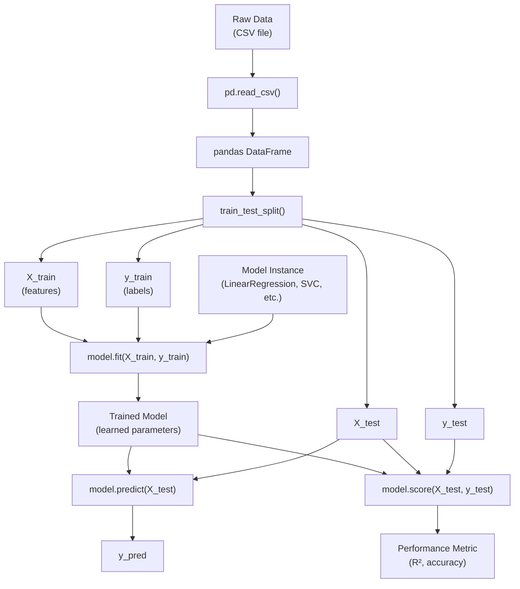
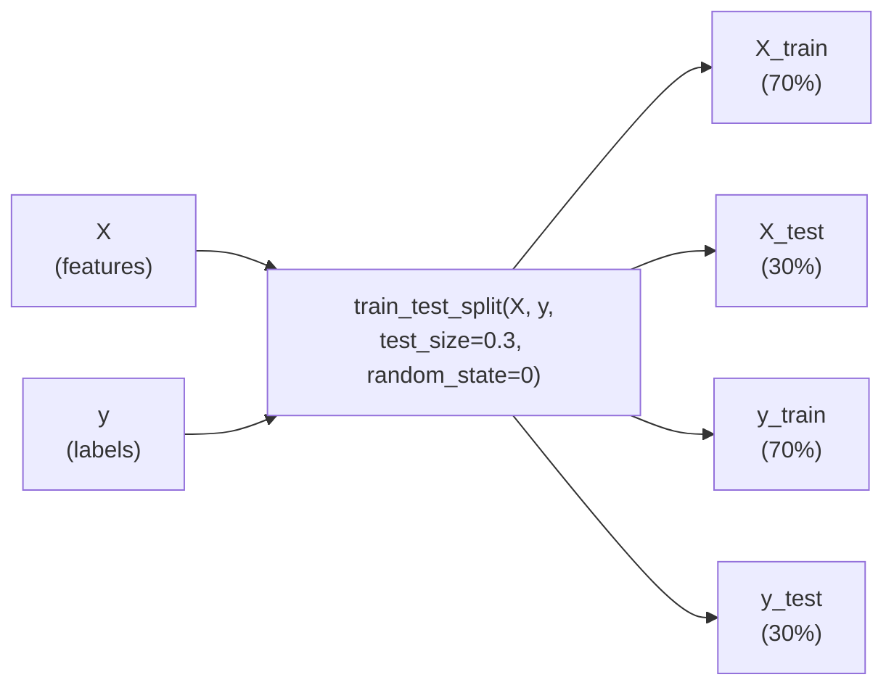
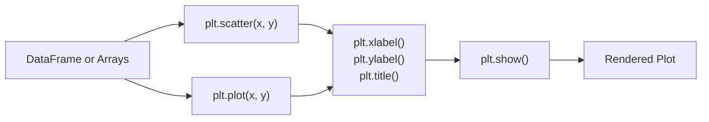
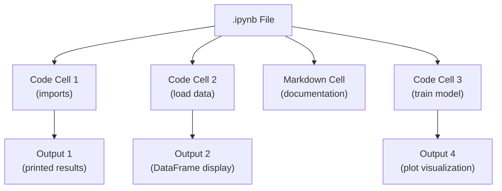
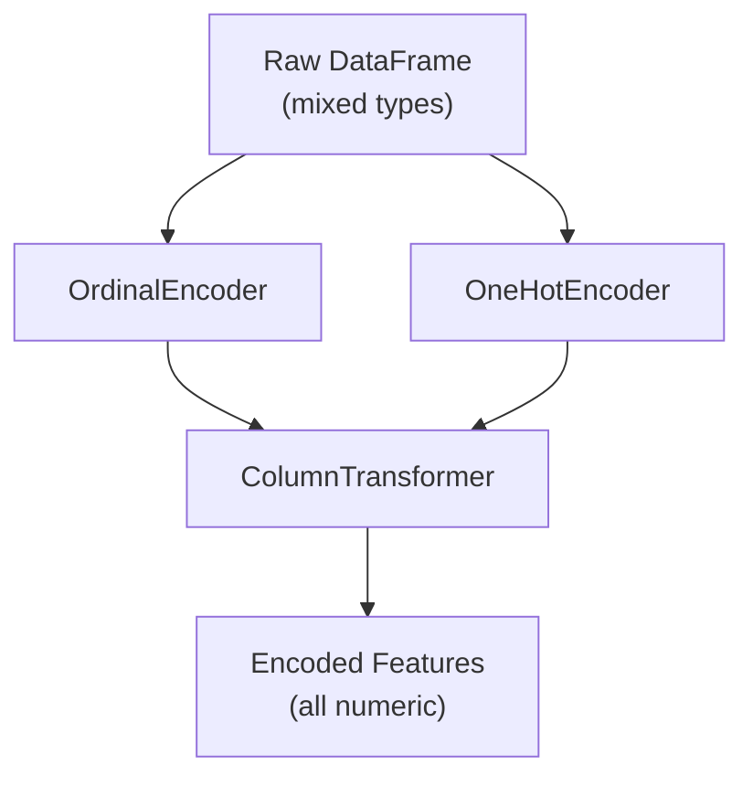
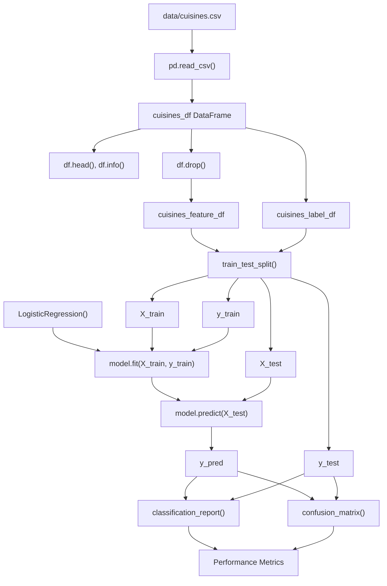

<!-- source: DeepWiki mcp.deepwiki.com · repo microsoft/ML-For-Beginners · extra page Core Python Libraries and Workflow · fetched 2026-10-26 -->

# Core Python Libraries and Workflow

<details>
<summary>Relevant source files</summary>

The following files were used as context for generating this wiki page:

- [2-Regression/1-Tools/README.md](2-Regression/1-Tools/README.md)
- [2-Regression/2-Data/README.md](2-Regression/2-Data/README.md)
- [2-Regression/3-Linear/README.md](2-Regression/3-Linear/README.md)
- [2-Regression/4-Logistic/README.md](2-Regression/4-Logistic/README.md)
- [4-Classification/1-Introduction/README.md](4-Classification/1-Introduction/README.md)
- [4-Classification/1-Introduction/assignment.md](4-Classification/1-Introduction/assignment.md)
- [4-Classification/1-Introduction/notebook.ipynb](4-Classification/1-Introduction/notebook.ipynb)
- [4-Classification/1-Introduction/solution/notebook.ipynb](4-Classification/1-Introduction/solution/notebook.ipynb)
- [4-Classification/2-Classifiers-1/README.md](4-Classification/2-Classifiers-1/README.md)
- [4-Classification/2-Classifiers-1/notebook.ipynb](4-Classification/2-Classifiers-1/notebook.ipynb)
- [4-Classification/2-Classifiers-1/solution/notebook.ipynb](4-Classification/2-Classifiers-1/solution/notebook.ipynb)
- [4-Classification/3-Classifiers-2/README.md](4-Classification/3-Classifiers-2/README.md)
- [4-Classification/3-Classifiers-2/notebook.ipynb](4-Classification/3-Classifiers-2/notebook.ipynb)
- [4-Classification/3-Classifiers-2/solution/notebook.ipynb](4-Classification/3-Classifiers-2/solution/notebook.ipynb)
- [4-Classification/4-Applied/README.md](4-Classification/4-Applied/README.md)
- [4-Classification/4-Applied/notebook.ipynb](4-Classification/4-Applied/notebook.ipynb)
- [4-Classification/README.md](4-Classification/README.md)

</details>


## Purpose and Scope

This document describes the core Python libraries used throughout the ML-For-Beginners curriculum and their standard workflow patterns. It covers the fundamental APIs and operations for scikit-learn model training, pandas data manipulation, numpy numerical operations, matplotlib/seaborn visualization, and Jupyter notebook development. For specialized domain libraries (SMOTE, NLTK, statsmodels, OpenAI Gym), see [Specialized Python Libraries](#6.1.2).

---

## Scikit-learn Model API Pattern

All scikit-learn estimators follow a consistent three-method interface that enables uniform model training and evaluation across algorithms.

### Core Methods

The standard model workflow uses three primary methods:

**`fit(X_train, y_train)`** - Trains the model on labeled data. The method mutates the model object in-place, storing learned parameters as attributes.

**`predict(X_test)`** - Generates predictions for new data using the trained model. Returns an array of predicted values or class labels.

**`score(X_test, y_test)`** - Evaluates model performance on test data. Returns a metric appropriate to the model type (R² for regression, accuracy for classification).



Sources: [2-Regression/1-Tools/README.md:180-210](), [2-Regression/4-Logistic/README.md:244-257](), [4-Classification/2-Classifiers-1/README.md:158-164]()

### Common Model Types

The curriculum demonstrates multiple estimator classes, all following the same API:

| Model Class | Import Path | Purpose | Key Parameters |
|------------|-------------|---------|----------------|
| `LinearRegression` | `sklearn.linear_model` | Linear regression | None (uses OLS) |
| `LogisticRegression` | `sklearn.linear_model` | Classification | `multi_class`, `solver` |
| `SVC` | `sklearn.svm` | Support vector classification | `kernel`, `C`, `probability` |
| `KNeighborsClassifier` | `sklearn.neighbors` | K-nearest neighbors | `n_neighbors` |
| `RandomForestClassifier` | `sklearn.ensemble` | Random forest ensemble | `n_estimators` |
| `AdaBoostClassifier` | `sklearn.ensemble` | AdaBoost ensemble | `n_estimators` |

Sources: [2-Regression/1-Tools/README.md:120-124](), [2-Regression/4-Logistic/README.md:247-250](), [4-Classification/2-Classifiers-1/README.md:36-40](), [4-Classification/3-Classifiers-2/README.md:43-50]()

### Training Pattern Examples

The linear regression workflow demonstrates the standard pattern at [2-Regression/1-Tools/README.md:180-210]():

```python
from sklearn.linear_model import LinearRegression
from sklearn.model_selection import train_test_split

# Split data
X_train, X_test, y_train, y_test = train_test_split(X, y, test_size=0.33)

# Create and train model
model = LinearRegression()
model.fit(X_train, y_train)

# Generate predictions
y_pred = model.predict(X_test)
```

The logistic regression workflow at [2-Regression/4-Logistic/README.md:244-257]() follows the identical pattern with a different estimator:

```python
from sklearn.linear_model import LogisticRegression

model = LogisticRegression(multi_class='ovr', solver='liblinear')
model.fit(X_train, np.ravel(y_train))

predictions = model.predict(X_test)
```

Sources: [2-Regression/1-Tools/README.md:180-194](), [2-Regression/4-Logistic/README.md:244-257]()

### Model Hyperparameters

Estimators accept hyperparameters during initialization. For example, logistic regression requires configuration for multiclass scenarios at [4-Classification/2-Classifiers-1/README.md:126-133]():

- **`multi_class='ovr'`** - One-vs-rest scheme for multiclass classification
- **`solver='liblinear'`** - Optimization algorithm (alternatives: 'lbfgs', 'sag', 'saga', 'newton-cg')

SVC models at [4-Classification/3-Classifiers-2/README.md:60-74]() use different parameters:

- **`kernel='linear'`** - Linear decision boundary
- **`C=10`** - Regularization strength
- **`probability=True`** - Enable probability estimates
- **`random_state=0`** - Reproducible shuffling

Sources: [4-Classification/2-Classifiers-1/README.md:126-164](), [4-Classification/3-Classifiers-2/README.md:60-74]()

---

## Data Splitting with train_test_split

The `train_test_split` function from `sklearn.model_selection` partitions datasets into training and testing subsets, preventing overfitting by holding out evaluation data.



The standard invocation at [2-Regression/1-Tools/README.md:176-178]() is:

```python
X_train, X_test, y_train, y_test = train_test_split(X, y, test_size=0.33)
```

The `test_size` parameter specifies the proportion reserved for testing (0.2-0.3 is typical). The `random_state` parameter ensures reproducibility.

Sources: [2-Regression/1-Tools/README.md:174-178](), [2-Regression/4-Logistic/README.md:232-242](), [4-Classification/2-Classifiers-1/README.md:146-150]()

---

## Pandas DataFrame Operations

Pandas provides the `DataFrame` object for tabular data manipulation. All lesson notebooks use pandas for loading, cleaning, and transforming datasets.

### Loading Data

The `read_csv()` function loads CSV files into DataFrames at [2-Regression/2-Data/README.md:60-64]():

```python
import pandas as pd
pumpkins = pd.read_csv('../data/US-pumpkins.csv')
```

Sources: [2-Regression/2-Data/README.md:60-64](), [4-Classification/1-Introduction/README.md:77-80]()

### Inspection Methods

| Method | Purpose | Example Output |
|--------|---------|----------------|
| `df.head()` | Display first 5 rows | DataFrame preview |
| `df.info()` | Column types and counts | `<class 'pandas.core.frame.DataFrame'>` |
| `df.shape` | Dimensions | `(2448, 385)` |
| `df.describe()` | Statistical summary | Mean, std, quartiles |
| `df.isnull().sum()` | Count missing values per column | Series of counts |

Sources: [2-Regression/2-Data/README.md:58-73](), [4-Classification/1-Introduction/README.md:84-116]()

### Column Selection and Filtering

The `loc` accessor selects rows and columns by label at [2-Regression/2-Data/README.md:76-81]():

```python
columns_to_select = ['Package', 'Low Price', 'High Price', 'Date']
pumpkins = pumpkins.loc[:, columns_to_select]
```

Boolean indexing filters rows by condition at [4-Classification/1-Introduction/README.md:135-146]():

```python
thai_df = df[(df.cuisine == "thai")]
```

The `drop()` method removes columns at [4-Classification/2-Classifiers-1/README.md:61-66]():

```python
cuisines_feature_df = cuisines_df.drop(['Unnamed: 0', 'cuisine'], axis=1)
```

Sources: [2-Regression/2-Data/README.md:76-81](), [4-Classification/1-Introduction/README.md:135-146](), [4-Classification/2-Classifiers-1/README.md:61-66]()

### Data Transformation

New columns are created through assignment at [2-Regression/2-Data/README.md:89-96]():

```python
price = (pumpkins['Low Price'] + pumpkins['High Price']) / 2
month = pd.DatetimeIndex(pumpkins['Date']).month
```

The `dropna()` method removes rows with missing values at [2-Regression/3-Linear/README.md:152-156]():

```python
pie_pumpkins.dropna(inplace=True)
```

The `groupby()` method aggregates data at [2-Regression/2-Data/README.md:189-191]():

```python
new_pumpkins.groupby(['Month'])['Price'].mean().plot(kind='bar')
```

Sources: [2-Regression/2-Data/README.md:89-106](), [2-Regression/3-Linear/README.md:152-156](), [2-Regression/2-Data/README.md:187-191]()

### DataFrame to NumPy Conversion

Models require numpy arrays, not DataFrames. The `to_numpy()` method converts at [2-Regression/3-Linear/README.md:176-179]():

```python
X = pie_pumpkins['DayOfYear'].to_numpy().reshape(-1,1)
y = pie_pumpkins['Price']
```

The `values` attribute also provides numpy array access at [4-Classification/2-Classifiers-1/README.md:191]():

```python
test = X_test.iloc[50].values.reshape(-1, 1).T
```

Sources: [2-Regression/3-Linear/README.md:176-179](), [4-Classification/2-Classifiers-1/README.md:188-198]()

---

## NumPy Arrays and Reshaping

NumPy provides the `ndarray` type for efficient numerical computation. Scikit-learn models expect numpy arrays as input.

### Array Reshaping

The `reshape()` method changes array dimensions at [2-Regression/1-Tools/README.md:167-170]():

```python
X = X[:, 2]  # Select column
X = X.reshape((-1, 1))  # Convert to 2D array
```

The `-1` parameter auto-calculates the dimension. LinearRegression requires 2D input where each row is a sample and each column is a feature.

The `ravel()` function flattens multidimensional arrays at [4-Classification/2-Classifiers-1/README.md:160]():

```python
model.fit(X_train, np.ravel(y_train))
```

Sources: [2-Regression/1-Tools/README.md:165-170](), [2-Regression/3-Linear/README.md:176-181](), [4-Classification/2-Classifiers-1/README.md:160]()

### Array Creation

The `np.array()` constructor creates arrays from Python lists at [2-Regression/3-Linear/README.md:200-204]():

```python
import numpy as np
mse = np.sqrt(mean_squared_error(y_test, pred))
```

Sources: [2-Regression/1-Tools/README.md:122](), [2-Regression/3-Linear/README.md:170]()

---

## Visualization with Matplotlib and Seaborn

Matplotlib provides plotting functions for data visualization. Seaborn extends matplotlib with statistical visualizations.

### Matplotlib Basic Plotting



The standard matplotlib workflow at [2-Regression/1-Tools/README.md:196-204]() uses:

```python
import matplotlib.pyplot as plt

plt.scatter(X_test, y_test, color='black')
plt.plot(X_test, y_pred, color='blue', linewidth=3)
plt.xlabel('Scaled BMIs')
plt.ylabel('Disease Progression')
plt.title('A Graph Plot Showing Diabetes Progression Against BMI')
plt.show()
```

Sources: [2-Regression/1-Tools/README.md:196-204](), [2-Regression/2-Data/README.md:160-174](), [2-Regression/3-Linear/README.md:217-220]()

### Seaborn Statistical Plots

Seaborn provides high-level plotting functions at [2-Regression/4-Logistic/README.md:100-112]():

```python
import seaborn as sns

palette = {'ORANGE': 'orange', 'WHITE': 'wheat'}
sns.catplot(data=pumpkins, y="Variety", hue="Color", 
            kind="count", palette=palette)
```

The `catplot` function creates categorical plots with automatic grouping. The `swarmplot` function at [2-Regression/4-Logistic/README.md:203-209]() shows distribution of individual points:

```python
sns.swarmplot(x="Color", y="ord__Item Size", 
              data=encoded_pumpkins, palette=palette)
```

Sources: [2-Regression/4-Logistic/README.md:94-112](), [2-Regression/4-Logistic/README.md:203-209]()

---

## Jupyter Notebook Development Workflow

Jupyter notebooks (`.ipynb` files) provide an interactive development environment combining code, output, and markdown documentation.

### Notebook Structure



At [2-Regression/1-Tools/README.md:54-67](), notebooks are opened in VS Code with a Jupyter server. Each code cell executes independently and displays output inline.

Sources: [2-Regression/1-Tools/README.md:44-78]()

### Cell Execution

Code cells run with the play button or keyboard shortcuts. The typical workflow:

1. Import libraries in first cell
2. Load and inspect data in subsequent cells
3. Add markdown cells for explanations
4. Execute preprocessing steps
5. Train models
6. Evaluate and visualize results

Each cell maintains state in the notebook kernel, allowing variables to persist between executions.

Sources: [2-Regression/1-Tools/README.md:54-78]()

### Output Display

Notebooks automatically display the return value of the last expression at [4-Classification/1-Introduction/solution/notebook.ipynb:77-112]():

```python
df.head()  # Displays first 5 rows as formatted table
```

The `print()` function explicitly outputs values at [2-Regression/1-Tools/README.md:66-73]():

```python
print('hello notebook')
```

Matplotlib plots render inline when `plt.show()` is called at [2-Regression/2-Data/README.md:172-174]().

Sources: [2-Regression/1-Tools/README.md:66-78](), [2-Regression/2-Data/README.md:167-195]()

---

## Data Preprocessing Pipeline

The preprocessing workflow transforms raw data into model-ready features using scikit-learn transformers.

### Encoding Categorical Variables



The `OrdinalEncoder` maps ordered categories to integers at [2-Regression/4-Logistic/README.md:127-133]():

```python
from sklearn.preprocessing import OrdinalEncoder

item_size_categories = [['sml', 'med', 'med-lge', 'lge', 'xlge', 'jbo', 'exjbo']]
ordinal_encoder = OrdinalEncoder(categories=item_size_categories)
```

The `OneHotEncoder` creates binary indicator columns at [2-Regression/4-Logistic/README.md:138-142]():

```python
from sklearn.preprocessing import OneHotEncoder

categorical_features = ['City Name', 'Package', 'Variety', 'Origin']
categorical_encoder = OneHotEncoder(sparse_output=False)
```

The `ColumnTransformer` applies different encoders to different columns at [2-Regression/4-Logistic/README.md:145-155]():

```python
from sklearn.compose import ColumnTransformer

ct = ColumnTransformer(transformers=[
    ('ord', ordinal_encoder, ordinal_features),
    ('cat', categorical_encoder, categorical_features)
])
encoded_features = ct.fit_transform(pumpkins)
```

Sources: [2-Regression/4-Logistic/README.md:120-169]()

### Label Encoding

The `LabelEncoder` converts string labels to integer codes at [2-Regression/4-Logistic/README.md:158-163]():

```python
from sklearn.preprocessing import LabelEncoder

label_encoder = LabelEncoder()
encoded_label = label_encoder.fit_transform(pumpkins['Color'])
```

Sources: [2-Regression/4-Logistic/README.md:156-163]()

### Polynomial Features

The `PolynomialFeatures` transformer generates interaction terms at [2-Regression/3-Linear/README.md:236-245]():

```python
from sklearn.preprocessing import PolynomialFeatures
from sklearn.pipeline import make_pipeline

pipeline = make_pipeline(PolynomialFeatures(2), LinearRegression())
pipeline.fit(X_train, y_train)
```

With `degree=2`, this creates X², XY, Y² terms for polynomial regression.

Sources: [2-Regression/3-Linear/README.md:236-256]()

---

## Model Evaluation Metrics

Scikit-learn provides metrics modules for quantifying model performance.

### Regression Metrics

| Metric | Function | Interpretation |
|--------|----------|----------------|
| Mean Squared Error | `mean_squared_error(y_test, y_pred)` | Average squared error (lower is better) |
| R² Score | `model.score(X_test, y_test)` | Proportion of variance explained (0-1) |

At [2-Regression/3-Linear/README.md:198-213](), MSE and R² evaluate regression quality:

```python
from sklearn.metrics import mean_squared_error

mse = np.sqrt(mean_squared_error(y_test, pred))
score = lin_reg.score(X_train, y_train)
```

Sources: [2-Regression/3-Linear/README.md:198-213]()

### Classification Metrics

The `classification_report()` function at [2-Regression/4-Logistic/README.md:247-278]() generates comprehensive metrics:

```python
from sklearn.metrics import classification_report

print(classification_report(y_test, y_pred))
```

Output includes precision, recall, f1-score, and support for each class.

The `confusion_matrix()` function at [2-Regression/4-Logistic/README.md:286-298]() shows prediction errors:

```python
from sklearn.metrics import confusion_matrix

confusion_matrix(y_test, predictions)
# Returns [[TN, FP], [FN, TP]]
```

The `accuracy_score()` function computes overall accuracy at [4-Classification/2-Classifiers-1/README.md:162-164]():

```python
from sklearn.metrics import accuracy_score

accuracy = model.score(X_test, y_test)
```

Sources: [2-Regression/4-Logistic/README.md:214-340](), [4-Classification/2-Classifiers-1/README.md:38-39](), [4-Classification/2-Classifiers-1/README.md:162-164]()

### ROC Curve Analysis

The `roc_curve()` and `roc_auc_score()` functions evaluate binary classifiers at [2-Regression/4-Logistic/README.md:350-378]():

```python
from sklearn.metrics import roc_curve, roc_auc_score

y_scores = model.predict_proba(X_test)
fpr, tpr, thresholds = roc_curve(y_test, y_scores[:,1])
auc = roc_auc_score(y_test, y_scores[:,1])
```

The AUC (Area Under Curve) ranges from 0 to 1, with 1 indicating perfect classification.

Sources: [2-Regression/4-Logistic/README.md:342-378]()

---

## Complete Workflow Example

The following diagram shows the typical end-to-end workflow using all core libraries:



This workflow appears in classification lessons at [4-Classification/2-Classifiers-1/README.md:14-228](), demonstrating the integration of pandas (data loading), scikit-learn (modeling), and metrics (evaluation).

Sources: [4-Classification/2-Classifiers-1/README.md:14-228](), [4-Classification/3-Classifiers-2/README.md:41-88]()

---

