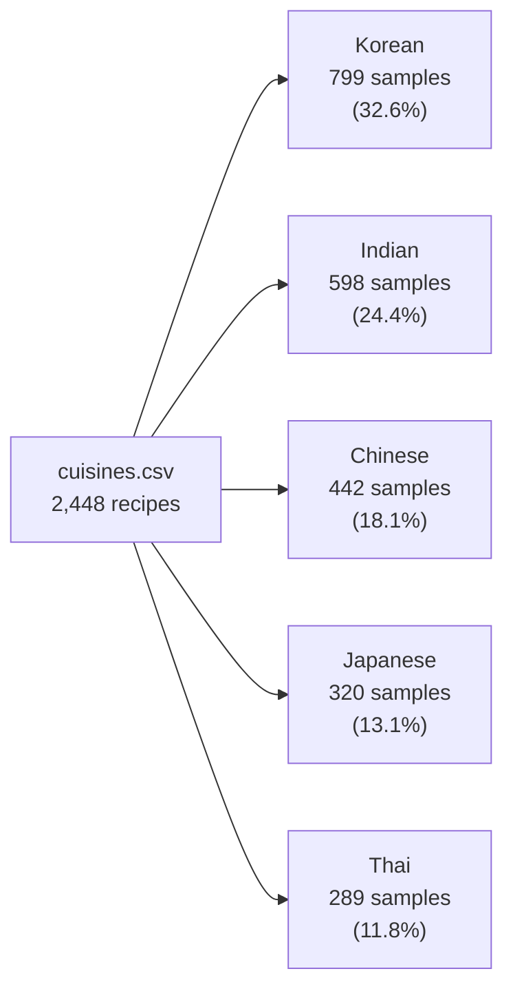
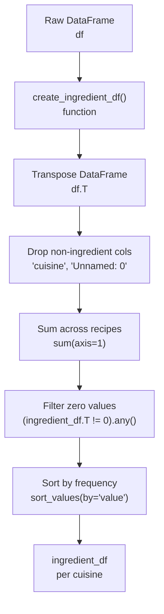
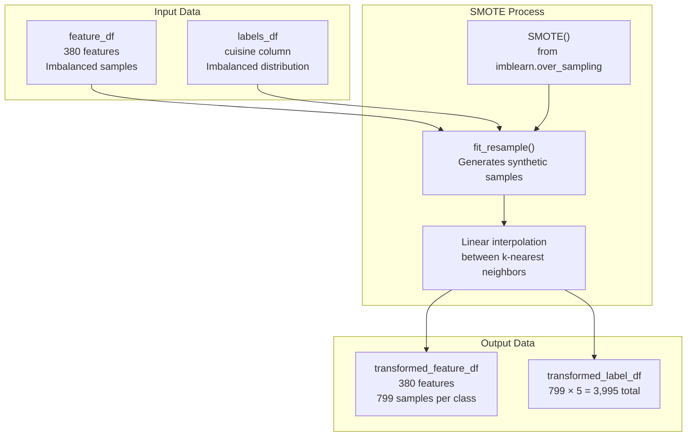
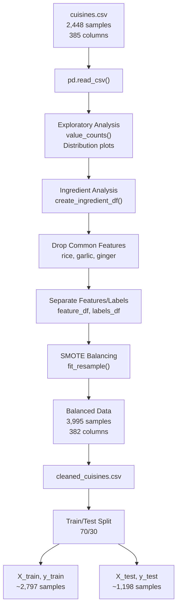

<!-- source: DeepWiki mcp.deepwiki.com · repo microsoft/ML-For-Beginners · extra page Data Preparation and Balancing · fetched 2026-10-26 -->

# Data Preparation and Balancing

<details>
<summary>Relevant source files</summary>

The following files were used as context for generating this wiki page:

- [4-Classification/1-Introduction/README.md](4-Classification/1-Introduction/README.md)
- [4-Classification/1-Introduction/assignment.md](4-Classification/1-Introduction/assignment.md)
- [4-Classification/1-Introduction/notebook.ipynb](4-Classification/1-Introduction/notebook.ipynb)
- [4-Classification/1-Introduction/solution/notebook.ipynb](4-Classification/1-Introduction/solution/notebook.ipynb)
- [4-Classification/2-Classifiers-1/README.md](4-Classification/2-Classifiers-1/README.md)
- [4-Classification/2-Classifiers-1/notebook.ipynb](4-Classification/2-Classifiers-1/notebook.ipynb)
- [4-Classification/2-Classifiers-1/solution/notebook.ipynb](4-Classification/2-Classifiers-1/solution/notebook.ipynb)
- [4-Classification/3-Classifiers-2/README.md](4-Classification/3-Classifiers-2/README.md)
- [4-Classification/3-Classifiers-2/notebook.ipynb](4-Classification/3-Classifiers-2/notebook.ipynb)
- [4-Classification/3-Classifiers-2/solution/notebook.ipynb](4-Classification/3-Classifiers-2/solution/notebook.ipynb)
- [4-Classification/4-Applied/README.md](4-Classification/4-Applied/README.md)
- [4-Classification/4-Applied/notebook.ipynb](4-Classification/4-Applied/notebook.ipynb)
- [4-Classification/README.md](4-Classification/README.md)

</details>


## Purpose and Scope

This page documents the data preparation and balancing techniques applied to the cuisine classification dataset before model training. The material covers initial data loading, exploratory analysis, handling class imbalance using SMOTE (Synthetic Minority Over-sampling Technique), feature engineering through ingredient filtering, and train/test splitting strategies for multiclass classification tasks.

For information about the classification algorithms applied to this prepared dataset, see [Classification Algorithms Comparison](#3.2.2). For deployment of trained models, see [Model Deployment with ONNX](#3.2.3).

---

## Dataset Overview

The cuisine classification dataset contains recipes represented as binary feature vectors indicating ingredient presence. Each row represents a single recipe labeled with its cuisine of origin.

### Dataset Structure

| Property | Value |
|----------|-------|
| **Source File** | `4-Classification/data/cuisines.csv` |
| **Total Rows** | 2,448 |
| **Total Columns** | 385 (383 ingredient features + 1 label + 1 index) |
| **Cuisines** | Chinese, Indian, Japanese, Korean, Thai |
| **Feature Type** | Binary (0 or 1) indicating ingredient presence |
| **Label Column** | `cuisine` |

The dataset is loaded using pandas in [4-Classification/1-Introduction/README.md:76-80]():

```python
df = pd.read_csv('../data/cuisines.csv')
```

Sources: [4-Classification/1-Introduction/README.md:76-116]()

---

## Data Exploration and Distribution Analysis

### Class Imbalance Problem

The initial dataset exhibits significant class imbalance across cuisine types:



**Distribution Analysis**

The class distribution is obtained using [4-Classification/1-Introduction/README.md:132-156]():

```python
thai_df = df[(df.cuisine == "thai")]
japanese_df = df[(df.cuisine == "japanese")]
chinese_df = df[(df.cuisine == "chinese")]
indian_df = df[(df.cuisine == "indian")]
korean_df = df[(df.cuisine == "korean")]
```

This imbalance creates a problematic bias during model training. Without correction, classifiers tend to predict the majority class (Korean) more frequently, achieving higher accuracy on that class while performing poorly on minority classes (Thai, Japanese).

Sources: [4-Classification/1-Introduction/README.md:118-156](), [4-Classification/1-Introduction/solution/notebook.ipynb:131-154]()

---

## Feature Analysis and Cleaning

### Ingredient Distribution by Cuisine

Each cuisine has characteristic ingredient patterns. The following workflow identifies top ingredients per cuisine:



The `create_ingredient_df()` function is defined in [4-Classification/1-Introduction/README.md:162-171]():

```python
def create_ingredient_df(df):
    ingredient_df = df.T.drop(['cuisine','Unnamed: 0']).sum(axis=1).to_frame('value')
    ingredient_df = ingredient_df[(ingredient_df.T != 0).any()]
    ingredient_df = ingredient_df.sort_values(by='value', ascending=False)
    return ingredient_df
```

### Removing Confounding Features

Analysis reveals that certain ingredients appear frequently across all cuisines, reducing discriminative power. These common ingredients are dropped in [4-Classification/1-Introduction/README.md:220-228]():

```python
feature_df = df.drop(['cuisine','Unnamed: 0','rice','garlic','ginger'], axis=1)
labels_df = df.cuisine
```

**Dropped Features:**
- `rice` - Universal staple in Asian cuisines
- `garlic` - Common seasoning across all cuisines
- `ginger` - Frequent in multiple Asian cooking traditions
- `cuisine` - Target label (separated into `labels_df`)
- `Unnamed: 0` - Row index column with no predictive value

Sources: [4-Classification/1-Introduction/README.md:158-228](), [4-Classification/1-Introduction/solution/notebook.ipynb:56-112]()

---

## SMOTE Balancing Implementation

### SMOTE Algorithm Overview

SMOTE (Synthetic Minority Over-sampling Technique) addresses class imbalance by generating synthetic samples through interpolation between existing minority class instances. The implementation uses the `imblearn` library.



### Implementation Code

The SMOTE balancing process is implemented in [4-Classification/1-Introduction/README.md:54-64]() with library installation and [4-Classification/1-Introduction/README.md:230-265]() for the balancing operation:

```python
from imblearn.over_sampling import SMOTE

oversample = SMOTE()
transformed_feature_df, transformed_label_df = oversample.fit_resample(feature_df, labels_df)
```

### Before and After Comparison

| Cuisine | Original Count | After SMOTE |
|---------|----------------|-------------|
| Korean | 799 | 799 |
| Indian | 598 | 799 |
| Chinese | 442 | 799 |
| Japanese | 320 | 799 |
| Thai | 289 | 799 |
| **Total** | **2,448** | **3,995** |

The balanced dataset ensures equal representation, preventing model bias toward majority classes during training. The output from [4-Classification/1-Introduction/README.md:243-265]() confirms successful balancing:

```
new label count: korean      799
chinese     799
indian      799
japanese    799
thai        799
```

Sources: [4-Classification/1-Introduction/README.md:54-65](), [4-Classification/1-Introduction/README.md:230-265](), [4-Classification/1-Introduction/solution/notebook.ipynb:10-42]()

---

## Data Persistence and Export

### Combining Features and Labels

After balancing, features and labels are recombined into a single DataFrame for persistence:

```python
transformed_df = pd.concat([transformed_label_df, transformed_feature_df], axis=1, join='outer')
```

This operation is performed in [4-Classification/1-Introduction/README.md:269-283]().

### Export to CSV

The cleaned and balanced dataset is exported to `cleaned_cuisines.csv`:

```python
transformed_df.to_csv("../data/cleaned_cuisines.csv")
```

**Output File Structure:**
- Path: `4-Classification/data/cleaned_cuisines.csv`
- Rows: 3,995
- Columns: 382 (1 cuisine label + 1 index + 380 ingredient features)
- Format: CSV with header row

This file serves as the input for all subsequent classification exercises in [4-Classification/2-Classifiers-1/README.md:10-20]() and [4-Classification/3-Classifiers-2/README.md:9-13]().

Sources: [4-Classification/1-Introduction/README.md:269-283]()

---

## Train/Test Splitting Strategies

### Standard Split Implementation

The balanced dataset is divided into training and testing sets using scikit-learn's `train_test_split()` function. This occurs in subsequent classification lessons:

```python
from sklearn.model_selection import train_test_split

X_train, X_test, y_train, y_test = train_test_split(
    cuisines_feature_df, 
    cuisines_label_df, 
    test_size=0.3
)
```

Implementation examples:
- [4-Classification/2-Classifiers-1/README.md:143-150]()
- [4-Classification/3-Classifiers-2/README.md:52-57]()

### Split Parameters

| Parameter | Value | Purpose |
|-----------|-------|---------|
| `test_size` | 0.3 | 30% for testing, 70% for training |
| `random_state` | Not specified | Split is non-deterministic across runs |
| `stratify` | Not used | Not needed due to SMOTE pre-balancing |

### Resulting Dataset Sizes

With 3,995 total samples after SMOTE:
- **Training Set:** ~2,797 samples (70%)
- **Test Set:** ~1,198 samples (30%)

The 30% test split provides adequate evaluation data while preserving sufficient training samples. Since SMOTE has already balanced the classes, stratified splitting is unnecessary—all classes have equal representation in both splits.

Sources: [4-Classification/2-Classifiers-1/README.md:143-150](), [4-Classification/3-Classifiers-2/README.md:52-57](), [4-Classification/2-Classifiers-1/solution/notebook.ipynb:136-143]()

---

## Data Preparation Pipeline

The complete data preparation workflow integrates all steps discussed above:



### Key Files in Pipeline

| File | Role | Lines |
|------|------|-------|
| `4-Classification/data/cuisines.csv` | Raw input dataset | N/A |
| `4-Classification/1-Introduction/README.md` | Preparation documentation | 52-283 |
| `4-Classification/1-Introduction/solution/notebook.ipynb` | Implementation notebook | All cells |
| `4-Classification/data/cleaned_cuisines.csv` | Processed output | Generated |

Sources: [4-Classification/1-Introduction/README.md:52-283](), [4-Classification/1-Introduction/solution/notebook.ipynb:1-300]()

---

## Best Practices and Considerations

### Why Balance After Cleaning

The workflow intentionally performs feature cleaning **before** SMOTE balancing. This sequence is critical:

1. **Remove confounding features first** - SMOTE interpolates between samples, so removing non-discriminative features prevents synthetic samples from inheriting useless patterns
2. **Apply SMOTE to cleaned features** - Synthetic samples are generated using only relevant ingredients, improving model discriminative power
3. **Split after balancing** - Ensures both train and test sets reflect the balanced distribution

### SMOTE Parameter Selection

The implementation uses default SMOTE parameters:
- `k_neighbors=5` (default) - Uses 5 nearest neighbors for interpolation
- `sampling_strategy='auto'` (default) - Over-samples all minority classes to match majority class
- No `random_state` - Results vary across runs

For production systems, consider setting `random_state` for reproducibility in [4-Classification/1-Introduction/README.md:237-239]().

### Data Leakage Prevention

The workflow correctly prevents data leakage by:
- Performing SMOTE on the entire dataset before splitting (acceptable since SMOTE doesn't "learn" from test data)
- Not using test set information during cleaning
- Separating labels before applying any transformations

Sources: [4-Classification/1-Introduction/README.md:230-283](), [4-Classification/README.md:1-28]()

---

## Usage in Downstream Tasks

The `cleaned_cuisines.csv` file is consumed by subsequent classification workflows:

### Loading Cleaned Data

All classification notebooks load the prepared dataset consistently:

```python
import pandas as pd
cuisines_df = pd.read_csv("../data/cleaned_cuisines.csv")
```

Examples:
- [4-Classification/2-Classifiers-1/README.md:14-20]()
- [4-Classification/3-Classifiers-2/solution/notebook.ipynb:48-52]()
- [4-Classification/4-Applied/README.md:40-45]()

### Feature/Label Separation

After loading, the data is consistently separated into features and labels:

```python
cuisines_label_df = cuisines_df['cuisine']
cuisines_feature_df = cuisines_df.drop(['Unnamed: 0', 'cuisine'], axis=1)
```

This pattern appears in:
- [4-Classification/2-Classifiers-1/README.md:43-66]()
- [4-Classification/3-Classifiers-2/solution/notebook.ipynb:75-121]()

The cleaned dataset's consistent format enables seamless integration across all classification experiments and model comparisons.

Sources: [4-Classification/2-Classifiers-1/README.md:10-77](), [4-Classification/3-Classifiers-2/README.md:9-57](), [4-Classification/4-Applied/README.md:27-60]()

---

