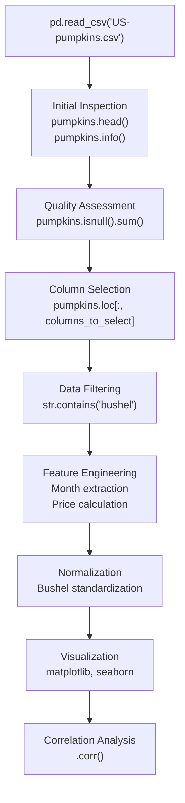
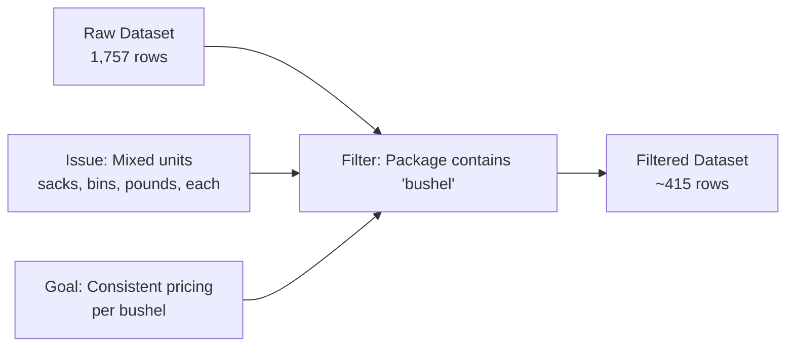
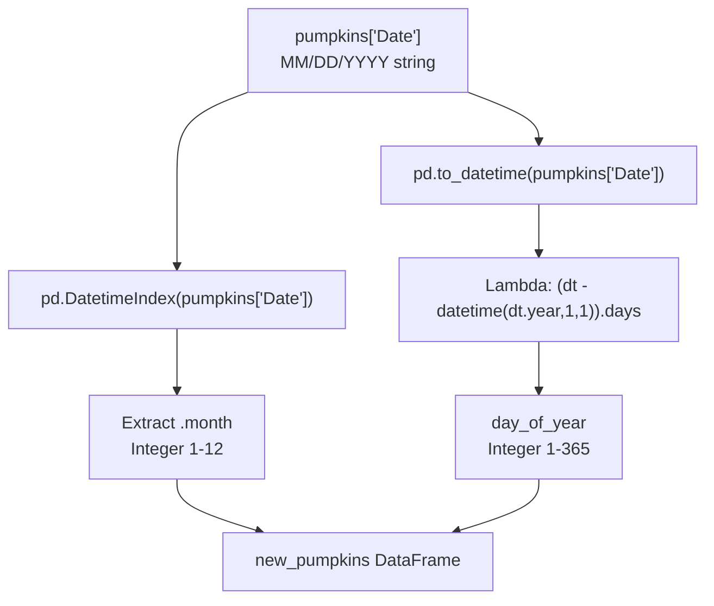
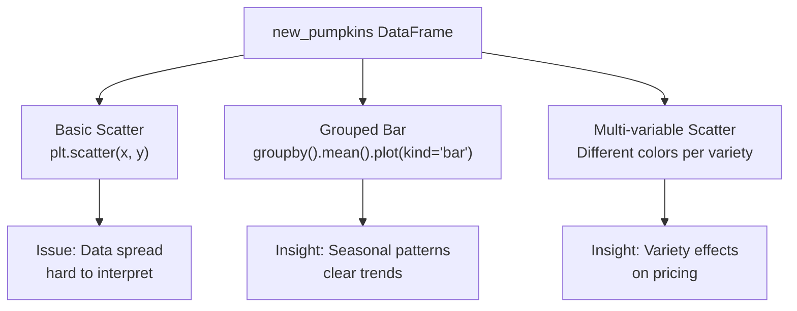
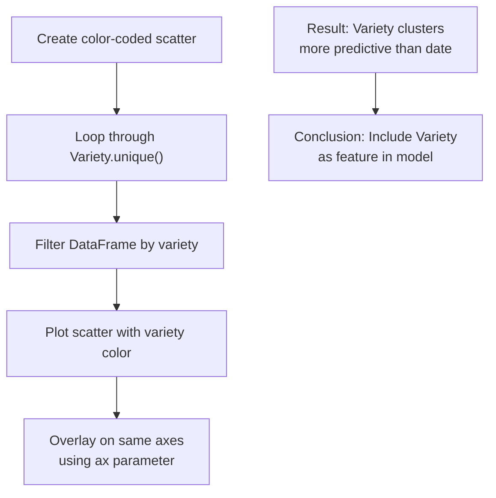
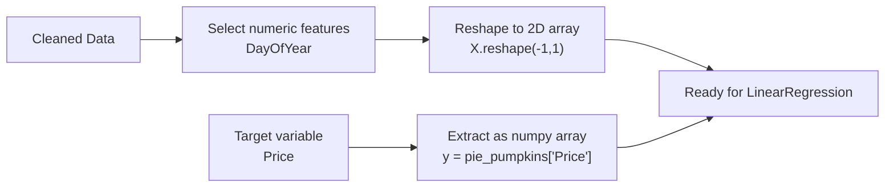
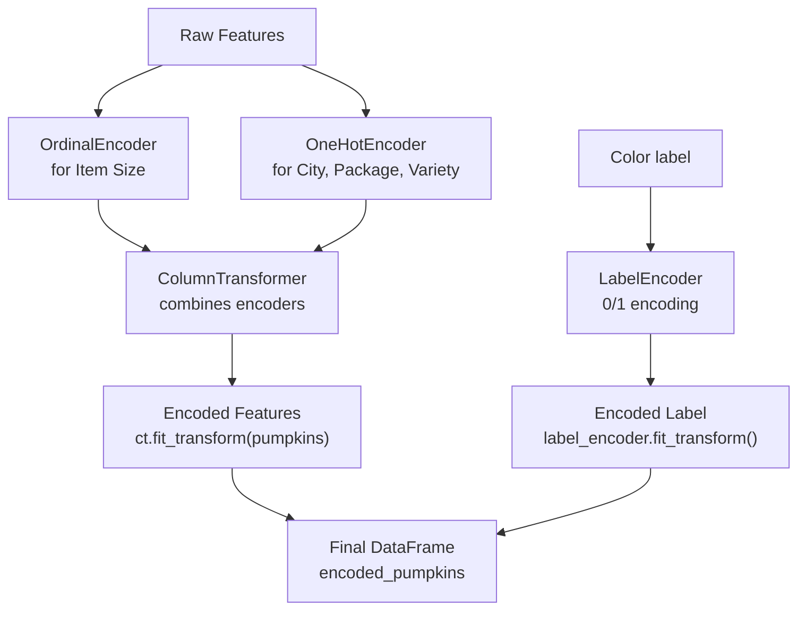
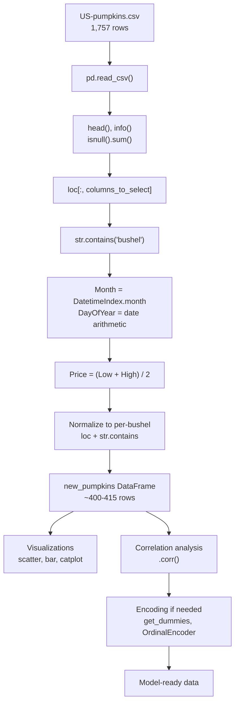

<!-- source: DeepWiki mcp.deepwiki.com · repo microsoft/ML-For-Beginners · extra page Data Preparation and Visualization · fetched 2026-10-26 -->

# Data Preparation and Visualization

<details>
<summary>Relevant source files</summary>

The following files were used as context for generating this wiki page:

- [2-Regression/1-Tools/README.md](2-Regression/1-Tools/README.md)
- [2-Regression/1-Tools/assignment.md](2-Regression/1-Tools/assignment.md)
- [2-Regression/2-Data/README.md](2-Regression/2-Data/README.md)
- [2-Regression/3-Linear/README.md](2-Regression/3-Linear/README.md)
- [2-Regression/3-Linear/assignment.md](2-Regression/3-Linear/assignment.md)
- [2-Regression/3-Linear/images/linear-results.png](2-Regression/3-Linear/images/linear-results.png)
- [2-Regression/3-Linear/images/pie-pumpkins-scatter.png](2-Regression/3-Linear/images/pie-pumpkins-scatter.png)
- [2-Regression/3-Linear/images/poly-results.png](2-Regression/3-Linear/images/poly-results.png)
- [2-Regression/3-Linear/images/price-by-variety.png](2-Regression/3-Linear/images/price-by-variety.png)
- [2-Regression/3-Linear/images/scatter-dayofyear-color.png](2-Regression/3-Linear/images/scatter-dayofyear-color.png)
- [2-Regression/3-Linear/images/scatter-dayofyear.png](2-Regression/3-Linear/images/scatter-dayofyear.png)
- [2-Regression/3-Linear/notebook.ipynb](2-Regression/3-Linear/notebook.ipynb)
- [2-Regression/3-Linear/solution/notebook.ipynb](2-Regression/3-Linear/solution/notebook.ipynb)
- [2-Regression/4-Logistic/README.md](2-Regression/4-Logistic/README.md)
- [3-Web-App/README.md](3-Web-App/README.md)
- [3-Web-App/images/ufo.jpg](3-Web-App/images/ufo.jpg)

</details>


## Purpose and Scope

This document covers data preparation and visualization techniques used in the regression module of the ML-For-Beginners curriculum. It explains how to load, clean, transform, and visualize the US pumpkin pricing dataset before building regression models. This page focuses on the exploratory data analysis (EDA) and data preparation steps that occur after environment setup (see [3.1.1](#3.1.1)) and before model training (see [3.1.3](#3.1.3)).

The primary dataset used is `US-pumpkins.csv`, which contains 1,757 rows of pumpkin market data from various US cities, including pricing, varieties, package types, and dates.

Sources: [2-Regression/2-Data/README.md:1-44]()

---

## Data Loading Workflow

The data preparation pipeline follows a standard sequence of operations, from initial loading through transformation to visualization-ready data.



Sources: [2-Regression/2-Data/README.md:45-141]()

---

## Initial Data Loading and Inspection

### Loading with Pandas

Data is loaded using `pd.read_csv()` into a pandas DataFrame, which provides the foundation for all subsequent operations:

```python
import pandas as pd
pumpkins = pd.read_csv('../data/US-pumpkins.csv')
```

Sources: [2-Regression/2-Data/README.md:60-64]()

### Inspection Functions

| Function | Purpose | Returns |
|----------|---------|---------|
| `pumpkins.head()` | View first 5 rows | DataFrame slice |
| `pumpkins.tail()` | View last 5 rows | DataFrame slice |
| `pumpkins.info()` | Column types, non-null counts | Summary text |
| `pumpkins.isnull().sum()` | Count missing values per column | Series |

Sources: [2-Regression/2-Data/README.md:58-74]()

### Data Structure

The raw `US-pumpkins.csv` contains these key columns:
- `City Name`: Market location
- `Package`: Container type (bins, bushels, cartons)
- `Variety`: Pumpkin variety (PIE TYPE, MINIATURE, etc.)
- `Low Price`, `High Price`: Price range
- `Date`: Transaction date (MM/DD/YYYY format)

Sources: [2-Regression/2-Data/README.md:24-44](), [2-Regression/3-Linear/README.md:41-42]()

---

## Data Cleaning Operations

### Column Selection with `loc`

The `loc` function extracts specific columns, reducing the dataset to relevant features:

```python
columns_to_select = ['Package', 'Low Price', 'High Price', 'Date']
pumpkins = pumpkins.loc[:, columns_to_select]
```

The `:` operator selects all rows, while the second parameter specifies columns.

Sources: [2-Regression/2-Data/README.md:76-81]()

### Filtering Strategy



The filtering operation uses pandas string methods:

```python
pumpkins = pumpkins[pumpkins['Package'].str.contains('bushel', case=True, regex=True)]
```

This removes entries sold by pound, per pumpkin, or in non-standardized containers.

Sources: [2-Regression/2-Data/README.md:108-122]()

### Handling Missing Data

Two approaches are used:
1. **Check impact**: `pumpkins.isnull().sum()` reveals which columns have missing values
2. **Remove if necessary**: `pumpkins.dropna(inplace=True)` removes rows with null values

Sources: [2-Regression/2-Data/README.md:68-74](), [2-Regression/3-Linear/README.md:151-156]()

---

## Feature Engineering and Transformation

### Calculated Price Field

The average price is calculated from the range:

```python
price = (pumpkins['Low Price'] + pumpkins['High Price']) / 2
```

Sources: [2-Regression/2-Data/README.md:89-96]()

### Date Feature Extraction



**Month Extraction**:
```python
month = pd.DatetimeIndex(pumpkins['Date']).month
```

**Day of Year Calculation**:
```python
day_of_year = pd.to_datetime(pumpkins['Date']).apply(lambda dt: (dt-datetime(dt.year,1,1)).days)
```

Sources: [2-Regression/2-Data/README.md:94-96](), [2-Regression/3-Linear/notebook.ipynb:46-47]()

### Bushel Normalization

Different package sizes require price adjustment to standardize to per-bushel pricing:

| Package Type | Adjustment Formula | Reason |
|--------------|-------------------|---------|
| `'1 1/9'` | `price / 1.1` | 1.111... bushels per package |
| `'1/2'` | `price * 2` | Half-bushel packages |

```python
new_pumpkins.loc[new_pumpkins['Package'].str.contains('1 1/9'), 'Price'] = price/(1 + 1/9)
new_pumpkins.loc[new_pumpkins['Package'].str.contains('1/2'), 'Price'] = price/(1/2)
```

Sources: [2-Regression/2-Data/README.md:128-135]()

### Creating the Transformed DataFrame

```python
new_pumpkins = pd.DataFrame({
    'Month': month, 
    'Package': pumpkins['Package'], 
    'Low Price': pumpkins['Low Price'],
    'High Price': pumpkins['High Price'], 
    'Price': price
})
```

Sources: [2-Regression/2-Data/README.md:100-106]()

---

## Visualization Techniques

### Matplotlib Scatter Plots

Basic scatter plots reveal relationships between variables:

```python
import matplotlib.pyplot as plt
price = new_pumpkins.Price
month = new_pumpkins.Month
plt.scatter(price, month)
plt.show()
```

However, unprocessed scatter plots may not be informative due to data spread.

Sources: [2-Regression/2-Data/README.md:157-180]()

### Grouped Bar Charts

Aggregated visualizations provide clearer insights:

```python
new_pumpkins.groupby(['Month'])['Price'].mean().plot(kind='bar')
plt.ylabel("Pumpkin Price")
```

This shows average pumpkin price by month, revealing seasonal patterns (e.g., highest prices in September-October near Halloween).

Sources: [2-Regression/2-Data/README.md:186-195]()

### Visualization Workflow



Sources: [2-Regression/2-Data/README.md:142-195](), [2-Regression/3-Linear/README.md:106-149]()

### Seaborn Categorical Plots

For categorical variables, seaborn provides specialized visualizations:

**Category Plot (catplot)**:
```python
import seaborn as sns
sns.catplot(
    data=pumpkins, y="Variety", hue="Color", kind="count",
    palette={'ORANGE': 'orange', 'WHITE': 'wheat'}
)
```

**Swarm Plot**:
```python
sns.swarmplot(x="Color", y="ord__Item Size", data=encoded_pumpkins, palette=palette)
```

Sources: [2-Regression/4-Logistic/README.md:92-211]()

---

## Correlation Analysis

### Computing Correlations

The `corr()` method calculates correlation coefficients between numeric columns:

```python
print(new_pumpkins['Month'].corr(new_pumpkins['Price']))
print(new_pumpkins['DayOfYear'].corr(new_pumpkins['Price']))
```

**Correlation values**:
- Month vs Price: ~-0.15
- DayOfYear vs Price: ~-0.17

These weak correlations suggest date alone is insufficient for price prediction.

Sources: [2-Regression/3-Linear/README.md:100-122]()

### Multi-Variable Scatter Analysis



**Implementation**:
```python
ax = None
colors = ['red','blue','green','yellow']
for i, var in enumerate(new_pumpkins['Variety'].unique()):
    df = new_pumpkins[new_pumpkins['Variety']==var]
    ax = df.plot.scatter('DayOfYear','Price', ax=ax, c=colors[i], label=var)
```

This reveals that variety has stronger influence on price than selling date.

Sources: [2-Regression/3-Linear/README.md:121-149]()

### Correlation Interpretation

| Correlation Range | Interpretation | Action |
|-------------------|----------------|--------|
| 0.8 to 1.0 | Strong positive | Good linear predictor |
| 0.5 to 0.8 | Moderate positive | Consider including |
| -0.3 to 0.3 | Weak/negligible | Poor linear predictor |
| -0.8 to -0.5 | Moderate negative | Consider including |
| -1.0 to -0.8 | Strong negative | Good linear predictor |

Sources: [2-Regression/3-Linear/README.md:74-80]()

---

## Data Preparation for Specific Regression Types

### Linear Regression Preparation



Linear regression requires:
1. 2D feature array: `X = pie_pumpkins['DayOfYear'].to_numpy().reshape(-1,1)`
2. 1D target array: `y = pie_pumpkins['Price']`

The `reshape(-1,1)` ensures X has shape (N, 1) where N is the dataset size.

Sources: [2-Regression/3-Linear/README.md:174-181]()

### Categorical Feature Encoding

For including categorical variables like `Variety`:

**One-Hot Encoding**:
```python
X = pd.get_dummies(new_pumpkins['Variety'])
```

This creates binary columns for each category:

| ID | FAIRYTALE | MINIATURE | MIXED HEIRLOOM | PIE TYPE |
|----|-----------|-----------|----------------|----------|
| 70 | 0 | 0 | 0 | 1 |
| 71 | 0 | 0 | 0 | 1 |

**Combining Multiple Features**:
```python
X = pd.get_dummies(new_pumpkins['Variety']) \
    .join(new_pumpkins['Month']) \
    .join(pd.get_dummies(new_pumpkins['City'])) \
    .join(pd.get_dummies(new_pumpkins['Package']))
```

Sources: [2-Regression/3-Linear/README.md:259-310]()

### Logistic Regression Preparation



**Ordinal Encoding** (for ordered categories):
```python
from sklearn.preprocessing import OrdinalEncoder
item_size_categories = [['sml', 'med', 'med-lge', 'lge', 'xlge', 'jbo', 'exjbo']]
ordinal_encoder = OrdinalEncoder(categories=item_size_categories)
```

**One-Hot Encoding** (for nominal categories):
```python
from sklearn.preprocessing import OneHotEncoder
categorical_features = ['City Name', 'Package', 'Variety', 'Origin']
categorical_encoder = OneHotEncoder(sparse_output=False)
```

**Label Encoding** (for binary target):
```python
from sklearn.preprocessing import LabelEncoder
label_encoder = LabelEncoder()
encoded_label = label_encoder.fit_transform(pumpkins['Color'])
```

Sources: [2-Regression/4-Logistic/README.md:120-168]()

---

## Common Data Quality Issues

### Issue 1: Mixed Units

**Problem**: The `Package` column contains inconsistent units (sacks, bins, pounds, inches, each).

**Solution**: Filter to consistent unit (bushels only).

```python
pumpkins = pumpkins[pumpkins['Package'].str.contains('bushel', case=True, regex=True)]
```

Sources: [2-Regression/2-Data/README.md:108-122]()

### Issue 2: Varying Package Sizes

**Problem**: Bushel packages come in different sizes (1 1/9 bushel, 1/2 bushel).

**Solution**: Normalize all prices to per-bushel basis using conditional logic.

Sources: [2-Regression/2-Data/README.md:126-140]()

### Issue 3: Sparse Temporal Coverage

**Problem**: Data only spans August-December (5 months).

**Impact**: Limited for annual predictions, but sufficient for seasonal analysis.

**Mitigation**: Use `DayOfYear` instead of `Month` for finer granularity.

Sources: [2-Regression/3-Linear/README.md:35-38](), [2-Regression/3-Linear/notebook.ipynb:69]()

---

## Data Preparation Pipeline Summary



Sources: [2-Regression/2-Data/README.md:45-141](), [2-Regression/3-Linear/README.md:82-96]()

---

## Key Takeaways

1. **Pandas is central**: `read_csv()`, `loc`, `str.contains()`, `groupby()`, `get_dummies()` are essential operations.

2. **Data quality matters**: Raw datasets require cleaning (filtering, normalization, missing value handling) before modeling.

3. **Visualization guides decisions**: Scatter plots, bar charts, and categorical plots reveal which features are predictive.

4. **Correlation informs feature selection**: Low correlation values (< 0.3) suggest weak linear relationships.

5. **Encoding is necessary**: Categorical variables must be encoded (one-hot, ordinal, or label) for ML algorithms.

6. **Domain knowledge is critical**: Understanding bushel measurements and seasonal patterns informs appropriate transformations.

Sources: [2-Regression/2-Data/README.md:1-211](), [2-Regression/3-Linear/README.md:1-367](), [2-Regression/4-Logistic/README.md:72-193]()

---

