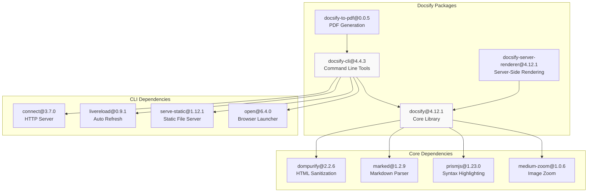
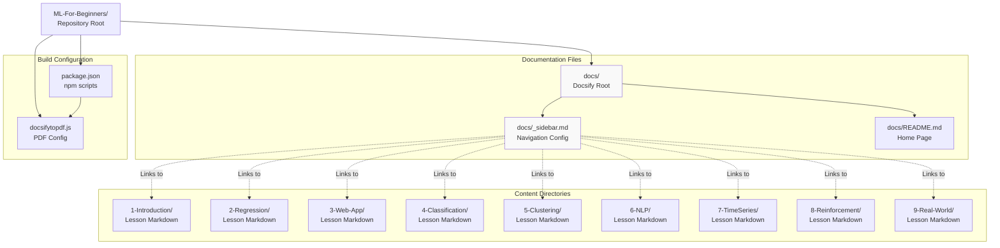
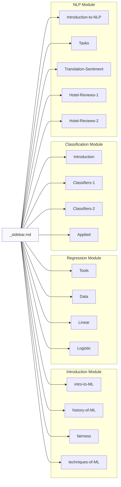
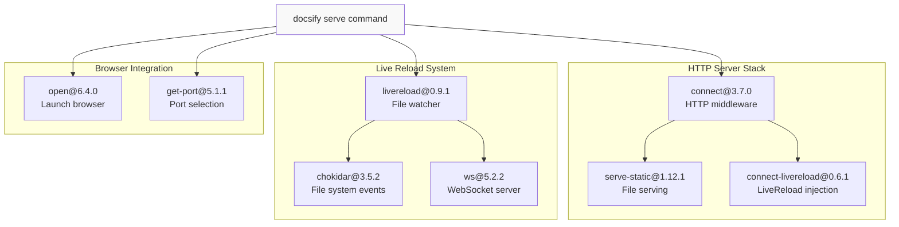
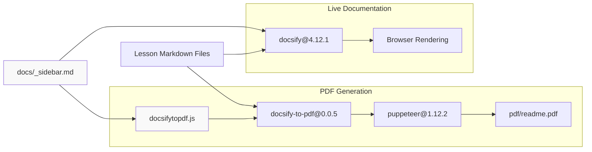

<!-- source: DeepWiki mcp.deepwiki.com · repo microsoft/ML-For-Beginners · extra page Docsify Documentation · fetched 2026-10-26 -->

# Docsify Documentation

<details>
<summary>Relevant source files</summary>

The following files were used as context for generating this wiki page:

- [docs/_sidebar.md](docs/_sidebar.md)
- [docsifytopdf.js](docsifytopdf.js)
- [package-lock.json](package-lock.json)
- [package.json](package.json)
- [pdf/readme.pdf](pdf/readme.pdf)

</details>


## Purpose and Scope

This document describes the Docsify-based documentation system used to render the ML-For-Beginners curriculum as a browsable website. It covers the Docsify configuration, sidebar navigation structure, local development server setup, and browser-based markdown rendering. For information about PDF generation from Docsify documentation, see [PDF Generation Workflow](#6.4.2).

---

## Overview

Docsify is a lightweight documentation generator that dynamically renders markdown files in the browser without requiring a build step. The ML-For-Beginners repository uses Docsify version 4.12.1 to provide an alternative reading experience to the native GitHub interface, enabling users to navigate the curriculum through a sidebar menu and view lessons in a formatted web interface.

**Key Characteristics:**
- **No build process**: Markdown files are parsed at runtime in the browser
- **Dynamic routing**: URLs map directly to markdown file paths
- **Sidebar navigation**: Structured table of contents defined in `_sidebar.md`
- **Theme support**: Uses Docsify's default theme with customizable styling

Sources: [package-lock.json:610-626]()

---

## Docsify Package Architecture



**Docsify Core Package Structure**

The core `docsify` package provides markdown rendering, DOM sanitization through DOMPurify, syntax highlighting via Prism.js, and image zoom functionality. The `docsify-cli` package extends this with development server capabilities including live reload and static file serving.

Sources: [package-lock.json:610-626](), [package-lock.json:627-657](), [package-lock.json:658-671](), [package-lock.json:695-711]()

---

## Documentation Directory Structure



**Documentation File Organization**

The `docs/` directory serves as the Docsify root. The `_sidebar.md` file defines navigation links that reference lesson markdown files located in the numbered module directories at the repository root. This structure allows Docsify to serve a unified documentation site while content remains organized by curriculum module.

Sources: [docs/_sidebar.md:1-43]()

---

## Sidebar Navigation Configuration

The `_sidebar.md` file defines the documentation site's navigation structure using a nested markdown list format. Docsify parses this file to generate the sidebar menu displayed on all documentation pages.

### Sidebar Structure

| Section | Subsections | File Pattern |
|---------|-------------|--------------|
| Introduction | 4 lessons | `../1-Introduction/{1-4}-*/README.md` |
| Regression | 4 lessons | `../2-Regression/{1-4}-*/README.md` |
| Build a Web App | 1 lesson | `../3-Web-App/1-Web-App/README.md` |
| Classification | 4 lessons | `../4-Classification/{1-4}-*/README.md` |
| Clustering | 2 lessons | `../5-Clustering/{1-2}-*/README.md` |
| NLP | 5 lessons | `../6-NLP/{1-5}-*/README.md` |
| Time Series Forecasting | 3 lessons | `../7-TimeSeries/{1-3}-*/README.md` |
| Reinforcement Learning | 2 lessons | `../8-Reinforcement/{1-2}-*/README.md` |
| Real World ML | 1 lesson | `../9-Real-World/1-Applications/README.md` |

### Navigation Link Format

Each navigation entry follows this pattern:

```markdown
- [Display Text](../Module-Directory/Lesson-Directory/README.md)
```

**Example entries:**
- `[Introduction to Machine Learning](../1-Introduction/1-intro-to-ML/README.md)` - Links to the first lesson in the Introduction module
- `[Linear Regression](../2-Regression/3-Linear/README.md)` - Links to the third lesson in the Regression module
- `[Q-Learning](../8-Reinforcement/1-QLearning/README.md)` - Links to the first lesson in Reinforcement Learning

The relative paths (`../`) navigate up from the `docs/` directory to the repository root, then into the appropriate module and lesson directories.

Sources: [docs/_sidebar.md:1-43]()

---

## Sidebar Navigation Mapping



**Navigation Hierarchy from _sidebar.md**

The sidebar configuration creates a two-level navigation hierarchy: top-level module categories (Introduction, Regression, Classification, etc.) and their associated lesson pages. Each lesson link resolves to a `README.md` file within the corresponding lesson directory.

Sources: [docs/_sidebar.md:1-43]()

---

## Local Development Server

The `docsify-cli` package provides a local development server for previewing documentation during development. The CLI tool is installed as a dev dependency and provides the `docsify` command.

### Server Components



**Development Server Architecture**

The `docsify serve` command creates an HTTP server using Connect middleware, serves static files from the documentation directory, watches for file changes with Chokidar, and automatically refreshes the browser via WebSocket-based LiveReload when markdown files are modified.

Sources: [package-lock.json:627-657](), [package-lock.json:490-504](), [package-lock.json:505-513](), [package-lock.json:355-375]()

### Serving the Documentation

**Command:**
```bash
docsify serve docs/
```

This command:
1. Starts an HTTP server (default port 3000)
2. Serves files from the `docs/` directory
3. Watches for changes to markdown files
4. Automatically opens the browser to the documentation site
5. Injects LiveReload script for hot reloading

**Port Selection:**
The `get-port` package (version 5.1.1) is used to find an available port if the default port 3000 is already in use.

**File Watching:**
The `chokidar` package (version 3.5.2) monitors the file system for changes to markdown files. When changes are detected, the LiveReload system triggers a browser refresh.

Sources: [package-lock.json:355-375](), [package-lock.json:975-986]()

---

## Browser-Based Rendering Process

```mermaid
sequenceDiagram
    participant Browser
    participant DocsifyCore["docsify@4.12.1"]
    participant Marked["marked@1.2.9"]
    participant DOMPurify["dompurify@2.2.6"]
    participant Prism["prismjs@1.23.0"]
    
    Browser->>DocsifyCore: Load index.html
    DocsifyCore->>DocsifyCore: Parse _sidebar.md
    Browser->>DocsifyCore: Navigate to route
    DocsifyCore->>DocsifyCore: Map route to .md file
    DocsifyCore->>Browser: Fetch markdown file
    Browser->>DocsifyCore: Return markdown content
    DocsifyCore->>Marked: Parse markdown
    Marked->>DocsifyCore: Return HTML
    DocsifyCore->>DOMPurify: Sanitize HTML
    DOMPurify->>DocsifyCore: Return safe HTML
    DocsifyCore->>Prism: Highlight code blocks
    Prism->>DocsifyCore: Return highlighted HTML
    DocsifyCore->>Browser: Render final HTML
```

**Docsify Rendering Pipeline**

When a user navigates to a documentation page, Docsify intercepts the route, fetches the corresponding markdown file via AJAX, parses it using the Marked library, sanitizes the resulting HTML with DOMPurify, applies syntax highlighting through Prism.js, and finally renders the processed content in the browser.

### Core Rendering Dependencies

| Package | Version | Purpose |
|---------|---------|---------|
| `marked` | 1.2.9 | Converts markdown to HTML |
| `dompurify` | 2.2.6 | Sanitizes HTML to prevent XSS attacks |
| `prismjs` | 1.23.0 | Provides syntax highlighting for code blocks |
| `medium-zoom` | 1.0.6 | Adds zoom functionality to images |
| `strip-indent` | 3.0.0 | Normalizes code block indentation |
| `tinydate` | 1.3.0 | Formats dates in the documentation |

### Routing Mechanism

Docsify uses hash-based routing where URLs map to markdown file paths:

- `#/` → `docs/README.md` (home page)
- `#/1-Introduction/1-intro-to-ML/README` → `../1-Introduction/1-intro-to-ML/README.md`
- `#/2-Regression/3-Linear/README` → `../2-Regression/3-Linear/README.md`

The sidebar links in `_sidebar.md` generate these routes automatically. Docsify strips the `.md` extension from URLs for cleaner navigation.

Sources: [package-lock.json:610-626](), [package-lock.json:713-718]()

---

## Integration with PDF Generation

The Docsify documentation system serves as the source for PDF generation through the `docsify-to-pdf` tool. The configuration file `docsifytopdf.js` references the same `_sidebar.md` file used by the live documentation site.



**Docsify Content Reuse**

Both the live Docsify site and the PDF generation process consume the same markdown files and sidebar configuration, ensuring consistency between the web and print versions of the documentation.

### PDF Configuration

The `docsifytopdf.js` file specifies:
- **Contents source**: References `docs/_sidebar.md` as the table of contents
- **Output path**: `pdf/readme.pdf`
- **PDF options**: Margins set to 100px top and bottom
- **Cleanup**: Removes temporary `.md` and `.html` files after generation
- **Media emulation**: Uses `print` media type for rendering

Sources: [docsifytopdf.js:1-10]()

### NPM Script for PDF Generation

The `package.json` file defines a convenience script:

```json
"scripts": {
  "convert": "node_modules/.bin/docsify-to-pdf"
}
```

**Usage:**
```bash
npm run convert
```

This command invokes the `docsify-to-pdf` CLI tool, which reads the configuration from `docsifytopdf.js`, starts a headless browser using Puppeteer, renders each page from the sidebar navigation, and outputs a single consolidated PDF file.

Sources: [package.json:6-8](), [docsifytopdf.js:2-3]()

---

## Server-Side Rendering (Deprecated)

The `docsify-server-renderer` package (version 4.12.1) provides server-side rendering capabilities for Docsify, but is marked as deprecated in the package manifest:

> "docsify-server-renderer 4.x and below is no longer supported while we investigate the future of SSR and SSG for Docsify"

This package is a dependency of `docsify-cli` and `docsify-to-pdf` but is not actively used for the live documentation site, which relies on client-side rendering in the browser.

**Server-Side Rendering Dependencies:**
- `node-fetch@2.6.0` - HTTP client for fetching markdown files
- `resolve-pathname@3.0.0` - Path resolution for server-side routing
- `debug@4.3.2` - Logging for SSR operations

Sources: [package-lock.json:658-671]()

---

## Key Configuration Files

### _sidebar.md Structure

The sidebar file uses markdown list syntax to define navigation:

```markdown
- Section Title
  - [Page Title](../path/to/page/README.md)
  - [Page Title](../path/to/page/README.md)

- Section Title
  - [Page Title](../path/to/page/README.md)
```

**Characteristics:**
- Top-level list items create section headers (not clickable)
- Nested list items create navigation links
- All paths are relative to the `docs/` directory
- Links point to `README.md` files within lesson directories

### Module Organization

The sidebar organizes content into 9 major curriculum modules:

1. **Introduction** (4 lessons) - ML fundamentals, history, fairness, techniques
2. **Regression** (4 lessons) - Tools, data, linear regression, logistic regression
3. **Build a Web App** (1 lesson) - Deployment of ML models
4. **Classification** (4 lessons) - Introduction, multiple classifier algorithms, applications
5. **Clustering** (2 lessons) - Data visualization, K-Means algorithm
6. **NLP** (5 lessons) - Introduction, tasks, translation, sentiment analysis projects
7. **Time Series Forecasting** (3 lessons) - Introduction, ARIMA, SVR
8. **Reinforcement Learning** (2 lessons) - Q-Learning, OpenAI Gym
9. **Real World ML** (1 lesson) - Industry applications

Sources: [docs/_sidebar.md:1-43]()

---

## Docsify vs. Static Site Generators

Unlike static site generators (Jekyll, Hugo, MkDocs), Docsify does not pre-build HTML files. Instead, it performs all processing in the browser at runtime:

| Aspect | Docsify | Static Generators |
|--------|---------|-------------------|
| Build step | None | Required |
| HTML files | Not created | Pre-generated |
| Markdown parsing | Client-side (browser) | Build-time (server) |
| Deployment | Raw markdown files | Compiled HTML |
| Initial load | Faster (no build) | Slower (build required) |
| Browser requirements | JavaScript required | Works without JS |
| Search | Requires plugin | Can be pre-indexed |

**Advantages for ML-For-Beginners:**
- Contributors can preview changes immediately without a build step
- Repository remains organized by curriculum structure rather than generated output
- Markdown files remain readable on GitHub without additional processing
- No need to manage generated HTML files in version control

**Trade-offs:**
- Requires JavaScript enabled in the browser
- Slightly slower initial page render (markdown must be parsed client-side)
- Search functionality requires additional Docsify plugins

Sources: [package-lock.json:610-626]()

---

