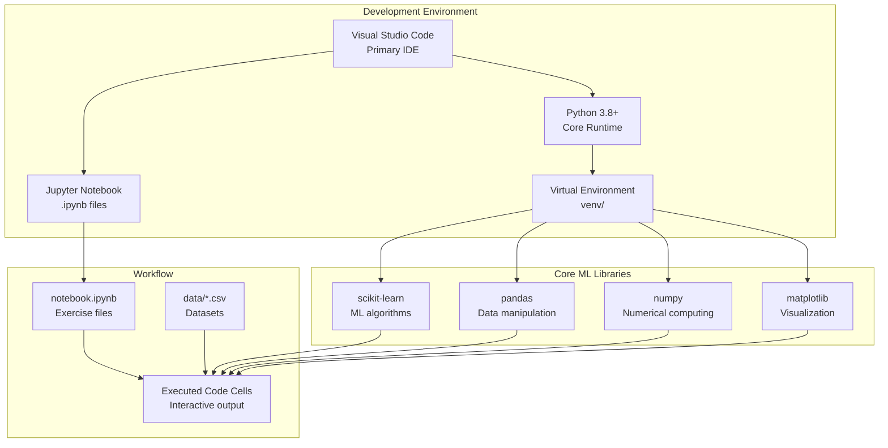
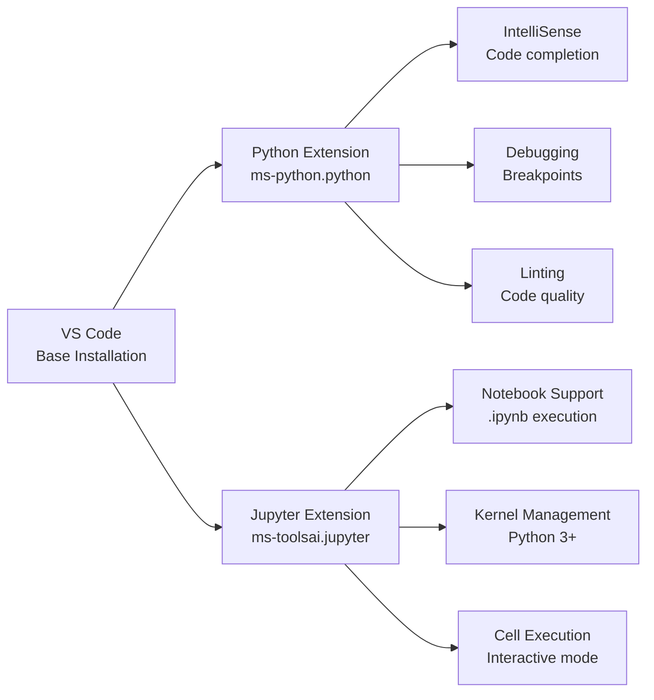
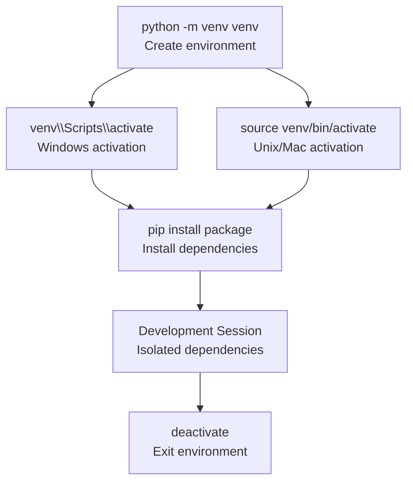
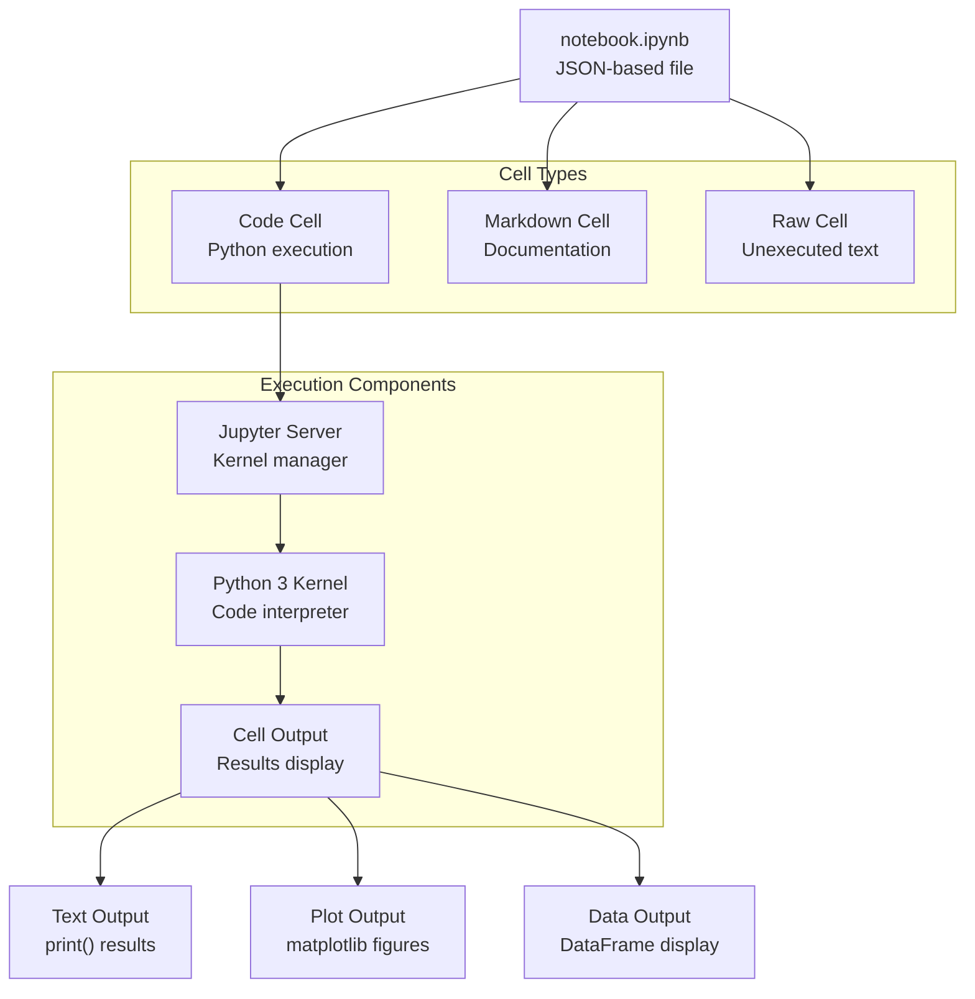
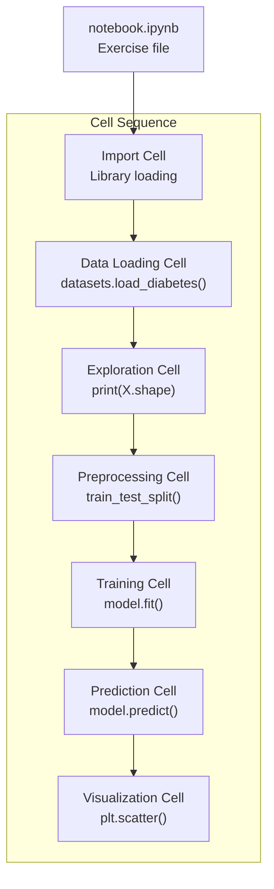
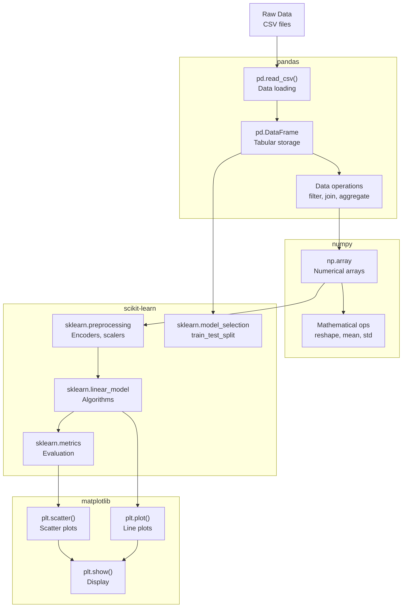
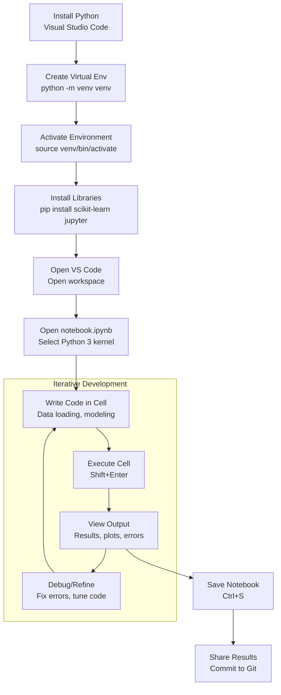

<!-- source: DeepWiki mcp.deepwiki.com · repo microsoft/ML-For-Beginners · extra page Environment Setup and Tools · fetched 2026-10-26 -->

# Environment Setup and Tools

<details>
<summary>Relevant source files</summary>

The following files were used as context for generating this wiki page:

- [2-Regression/1-Tools/README.md](2-Regression/1-Tools/README.md)
- [2-Regression/2-Data/README.md](2-Regression/2-Data/README.md)
- [2-Regression/3-Linear/README.md](2-Regression/3-Linear/README.md)
- [2-Regression/4-Logistic/README.md](2-Regression/4-Logistic/README.md)

</details>


This document details the installation and configuration of the development environment required for machine learning projects in the ML-For-Beginners curriculum. It covers Python installation, Visual Studio Code setup, virtual environment management, and core ML libraries including Scikit-learn and Jupyter notebooks. This setup applies to all lessons in the curriculum, with particular focus on regression tasks.

For information about specific data preparation workflows using these tools, see [Data Preparation and Visualization](#3.1.2). For R-based alternatives to this Python setup, see [R Implementation with tidymodels](#6.2).

---

## Development Environment Architecture

The ML-For-Beginners curriculum uses a Python-based development stack centered on Jupyter notebooks for interactive learning and experimentation. The following diagram shows the core components and their relationships:



**Sources:** [2-Regression/1-Tools/README.md:22-43]()

---

## Python Installation

Python 3.8 or higher is required for all ML exercises. Most modern operating systems include Python, but version verification and proper installation are critical.

### Installation Steps

1. **Download Python:** Obtain the latest Python 3.x from the official Python website
2. **Verify Installation:** Execute `python --version` or `python3 --version` in terminal
3. **Alternative: Python Coding Packs:** Microsoft provides Python Coding Packs that bundle Python with VS Code extensions for simplified setup

### Version Considerations

Different ML libraries and projects may require specific Python versions. The curriculum uses virtual environments to isolate dependencies and avoid version conflicts between projects.

| Python Version | Compatibility | Notes |
|---------------|---------------|-------|
| 3.8+ | Recommended | Full scikit-learn support |
| 3.7 | Supported | Older version, limited features |
| 2.x | Not supported | Deprecated for ML work |

**Sources:** [2-Regression/1-Tools/README.md:28-30]()

---

## Visual Studio Code Configuration

Visual Studio Code serves as the primary integrated development environment (IDE) for the curriculum, providing Jupyter notebook support, Python debugging, and extension ecosystem integration.

### Required Components



### Configuration Steps

1. **Install VS Code:** Download from the official Visual Studio Code website
2. **Install Python Extension:** Search for "Python" in the Extensions marketplace (`ms-python.python`)
3. **Install Jupyter Extension:** Search for "Jupyter" in the Extensions marketplace (`ms-toolsai.jupyter`)
4. **Configure Python Interpreter:** Use Command Palette (`Ctrl+Shift+P` or `Cmd+Shift+P`) and select "Python: Select Interpreter"

### Learning Resources

Microsoft Learn provides comprehensive modules for Python development in VS Code. The curriculum references specific learning paths at `docs.microsoft.com/learn/modules/python-install-vscode`.

**Sources:** [2-Regression/1-Tools/README.md:32-38]()

---

## Virtual Environment Management

Virtual environments provide isolated Python installations with project-specific dependencies, preventing version conflicts between different ML projects.

### Virtual Environment Workflow



### Creating a Virtual Environment

The Python `venv` module creates isolated environments in a local directory:

```
python -m venv venv
```

or

```
python3 -m venv venv
```

This creates a `venv/` directory containing a complete Python environment separate from the system installation.

### Activation Commands

| Platform | Command |
|----------|---------|
| Windows | `venv\Scripts\activate` |
| Unix/Mac | `source venv/bin/activate` |
| PowerShell | `venv\Scripts\Activate.ps1` |

After activation, the terminal prompt displays the environment name (e.g., `(venv)`), and all `pip install` commands affect only this environment.

**Sources:** [2-Regression/1-Tools/README.md:30]()

---

## Core Library Installation

The curriculum requires several foundational Python libraries for machine learning, data manipulation, and visualization.

### Scikit-learn Installation

Scikit-learn is the primary ML library, providing implementations of regression, classification, clustering, and preprocessing algorithms:

```
pip install scikit-learn
```

**Important:** For Apple M1 Mac systems, special installation instructions apply. Refer to the scikit-learn installation documentation for platform-specific guidance.

### Jupyter Notebook Installation

Jupyter provides the interactive notebook interface for executing Python code in cells:

```
pip install jupyter
```

### Additional Required Libraries

The following libraries are dependencies or commonly used alongside scikit-learn:

| Library | Installation Command | Purpose |
|---------|---------------------|---------|
| matplotlib | `pip install matplotlib` | Plotting and visualization |
| numpy | `pip install numpy` | Numerical array operations |
| pandas | `pip install pandas` | Data manipulation and DataFrames |
| seaborn | `pip install seaborn` | Statistical visualization |

### Import Verification

A typical import block at the start of a notebook verifies installation:

```python
import matplotlib.pyplot as plt
import numpy as np
import pandas as pd
from sklearn import datasets, linear_model, model_selection
```

**Sources:** [2-Regression/1-Tools/README.md:40-42](), [2-Regression/1-Tools/README.md:118-124]()

---

## Jupyter Notebook Workflow

Jupyter notebooks (`.ipynb` files) serve as the primary authoring environment for ML code, combining executable code, markdown documentation, and visualization output.

### Notebook Structure and Execution



### Opening and Executing Notebooks in VS Code

1. **Open Notebook:** Navigate to a `.ipynb` file in VS Code file explorer and click to open
2. **Select Kernel:** VS Code prompts for kernel selection; choose "Python 3+" environment (preferably the virtual environment)
3. **Execute Cells:** Click the play button icon next to a cell, or use `Shift+Enter` to execute and advance

### Cell Execution Modes

| Action | Keyboard Shortcut | Effect |
|--------|------------------|--------|
| Run cell and advance | `Shift+Enter` | Execute current cell, select next |
| Run cell in place | `Ctrl+Enter` | Execute current cell, stay selected |
| Insert cell below | `B` (command mode) | Add new code cell |
| Change to markdown | `M` (command mode) | Convert cell to markdown |

### Interactive Features

Notebooks provide an interactive REPL (Read-Eval-Print Loop) environment where:
- Variables persist across cell executions
- Output displays directly below code cells
- Plots render inline
- Data structures (e.g., DataFrames) display with rich formatting

**Sources:** [2-Regression/1-Tools/README.md:44-78]()

---

## Notebook Exercise Workflow

The curriculum's `notebook.ipynb` files contain structured exercises demonstrating ML concepts through interactive code execution.

### Exercise File Structure



### Example: First Scikit-learn Exercise

The first regression exercise in [2-Regression/1-Tools/notebook.ipynb]() demonstrates the complete ML workflow:

1. **Import Libraries** - Load `matplotlib.pyplot`, `numpy`, `sklearn` modules
2. **Load Dataset** - Use `datasets.load_diabetes(return_X_y=True)` to obtain sample data
3. **Inspect Data** - Print shape `X.shape` returns `(442, 10)` indicating 442 samples with 10 features
4. **Select Features** - Extract specific feature: `X = X[:, 2]` selects BMI column
5. **Reshape Data** - Convert to 2D array: `X = X.reshape((-1,1))` for sklearn compatibility
6. **Split Data** - Create train/test sets: `model_selection.train_test_split(X, y, test_size=0.33)`
7. **Train Model** - Instantiate and fit: `model = linear_model.LinearRegression()` then `model.fit(X_train, y_train)`
8. **Make Predictions** - Generate predictions: `y_pred = model.predict(X_test)`
9. **Visualize Results** - Plot with matplotlib: `plt.scatter(X_test, y_test)` and `plt.plot(X_test, y_pred)`

### Key Scikit-learn API Patterns

| Method | Usage | Returns |
|--------|-------|---------|
| `model.fit(X_train, y_train)` | Train model on data | Fitted model object |
| `model.predict(X_test)` | Generate predictions | Array of predicted values |
| `model.score(X_train, y_train)` | Calculate R² coefficient | Float between 0 and 1 |
| `model.coef_` | Access model parameters | Array of coefficients |
| `model.intercept_` | Access intercept term | Float value |

**Sources:** [2-Regression/1-Tools/README.md:91-210]()

---

## Library Ecosystem Overview

The curriculum leverages a coordinated ecosystem of Python libraries, each serving specific roles in the ML workflow.

### Core Library Responsibilities



### Pandas DataFrame Operations

Pandas provides the `DataFrame` object for tabular data manipulation, commonly used for:
- Loading CSV files: `pd.read_csv('../data/US-pumpkins.csv')`
- Selecting columns: `pumpkins.loc[:, columns_to_select]`
- Filtering rows: `pumpkins[pumpkins['Package'].str.contains('bushel')]`
- Handling missing data: `pumpkins.dropna(inplace=True)`
- Aggregation: `pumpkins.groupby(['Month'])['Price'].mean()`

### NumPy Array Handling

NumPy arrays underlie scikit-learn's data structures:
- Conversion: `X = pie_pumpkins['DayOfYear'].to_numpy()`
- Reshaping: `X = X.reshape((-1,1))` converts 1D to 2D array
- Array operations: Element-wise arithmetic, broadcasting

### Matplotlib Visualization

Matplotlib provides plotting capabilities:
- Scatter plots: `plt.scatter(X_test, y_test, color='black')`
- Line plots: `plt.plot(X_test, y_pred, color='blue', linewidth=3)`
- Labels: `plt.xlabel('Scaled BMIs')`, `plt.ylabel('Disease Progression')`
- Display: `plt.show()` renders the plot

**Sources:** [2-Regression/1-Tools/README.md:108-124](), [2-Regression/2-Data/README.md:60-104](), [2-Regression/3-Linear/README.md:168-220]()

---

## Verification and Testing

After installation, verify the environment is properly configured by executing a minimal test script.

### Environment Verification Script

The following code tests all core components:

```python
# Test imports
import matplotlib.pyplot as plt
import numpy as np
import pandas as pd
from sklearn import datasets, linear_model

# Test data loading
X, y = datasets.load_diabetes(return_X_y=True)
print(f"Data shape: {X.shape}")  # Should print (442, 10)

# Test model training
X_subset = X[:, 2].reshape(-1, 1)
model = linear_model.LinearRegression()
model.fit(X_subset, y)
print(f"Model trained. Coefficient: {model.coef_[0]:.4f}")

# Test visualization
plt.scatter(X_subset[:50], y[:50])
plt.title("Verification Plot")
plt.show()
```

### Expected Outputs

| Component | Expected Result |
|-----------|----------------|
| Import statements | No errors, silent execution |
| Data shape | `(442, 10)` printed to output |
| Model training | Coefficient approximately `-0.3` to `0.3` |
| Visualization | Scatter plot window appears |

### Troubleshooting

Common issues and resolutions:

1. **Module not found errors:** Virtual environment not activated or package not installed
2. **Kernel not starting:** Jupyter extension not properly configured in VS Code
3. **Import errors on M1 Mac:** Requires specific installation instructions from scikit-learn documentation

For comprehensive troubleshooting guidance covering 9 common issue categories, refer to `TROUBLESHOOTING.md` in the repository root.

**Sources:** [2-Regression/1-Tools/README.md:140-210]()

---

## Development Workflow Summary

The complete workflow from environment setup to model execution follows this sequence:



This iterative workflow enables rapid experimentation and learning, with immediate feedback from executed code cells and inline visualizations.

**Sources:** [2-Regression/1-Tools/README.md:1-227](), [2-Regression/2-Data/README.md:1-212]()

---

