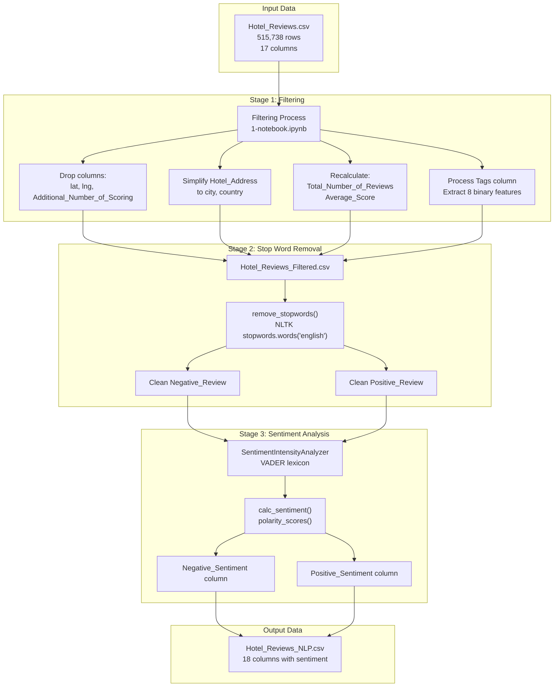
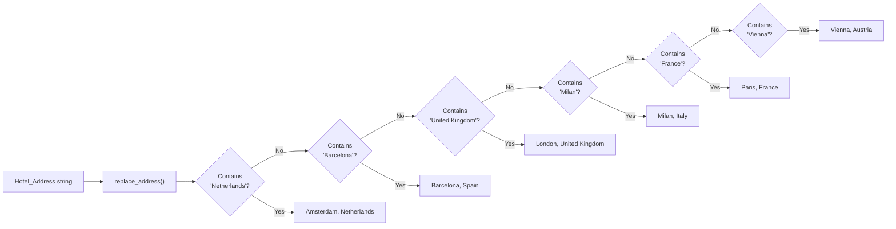
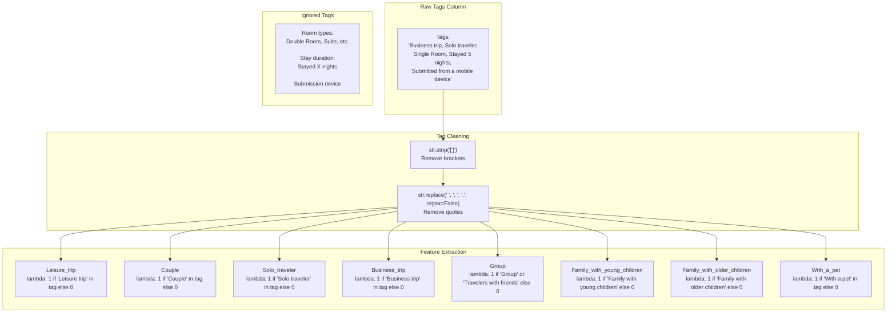
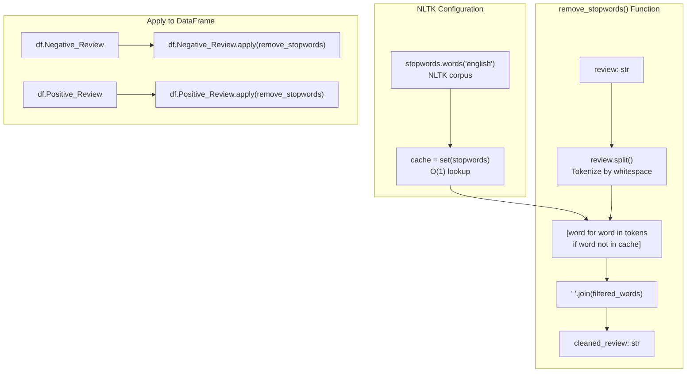
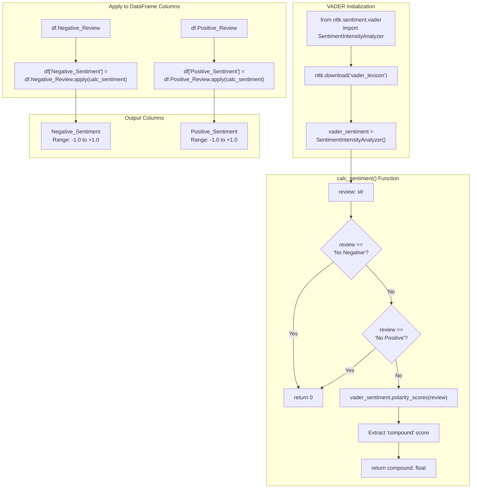
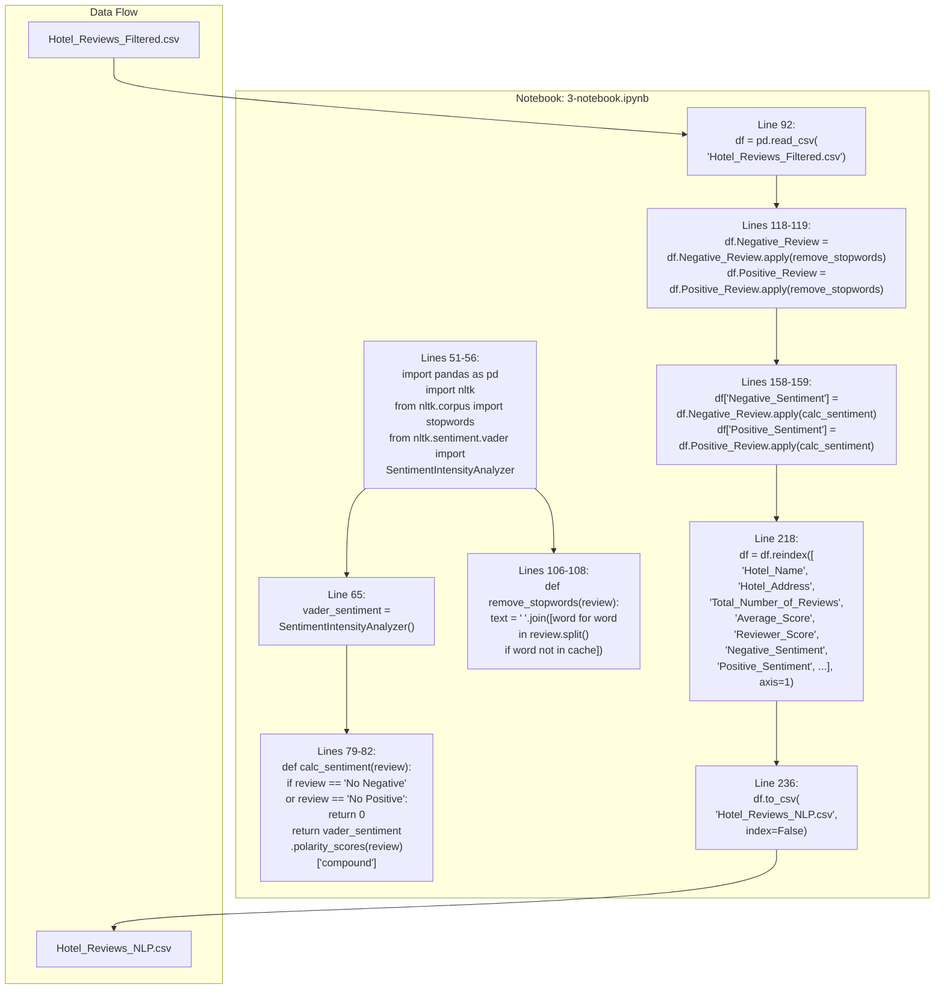

<!-- source: DeepWiki mcp.deepwiki.com · repo microsoft/ML-For-Beginners · extra page Hotel Review Sentiment Analysis · fetched 2026-10-26 -->

# Hotel Review Sentiment Analysis

<details>
<summary>Relevant source files</summary>

The following files were used as context for generating this wiki page:

- [5-Clustering/1-Visualize/README.md](5-Clustering/1-Visualize/README.md)
- [5-Clustering/2-K-Means/README.md](5-Clustering/2-K-Means/README.md)
- [6-NLP/1-Introduction-to-NLP/README.md](6-NLP/1-Introduction-to-NLP/README.md)
- [6-NLP/1-Introduction-to-NLP/images/comprehension.png](6-NLP/1-Introduction-to-NLP/images/comprehension.png)
- [6-NLP/2-Tasks/README.md](6-NLP/2-Tasks/README.md)
- [6-NLP/3-Translation-Sentiment/README.md](6-NLP/3-Translation-Sentiment/README.md)
- [6-NLP/3-Translation-Sentiment/images/monnaie.png](6-NLP/3-Translation-Sentiment/images/monnaie.png)
- [6-NLP/4-Hotel-Reviews-1/README.md](6-NLP/4-Hotel-Reviews-1/README.md)
- [6-NLP/5-Hotel-Reviews-2/README.md](6-NLP/5-Hotel-Reviews-2/README.md)
- [6-NLP/5-Hotel-Reviews-2/assignment.md](6-NLP/5-Hotel-Reviews-2/assignment.md)
- [6-NLP/5-Hotel-Reviews-2/solution/3-notebook.ipynb](6-NLP/5-Hotel-Reviews-2/solution/3-notebook.ipynb)
- [6-NLP/README.md](6-NLP/README.md)

</details>


## Purpose and Scope

This document describes the complete NLP pipeline for analyzing sentiment in hotel reviews from the European Hotels dataset containing 515,738 reviews. The pipeline transforms raw review text into structured sentiment scores through data cleaning, filtering, tag processing, stop word removal, and sentiment scoring using NLTK's VADER sentiment analyzer. This prepares the data for downstream tasks such as hotel recommendation systems.

For initial dataset exploration and column analysis, see [Hotel Reviews Data Preparation](#5.1.1). For fundamental NLP concepts like tokenization and POS tagging, see [NLP Fundamentals and Common Tasks](#5.1.1).

## Dataset Overview

The European Hotels dataset contains reviews of 1,493 hotels across 6 cities (Amsterdam, Barcelona, London, Milan, Paris, Vienna) scraped from Booking.com. Each review includes both positive and negative review text, reviewer metadata, and hotel metadata.

**Key Dataset Characteristics:**

| Attribute | Value |
|-----------|-------|
| Total Reviews | 515,738 |
| Hotels | 1,493 |
| Cities | 6 |
| Review Columns | `Positive_Review`, `Negative_Review` |
| Metadata | Reviewer nationality, tags, scores, dates |
| Special Values | "No Negative", "No Positive" (empty reviews) |

**Review Distribution:**

- 127,890 reviews contain "No Negative" 
- 35,946 reviews contain "No Positive"
- 127 reviews contain both "No Negative" and "No Positive"

Sources: [6-NLP/4-Hotel-Reviews-1/README.md:34-96](), [6-NLP/5-Hotel-Reviews-2/README.md:1-13]()

## Data Processing Pipeline

The sentiment analysis workflow consists of three sequential stages: filtering, stop word removal, and sentiment calculation. Each stage produces an intermediate dataset used by the next stage.



**Pipeline Execution Order:**

1. `1-notebook.ipynb` - Filtering and tag processing → `Hotel_Reviews_Filtered.csv`
2. `3-notebook.ipynb` - Stop word removal and sentiment analysis → `Hotel_Reviews_NLP.csv`

Sources: [6-NLP/5-Hotel-Reviews-2/README.md:353-358](), [6-NLP/5-Hotel-Reviews-2/solution/3-notebook.ipynb:86-93]()

## Column Filtering and Transformation

The filtering stage removes unnecessary columns and recalculates aggregate values based on the actual reviews in the dataset.

### Columns Dropped

The following columns are removed as they provide unclear or unreliable information:

- `lat`, `lng` - Geographic coordinates (replaced by simplified address)
- `Additional_Number_of_Scoring` - Reviews without text
- `Review_Total_Negative_Word_Counts` - Simple word count without sentiment
- `Review_Total_Positive_Word_Counts` - Simple word count without sentiment  
- `Review_Date`, `days_since_review` - Temporal features (optional for time-series analysis)
- `Total_Number_of_Reviews_Reviewer_Has_Given` - Unreliable reviewer metadata

### Columns Recalculated

| Original Column | Recalculation Method | Rationale |
|----------------|---------------------|-----------|
| `Hotel_Address` | Map to "City, Country" format | Standardize 6 cities: Amsterdam/NL, Barcelona/ES, London/UK, Milan/IT, Paris/FR, Vienna/AT |
| `Total_Number_of_Reviews` | `groupby('Hotel_Name').transform('count')` | Count actual reviews in dataset |
| `Average_Score` | `round(groupby('Hotel_Name').Reviewer_Score.transform('mean'), 1)` | Calculate true average from dataset |

### Address Standardization Function



Sources: [6-NLP/5-Hotel-Reviews-2/README.md:15-86]()

## Tag Processing and Feature Extraction

The `Tags` column contains comma-separated lists of reviewer-selected descriptors. Tag processing extracts 8 binary features representing trip type and group composition.

### Tag Extraction Process



### Tag Feature Distribution

| Tag Feature | Count | Description |
|------------|-------|-------------|
| `Leisure_trip` | 417,778 | Vacation/tourism travel |
| `Couple` | 252,294 | Two travelers together |
| `Solo_traveler` | 108,545 | Single traveler |
| `Business_trip` | 82,939 | Work-related travel |
| `Group` | 67,535 | Combined: Group + Travelers with friends |
| `Family_with_young_children` | 61,015 | Families with children under ~12 |
| `Family_with_older_children` | 26,349 | Families with teenagers |
| `With_a_pet` | 1,405 | Brought pet to hotel |

Sources: [6-NLP/5-Hotel-Reviews-2/README.md:103-223]()

## Stop Word Removal

Stop word removal reduces text dimensionality by eliminating common English words that carry minimal sentiment information. This improves sentiment analysis performance and reduces processing time.

### Stop Word Removal Implementation



### Performance Characteristics

**Example Transformation:**

- Original: "This is currently not a hotel but a construction site I was terrorized from early morning..." (395 words)
- After removal: "currently hotel construction site terrorized early morning..." (195 words)
- Reduction: 50.6%

**Processing Time:**

- Dataset size: 515,738 reviews
- Time to remove stop words: ~5-10 seconds (varies by CPU)
- Method: Fast set-based lookup recommended by Ryan Han on Kaggle

Sources: [6-NLP/5-Hotel-Reviews-2/README.md:265-293](), [6-NLP/5-Hotel-Reviews-2/solution/3-notebook.ipynb:96-120]()

## Sentiment Analysis with VADER

VADER (Valence Aware Dictionary and sEntiment Reasoner) is a lexicon and rule-based sentiment analysis tool optimized for social media text. It produces a compound sentiment score ranging from -1.0 (most negative) to +1.0 (most positive).

### VADER Sentiment Pipeline



### Sentiment Scoring Details

**Compound Score Calculation:**

VADER's `polarity_scores()` method returns a dictionary with four scores:
- `neg`: Proportion of negative sentiment (0.0 - 1.0)
- `neu`: Proportion of neutral sentiment (0.0 - 1.0)  
- `pos`: Proportion of positive sentiment (0.0 - 1.0)
- `compound`: Normalized weighted composite score (-1.0 to +1.0)

The pipeline extracts only the `compound` score as the final sentiment measure.

**Special Case Handling:**

Reviews with placeholder text "No Negative" or "No Positive" are assigned a sentiment score of 0 to avoid false sentiment detection.

### Processing Performance

| Metric | Value |
|--------|-------|
| Reviews processed | 515,738 |
| Columns processed | 2 (Negative, Positive) |
| Processing time | ~120-200 seconds |
| Time per review | ~0.2-0.4 ms |

Sources: [6-NLP/5-Hotel-Reviews-2/README.md:295-349](), [6-NLP/5-Hotel-Reviews-2/solution/3-notebook.ipynb:59-83](), [6-NLP/5-Hotel-Reviews-2/solution/3-notebook.ipynb:154-162]()

## Code Entity Reference Map

This diagram maps the high-level sentiment analysis workflow to specific code entities in the implementation notebooks.



Sources: [6-NLP/5-Hotel-Reviews-2/solution/3-notebook.ipynb:28-237]()

## Output Dataset Schema

The final `Hotel_Reviews_NLP.csv` dataset contains 18 columns organized for downstream ML tasks such as hotel recommendation or sentiment-based filtering.

### Column Organization

**Hotel Metadata (4 columns):**
- `Hotel_Name`: Hotel identifier
- `Hotel_Address`: Standardized "City, Country" format
- `Total_Number_of_Reviews`: Count of reviews in dataset for this hotel
- `Average_Score`: Calculated mean of all `Reviewer_Score` values for hotel

**Review Metadata (2 columns):**
- `Reviewer_Score`: Original numerical score (2.5 - 10.0)
- `Reviewer_Nationality`: Reviewer's country

**Sentiment Scores (2 columns):**
- `Negative_Sentiment`: VADER compound score for `Negative_Review` (-1.0 to +1.0)
- `Positive_Sentiment`: VADER compound score for `Positive_Review` (-1.0 to +1.0)

**Tag Features (8 columns):**
- `Leisure_trip`: Binary (0 or 1)
- `Couple`: Binary (0 or 1)
- `Solo_traveler`: Binary (0 or 1)
- `Business_trip`: Binary (0 or 1)
- `Group`: Binary (0 or 1)
- `Family_with_young_children`: Binary (0 or 1)
- `Family_with_older_children`: Binary (0 or 1)
- `With_a_pet`: Binary (0 or 1)

**Review Text (2 columns):**
- `Negative_Review`: Cleaned review text (stop words removed)
- `Positive_Review`: Cleaned review text (stop words removed)

### Example Output Row

| Column | Value |
|--------|-------|
| `Hotel_Name` | "Britannia International Hotel Canary Wharf" |
| `Hotel_Address` | "London, United Kingdom" |
| `Average_Score` | 7.1 |
| `Reviewer_Score` | 2.5 |
| `Negative_Sentiment` | -0.9584 |
| `Positive_Sentiment` | 0.0 |
| `Leisure_trip` | 0 |
| `Business_trip` | 1 |
| `Negative_Review` | "currently hotel construction site terrorized early morning..." |
| `Positive_Review` | "No Positive" |

Sources: [6-NLP/5-Hotel-Reviews-2/README.md:343-349](), [6-NLP/5-Hotel-Reviews-2/solution/3-notebook.ipynb:217-219]()

## Sentiment Analysis Results

The sentiment scores can be used to validate review consistency and identify potentially mismatched reviews where the sentiment does not align with the reviewer's numerical score.

### Sentiment Score Distribution

**Most Negative Reviews (Negative_Sentiment):**
- Lowest score: -0.9920
- Characteristics: Reviews containing strongly negative language about "bad experience", "charged twice", "rude staff", "no WLAN"

**Most Positive Reviews (Positive_Sentiment):**
- Highest score: +0.9987
- Characteristics: Reviews with "celebrated wedding night", "super cute boutique hotel", "everything was perfect"

### Anomaly Detection

Reviews where sentiment contradicts the reviewer's numerical score may indicate:
- Sarcasm or ironic language
- Reviewer placed positive comments in negative field or vice versa
- Reviewer scoring methodology differs from typical sentiment

These cases can be identified by comparing `Negative_Sentiment` and `Positive_Sentiment` values against `Reviewer_Score`.

Sources: [6-NLP/5-Hotel-Reviews-2/solution/3-notebook.ipynb:203-209](), [6-NLP/5-Hotel-Reviews-2/README.md:297-333]()

## Pipeline Execution Guide

### Prerequisites

```python
# Required libraries
import pandas as pd
import nltk
from nltk.corpus import stopwords
from nltk.sentiment.vader import SentimentIntensityAnalyzer

# Download VADER lexicon
nltk.download('vader_lexicon')
```

### Execution Steps

1. **Run Filtering Notebook**
   - Input: `data/Hotel_Reviews.csv` (original dataset)
   - Notebook: `6-NLP/5-Hotel-Reviews-2/solution/1-notebook.ipynb`
   - Output: `data/Hotel_Reviews_Filtered.csv`
   - Duration: ~30-60 seconds

2. **Run Sentiment Analysis Notebook**
   - Input: `data/Hotel_Reviews_Filtered.csv`
   - Notebook: `6-NLP/5-Hotel-Reviews-2/solution/3-notebook.ipynb`
   - Output: `data/Hotel_Reviews_NLP.csv`
   - Duration: ~200-300 seconds (stop word removal + sentiment calculation)

3. **Use Processed Dataset**
   - Load `data/Hotel_Reviews_NLP.csv` for ML modeling
   - 18 columns with sentiment scores and binary tag features
   - Ready for clustering, classification, or recommendation systems

Sources: [6-NLP/5-Hotel-Reviews-2/README.md:353-358](), [6-NLP/5-Hotel-Reviews-2/solution/3-notebook.ipynb:1-237]()

---

