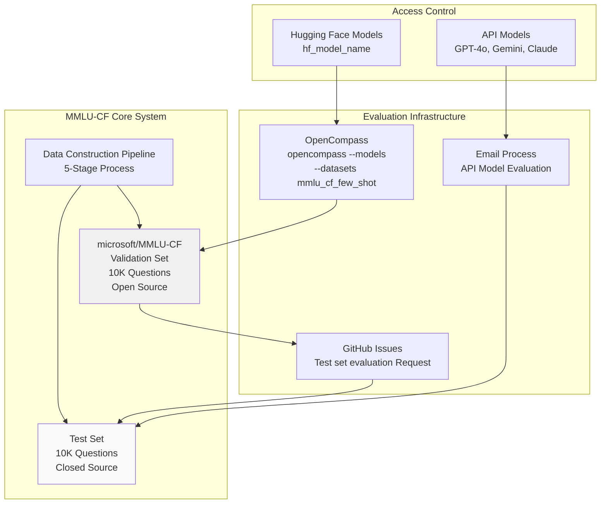
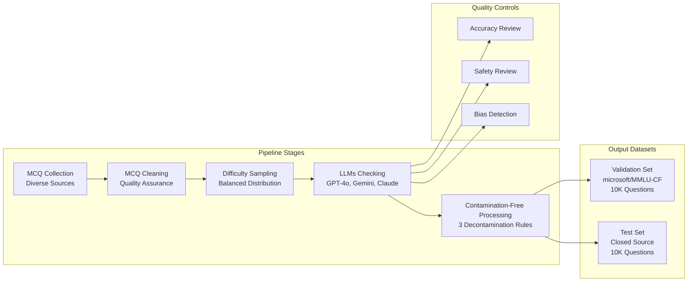

<!-- source: DeepWiki mcp.deepwiki.com · repo microsoft/MMLU-CF · page 1 MMLU-CF Overview · fetched 2026-10-26 -->

# MMLU-CF Overview

<details>
<summary>Relevant source files</summary>

The following files were used as context for generating this wiki page:

- [README.md](README.md)

</details>


## Purpose and Scope

This document provides an overview of the MMLU-CF (Contamination-free Multi-task Language Understanding) benchmark system, a comprehensive evaluation framework designed to address data contamination issues in Large Language Model (LLM) assessment. MMLU-CF serves as a contamination-free alternative to the widely-used MMLU benchmark, providing reliable evaluation results through controlled access mechanisms and decontamination processes.

For detailed instructions on evaluating models, see [Model Evaluation Process](#2.1). For technical implementation details, see [System Architecture](#3). For information about contamination prevention mechanisms, see [Contamination Prevention](#3.2).

## The Contamination Problem

The original MMLU benchmark suffers from data contamination where LLMs memorize answers during training, leading to inflated evaluation scores that do not reflect true reasoning capabilities. MMLU-CF addresses this critical issue through three key innovations:

| Problem | MMLU Impact | MMLU-CF Solution |
|---------|-------------|------------------|
| Open-source test data | LLMs memorize exact answers | Closed-source test set with controlled access |
| Training data leakage | Unreliable evaluation results | 3-stage decontamination pipeline |
| Lack of contamination detection | False performance claims | Validation/test set comparison analysis |

**Sources:** [README.md:23-33]()

## System Components Overview

MMLU-CF consists of three primary components that work together to ensure contamination-free evaluation:



**MMLU-CF System Architecture**

**Sources:** [README.md:36-73](), [README.md:597-599]()

## Data Construction Pipeline

The system employs a rigorous 5-stage data construction process to ensure question quality and contamination prevention:



**Data Construction and Quality Control Pipeline**

**Sources:** [README.md:597-599]()

## Evaluation Workflow

MMLU-CF implements a two-tier evaluation system that separates validation testing from final assessment:

### Validation Set Evaluation

The validation set is publicly available through Hugging Face and can be evaluated using OpenCompass:

```bash
# 5-shot evaluation
opencompass --models hf_internlm2_5_1_8b_chat --datasets mmlu_cf_few_shot --summarizer mmlu_cf

# 0-shot evaluation  
opencompass --models hf_internlm2_5_1_8b_chat --datasets mmlu_cf_zero_shot --summarizer mmlu_cf
```

### Test Set Access Control

Test set evaluation requires a controlled access process:

1. **Hugging Face Models**: Submit GitHub issue with validation results
2. **API Models**: Email process with temporary key sharing
3. **Automated Processing**: 1-2 week turnaround for results

**Sources:** [README.md:40-72]()

## Key Differences from MMLU

| Aspect | MMLU | MMLU-CF |
|--------|------|---------|
| **Test Set Access** | Open source | Closed source with controlled access |
| **Contamination Prevention** | None | 3-stage decontamination rules |
| **Data Sources** | Limited scope | Broader domain coverage |
| **Quality Assurance** | Basic | Multi-LLM review process (GPT-4o, Gemini, Claude) |
| **Evaluation Tools** | Various | Standardized OpenCompass integration |
| **Result Reliability** | Potentially inflated | Contamination-free assessment |

The validation/test set comparison in the leaderboard demonstrates MMLU-CF's reliability - the small delta (Δ) values between validation and test performance indicate minimal contamination, unlike MMLU where test scores are often artificially inflated.

**Sources:** [README.md:75-82](), [README.md:86-595]()

## Performance Comparison

MMLU-CF reveals more realistic model capabilities compared to MMLU. For example:

- **GPT-4o**: MMLU 88.0% → MMLU-CF 73.4% (5-shot test)
- **Qwen2.5-72B**: MMLU 85.3% → MMLU-CF 71.6% (5-shot test)  
- **Llama-3-70B**: MMLU 82.0% → MMLU-CF 68.9% (5-shot test)

These reductions indicate the extent of contamination in MMLU and demonstrate MMLU-CF's effectiveness in providing unbiased evaluation metrics.

**Sources:** [README.md:86-595]()

## Integration Points

MMLU-CF integrates with several external systems:

- **Hugging Face Platform**: Hosts the validation dataset (`microsoft/MMLU-CF`)
- **OpenCompass Framework**: Provides standardized evaluation infrastructure
- **GitHub Issues**: Manages test set access requests
- **Microsoft Security**: Handles security policy and vulnerability reporting

For detailed integration information, see [OpenCompass Integration](#4.1) and [Technical Integration](#4).

**Sources:** [README.md:10-12](), [README.md:19](), [README.md:38-41]()

---

