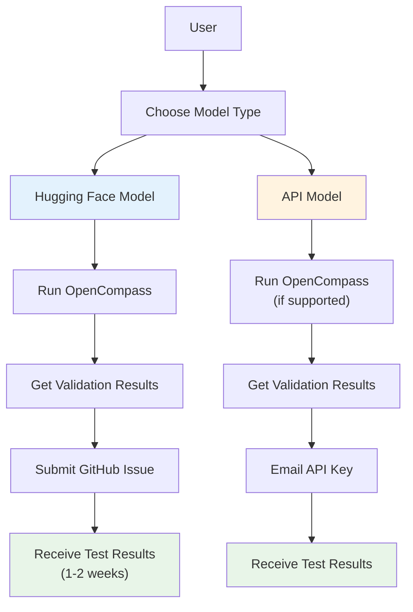
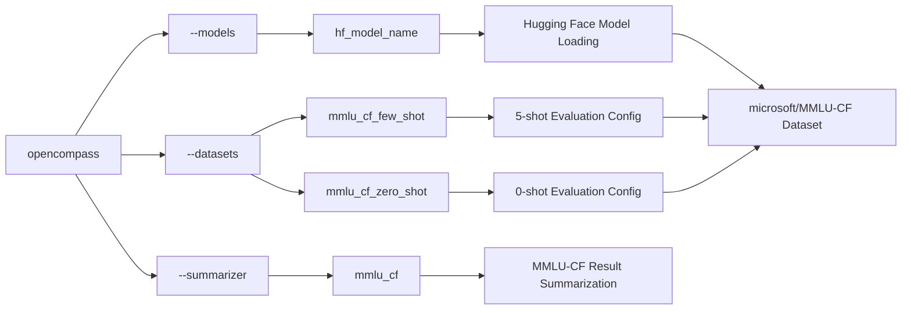
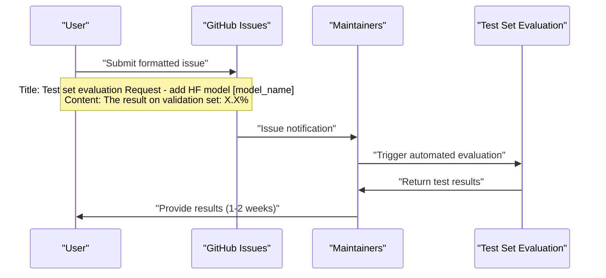
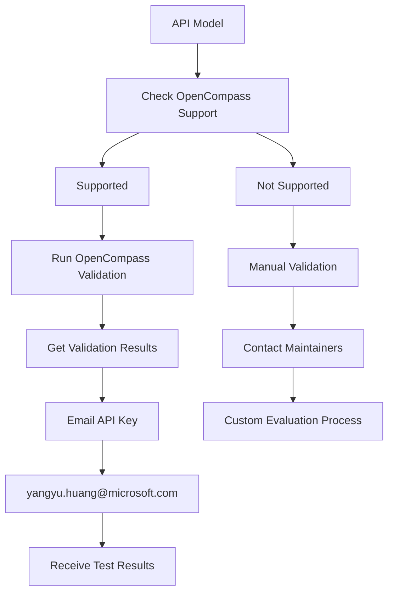
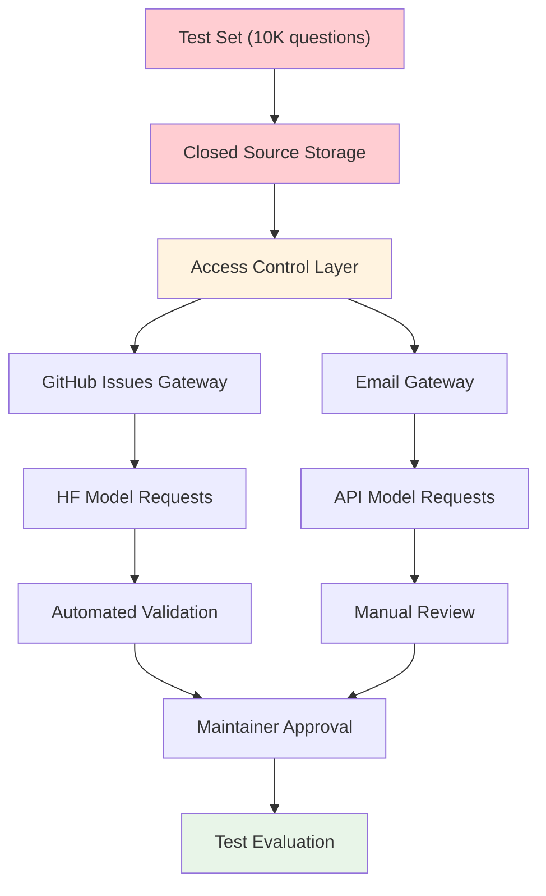

<!-- source: DeepWiki mcp.deepwiki.com · repo microsoft/MMLU-CF · page 2 User Guide · fetched 2026-10-26 -->

# User Guide

<details>
<summary>Relevant source files</summary>

The following files were used as context for generating this wiki page:

- [README.md](README.md)

</details>


This document provides complete instructions for evaluating language models using the MMLU-CF benchmark system. It covers the step-by-step process for obtaining both validation and test set results, including the different pathways for Hugging Face models versus API models.

For information about the technical architecture and data construction process, see [System Architecture](#3). For details about contamination prevention mechanisms, see [Contamination Prevention](#3.2).

## Overview

MMLU-CF provides a two-tier evaluation system designed to prevent data contamination while enabling reliable model assessment:

- **Validation Set**: 10,000 open-source questions available via Hugging Face for initial model testing
- **Test Set**: 10,000 closed-source questions accessible only through controlled request processes

The system supports two distinct evaluation pathways depending on your model type and deployment method.

## Evaluation Pathways

### User Evaluation Workflow



Sources: [README.md:36-73]()

### Model Type Decision Matrix

| Model Type | Access Method | Validation Process | Test Access Method | Timeline |
|------------|---------------|-------------------|-------------------|----------|
| Hugging Face Models | `hf_model_name` | OpenCompass automated | GitHub Issues | 1-2 weeks |
| API Models | API endpoints | OpenCompass (if supported) | Email process | Variable |

Sources: [README.md:38-72]()

## Hugging Face Model Evaluation

### Step 1: Validation Set Evaluation

Use OpenCompass to evaluate your model against the validation set. The system automatically loads the dataset from `microsoft/MMLU-CF` on Hugging Face.

#### 5-Shot Evaluation
```bash
opencompass --models hf_internlm2_5_1_8b_chat --datasets mmlu_cf_few_shot --summarizer mmlu_cf
```

#### 0-Shot Evaluation  
```bash
opencompass --models hf_internlm2_5_1_8b_chat --datasets mmlu_cf_zero_shot --summarizer mmlu_cf
```

#### OpenCompass Integration Components



Sources: [README.md:40-52]()

### Step 2: Test Set Access Request

Submit a GitHub issue following the exact format requirements to request test set evaluation.

#### Required GitHub Issue Format

**Title Format:**
```
Test set evaluation Request - add HF model [model_name]
```

**Content Format:**
```
The result on validation set: X.X%
```

#### GitHub Issue Workflow



Sources: [README.md:54-71]()

#### Format Requirements

| Component | Requirement | Example |
|-----------|-------------|---------|
| Title | Use square brackets `[ ]` | `[microsoft/phi-4]` |
| Model Name | Exact Hugging Face identifier | `microsoft/phi-4` |
| Validation Result | Percentage format | `68.5%` |
| Timeline | Expect 1-2 weeks | Depends on evaluation queue |

Sources: [README.md:68-71]()

## API Model Evaluation

For API-based models (GPT-4o, Gemini, Claude), the evaluation process differs based on OpenCompass support availability.

### API Model Workflow



Sources: [README.md:72]()

### Email Process Requirements

| Component | Details |
|-----------|---------|
| Recipient | `yangyu.huang@microsoft.com` |
| Required | Validation set results |
| Required | Temporary API key |
| Purpose | Test set evaluation access |

Sources: [README.md:72]()

## Access Control Mechanisms

### Test Set Protection System



Sources: [README.md:76](), based on system architecture

### Validation vs Test Set Comparison

| Aspect | Validation Set | Test Set |
|--------|----------------|----------|
| Access | Open source via Hugging Face | Controlled access only |
| Size | 10,000 questions | 10,000 questions |
| Purpose | Initial model testing | Final evaluation |
| Automation | Fully automated | Request-based |
| Contamination Risk | Managed through guidelines | Prevented through access control |

Sources: [README.md:25-29](), [README.md:76]()

## Expected Results and Timeline

### Performance Expectations

The leaderboard shows typical performance gaps between MMLU and MMLU-CF, indicating the contamination-free nature of the benchmark:

| Model Category | MMLU Range | MMLU-CF Range | Typical Gap |
|----------------|------------|---------------|-------------|
| API Models | 71.4-88.0% | 58.2-73.4% | 10-15% lower |
| Large Models | 68.9-86.3% | 52.2-71.6% | 10-15% lower |
| Medium Models | 55.7-84.8% | 48.3-69.7% | 10-15% lower |

Sources: [README.md:86-595]()

### Timeline Expectations

| Process Stage | Timeline | Dependencies |
|---------------|----------|-------------|
| Validation Evaluation | Minutes-Hours | OpenCompass setup |
| GitHub Issue Submission | Immediate | Proper formatting |
| Test Result Delivery | 1-2 weeks | Evaluation queue |
| API Model Processing | Variable | Manual coordination |

Sources: [README.md:70]()

## Troubleshooting

### Common Issues

| Issue | Solution | Reference |
|-------|----------|-----------|
| OpenCompass command fails | Check model name format | Use exact HF identifier |
| GitHub issue rejected | Verify format requirements | Use square brackets `[ ]` |
| Missing validation results | Re-run OpenCompass evaluation | Ensure dataset loads correctly |
| Extended wait times | Contact maintainers | Check evaluation queue status |

### Contact Information

For technical issues or inquiries:
- **Primary Contact**: Qihao Zhao (`qhzhaoo@gmail.com`)
- **API Model Issues**: Yangyu Huang (`yanghuan@microsoft.com`)

Sources: [README.md:602]()

---

