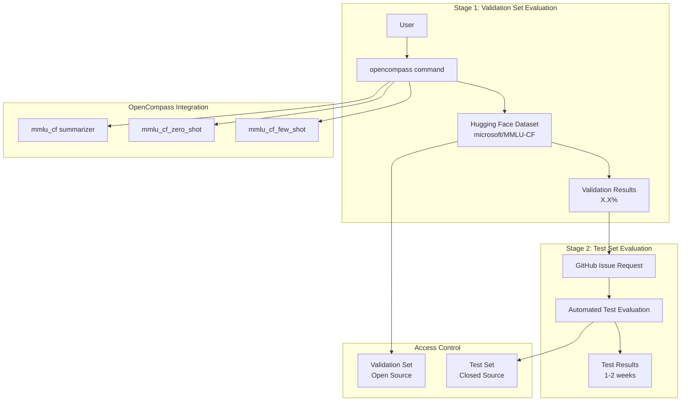
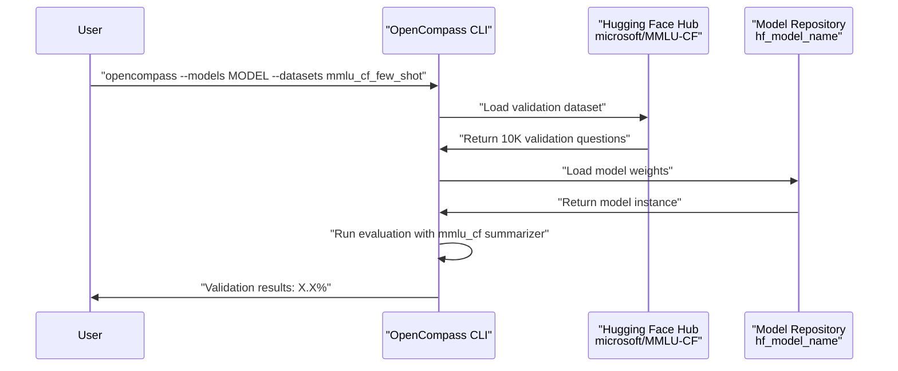
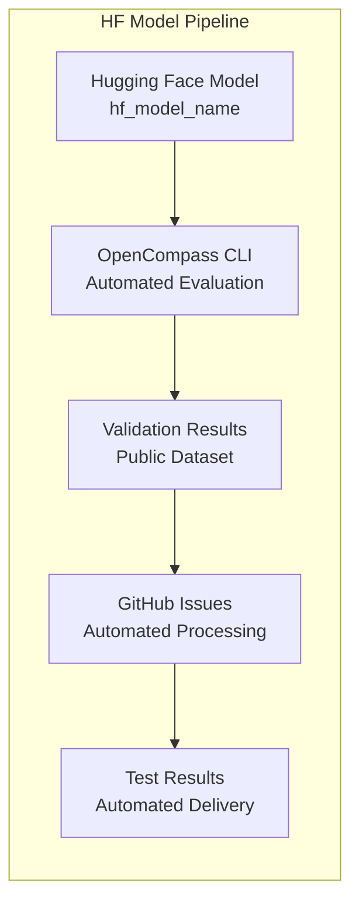
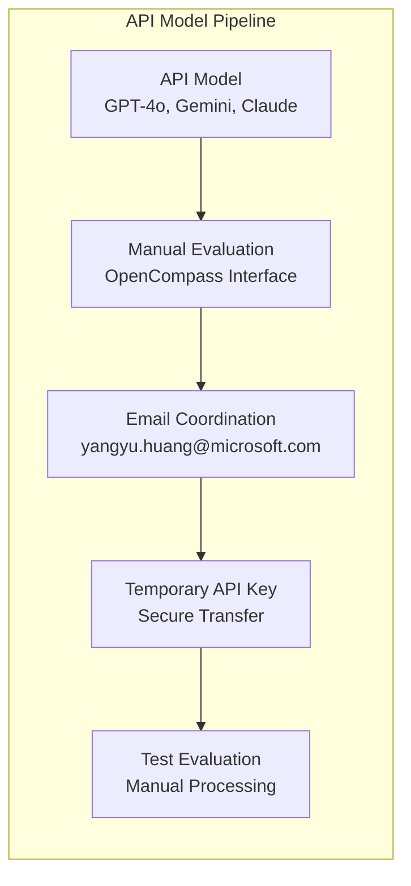

<!-- source: DeepWiki mcp.deepwiki.com · repo microsoft/MMLU-CF · page 2.1 Model Evaluation Process · fetched 2026-10-26 -->

# Model Evaluation Process

<details>
<summary>Relevant source files</summary>

The following files were used as context for generating this wiki page:

- [README.md](README.md)

</details>


This document provides step-by-step instructions for evaluating Large Language Models using the MMLU-CF benchmark system. It covers the complete workflow from initial validation set testing through final test set results, including the specific commands, formats, and procedures required for both Hugging Face models and API models.

For information about the different model types and their technical requirements, see [Supported Model Types](#2.2). For details about the underlying system architecture, see [System Architecture](#3).

## Evaluation Workflow Overview

The MMLU-CF evaluation process follows a two-stage approach designed to maintain test set integrity while providing users with immediate feedback on model performance.

### Two-Stage Evaluation Architecture



Sources: [README.md:36-74]()

## Stage 1: Validation Set Evaluation

The validation set evaluation provides immediate feedback on model performance using the publicly available MMLU-CF validation dataset. This stage uses the OpenCompass evaluation framework with specific dataset configurations.

### OpenCompass Command Structure

| Evaluation Type | Dataset Configuration | Command Example |
|----------------|----------------------|------------------|
| 5-shot | `mmlu_cf_few_shot` | `opencompass --models hf_internlm2_5_1_8b_chat --datasets mmlu_cf_few_shot --summarizer mmlu_cf` |
| 0-shot | `mmlu_cf_zero_shot` | `opencompass --models hf_internlm2_5_1_8b_chat --datasets mmlu_cf_zero_shot --summarizer mmlu_cf` |

### Validation Evaluation Technical Flow



Sources: [README.md:40-52]()

### Required Components

- **Model Specification**: Hugging Face model identifier (e.g., `hf_internlm2_5_1_8b_chat`)
- **Dataset Configuration**: Either `mmlu_cf_few_shot` or `mmlu_cf_zero_shot`
- **Summarizer**: `mmlu_cf` for proper result formatting
- **Data Source**: Automatic loading from `microsoft/MMLU-CF` Hugging Face dataset

## Stage 2: Test Set Evaluation

Test set evaluation requires submitting a GitHub issue with validation results to access the protected test set. This process maintains test set integrity through controlled access.

### GitHub Issue Submission Process

The test set evaluation follows a specific GitHub issue format that triggers automated processing:

```mermaid
flowchart LR
    subgraph "Issue Requirements"
        T1["Title Format:<br/>Test set evaluation Request - add HF model [model_name]"]
        C1["Content Format:<br/>The result on validation set: X.X%"]
    end
    
    subgraph "Processing Pipeline"
        GH["GitHub Issues API"]
        AUTO["Automated Test Runner"]
        TEST["Test Set Evaluation<br/>10K questions"]
    end
    
    subgraph "Model Identification"
        HF_ID["HuggingFace Model ID<br/>microsoft/phi-4"]
        BRACKET["Square Bracket Format<br/>[model_name]"]
    end
    
    T1 --> GH
    C1 --> GH
    HF_ID --> BRACKET
    BRACKET --> T1
    GH --> AUTO
    AUTO --> TEST
    TEST --> "Results (1-2 weeks)"
```

Sources: [README.md:54-71]()

### Issue Format Specification

**Title Template**:
```
Test set evaluation Request - add HF model [microsoft/phi-4]
```

**Content Template**:
```
The result on validation set: 68.5%
```

### Critical Format Requirements

- **Square Brackets**: Model name must be enclosed in `[ ]` brackets
- **HuggingFace ID**: Use exact HuggingFace repository name (e.g., `microsoft/phi-4`)
- **Validation Score**: Include precise percentage from validation evaluation
- **Processing Time**: Expect 1-2 weeks for automated test evaluation

## Model Type-Specific Pathways

### Hugging Face Models

Hugging Face models follow the standard two-stage process with full automation support:



### API Models

API models require manual coordination through email communication due to interface limitations:



Sources: [README.md:72]()

## Timeline and Processing Expectations

### Standard Processing Timeline

| Stage | Process | Expected Duration |
|-------|---------|------------------|
| Validation | OpenCompass evaluation | Minutes to hours |
| Issue submission | GitHub issue creation | Immediate |
| Test evaluation | Automated processing | 1-2 weeks |
| Result delivery | Automated notification | Upon completion |

### Factors Affecting Processing Time

- **Queue Length**: Number of models currently being evaluated
- **Model Size**: Computational requirements for evaluation
- **System Load**: Available computational resources
- **Validation**: Manual review of results if needed

Sources: [README.md:70-71]()

## Command Reference

### Complete Command Examples

**5-shot Evaluation**:
```bash
opencompass --models hf_internlm2_5_1_8b_chat --datasets mmlu_cf_few_shot --summarizer mmlu_cf
```

**0-shot Evaluation**:
```bash
opencompass --models hf_internlm2_5_1_8b_chat --datasets mmlu_cf_zero_shot --summarizer mmlu_cf
```

### Parameter Specifications

- `--models`: Hugging Face model identifier with `hf_` prefix
- `--datasets`: Either `mmlu_cf_few_shot` or `mmlu_cf_zero_shot`
- `--summarizer`: Must be `mmlu_cf` for proper result formatting

Sources: [README.md:42-52]()

---

