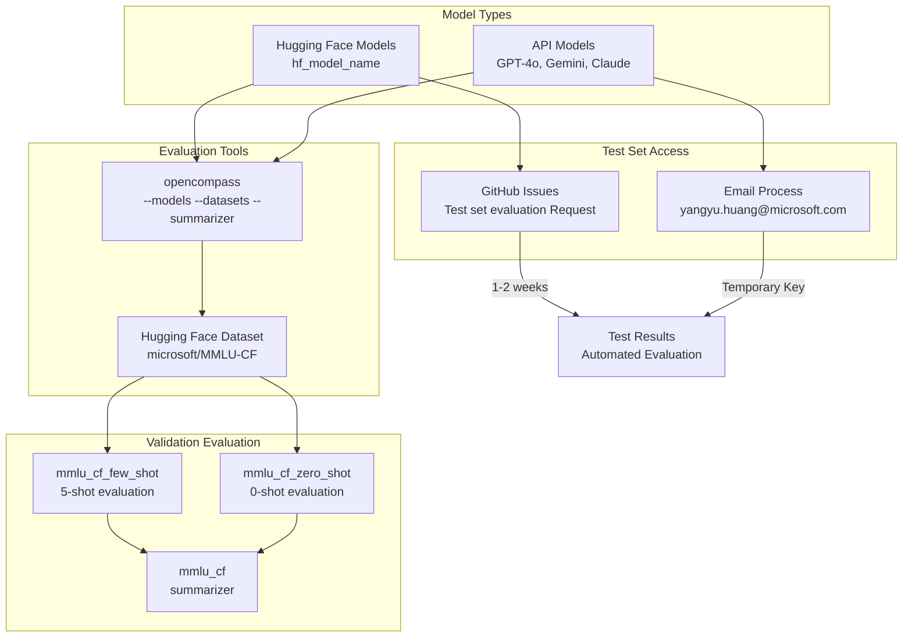
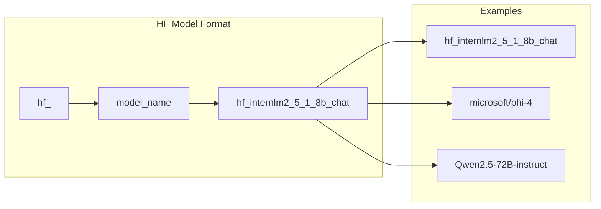
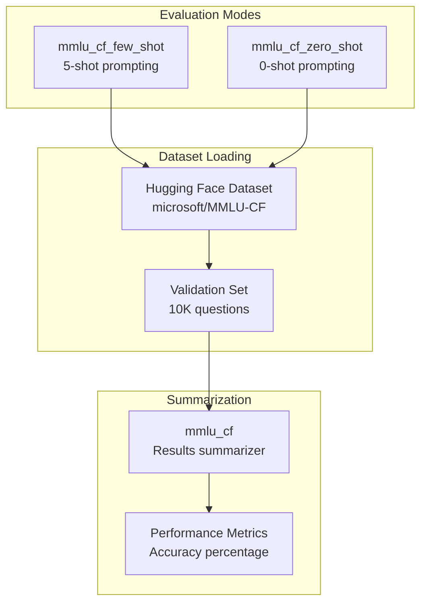

<!-- source: DeepWiki mcp.deepwiki.com · repo microsoft/MMLU-CF · page 2.2 Supported Model Types · fetched 2026-10-26 -->

# Supported Model Types

Relevant source files

The following files were used as context for generating this wiki page:

- [README.md](README.md)

This document describes the different types of models that can be evaluated using the MMLU-CF benchmark system and their respective evaluation pathways. MMLU-CF supports two primary model categories: Hugging Face models and API-based models, each with distinct evaluation processes and access controls.

For step-by-step evaluation instructions, see [Model Evaluation Process](#2.1). For technical details about OpenCompass integration, see [OpenCompass Integration](#4.1).

## Model Type Categories

MMLU-CF supports evaluation of two fundamental model types, each requiring different evaluation workflows and access mechanisms.

### Hugging Face Models

Hugging Face models represent the primary supported model type for automated evaluation. These models are hosted on the Hugging Face platform and can be directly integrated with the OpenCompass evaluation framework.

**Key Characteristics:**
- Automated testing capability through OpenCompass integration
- Direct access to validation set via Hugging Face dataset loading
- GitHub Issues-based workflow for test set evaluation
- Support for both 5-shot and 0-shot evaluation modes

**Evaluation Commands:**
- 5-shot evaluation: `opencompass --models hf_model_name --datasets mmlu_cf_few_shot --summarizer mmlu_cf`
- 0-shot evaluation: `opencompass --models hf_model_name --datasets mmlu_cf_zero_shot --summarizer mmlu_cf`

### API Models

API models include commercial language models accessible through APIs such as OpenAI's GPT series, Google's Gemini, and Anthropic's Claude. These models require special handling due to their API-based nature.

**Key Characteristics:**
- Requires OpenCompass API interface updates for compatibility
- Email-based workflow for test set evaluation requests
- Temporary API key sharing for evaluation access
- Support for major commercial model providers

**Supported API Models:**
- GPT-4o, GPT-4-Turbo, GPT-4o-mini
- Gemini-1.5-Flash
- GPT-3.5-Turbo
- Claude (various versions)

Sources: [README.md:38-73]()

## Model Size Categories

The MMLU-CF leaderboard organizes models into size-based categories to facilitate performance comparison across similar model scales.

| Category | Parameter Range | Example Models |
|----------|----------------|----------------|
| **API** | Variable | `GPT-4o`, `GPT-4-Turbo`, `Gemini-1.5-Flash` |
| **Large** | 70B+ parameters | `Qwen2.5-72B-instruct`, `Llama-3-70B-instruct` |
| **Medium** | 13B-34B parameters | `Qwen2.5-32B-instruct`, `Phi-4-14B` |
| **Small** | 6B-9B parameters | `Qwen2.5-7B-instruct`, `Llama-3-8B-instruct` |
| **Mini** | <4B parameters | `Phi-3-mini-instruct`, `Qwen2.5-1.5B-instruct` |

Sources: [README.md:86-595]()

## Evaluation Pathway Architecture

The following diagram illustrates how different model types flow through the MMLU-CF evaluation system:

**Model Type Evaluation Pathways**

Sources: [README.md:38-73]()

## Model Identifier Format

Different model types use specific identifier formats within the MMLU-CF evaluation system:

**Hugging Face Model Identifiers**

**GitHub Issue Format for HF Models:**
- Title: `Test set evaluation Request - add HF model [model_name]`
- Content: `The result on validation set: X.X%`
- Model name format: `microsoft/phi-4` (HuggingFace repository path)

Sources: [README.md:54-71]()

## Evaluation Mode Support

Both model types support multiple evaluation modes with different prompting strategies:

### 5-Shot Evaluation
- Dataset identifier: `mmlu_cf_few_shot`
- Provides 5 example questions before the target question
- Generally yields higher performance scores

### 0-Shot Evaluation  
- Dataset identifier: `mmlu_cf_zero_shot`
- No example questions provided
- Tests pure model capabilities without examples

**Evaluation Mode Architecture**

Sources: [README.md:42-52]()

## Access Control Mechanisms

The MMLU-CF system implements different access control mechanisms based on model type:

### Hugging Face Models
- **Validation Set**: Open access via Hugging Face datasets
- **Test Set**: Controlled access via GitHub Issues workflow
- **Automation**: Fully automated evaluation pipeline
- **Timeline**: 1-2 weeks for test results

### API Models
- **Validation Set**: OpenCompass API interface (when available)
- **Test Set**: Email-based request with temporary API key sharing
- **Manual Process**: Requires human coordination for API access
- **Flexibility**: Accommodates API interface updates

Sources: [README.md:68-72]()

## Technical Requirements

### For Hugging Face Models
- OpenCompass installation and configuration
- Access to Hugging Face model repositories
- GitHub account for test set evaluation requests
- Model name must follow HuggingFace repository format

### For API Models
- Valid API credentials for the target model service
- OpenCompass API interface compatibility
- Email communication for test set evaluation coordination
- Temporary API key sharing capability

Sources: [README.md:38-73]()

---

