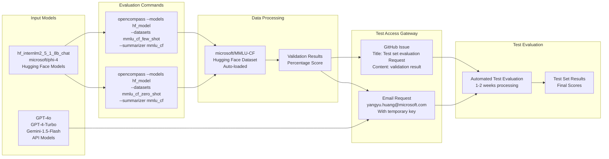
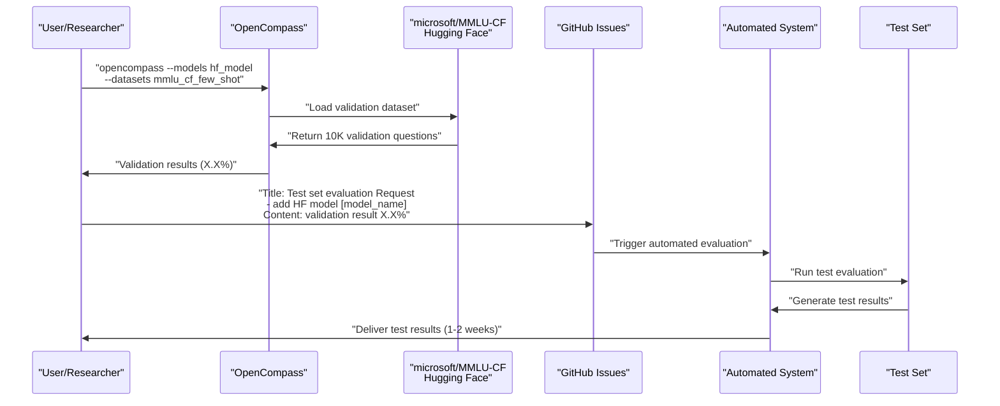
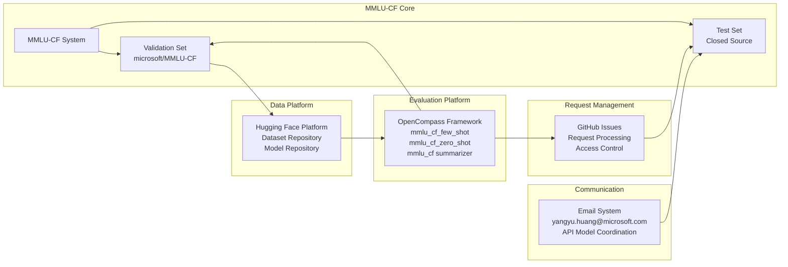

<!-- source: DeepWiki mcp.deepwiki.com · repo microsoft/MMLU-CF · page 3 System Architecture · fetched 2026-10-26 -->

# System Architecture

<details>
<summary>Relevant source files</summary>

The following files were used as context for generating this wiki page:

- [Figures/Fig_5.png](Figures/Fig_5.png)
- [Figures/Fig_6.png](Figures/Fig_6.png)
- [README.md](README.md)

</details>


This document provides a technical overview of the MMLU-CF system architecture, focusing on the core components, data pipeline, and evaluation infrastructure that enable contamination-free benchmark evaluation of Large Language Models.

For detailed information about the data construction process, see [Data Construction Pipeline](#3.1). For contamination prevention mechanisms, see [Contamination Prevention](#3.2). For integration details with OpenCompass, see [OpenCompass Integration](#4.1).

## Core System Components

The MMLU-CF system consists of several interconnected components designed to prevent data contamination while providing reliable model evaluation capabilities.

### System Component Architecture

```mermaid
graph TB
    subgraph "Data Assets"
        VS[microsoft/MMLU-CF<br/>"Validation Set<br/>10K Questions"]
        TS["Test Set<br/>10K Questions<br/>Closed Source"]
    end
    
    subgraph "Evaluation Infrastructure" 
        OC["OpenCompass<br/>mmlu_cf_few_shot<br/>mmlu_cf_zero_shot"]
        GH["GitHub Issues<br/>Test Evaluation Requests"]
        EMAIL["Email Process<br/>yangyu.huang@microsoft.com"]
    end
    
    subgraph "Model Integration Points"
        HF["Hugging Face Models<br/>hf_model_name"]
        API["API Models<br/>GPT-4o, Gemini, Claude"]
    end
    
    subgraph "Access Control"
        AUTO["Automated Evaluation<br/>1-2 weeks processing"]
        MANUAL["Manual Request Processing<br/>GitHub Issue Format"]
    end
    
    HF --> OC
    API --> EMAIL
    OC --> VS
    EMAIL --> VS
    VS --> GH
    GH --> MANUAL
    MANUAL --> AUTO
    AUTO --> TS
    EMAIL --> TS
    
    style TS fill:#f9f9f9
    style VS fill:#f0f8ff
    style OC fill:#fff8dc
```

Sources: [README.md:38-72]()

## Data Flow Architecture

The system implements a two-tier access model where validation results gate access to test evaluation, ensuring controlled usage of the closed-source test set.

### Evaluation Data Flow



Sources: [README.md:40-72]()

## Evaluation Workflow Components

The system supports two distinct evaluation pathways based on model type, each with specific integration requirements and access protocols.

### Model Type Processing Matrix

| Model Type | Evaluation Tool | Dataset Access | Test Set Access | Processing Time |
|------------|----------------|----------------|-----------------|-----------------|
| Hugging Face Models | `opencompass` | Automatic via HF | GitHub Issues | 1-2 weeks |
| API Models | `opencompass` + Email | Manual coordination | Email + temp key | 1-2 weeks |

### Command Interface Specifications

The system exposes evaluation capabilities through standardized OpenCompass commands:

**5-shot Evaluation:**
```bash
opencompass --models hf_internlm2_5_1_8b_chat --datasets mmlu_cf_few_shot --summarizer mmlu_cf
```

**0-shot Evaluation:**
```bash
opencompass --models hf_internlm2_5_1_8b_chat --datasets mmlu_cf_zero_shot --summarizer mmlu_cf
```

Sources: [README.md:42-52]()

## Access Control Architecture

The system implements a controlled access mechanism to maintain test set integrity while enabling legitimate research evaluation.

### GitHub Issues Workflow



### Access Control Rules

1. **Validation Prerequisite**: Test set access requires validation results
2. **Format Enforcement**: GitHub issue titles must use `[model_name]` bracket format
3. **HuggingFace Verification**: Model names must correspond to valid HF repository names
4. **Processing Queue**: Automated system processes requests with 1-2 week turnaround

Sources: [README.md:54-71]()

## Integration Points

The system integrates with external platforms and tools to provide comprehensive evaluation capabilities.

### External System Dependencies



### Dataset Integration Specifications

- **Dataset Identifier**: `microsoft/MMLU-CF`
- **OpenCompass Datasets**: `mmlu_cf_few_shot`, `mmlu_cf_zero_shot`  
- **Summarizer Component**: `mmlu_cf`
- **Auto-loading**: Validation set loaded automatically from Hugging Face during evaluation

Sources: [README.md:19, 40-46]()

## Contamination Prevention Architecture

The system implements multiple layers of contamination prevention to ensure evaluation reliability.

### Data Integrity Safeguards

1. **Closed Source Test Set**: 10K questions kept in controlled environment
2. **Validation Gate**: Public validation set (10K questions) serves as access prerequisite  
3. **Controlled Access Protocol**: GitHub Issues workflow prevents unauthorized test set access
4. **Processing Delay**: 1-2 week evaluation window prevents real-time exploitation
5. **Format Validation**: Standardized request format ensures legitimate research usage

The architecture demonstrates significant performance gaps between MMLU and MMLU-CF scores, indicating successful contamination prevention in the original MMLU benchmark.

Sources: [README.md:27-29, 76-77]()

---

