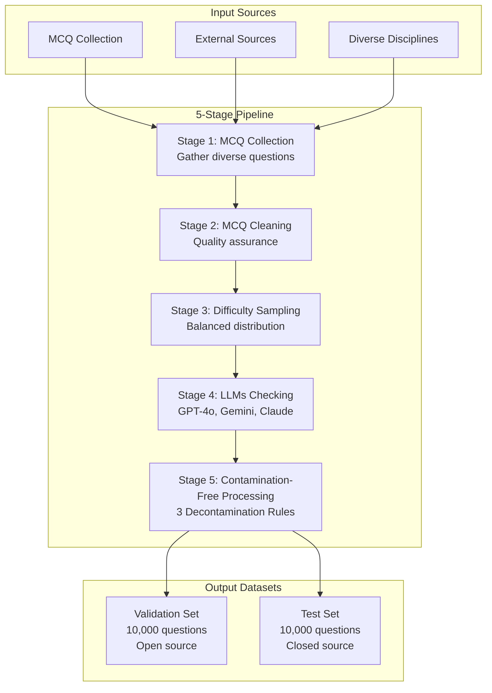
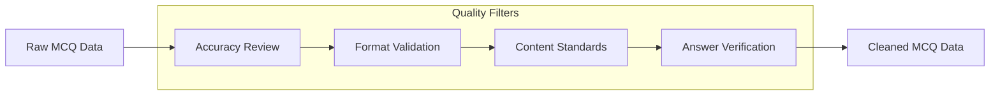
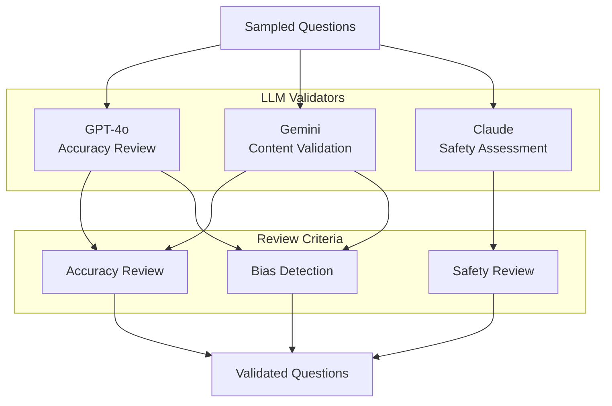
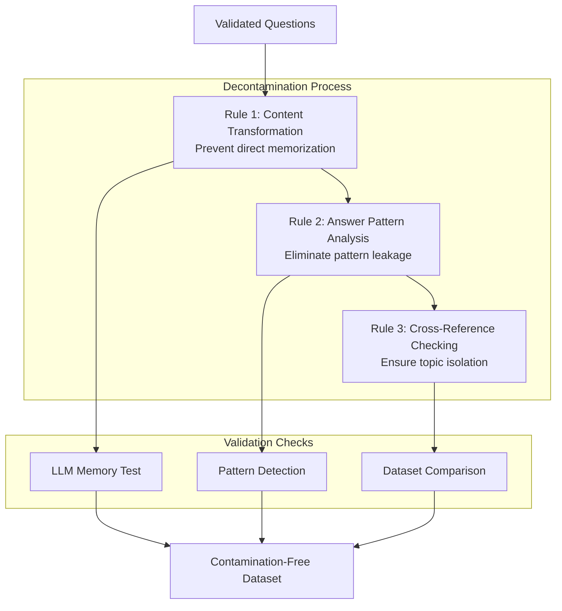
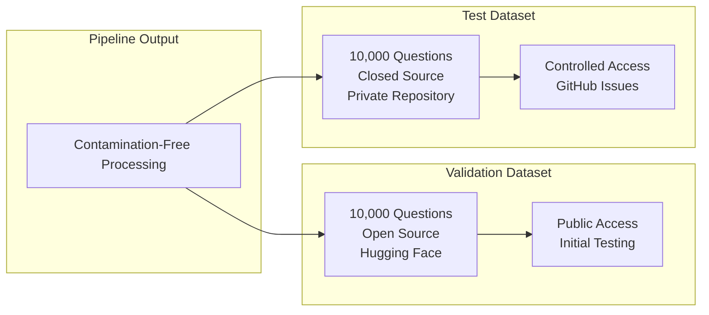
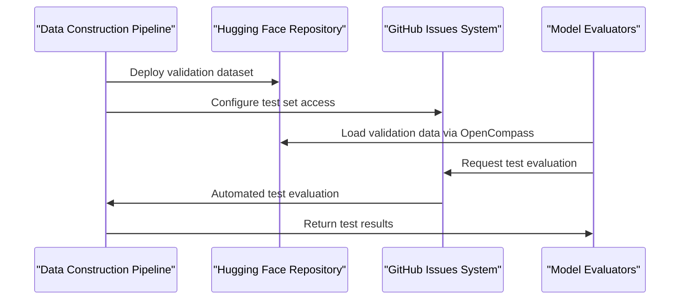

<!-- source: DeepWiki mcp.deepwiki.com · repo microsoft/MMLU-CF · page 3.1 Data Construction Pipeline · fetched 2026-10-26 -->

# Data Construction Pipeline

Relevant source files

The following files were used as context for generating this wiki page:

- [README.md](README.md)

This page documents the technical implementation of MMLU-CF's 5-stage data construction pipeline that creates contamination-free evaluation datasets. The pipeline processes multiple-choice questions through quality assurance, difficulty balancing, LLM validation, and decontamination processing to produce reliable benchmark data.

For information about how contamination prevention works, see [Contamination Prevention](#3.2). For details about the overall system architecture, see [System Architecture](#3).

## Pipeline Overview

The MMLU-CF data construction pipeline implements a systematic 5-stage process designed to address the fundamental contamination problem in existing benchmarks like MMLU, where LLMs can memorize training data and achieve artificially inflated scores.

**Sources: [README.md:597-599]()**

## Stage 1: MCQ Collection

The initial stage gathers multiple-choice questions from diverse academic and professional domains to ensure comprehensive coverage across disciplines. This stage focuses on breadth and variety to create a robust foundation for the benchmark.

| Collection Criteria | Description |
|-------------------|-------------|
| **Domain Coverage** | Questions span various academic disciplines and professional fields |
| **Question Types** | Multiple-choice format with 4-option answers |
| **Source Diversity** | External sources beyond traditional academic materials |
| **Scope** | Broad collection to enable effective sampling in later stages |

## Stage 2: MCQ Cleaning

Quality assurance processing removes low-quality questions and ensures consistency across the dataset. This stage implements systematic filtering to maintain high data quality standards.

**Sources: [README.md:597-599]()**

## Stage 3: Difficulty Sampling

This stage ensures appropriate difficulty distribution across the final dataset to create a balanced evaluation benchmark that accurately reflects model capabilities across different skill levels.

| Sampling Dimension | Implementation |
|-------------------|----------------|
| **Difficulty Levels** | Balanced distribution across easy, medium, and hard questions |
| **Subject Balance** | Proportional representation across academic disciplines |
| **Complexity Metrics** | Question complexity analysis for appropriate sampling |
| **Distribution Control** | Statistical sampling to achieve target distributions |

## Stage 4: LLMs Checking

Multiple state-of-the-art language models perform accuracy and safety validation on the curated questions. This stage provides automated quality control through ensemble model review.

**Sources: [README.md:597-599]()**

## Stage 5: Contamination-Free Processing

The final stage implements three decontamination rules to prevent data leakage and ensure the benchmark maintains evaluation integrity. This stage addresses the core contamination problem that affects existing benchmarks.

### Decontamination Rules

The pipeline applies three systematic decontamination rules to prevent unintentional data leakage:

| Rule Type | Purpose | Implementation |
|-----------|---------|----------------|
| **Rule 1** | Prevents direct question memorization | Content transformation and validation |
| **Rule 2** | Eliminates answer pattern leakage | Answer distribution analysis |
| **Rule 3** | Ensures topic isolation** | Cross-reference checking with known datasets |

### Contamination Prevention Mechanism

**Sources: [README.md:76-77](), [README.md:597-599]()**

## Quality Control Integration

The pipeline integrates multiple quality control mechanisms throughout the process to ensure data integrity and benchmark reliability.

| QA Component | Stage Integration | Validation Method |
|--------------|------------------|-------------------|
| **Accuracy Review** | Stage 2, 4 | Manual review + LLM validation |
| **Safety Review** | Stage 4 | Multi-model safety assessment |
| **Bias Detection** | Stage 4 | Automated bias analysis |
| **Contamination Check** | Stage 5 | Decontamination rule enforcement |

## Output Specifications

The pipeline produces two distinct dataset outputs with controlled access patterns to maintain benchmark integrity.

### Dataset Splits

### Technical Specifications

| Dataset Component | Validation Set | Test Set |
|------------------|----------------|----------|
| **Question Count** | 10,000 | 10,000 |
| **Access Model** | Open source via Hugging Face | Closed source via request |
| **Usage Pattern** | Initial model evaluation | Final benchmark testing |
| **Distribution** | Public repository | Private repository with controlled access |
| **Update Frequency** | Static after release | Static with periodic review |

**Sources: [README.md:597-599](), [README.md:38-71]()**

## Pipeline Integration with Evaluation Workflow

The data construction pipeline integrates with the broader MMLU-CF evaluation system through standardized dataset formats and access controls.

The pipeline ensures that both validation and test datasets maintain consistent quality standards while implementing different access controls to prevent contamination during the evaluation process.

**Sources: [README.md:38-71](), [README.md:597-599]()**

---

