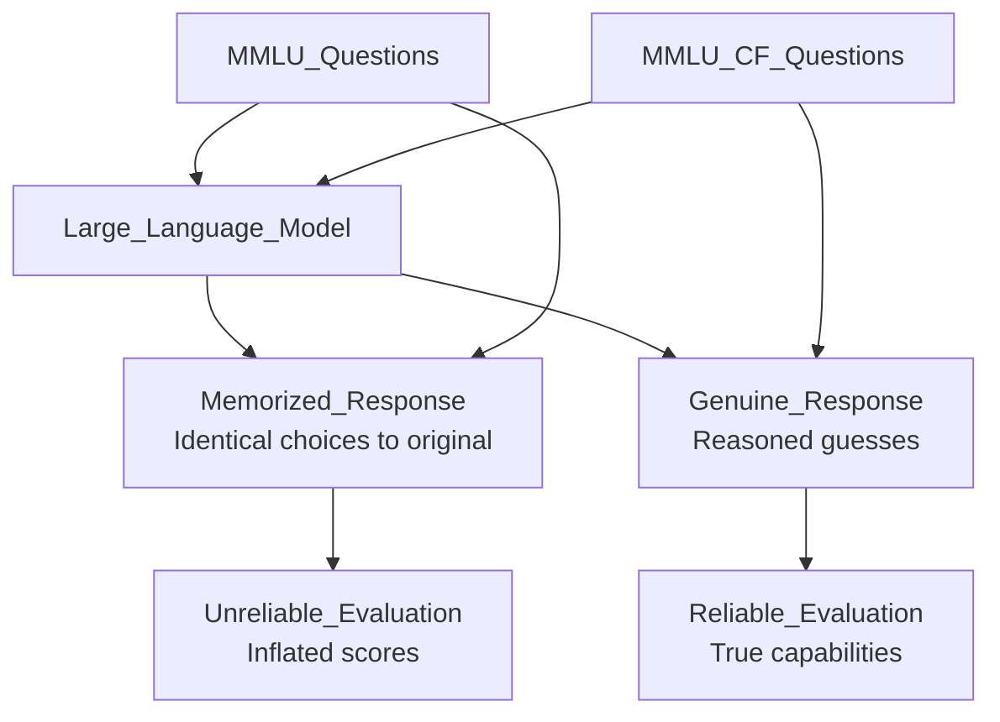
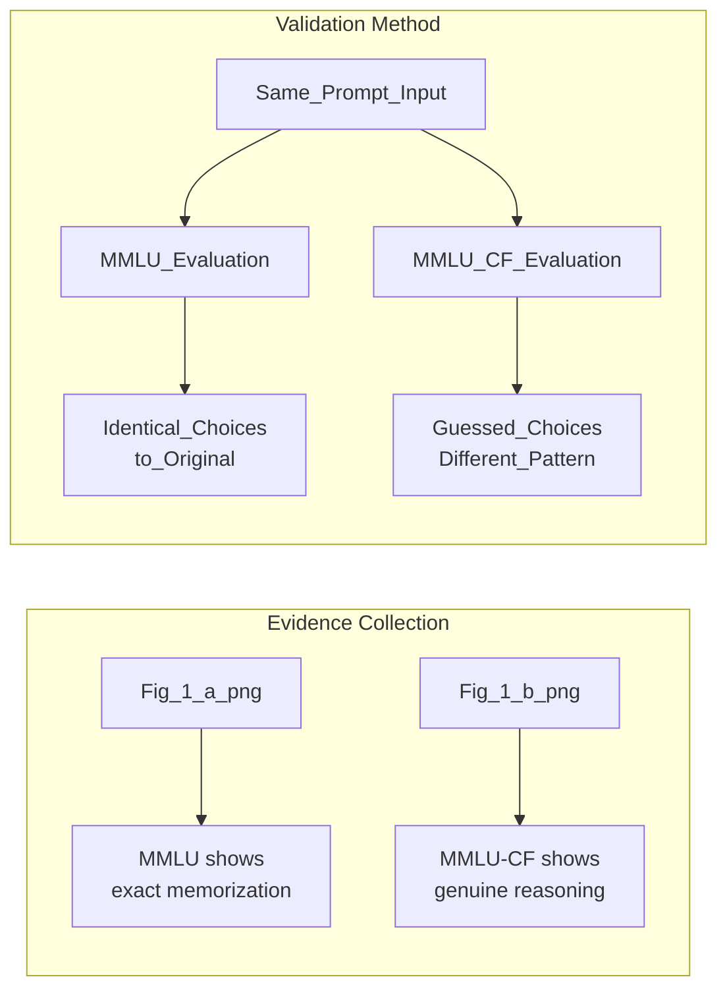
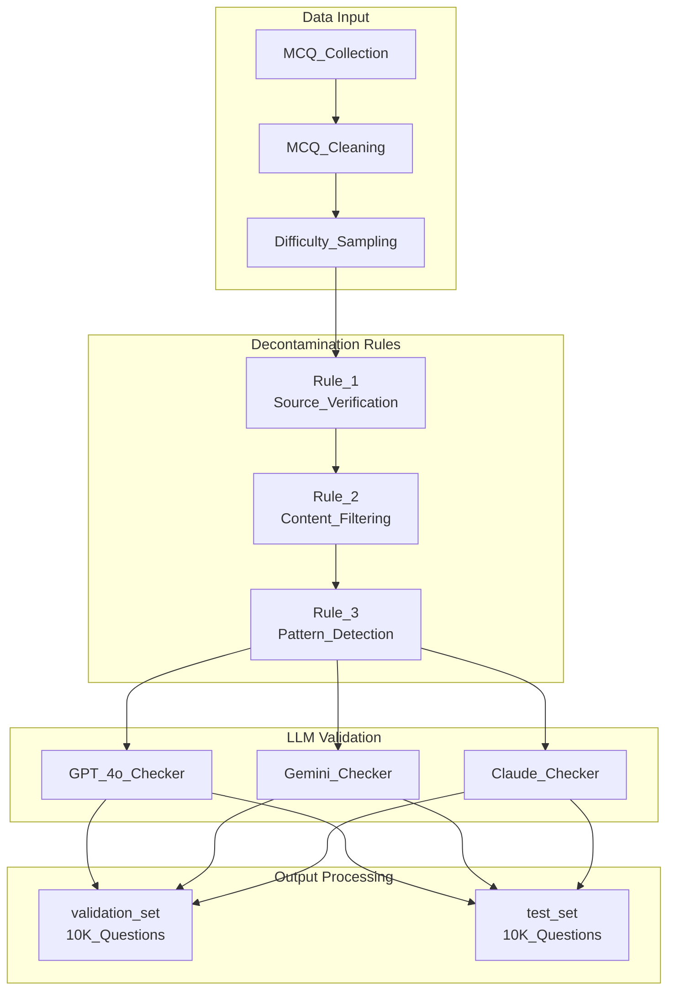
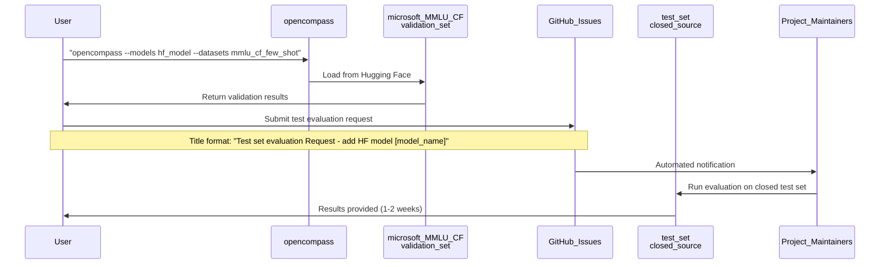
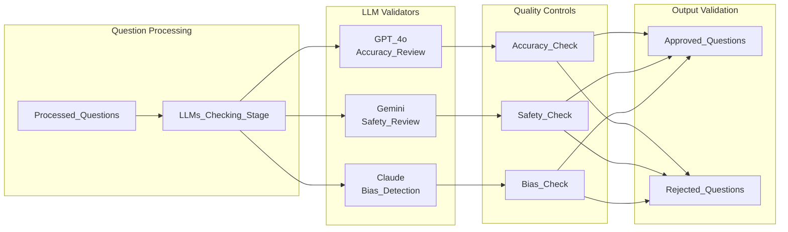
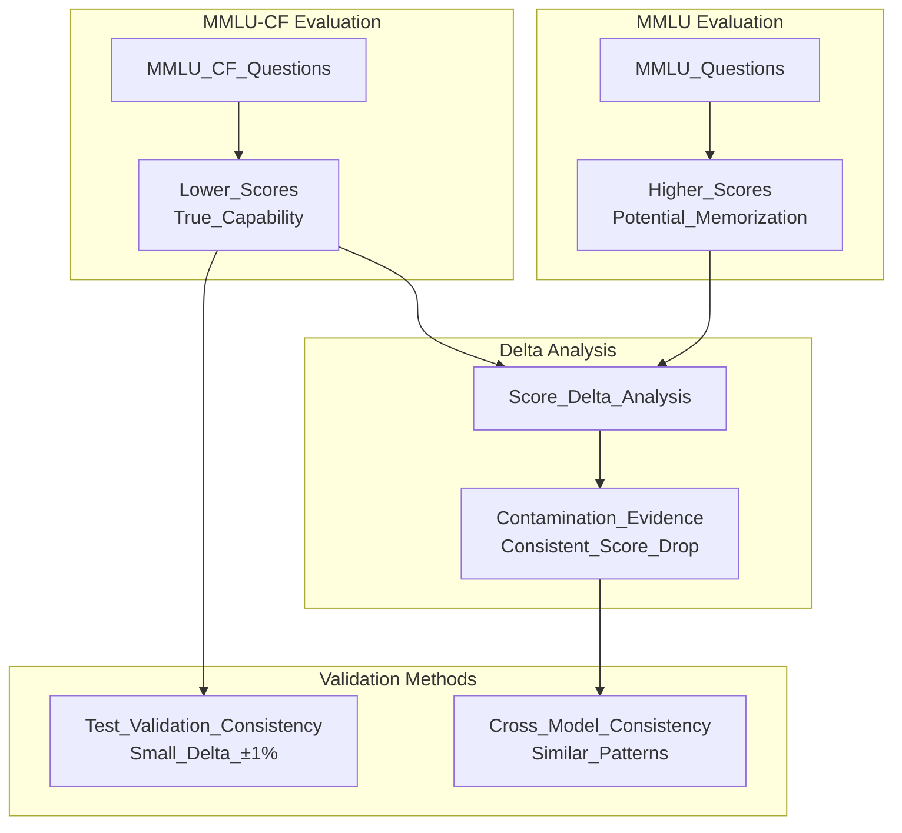
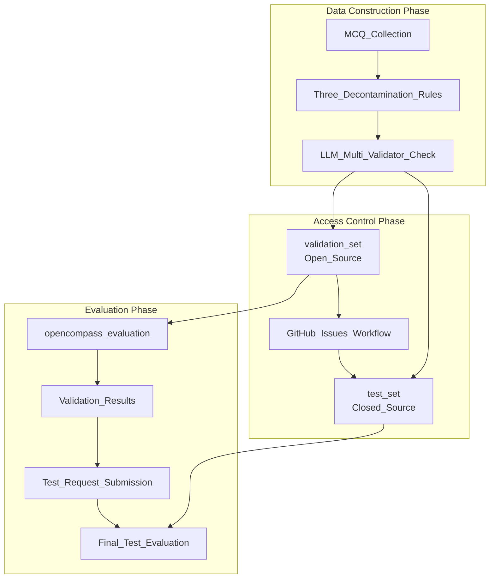

<!-- source: DeepWiki mcp.deepwiki.com · repo microsoft/MMLU-CF · page 3.2 Contamination Prevention · fetched 2026-10-26 -->

# Contamination Prevention

Relevant source files

The following files were used as context for generating this wiki page:

- [README.md](README.md)

This document explains how MMLU-CF prevents data contamination and ensures reliable evaluation compared to MMLU. It covers the specific mechanisms, rules, and architectural decisions that maintain dataset integrity and prevent both unintentional and malicious data leakage.

For details about the overall data construction pipeline, see [Data Construction Pipeline](#3.1). For information about evaluation workflows, see [Model Evaluation Process](#2.1).

## The Contamination Problem

MMLU-CF was created to address fundamental contamination issues in the original MMLU benchmark. The open-source nature of existing benchmarks and the broad training data sources for LLMs have led to benchmark contamination, resulting in unreliable evaluation results.

### Evidence of MMLU Contamination

The contamination manifests as memorization behavior where LLMs provide identical choices to original MMLU questions rather than genuinely reasoning through them. This is demonstrated through direct comparison between MMLU and MMLU-CF responses.

**Contamination Detection Process**

Sources: [README.md:27-33](), [README.md:30-33]()

## Three Decontamination Rules

MMLU-CF implements three specific decontamination rules during the contamination-free processing stage to mitigate unintentional data leakage while collecting data from broader domains.

### Decontamination Rule Architecture

Sources: [README.md:76](), [README.md:598-599]()

## Closed-Source Test Set Strategy

MMLU-CF maintains the test set as closed-source to prevent malicious data leakage, while providing an open-source validation set for initial model evaluation.

### Access Control Architecture

### Test Set Protection Mechanisms

| Protection Layer | Implementation | Purpose |
|------------------|----------------|---------|
| **Access Control** | GitHub Issues workflow | Prevent unauthorized access |
| **Automated Validation** | `opencompass` integration | Verify validation results first |
| **Manual Review** | Maintainer approval | Additional security layer |
| **Time Delay** | 1-2 weeks processing | Prevent rapid iteration attacks |

Sources: [README.md:54-71](), [README.md:38-71]()

## LLM-Based Quality Assurance

The contamination prevention system employs multiple LLMs for accuracy and safety validation during the data construction process.

### Multi-LLM Validation Pipeline

Sources: [README.md:598-599]()

## Evaluation Integrity Comparison

MMLU-CF demonstrates contamination prevention effectiveness through comparative analysis between MMLU and MMLU-CF performance across different model types.

### Performance Delta Analysis

The leaderboard data shows the difference between MMLU and MMLU-CF scores, indicating contamination levels in the original MMLU benchmark.

| Model Category | MMLU Score Range | MMLU-CF Score Range | Typical Delta |
|----------------|------------------|---------------------|---------------|
| **API Models** | 71.4-88.0 | 58.2-73.4 | -12.8 to -14.6 |
| **Large Models** | 68.9-86.3 | 52.2-71.6 | -14.7 to -16.7 |
| **Medium Models** | 55.7-84.8 | 48.3-69.7 | -7.4 to -15.1 |
| **Small Models** | 45.3-75.4 | 38.5-61.3 | -6.8 to -14.1 |

### Contamination-Free Validation

Sources: [README.md:85-595](), [README.md:94-101]()

## Implementation Architecture

The contamination prevention mechanisms are integrated throughout the MMLU-CF system architecture.

### Contamination Prevention Integration Points

Sources: [README.md:597-599](), [README.md:36-73]()

---

