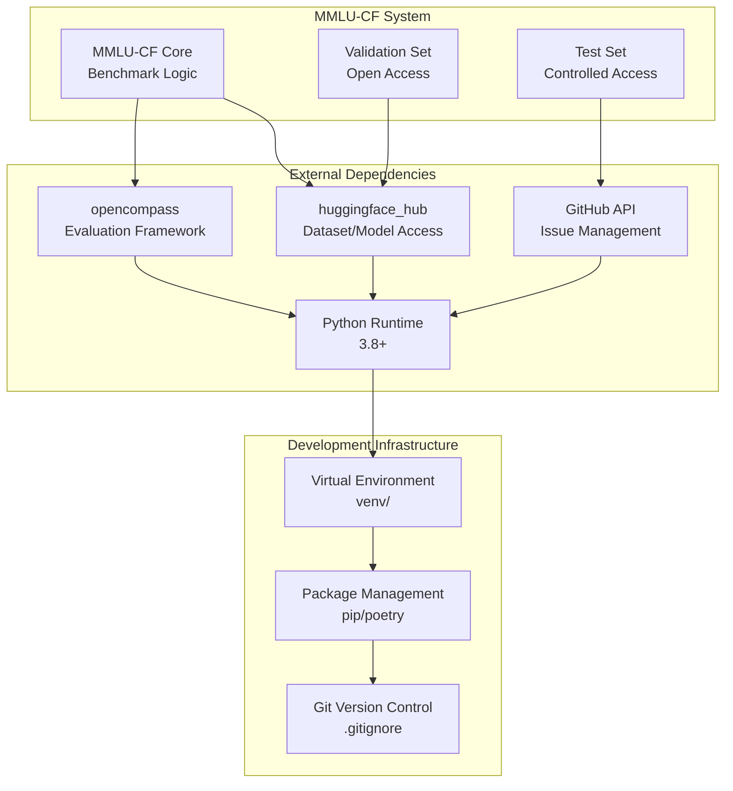
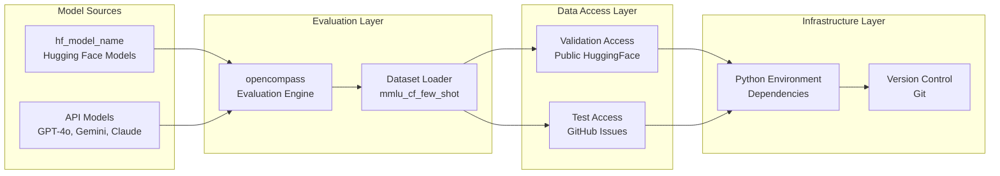
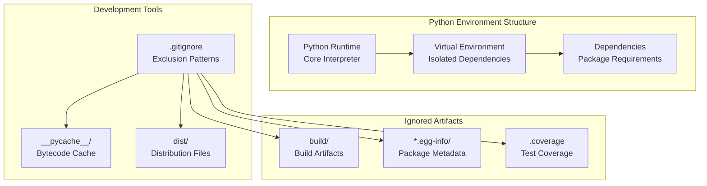
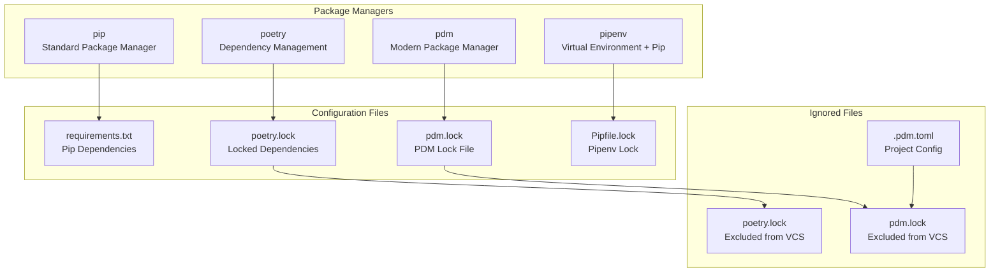

<!-- source: DeepWiki mcp.deepwiki.com · repo microsoft/MMLU-CF · page 4 Technical Integration · fetched 2026-10-26 -->

# Technical Integration

Relevant source files

The following files were used as context for generating this wiki page:

- [.gitignore](.gitignore)
- [NOTICE](NOTICE)

This document covers the technical dependencies, system integrations, and infrastructure components that enable MMLU-CF to function as a contamination-free benchmark system. It provides an overview of how external frameworks, evaluation tools, and development dependencies work together to support the benchmark's core functionality.

For specific details about OpenCompass evaluation framework integration, see [OpenCompass Integration](#4.1). For development environment setup and contributor workflows, see [Development Environment](#4.2).

## System Dependencies Overview

MMLU-CF operates as an integrated system that relies on several key external dependencies and frameworks to deliver its contamination-free evaluation capabilities.

### Core Integration Components

Sources: [NOTICE:1-6](), [.gitignore:1-163]()

### Integration Architecture

The system follows a modular integration pattern where external dependencies provide specialized capabilities while maintaining clear separation of concerns.

Sources: [NOTICE:5](), [.gitignore:125-131]()

## External Framework Dependencies

### OpenCompass Integration

The system incorporates OpenCompass as a core evaluation framework dependency, as documented in the project notices.

| Component | Integration Type | Purpose |
|-----------|-----------------|---------|
| `opencompass` | External Framework | Primary evaluation engine for model testing |
| `mmlu_cf_few_shot` | Dataset Configuration | MMLU-CF dataset integration within OpenCompass |
| `hf_model_name` | Model Identifier | Hugging Face model specification format |

The OpenCompass framework serves as the primary interface between MMLU-CF datasets and model evaluation workflows.

Sources: [NOTICE:5]()

### Python Environment Requirements

The development environment follows standard Python project conventions with comprehensive dependency management.

Sources: [.gitignore:1-10](), [.gitignore:123-131](), [.gitignore:39-52]()

## Development Infrastructure

### Version Control Configuration

The project uses Git with comprehensive exclusion patterns to maintain clean version control.

| Category | Excluded Files | Purpose |
|----------|---------------|---------|
| Python Bytecode | `__pycache__/`, `*.py[cod]` | Compiled Python artifacts |
| Virtual Environments | `.venv`, `venv/`, `ENV/` | Isolated dependency environments |
| Distribution | `build/`, `dist/`, `*.egg-info/` | Package build artifacts |
| IDE Configuration | `.spyderproject`, `.ropeproject` | Editor-specific settings |
| Testing | `.pytest_cache/`, `.coverage` | Test execution artifacts |

The `.gitignore` configuration follows Python community best practices for development workflow management.

Sources: [.gitignore:1-10](), [.gitignore:123-131](), [.gitignore:39-52](), [.gitignore:134-162]()

### Package Management Support

The system supports multiple Python package management approaches:

Sources: [.gitignore:90-112]()

### Testing and Quality Infrastructure

The development environment supports comprehensive testing and code quality tools:

| Tool Category | Supported Tools | Configuration |
|--------------|----------------|---------------|
| Testing Frameworks | `pytest`, `nose` | `.pytest_cache/`, `nosetests.xml` excluded |
| Coverage Analysis | `coverage.py` | `.coverage*`, `htmlcov/` excluded |
| Type Checking | `mypy`, `pytype` | `.mypy_cache/`, `.pytype/` excluded |
| Documentation | `Sphinx`, `mkdocs` | `docs/_build/`, `/site` excluded |

Sources: [.gitignore:39-52](), [.gitignore:71-73](), [.gitignore:140-152]()

## Integration Security Considerations

The system maintains security through controlled access patterns and dependency management:

- **Test Set Isolation**: Test set access requires GitHub Issues workflow
- **Dependency Verification**: External dependencies documented in `NOTICE` file
- **Environment Isolation**: Virtual environment support for dependency containment
- **Artifact Exclusion**: Build artifacts and caches excluded from version control

Sources: [NOTICE:1-6](), [.gitignore:123-131]()

---

