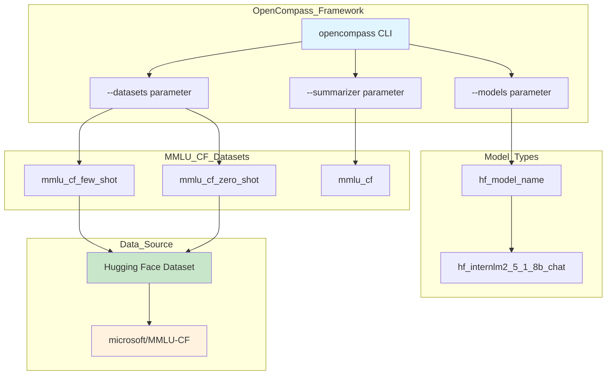
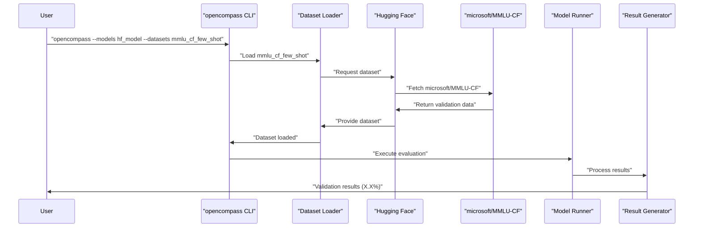
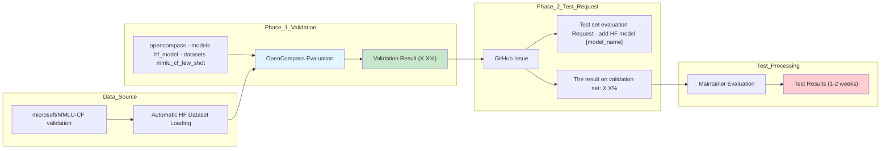

<!-- source: DeepWiki mcp.deepwiki.com · repo microsoft/MMLU-CF · page 4.1 OpenCompass Integration · fetched 2026-10-26 -->

# OpenCompass Integration

Relevant source files

The following files were used as context for generating this wiki page:

- [NOTICE](NOTICE)
- [README.md](README.md)

This document covers the technical integration between MMLU-CF and the OpenCompass evaluation framework. OpenCompass serves as the primary evaluation tool for automated testing of Hugging Face models on the MMLU-CF validation set.

For information about the overall model evaluation process workflow, see [Model Evaluation Process](#2.1). For details about different model types and their evaluation pathways, see [Supported Model Types](#2.2).

## Purpose and Scope

OpenCompass is an external evaluation framework that has been integrated with MMLU-CF to provide standardized evaluation capabilities. The integration enables automated loading of MMLU-CF datasets, execution of evaluation runs, and generation of results for both 5-shot and 0-shot evaluation scenarios.

Sources: [README.md:19-19](), [README.md:38-72]()

## Integration Architecture

The OpenCompass integration operates as the primary evaluation interface for Hugging Face models within the MMLU-CF ecosystem. The system automatically handles dataset loading, model evaluation, and result generation.

Sources: [README.md:42-52](), [README.md:40-40]()

## Command Structure and Parameters

OpenCompass evaluation commands follow a standardized structure with three primary parameters: models, datasets, and summarizer. The integration supports two evaluation modes with distinct dataset configurations.

### Evaluation Commands

| Parameter | 5-shot Evaluation | 0-shot Evaluation |
|-----------|------------------|------------------|
| `--models` | `hf_internlm2_5_1_8b_chat` | `hf_internlm2_5_1_8b_chat` |
| `--datasets` | `mmlu_cf_few_shot` | `mmlu_cf_zero_shot` |
| `--summarizer` | `mmlu_cf` | `mmlu_cf` |

### Model Naming Convention

The integration uses Hugging Face model naming convention with the `hf_` prefix followed by the model identifier. Models must be accessible on the Hugging Face platform for automated evaluation.

Sources: [README.md:42-52]()

## Data Loading and Processing Flow

The OpenCompass integration implements automatic data loading from the Hugging Face dataset repository. The system retrieves validation data without requiring manual dataset management.

Sources: [README.md:40-40](), [README.md:42-52]()

## Evaluation Workflow Integration

The OpenCompass integration serves as the first step in the two-phase MMLU-CF evaluation process. Results from OpenCompass validation runs are required for subsequent test set evaluation requests.

Sources: [README.md:54-71]()

## API Model Limitations

The OpenCompass integration currently supports automated evaluation exclusively for Hugging Face models. API models require alternative evaluation pathways through email-based processes when OpenCompass updates model interfaces.

### Model Type Support Matrix

| Model Type | OpenCompass Support | Evaluation Method |
|------------|-------------------|------------------|
| Hugging Face Models | ✅ Automated | OpenCompass CLI |
| API Models (GPT-4o, Gemini, Claude) | ⚠️ Limited | Email Process |

Sources: [README.md:72-72]()

## Technical Dependencies

The integration incorporates OpenCompass framework components as indicated in the project dependencies. The system maintains compatibility with the OpenCompass evaluation ecosystem while providing MMLU-CF specific dataset configurations.

Sources: [NOTICE:5-6]()

## Integration Status and Updates

OpenCompass support for MMLU-CF was officially announced and integrated as of January 9, 2025. The integration provides production-ready evaluation capabilities for the MMLU-CF validation set.

Sources: [README.md:19-19]()

---

