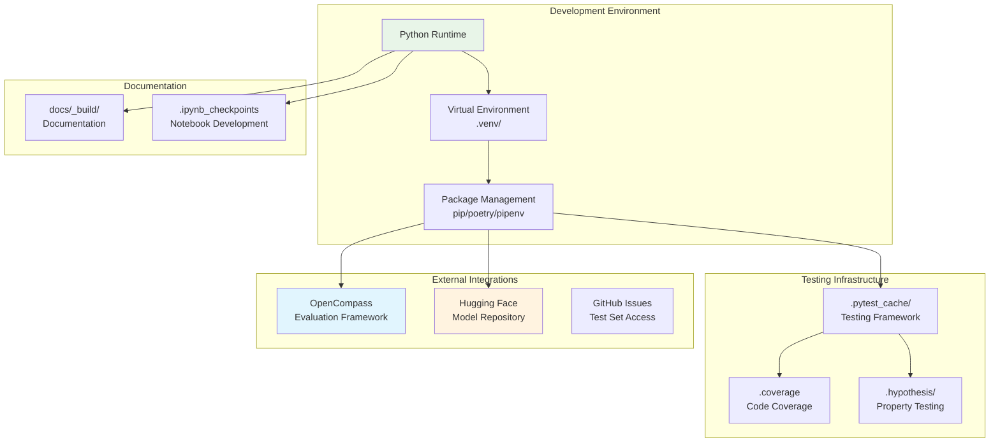
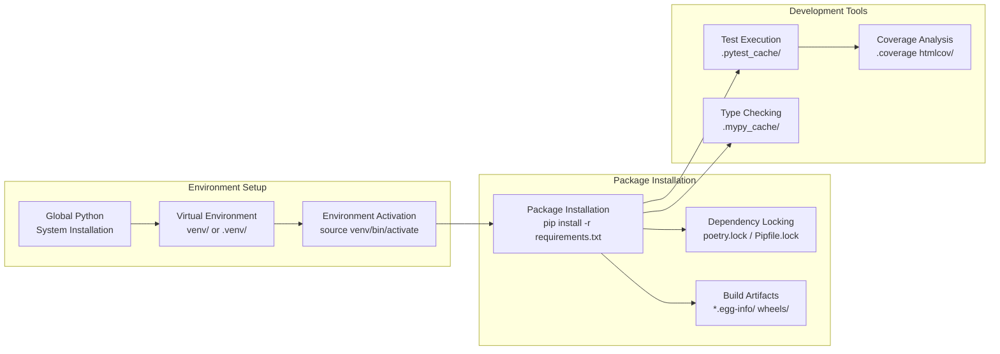
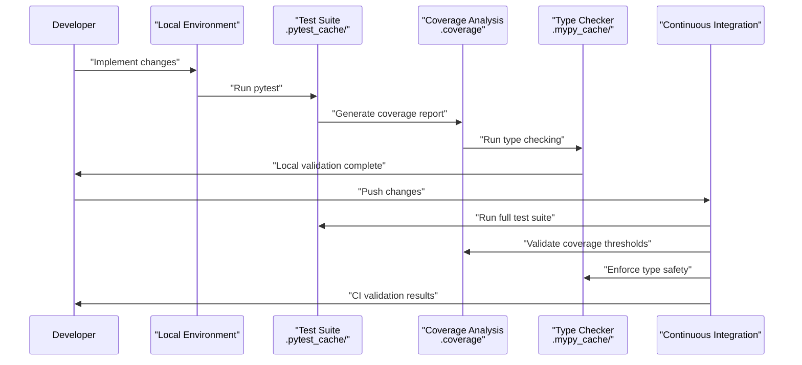
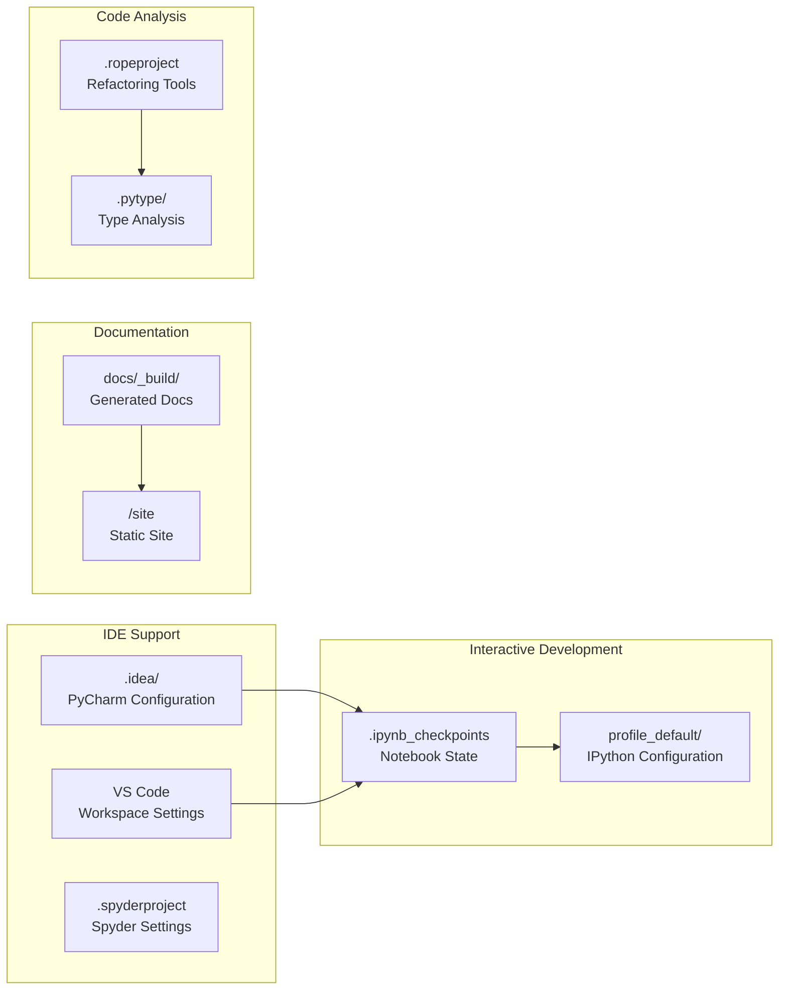
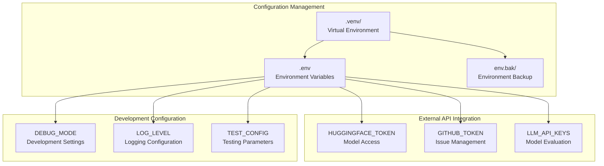

<!-- source: DeepWiki mcp.deepwiki.com · repo microsoft/MMLU-CF · page 4.2 Development Environment · fetched 2026-10-26 -->

# Development Environment

Relevant source files

The following files were used as context for generating this wiki page:

- [.gitignore](.gitignore)

This page covers the development tools, environment setup, and technical infrastructure required for contributing to the MMLU-CF benchmark system. It provides guidance on configuring a local development environment and understanding the project's technical dependencies.

For information about integrating with the OpenCompass evaluation framework, see [OpenCompass Integration](#4.1). For system architecture details, see [System Architecture](#3).

## Development Stack Overview

MMLU-CF is built as a Python-based benchmark system designed to integrate with existing evaluation frameworks and model repositories. The development environment supports both local development and integration testing with external evaluation tools.

### Core Technology Stack

Sources: [.gitignore:1-163]()

## Package Management and Dependencies

The project supports multiple Python package management approaches, with environment isolation being a critical requirement for reproducible evaluations.

### Supported Package Managers

| Package Manager | Configuration Files | Environment Isolation |
|----------------|-------------------|---------------------|
| pip | `requirements.txt` | Virtual environments |
| Poetry | `pyproject.toml`, `poetry.lock` | Built-in isolation |
| Pipenv | `Pipfile`, `Pipfile.lock` | Built-in isolation |
| PDM | `pyproject.toml`, `pdm.lock` | Built-in isolation |

### Environment Isolation Workflow

Sources: [.gitignore:88-112](), [.gitignore:124-131](), [.gitignore:14-27]()

## Testing and Quality Assurance

The development environment includes comprehensive testing infrastructure to ensure benchmark reliability and prevent contamination issues.

### Testing Framework Configuration

The project uses multiple testing and quality assurance tools:

- **pytest**: Primary testing framework with caching in `.pytest_cache/`
- **Coverage.py**: Code coverage analysis with reports in `htmlcov/` and `.coverage`
- **Hypothesis**: Property-based testing with state in `.hypothesis/`
- **mypy**: Static type checking with cache in `.mypy_cache/`
- **Pyre**: Alternative type checker with artifacts in `.pyre/`

### Quality Control Pipeline

Sources: [.gitignore:39-52](), [.gitignore:143-153]()

## Documentation and Development Tools

The development environment supports both code documentation and interactive development workflows.

### Documentation Infrastructure

- **Sphinx**: Documentation building with output in `docs/_build/`
- **Jupyter Notebooks**: Interactive development with checkpoints in `.ipynb_checkpoints`
- **MkDocs**: Alternative documentation with site output in `/site`

### Development Tool Integration

Sources: [.gitignore:78-83](), [.gitignore:71-72](), [.gitignore:140-141](), [.gitignore:135-138](), [.gitignore:151-152]()

## Integration Environment Setup

The development environment must support integration with external evaluation frameworks and model repositories that are core to MMLU-CF's functionality.

### External System Dependencies

| System | Purpose | Integration Point |
|--------|---------|------------------|
| OpenCompass | Evaluation framework | Command-line interface |
| Hugging Face Hub | Model repository | API and dataset access |
| GitHub Issues | Test set access control | REST API |
| Various LLM APIs | Model evaluation | HTTP APIs |

### Environment Variable Management

The project uses environment files for configuration management, with support for:

- `.env`: Environment-specific configuration
- `.venv/`: Virtual environment directory
- `ENV/`: Alternative environment directory structure

Sources: [.gitignore:124-131]()

---

