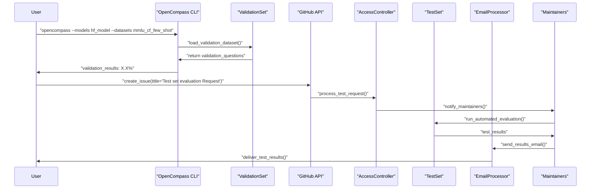
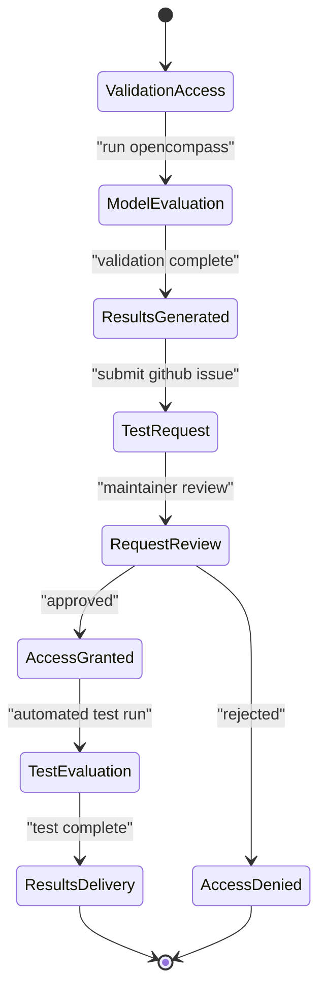

<!-- source: DeepWiki mcp.deepwiki.com · repo microsoft/MMLU-CF · page 5 Visual Documentation · fetched 2026-10-26 -->

# Visual Documentation

<details>
<summary>Relevant source files</summary>

The following files were used as context for generating this wiki page:

- [Figures/Fig_1_a.png](Figures/Fig_1_a.png)
- [Figures/Fig_5.png](Figures/Fig_5.png)
- [Figures/Fig_6.png](Figures/Fig_6.png)

</details>


This page provides a comprehensive collection of diagrams and visual representations that illustrate the MMLU-CF system architecture, data flows, and key processes. These diagrams serve as visual guides for understanding system components, their interactions, and the overall evaluation workflow.

For technical implementation details, see [Technical Integration](#4). For system architecture concepts, see [System Architecture](#3). For user-facing evaluation processes, see [User Guide](#2).

## System Architecture Overview

The MMLU-CF system consists of multiple interconnected components that work together to provide contamination-free evaluation of language models. The following diagram illustrates the core system architecture and component relationships.

### Core System Components

```mermaid
graph TB
    subgraph "Data Layer"
        VS[ValidationSet<br/>"mmlu_cf_validation"]
        TS[TestSet<br/>"mmlu_cf_test"]
        MCQ[MCQCollection<br/>"mcq_sources"]
    end
    
    subgraph "Processing Pipeline"
        DCP[DataConstructionPipeline<br/>"data_pipeline"]
        QC[QualityControl<br/>"quality_checker"]
        DC[DecontaminationRules<br/>"decontamination"]
    end
    
    subgraph "Evaluation Framework"
        OC[OpenCompass<br/>"opencompass_integration"]
        ME[ModelEvaluator<br/>"model_evaluator"]
        RG[ResultsGenerator<br/>"results_generator"]
    end
    
    subgraph "Access Control"
        GH[GitHubIssues<br/>"github_workflow"]
        AC[AccessController<br/>"access_control"]
        EM[EmailProcessor<br/>"email_handler"]
    end
    
    MCQ --> DCP
    DCP --> QC
    QC --> DC
    DC --> VS
    DC --> TS
    
    VS --> OC
    OC --> ME
    ME --> RG
    
    VS --> GH
    GH --> AC
    AC --> TS
    AC --> EM
```

Sources: [Figures/Fig_6.png]()

### Model Evaluation Workflow

This diagram shows the complete evaluation workflow from model submission to result delivery, highlighting the dual-path approach for validation and test evaluation.



Sources: [Figures/Fig_6.png]()

## Data Construction and Quality Control

The data construction pipeline implements multiple stages of quality control and contamination prevention. This diagram illustrates the data flow and quality assurance processes.

### Data Pipeline Architecture

```mermaid
flowchart LR
    subgraph "Input Sources"
        ES[ExternalSources<br/>"external_mcq_sources"]
        CS[CuratedSources<br/>"curated_datasets"]
    end
    
    subgraph "Processing Stages"
        MC[MCQCleaner<br/>"mcq_cleaner.py"]
        DS[DifficultySampler<br/>"difficulty_sampler.py"]
        LC[LLMChecker<br/>"llm_checker.py"]
        DF[DecontaminationFilter<br/>"decontamination_filter.py"]
    end
    
    subgraph "Quality Assurance"
        AR[AccuracyReviewer<br/>"accuracy_reviewer"]
        SR[SafetyReviewer<br/>"safety_reviewer"]
        BD[BiasDetector<br/>"bias_detector"]
    end
    
    subgraph "Output"
        VD[ValidationData<br/>"validation_10k.json"]
        TD[TestData<br/>"test_10k.json"]
    end
    
    ES --> MC
    CS --> MC
    MC --> DS
    DS --> LC
    LC --> DF
    
    LC --> AR
    LC --> SR
    LC --> BD
    
    DF --> VD
    DF --> TD
```

Sources: [Figures/Fig_6.png]()

### Contamination Prevention Rules

```mermaid
graph TD
    subgraph "Decontamination Process"
        Input[InputQuestions<br/>"raw_questions"]
        R1[Rule1<br/>"exact_match_filter"]
        R2[Rule2<br/>"semantic_similarity_filter"]
        R3[Rule3<br/>"paraphrase_detection"]
        
        Input --> R1
        R1 --> R2
        R2 --> R3
    end
    
    subgraph "LLM Validation"
        GPT[GPTChecker<br/>"gpt4_validator"]
        GEM[GeminiChecker<br/>"gemini_validator"]
        CLD[ClaudeChecker<br/>"claude_validator"]
        
        R3 --> GPT
        R3 --> GEM
        R3 --> CLD
    end
    
    subgraph "Final Output"
        CF[ContaminationFree<br/>"clean_questions"]
        
        GPT --> CF
        GEM --> CF
        CLD --> CF
    end
```

Sources: [Figures/Fig_6.png]()

## Model Integration and Evaluation

The system supports both Hugging Face models and API-based models through different evaluation pathways. This section illustrates the model integration architecture.

### Model Type Handling

```mermaid
graph LR
    subgraph "Model Sources"
        HF[HuggingFaceModels<br/>"hf_model_loader"]
        API[APIModels<br/>"api_model_interface"]
    end
    
    subgraph "Evaluation Interfaces"
        HFE[HFEvaluator<br/>"hf_evaluator.py"]
        APIE[APIEvaluator<br/>"api_evaluator.py"]
    end
    
    subgraph "Common Pipeline"
        PP[PromptProcessor<br/>"prompt_processor"]
        RG[ResponseGenerator<br/>"response_generator"]
        SA[ScoreAggregator<br/>"score_aggregator"]
    end
    
    HF --> HFE
    API --> APIE
    
    HFE --> PP
    APIE --> PP
    
    PP --> RG
    RG --> SA
```

Sources: [Figures/Fig_6.png]()

### OpenCompass Integration

```mermaid
graph TB
    subgraph "OpenCompass Framework"
        OC[OpenCompassCore<br/>"opencompass.main"]
        CF[ConfigFile<br/>"mmlu_cf_config.py"]
        DS[DatasetLoader<br/>"mmlu_cf_dataset.py"]
    end
    
    subgraph "MMLU-CF Components"
        VL[ValidationLoader<br/>"validation_loader"]
        ME[ModelEvaluator<br/>"model_evaluator"]
        RM[ResultsManager<br/>"results_manager"]
    end
    
    subgraph "Output Generation"
        RP[ResultsProcessor<br/>"results_processor"]
        RF[ReportFormatter<br/>"report_formatter"]
        FS[FileSystem<br/>"output_handler"]
    end
    
    OC --> CF
    CF --> DS
    DS --> VL
    VL --> ME
    ME --> RM
    RM --> RP
    RP --> RF
    RF --> FS
```

Sources: [Figures/Fig_6.png]()

## Access Control and Security

The system implements a multi-layered access control mechanism to protect the test set while allowing open access to the validation set.

### Access Control Flow



Sources: [Figures/Fig_6.png]()

### GitHub Workflow Integration

```mermaid
graph LR
    subgraph "GitHub Integration"
        API[GitHubAPI<br/>"github_client"]
        IH[IssueHandler<br/>"issue_handler.py"]
        TM[TemplateManager<br/>"issue_templates"]
    end
    
    subgraph "Request Processing"
        VP[ValidationParser<br/>"validation_parser"]
        RV[RequestValidator<br/>"request_validator"]
        AA[AccessApprover<br/>"access_approver"]
    end
    
    subgraph "Automation"
        AE[AutomatedEvaluator<br/>"automated_evaluator"]
        NM[NotificationManager<br/>"notification_manager"]
        RL[ResultsLogger<br/>"results_logger"]
    end
    
    API --> IH
    IH --> TM
    TM --> VP
    VP --> RV
    RV --> AA
    AA --> AE
    AE --> NM
    NM --> RL
```

Sources: [Figures/Fig_6.png]()

## Support Infrastructure

The system includes comprehensive support infrastructure for security reporting, community guidelines, and user assistance.

### Support System Architecture

```mermaid
graph TB
    subgraph "External Interfaces"
        MS[MicrosoftSecurity<br/>"secure@microsoft.com"]
        CS[CustomerSupport<br/>"aka.ms/onboardsupport"]
        HF[HuggingFacePlatform<br/>"huggingface_integration"]
    end
    
    subgraph "Internal Support"
        SP[SecurityPolicy<br/>"SECURITY.md"]
        CC[CodeOfConduct<br/>"CODE_OF_CONDUCT.md"]
        SG[SupportGuidelines<br/>"SUPPORT.md"]
    end
    
    subgraph "Community Management"
        IG[IssueGuidelines<br/>"issue_templates"]
        CM[CommunityModerator<br/>"community_moderator"]
        DM[DocumentationMaintainer<br/>"docs_maintainer"]
    end
    
    MS --> SP
    CS --> SG
    HF --> IG
    
    SP --> CM
    SG --> CM
    IG --> DM
    
    CM --> CC
    DM --> CC
```

Sources: [Figures/Fig_6.png]()

---

