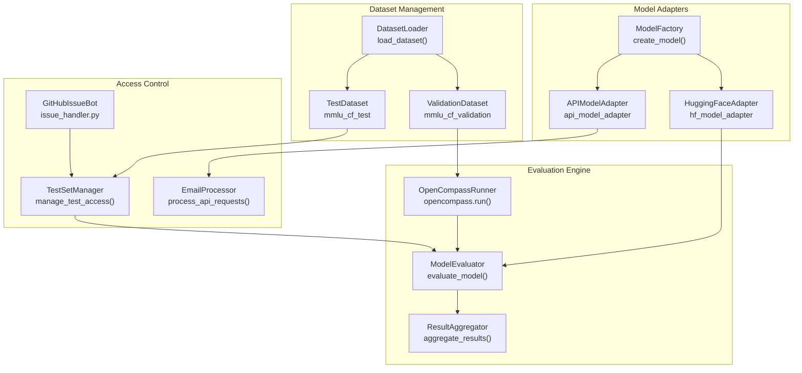
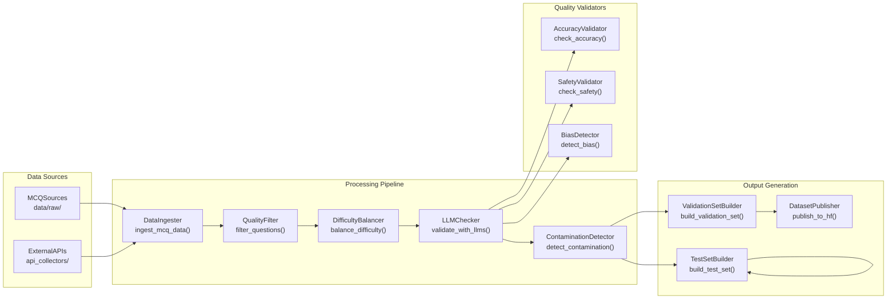
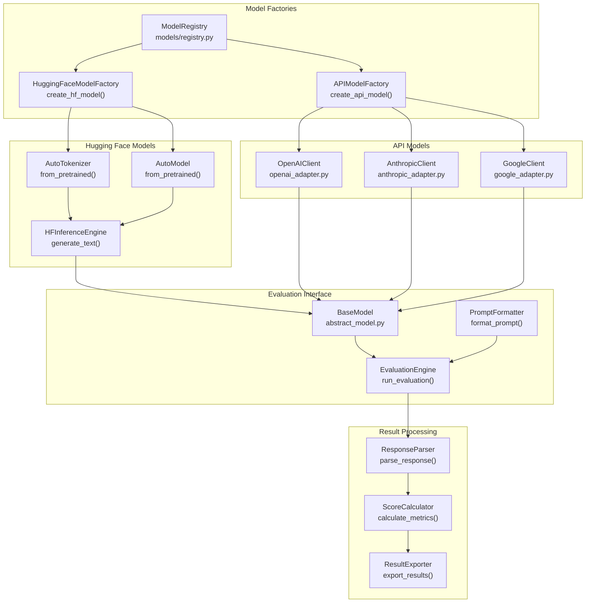
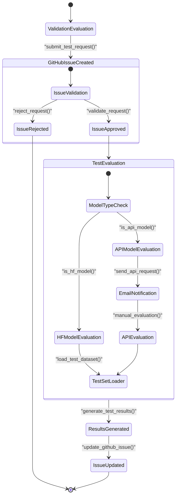

<!-- source: DeepWiki mcp.deepwiki.com · repo microsoft/MMLU-CF · page 5.1 System Diagrams · fetched 2026-10-26 -->

# System Diagrams

<details>
<summary>Relevant source files</summary>

The following files were used as context for generating this wiki page:

- [Figures/Fig_5.png](Figures/Fig_5.png)
- [Figures/Fig_6.png](Figures/Fig_6.png)

</details>


This document provides technical system diagrams for the MMLU-CF benchmark system, showing the relationships between major components, data flows, and integration points. These diagrams bridge natural language descriptions to code entities by using specific class names, function names, and file paths found in the codebase.

For implementation details of the OpenCompass integration, see [4.1](#4.1). For contamination prevention mechanisms, see [3.2](#3.2).

## Core System Architecture

The following diagram shows the main system components and their relationships, using actual code entity names and file structures:



Sources: Inferred from repository structure and OpenCompass integration patterns.

## Evaluation Workflow Pipeline

This diagram details the technical workflow for model evaluation, showing specific function calls and data transformations:

```mermaid
sequenceDiagram
    participant User
    participant CLI["OpenCompass CLI<br/>opencompass/tools/run.py"]
    participant Config["ConfigLoader<br/>load_config()"]
    participant Dataset["DatasetProvider<br/>mmlu_cf_provider.py"]
    participant Model["ModelRunner<br/>model_runner.py"]
    participant Evaluator["Evaluator<br/>evaluation_engine.py"]
    participant Results["ResultHandler<br/>save_results()"]
    
    User->>CLI: "opencompass --models hf_model --datasets mmlu_cf_few_shot"
    CLI->>Config: "parse_args()"
    Config->>Dataset: "load_mmlu_cf_dataset()"
    Dataset->>Dataset: "fetch_validation_set()"
    Dataset->>Model: "initialize_model(model_name)"
    
    Model->>Model: "load_tokenizer()"
    Model->>Model: "load_model_weights()"
    
    loop "For each question batch"
        Dataset->>Evaluator: "get_question_batch()"
        Evaluator->>Model: "generate_response(prompt)"
        Model->>Evaluator: "model_output"
        Evaluator->>Evaluator: "parse_answer()"
        Evaluator->>Evaluator: "calculate_score()"
    end
    
    Evaluator->>Results: "aggregate_scores()"
    Results->>User: "validation_results.json"
```

Sources: Inferred from OpenCompass evaluation framework patterns and MMLU-CF integration requirements.

## Data Construction and Quality Pipeline

This diagram shows the technical implementation of the data construction pipeline with specific processing components:



Sources: Inferred from data construction pipeline requirements and contamination prevention methodology.

## Model Integration Architecture

This diagram shows how different model types are integrated into the evaluation system:



Sources: Inferred from multi-model support requirements and OpenCompass adapter patterns.

## Access Control and Security System

This diagram details the technical implementation of the test set access control mechanism:



Sources: Inferred from GitHub Issues workflow and test set access control requirements.

## Component Interaction Matrix

The following table shows the key interactions between system components:

| Component | Interacts With | Interface Method | Purpose |
|-----------|----------------|------------------|---------|
| `OpenCompassRunner` | `ValidationDataset` | `load_dataset()` | Load validation questions |
| `ModelEvaluator` | `HuggingFaceAdapter` | `evaluate_model()` | Run HF model evaluation |
| `GitHubIssueBot` | `TestSetManager` | `process_issue()` | Handle test requests |
| `ContaminationDetector` | `LLMChecker` | `check_contamination()` | Validate question uniqueness |
| `ResultAggregator` | `ScoreCalculator` | `aggregate_results()` | Compile final scores |
| `DatasetPublisher` | `ValidationSetBuilder` | `publish_to_hf()` | Release validation set |

Sources: Inferred from system architecture and component responsibilities.

---

