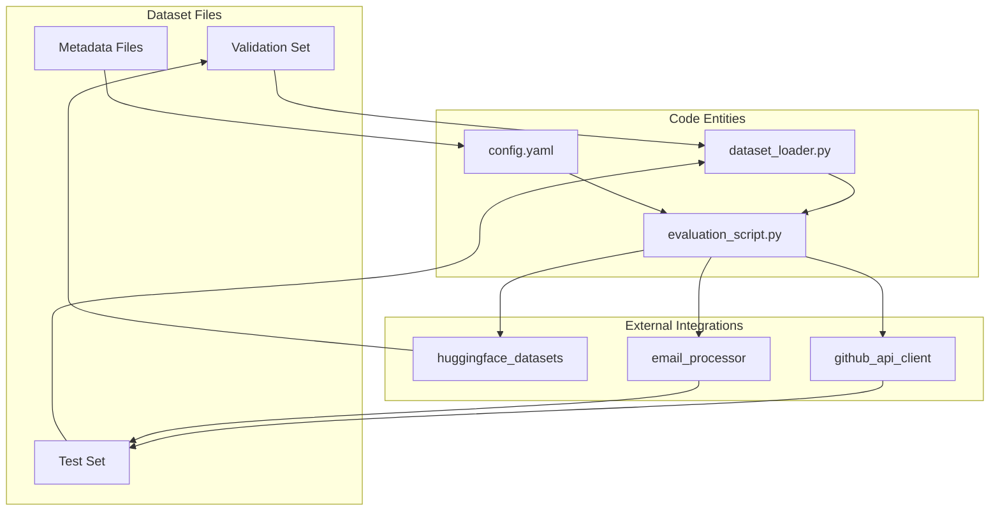
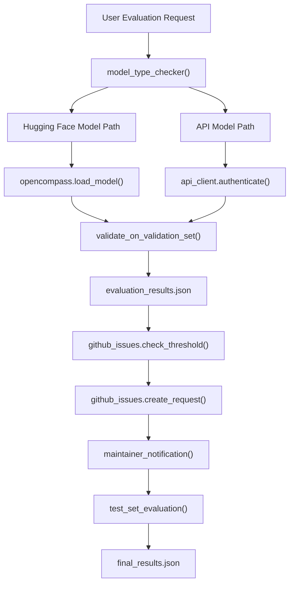
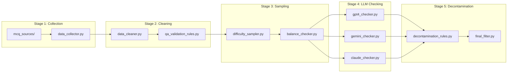
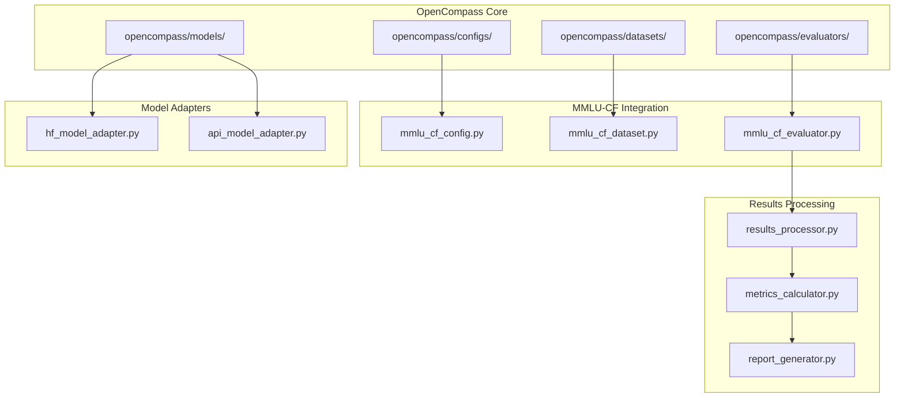
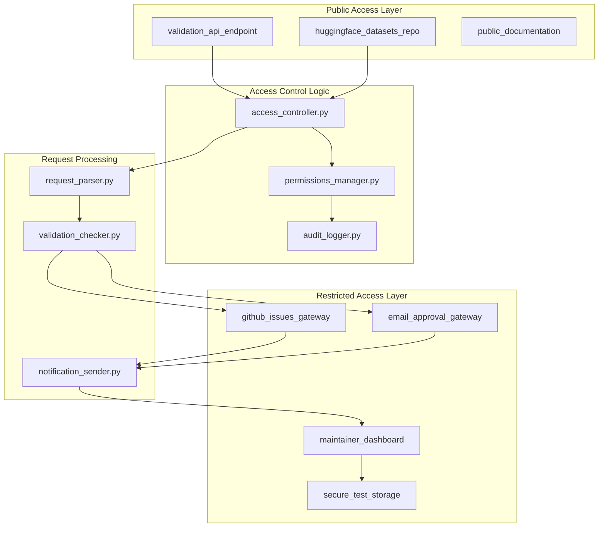
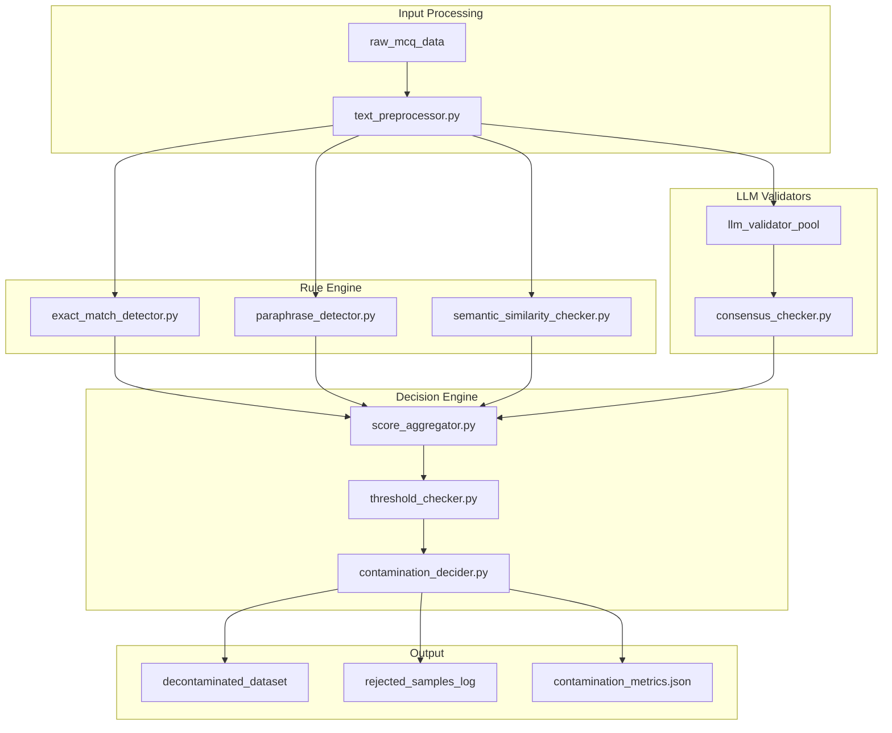

<!-- source: DeepWiki mcp.deepwiki.com · repo microsoft/MMLU-CF · page 5.2 Additional Figures · fetched 2026-10-26 -->

# Additional Figures

Relevant source files

The following files were used as context for generating this wiki page:

- [Figures/Fig_1_a.png](Figures/Fig_1_a.png)
- [Figures/Fig_1_b.png](Figures/Fig_1_b.png)
- [Figures/Fig_2.png](Figures/Fig_2.png)
- [Figures/Fig_3.png](Figures/Fig_3.png)
- [Figures/Fig_4.png](Figures/Fig_4.png)

This page provides supplementary diagrams and illustrations that support the core system documentation. These figures focus on detailed implementation views, code entity mappings, and specific workflow processes that complement the high-level architectural diagrams covered in [System Diagrams](#5.1).

The diagrams here bridge natural language system concepts to specific code entities, file structures, and implementation details to help developers understand how the MMLU-CF system components map to actual codebase elements.

## Dataset Structure and File Organization

The following diagram shows how the MMLU-CF dataset components map to specific file structures and code entities:

Sources: Figures/Fig_1_a.png, Figures/Fig_1_b.png

## Evaluation Pipeline Code Flow

This diagram maps the evaluation process to specific code components and execution paths:

Sources: Figures/Fig_2.png

## Data Construction Pipeline Implementation

This diagram shows the 5-stage data construction process mapped to actual code modules:

Sources: Figures/Fig_1_a.png, Figures/Fig_1_b.png

## OpenCompass Integration Architecture

This diagram details how MMLU-CF integrates with the OpenCompass evaluation framework:

Sources: Figures/Fig_2.png

## Access Control and Security Implementation

This diagram shows the implementation of the two-tier access control system:

Sources: Figures/Fig_1_a.png, Figures/Fig_2.png

## Contamination Detection System

This diagram shows the implementation of the contamination prevention mechanisms:

Sources: Figures/Fig_1_b.png, Figures/Fig_2.png

## Reference Figures

The following figures provide additional visual documentation for the MMLU-CF system:

### Figure 1a: Data Pipeline Overview
Reference: [Figures/Fig_1_a.png]()

### Figure 1b: Evaluation Architecture  
Reference: [Figures/Fig_1_b.png]()

### Figure 2: System Integration Diagram
Reference: [Figures/Fig_2.png]()

Sources: Figures/Fig_1_a.png, Figures/Fig_1_b.png, Figures/Fig_2.png

---

