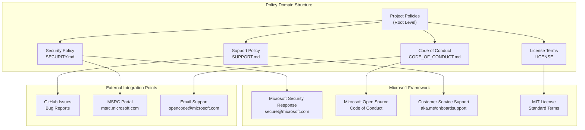
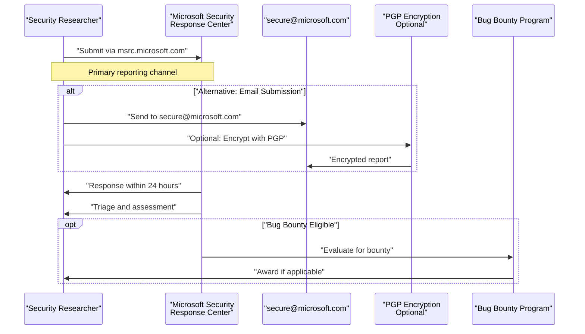
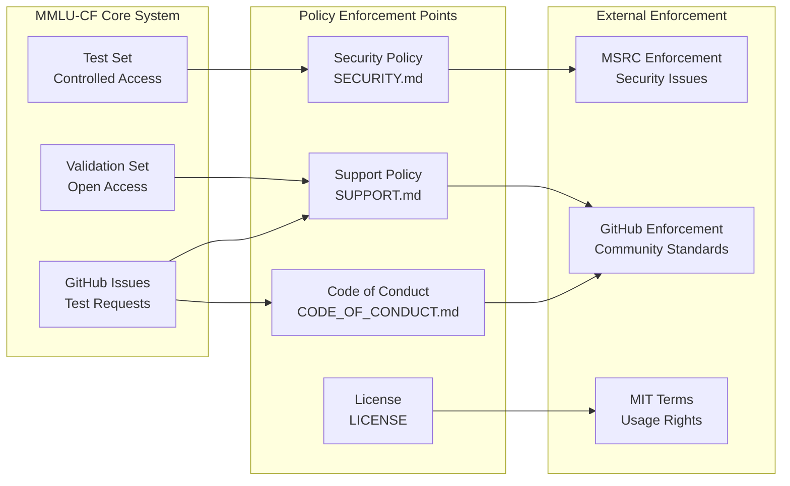

<!-- source: DeepWiki mcp.deepwiki.com · repo microsoft/MMLU-CF · page 6 Project Policies · fetched 2026-10-26 -->

# Project Policies

Relevant source files

The following files were used as context for generating this wiki page:

- [CODE_OF_CONDUCT.md](CODE_OF_CONDUCT.md)
- [LICENSE](LICENSE)
- [SECURITY.md](SECURITY.md)
- [SUPPORT.md](SUPPORT.md)

This document outlines the legal, security, and community policies that govern the MMLU-CF project. These policies establish the framework for project participation, security reporting, support processes, and licensing terms.

For technical integration details, see [Technical Integration](#4). For user evaluation processes, see [User Guide](#2).

## Policy Framework Overview

The MMLU-CF project operates under Microsoft's standard open source policy framework, which includes four key policy domains that govern project participation and usage.

### Policy Structure and File Organization

**Sources:** [SUPPORT.md:1-26](), [SECURITY.md:1-42](), [CODE_OF_CONDUCT.md:1-10](), [LICENSE:1-22]()

## Support and Community Engagement

The project uses a multi-channel support approach combining GitHub Issues for technical matters with Microsoft's Customer Service & Support infrastructure for broader inquiries.

### Support Channel Configuration

| Support Type | Channel | File Reference |
|--------------|---------|----------------|
| Bug Reports | GitHub Issues | [SUPPORT.md:15-17]() |
| Feature Requests | GitHub Issues | [SUPPORT.md:15-17]() |
| General Help | *To be configured* | [SUPPORT.md:19-21]() |
| Microsoft Support | CSS Intake Form | [SUPPORT.md:6]() |

The current support configuration is in a template state, with the maintainer needing to complete the setup process defined in [SUPPORT.md:3-9](). The support policy specifically limits assistance to the resources listed in the support documentation [SUPPORT.md:25]().

**Sources:** [SUPPORT.md:11-26]()

## Security Policy and Vulnerability Disclosure

The security framework follows Microsoft's standardized Coordinated Vulnerability Disclosure (CVD) process, managed through the Microsoft Security Response Center (MSRC).

### Security Reporting Workflow

### Required Vulnerability Information

The security policy requires specific information for effective vulnerability triage [SECURITY.md:19-28]():

- Issue type classification (buffer overflow, injection, XSS, etc.)
- Source file paths related to the vulnerability
- Affected source code location (tag/branch/commit/URL)
- Reproduction configuration requirements
- Step-by-step reproduction instructions
- Proof-of-concept or exploit code
- Impact assessment and exploitation scenarios

**Sources:** [SECURITY.md:1-42]()

## Community Standards and Code of Conduct

The project adopts Microsoft's Open Source Code of Conduct, establishing behavioral expectations for all participants.

### Code of Conduct Framework

The conduct policy is implemented through a three-tier resource structure:

1. **Primary Policy**: Microsoft Open Source Code of Conduct [CODE_OF_CONDUCT.md:3]()
2. **FAQ Resource**: Detailed guidance at `opensource.microsoft.com/codeofconduct/faq/` [CODE_OF_CONDUCT.md:8]()
3. **Contact Channel**: Direct communication via `opencode@microsoft.com` [CODE_OF_CONDUCT.md:9]()

This framework provides escalating levels of detail and support for community participants seeking clarification on behavioral standards.

**Sources:** [CODE_OF_CONDUCT.md:1-10]()

## Licensing Terms and Usage Rights

The project is licensed under the MIT License, providing broad usage permissions with minimal restrictions.

### License Grant Structure

The MIT License grants the following permissions [LICENSE:5-10]():

- **Use**: Unrestricted software usage
- **Modify**: Source code modification rights  
- **Publish**: Distribution permissions
- **Distribute**: Redistribution capabilities
- **Sublicense**: Secondary licensing authority
- **Sell**: Commercial usage rights

### License Obligations

The license requires two mandatory inclusions in all distributions [LICENSE:11-13]():

1. **Copyright Notice**: `Copyright (c) Microsoft Corporation.`
2. **License Text**: Complete MIT License terms

### Warranty Disclaimer

The license includes a comprehensive warranty disclaimer [LICENSE:15-21](), providing software "AS IS" without warranties of:

- **MERCHANTABILITY**: Fitness for commercial use
- **FITNESS FOR PURPOSE**: Suitability for specific applications  
- **NON-INFRINGEMENT**: Freedom from intellectual property conflicts

**Sources:** [LICENSE:1-22]()

## Policy Integration with Project Architecture

The policy framework integrates with the broader MMLU-CF system architecture through controlled access mechanisms and community engagement channels.

### Policy-Architecture Integration Points

The policy framework ensures that:

- **Validation Set** access is governed by support and conduct policies
- **Test Set** access is protected by security and conduct standards
- **GitHub Issues** workflow enforces community standards and support procedures
- **External enforcement** provides escalation paths for policy violations

**Sources:** [SUPPORT.md:15-17](), [SECURITY.md:10-11](), [CODE_OF_CONDUCT.md:3-9](), [LICENSE:5-10]()

---

