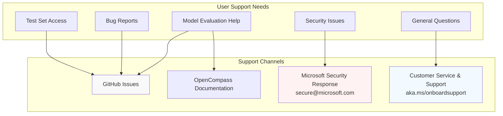
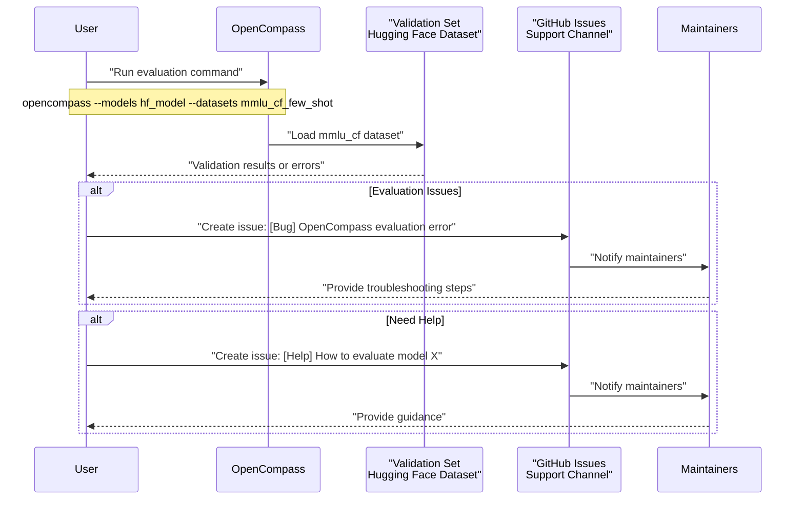
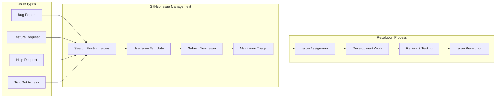
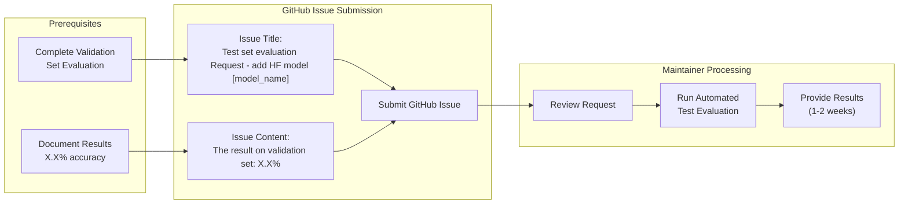
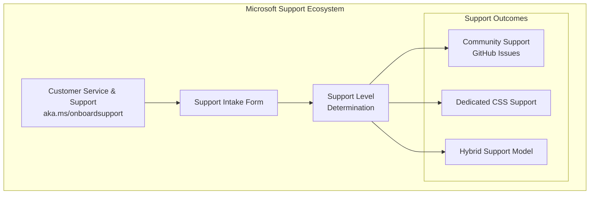

<!-- source: DeepWiki mcp.deepwiki.com · repo microsoft/MMLU-CF · page 6.1 Support and Help · fetched 2026-10-26 -->

# Support and Help

Relevant source files

The following files were used as context for generating this wiki page:

- [SUPPORT.md](SUPPORT.md)

This document explains how to get help, report issues, and engage with the MMLU-CF project community. It covers the various support channels available for different types of assistance, from model evaluation questions to technical issues and community engagement.

For information about security vulnerabilities, see [Security Policy](#6.2). For community standards and behavioral expectations, see [Code of Conduct](#6.3).

## Support Channels Overview

The MMLU-CF project provides multiple support pathways depending on your needs:

Sources: [SUPPORT.md:1-26]()

## Model Evaluation Support

### Getting Help with OpenCompass Integration

For assistance with model evaluation using the OpenCompass framework, the primary support pathway follows the standard evaluation workflow:

Sources: [SUPPORT.md:15-17]()

### Common Evaluation Support Topics

| Issue Type | GitHub Issue Template | Description |
|------------|----------------------|-------------|
| Evaluation Errors | `[Bug] OpenCompass evaluation failed for model X` | Technical issues during model evaluation |
| Configuration Help | `[Help] How to configure evaluation for model type Y` | Assistance with model-specific setup |
| Results Interpretation | `[Question] Understanding validation scores for model Z` | Help interpreting evaluation results |
| Performance Issues | `[Bug] Slow evaluation performance` | Performance-related problems |

Sources: [SUPPORT.md:15-17]()

## Issue Reporting and Bug Tracking

### GitHub Issues Workflow

All bug reports and feature requests are tracked through GitHub Issues. The repository uses issue templates to streamline the support process:

Sources: [SUPPORT.md:15-17]()

### Issue Filing Guidelines

Before filing a new issue:

1. **Search existing issues** to avoid duplicates
2. **Use appropriate issue templates** for consistent information gathering
3. **Provide detailed reproduction steps** for bugs
4. **Include environment information** (Python version, OpenCompass version, model details)

Sources: [SUPPORT.md:15-17]()

## Test Set Access Support

### Request Process for Closed Test Set

The test set access follows a controlled workflow through GitHub Issues:

Sources: [SUPPORT.md:15-17]()

### Test Set Request Requirements

| Requirement | Details |
|------------|---------|
| **Validation Results** | Must complete validation set evaluation first |
| **Issue Title Format** | `Test set evaluation Request - add HF model [model_name]` |
| **Results Documentation** | Include validation set accuracy: `The result on validation set: X.X%` |
| **Response Time** | 1-2 weeks for test set evaluation results |

Sources: [SUPPORT.md:15-17]()

## Microsoft Support Infrastructure

### Customer Service & Support

For general project support and onboarding assistance:

- **Support Portal**: [aka.ms/onboardsupport](https://aka.ms/onboardsupport)
- **Use Case**: General questions, project onboarding, non-technical support
- **Process**: Fill out intake form for CSS support determination

Sources: [SUPPORT.md:3-7]()

### Support Policy and Limitations

Microsoft's support for MMLU-CF is limited to the resources documented in this support framework. The project follows Microsoft's standard open-source support model:

- **Primary Support**: Community-driven through GitHub Issues
- **Secondary Support**: Microsoft CSS for qualifying cases
- **Security Support**: Microsoft Security Response Center (MSRC)
- **Code of Conduct**: Microsoft Open Source Code of Conduct

Sources: [SUPPORT.md:23-25]()

## Community Engagement Guidelines

### Best Practices for Getting Help

1. **Search First**: Check existing GitHub Issues and documentation
2. **Be Specific**: Provide clear, detailed descriptions of your issue
3. **Include Context**: Share relevant configuration, error messages, and environment details
4. **Follow Templates**: Use provided issue templates for consistency
5. **Be Patient**: Allow reasonable time for community response

### Contributing to Support

Community members can help improve support by:

- Answering questions in GitHub Issues
- Improving documentation based on common questions
- Reporting unclear or missing documentation
- Sharing successful evaluation configurations and tips

Sources: [SUPPORT.md:13-21]()

---

