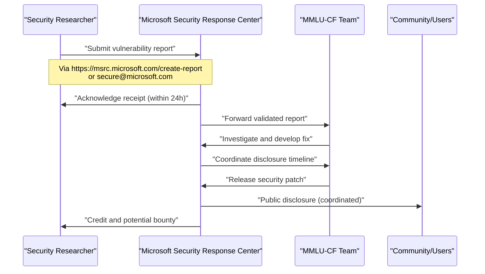
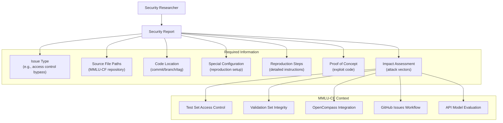

<!-- source: DeepWiki mcp.deepwiki.com · repo microsoft/MMLU-CF · page 6.2 Security Policy · fetched 2026-10-26 -->

# Security Policy

<details>
<summary>Relevant source files</summary>

The following files were used as context for generating this wiki page:

- [SECURITY.md](SECURITY.md)

</details>


This document outlines the security policy for the MMLU-CF project, including procedures for reporting security vulnerabilities and Microsoft's coordinated disclosure approach. This policy applies to all components of the MMLU-CF benchmark system, including the validation set, test set access controls, and evaluation infrastructure.

For general support and help with using MMLU-CF, see [Support and Help](#6.1). For community behavioral guidelines, see [Code of Conduct](#6.3).

## Security Vulnerability Reporting

Microsoft takes the security of the MMLU-CF project seriously as part of its broader commitment to secure software products and services. Security vulnerabilities in this repository must be reported through designated channels rather than public GitHub issues to ensure proper handling and coordinated disclosure.

### Reporting Channels

Security vulnerabilities should be reported through one of two primary channels:

| Channel | Contact Method | Purpose |
|---------|---------------|---------|
| Microsoft Security Response Center | [https://msrc.microsoft.com/create-report](https://msrc.microsoft.com/create-report) | Primary reporting portal with account login |
| Direct Email | [secure@microsoft.com](mailto:secure@microsoft.com) | Alternative reporting method without account requirement |

For email submissions, encryption using Microsoft's PGP key is recommended and can be downloaded from the Microsoft Security Response Center PGP Key page.

**Security Vulnerability Reporting Workflow**



Sources: [SECURITY.md:1-42]()

## Required Information for Security Reports

To ensure efficient triage and response, security reports should include comprehensive technical details about the vulnerability:

### Technical Details

- **Issue Type**: Classification such as buffer overflow, injection vulnerabilities, or access control issues
- **Source Files**: Full paths to affected files within the MMLU-CF repository
- **Code Location**: Specific tag, branch, commit hash, or direct URL to the vulnerable code
- **Configuration**: Any special setup required to reproduce the vulnerability
- **Reproduction Steps**: Detailed step-by-step instructions for vulnerability reproduction
- **Proof of Concept**: Exploit code or demonstration if available
- **Impact Assessment**: Analysis of potential attack vectors and security implications

### MMLU-CF Specific Considerations

For the MMLU-CF system, particular attention should be paid to:

- Test set access control mechanisms and potential bypass methods
- Validation set integrity and contamination prevention systems
- OpenCompass integration security boundaries
- GitHub Issues-based workflow vulnerabilities
- API model evaluation security concerns

**Security Information Flow**



Sources: [SECURITY.md:19-28]()

## Microsoft Security Response Process

Microsoft follows a structured approach to handling security vulnerabilities through the Microsoft Security Response Center (MSRC), which manages the entire lifecycle from initial report to public disclosure.

### Response Timeline

- **Initial Acknowledgment**: Response within 24 hours of report submission
- **Follow-up Communications**: Additional correspondence if initial response is not received
- **Investigation Period**: Variable duration based on vulnerability complexity
- **Coordinated Disclosure**: Timeline negotiated between MSRC and reporter

### Bug Bounty Program

Security researchers may be eligible for rewards through Microsoft's Bug Bounty Program. More comprehensive reports with detailed technical analysis and proof-of-concept code typically contribute to higher bounty awards.

**Microsoft Security Response Center Integration**

```mermaid
graph TD
    subgraph "External Reporting"
        WebPortal["MSRC Web Portal<br/>msrc.microsoft.com/create-report"]
        Email["Direct Email<br/>secure@microsoft.com"]
        PGP["PGP Encryption<br/>MSRC PGP Key"]
    end
    
    subgraph "MSRC Processing"
        Triage["Security Triage<br/>24-hour response"]
        Investigation["Vulnerability Investigation<br/>Technical analysis"]
        Coordination["Disclosure Coordination<br/>CVD process"]
    end
    
    subgraph "MMLU-CF Repository"
        SecurityMD["SECURITY.md<br/>Policy documentation"]
        Codebase["Repository code<br/>github.com/microsoft/MMLU-CF"]
        Issues["GitHub Issues<br/>Public discussion"]
    end
    
    subgraph "Response Actions"
        Patch["Security Patch<br/>Code fixes"]
        Disclosure["Public Disclosure<br/>Coordinated announcement"]
        Bounty["Bug Bounty<br/>Researcher rewards"]
    end
    
    WebPortal --> Triage
    Email --> Triage
    Email --> PGP
    
    Triage --> Investigation
    Investigation --> Coordination
    Coordination --> Patch
    Coordination --> Disclosure
    Coordination --> Bounty
    
    SecurityMD --> WebPortal
    Codebase --> Investigation
    Issues -.-> WebPortal
    
    Note over Issues: "Do NOT report<br/>security issues here"
```

Sources: [SECURITY.md:10-17](), [SECURITY.md:31-31]()

## Policy Framework

The MMLU-CF project operates under Microsoft's comprehensive security policy framework, which emphasizes coordinated vulnerability disclosure and responsible security practices.

### Coordinated Vulnerability Disclosure (CVD)

Microsoft follows the principle of Coordinated Vulnerability Disclosure, which balances the need for timely security fixes with responsible disclosure practices that protect users while allowing researchers to receive appropriate credit for their findings.

### Communication Standards

All security-related communications are conducted in English to ensure clear understanding and efficient processing by the Microsoft Security Response Center team.

### Prohibited Practices

- **Public Disclosure**: Security vulnerabilities must not be reported through public GitHub issues or other public forums
- **Premature Disclosure**: Vulnerabilities should not be publicly disclosed before coordinated disclosure timeline
- **Malicious Testing**: Security testing should not disrupt the MMLU-CF service or compromise user data

Sources: [SECURITY.md:35-39](), [SECURITY.md:11-11]()

## Integration with MMLU-CF Architecture

The security policy interfaces with several key components of the MMLU-CF system:

- **Test Set Protection**: Ensures the closed-source test set remains secure and inaccessible through unauthorized means
- **Validation Set Integrity**: Protects the open-source validation set from tampering or corruption
- **OpenCompass Integration**: Secures the evaluation framework integration points
- **GitHub Workflow**: Protects the Issues-based test set access control mechanism
- **API Model Support**: Ensures secure handling of API credentials and model interactions

This security framework supports the broader MMLU-CF mission of providing contamination-free evaluation by maintaining the integrity and security of all system components.

Sources: [SECURITY.md:1-42]()

---

