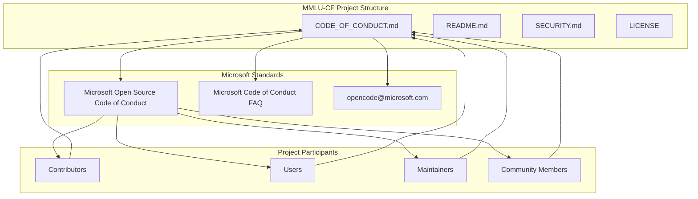
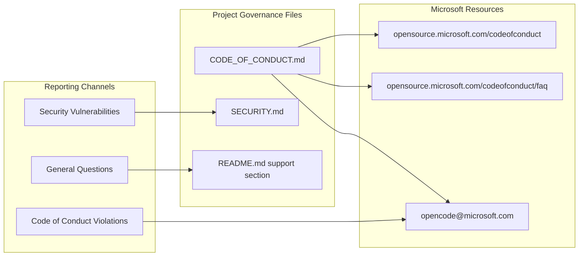
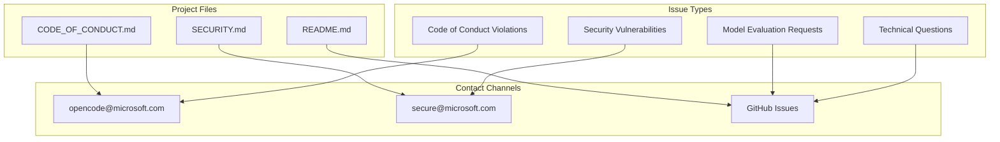

<!-- source: DeepWiki mcp.deepwiki.com · repo microsoft/MMLU-CF · page 6.3 Code of Conduct · fetched 2026-10-26 -->

# Code of Conduct

Relevant source files

The following files were used as context for generating this wiki page:

- [CODE_OF_CONDUCT.md](CODE_OF_CONDUCT.md)

This document outlines the community standards and behavioral expectations that govern participation in the MMLU-CF project. It establishes the framework for maintaining a respectful, inclusive, and productive collaborative environment for all contributors, users, and community members.

For information about security vulnerability reporting, see [Security Policy](#6.2). For general project support and help, see [Support and Help](#6.1).

## Microsoft Open Source Code of Conduct Adoption

The MMLU-CF project has adopted the Microsoft Open Source Code of Conduct as defined in [CODE_OF_CONDUCT.md:3](), which serves as the authoritative behavioral standard for all project interactions.

### Code of Conduct Framework

The project governance structure implements the Microsoft Open Source Code of Conduct through a standardized framework:

**Sources:** [CODE_OF_CONDUCT.md:1-10]()

### Governance Integration

The code of conduct integrates with the MMLU-CF project's governance structure through established communication channels and reporting mechanisms:

**Sources:** [CODE_OF_CONDUCT.md:7-9]()

## Resource Directory

The code of conduct implementation provides access to comprehensive resources for understanding and enforcing community standards:

| Resource Type | Location | Purpose |
|---------------|----------|---------|
| Primary Code of Conduct | `https://opensource.microsoft.com/codeofconduct/` | Complete behavioral guidelines |
| FAQ Documentation | `https://opensource.microsoft.com/codeofconduct/faq/` | Common questions and clarifications |
| Contact Email | `opencode@microsoft.com` | Questions, concerns, and violations |
| Local Reference | [CODE_OF_CONDUCT.md:1-10]() | Project-specific adoption statement |

**Sources:** [CODE_OF_CONDUCT.md:5-9]()

## Contact and Reporting

### Primary Contact Channel

All code of conduct related communications are handled through the designated Microsoft contact email `opencode@microsoft.com` as specified in [CODE_OF_CONDUCT.md:9](). This channel processes:

- Questions about code of conduct interpretation
- Concerns about potential violations
- Requests for clarification on behavioral expectations
- Reports of community standard violations

### Integration with Project Support Structure

The code of conduct reporting mechanism operates independently from but coordinates with other project support channels:

**Sources:** [CODE_OF_CONDUCT.md:9]()

## Enforcement Scope

The Microsoft Open Source Code of Conduct applies to all aspects of participation in the MMLU-CF project, including:

- Contributions to the codebase and documentation
- Interactions in GitHub issues and pull requests
- Community discussions and communications
- Use of evaluation services and test set access requests
- Participation in project-related forums and events

The enforcement mechanism operates through Microsoft's established open source governance framework, ensuring consistent application of community standards across all Microsoft open source projects.

**Sources:** [CODE_OF_CONDUCT.md:1-10]()

---

