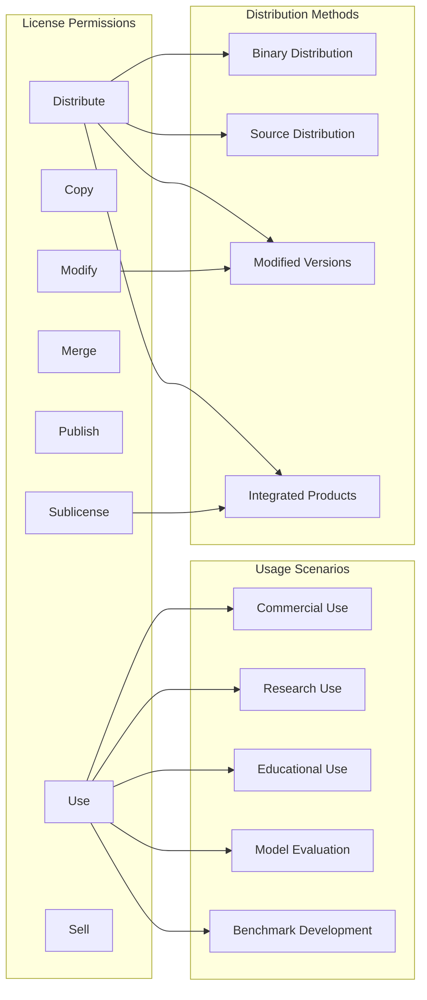
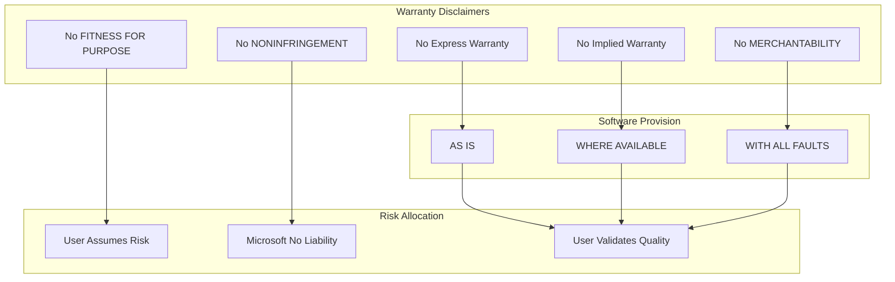
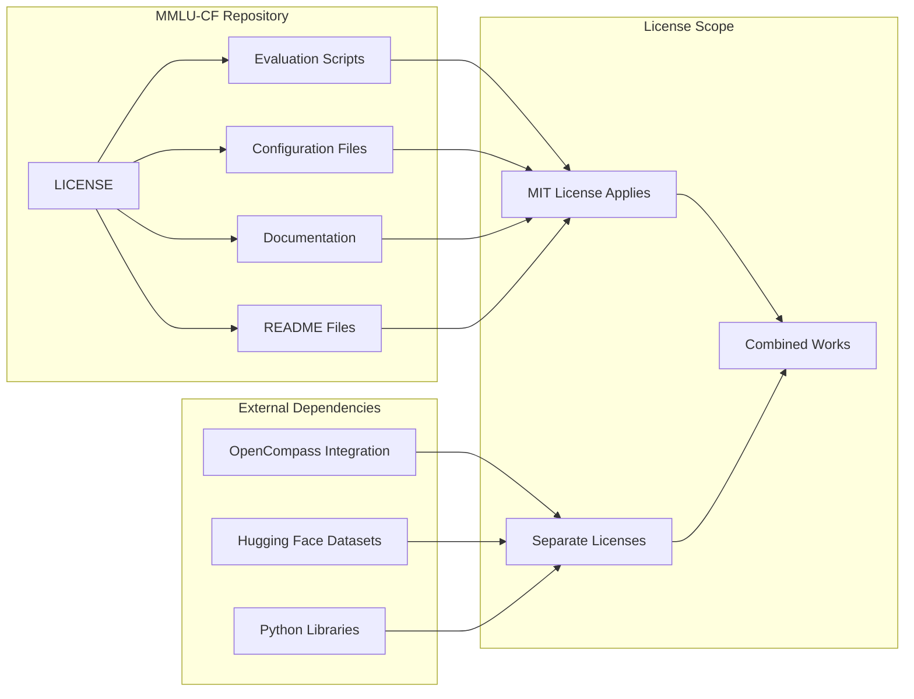

<!-- source: DeepWiki mcp.deepwiki.com · repo microsoft/MMLU-CF · page 6.4 License · fetched 2026-10-26 -->

# License

Relevant source files

The following files were used as context for generating this wiki page:

- [LICENSE](LICENSE)

This document covers the MIT License terms and conditions that govern the use, modification, and distribution of the MMLU-CF benchmark system. For information about project support and community guidelines, see [Support and Help](#6.1). For security-related matters, see [Security Policy](#6.2).

## License Overview

The MMLU-CF project is released under the MIT License, one of the most permissive open-source licenses available. This license grants broad permissions for commercial and non-commercial use while maintaining minimal restrictions and requirements.

### License Structure and Components

```mermaid
graph TB
    subgraph "License Coverage"
        LIC[LICENSE]
        SOFT["Software Components"]
        DOC["Documentation Files"]
        DATA["Dataset Components"]
    end
    
    subgraph "Permissions Granted"
        USE["Use"]
        MOD["Modify"] 
        DIST["Distribute"]
        SUB["Sublicense"]
        SELL["Sell"]
    end
    
    subgraph "Requirements"
        COPY["Copyright Notice"]
        PERM["Permission Notice"]
        INCL["Include in All Copies"]
    end
    
    subgraph "Disclaimers"
        WARR["No Warranty"]
        LIAB["No Liability"]
        ASIS["As-Is Provision"]
    end
    
    LIC --> SOFT
    LIC --> DOC
    LIC --> DATA
    
    LIC --> USE
    LIC --> MOD
    LIC --> DIST
    LIC --> SUB
    LIC --> SELL
    
    LIC --> COPY
    LIC --> PERM
    LIC --> INCL
    
    LIC --> WARR
    LIC --> LIAB
    LIC --> ASIS
```

Sources: [LICENSE:1-22]()

## Copyright and Ownership

The MMLU-CF project is owned by Microsoft Corporation, as specified in the copyright notice. All intellectual property rights are retained by Microsoft while granting extensive usage rights through the MIT License.

| Component | Copyright Holder | License Type |
|-----------|------------------|--------------|
| Source Code | Microsoft Corporation | MIT License |
| Documentation | Microsoft Corporation | MIT License |
| Dataset Components | Microsoft Corporation | MIT License |
| Configuration Files | Microsoft Corporation | MIT License |

Sources: [LICENSE:3]()

## Permissions and Rights

### Granted Permissions

The MIT License grants the following rights without restriction:

Sources: [LICENSE:5-10]()

### License Requirements

The only requirements imposed by the MIT License are the inclusion of copyright and permission notices:

- **Copyright Notice**: Must include the original copyright notice from Microsoft Corporation
- **Permission Notice**: Must include the full MIT License text
- **Scope**: Required in all copies or substantial portions of the software

Sources: [LICENSE:12-13]()

## Warranty and Liability Disclaimers

### No Warranty Clause

The MIT License explicitly disclaims all warranties, both express and implied:

Sources: [LICENSE:15-17]()

### Limitation of Liability

The license limits Microsoft's liability for any damages arising from software use:

| Liability Type | Coverage | Limitation |
|----------------|----------|------------|
| Contract Claims | Not covered | No liability |
| Tort Claims | Not covered | No liability |
| Direct Damages | Not covered | No liability |
| Indirect Damages | Not covered | No liability |
| Consequential Damages | Not covered | No liability |

Sources: [LICENSE:18-21]()

## License Application to MMLU-CF Components

### System Component Coverage

Sources: [LICENSE:1-22]()

### Usage Compliance Guidelines

To comply with the MIT License when using MMLU-CF:

1. **Include License Text**: Copy the complete license text from [LICENSE:1-22]() into distributions
2. **Preserve Copyright**: Maintain the Microsoft Corporation copyright notice [LICENSE:3]()
3. **Document Modifications**: While not required, documenting changes is recommended
4. **Understand Limitations**: Accept software "as-is" without warranty [LICENSE:15-17]()

The permissive nature of the MIT License makes MMLU-CF suitable for integration into both open-source and proprietary projects, research applications, and commercial products without licensing conflicts.

Sources: [LICENSE:1-22]()