# Page: MMLU-CF Overview

# MMLU-CF Overview

<details>
<summary>Relevant source files</summary>

The following files were used as context for generating this wiki page:

- [README.md](README.md)

</details>


## Purpose and Scope

This document provides an overview of the MMLU-CF (Contamination-free Multi-task Language Understanding) benchmark system, a comprehensive evaluation framework designed to address data contamination issues in Large Language Model (LLM) assessment. MMLU-CF serves as a contamination-free alternative to the widely-used MMLU benchmark, providing reliable evaluation results through controlled access mechanisms and decontamination processes.

For detailed instructions on evaluating models, see [Model Evaluation Process](#2.1). For technical implementation details, see [System Architecture](#3). For information about contamination prevention mechanisms, see [Contamination Prevention](#3.2).

## The Contamination Problem

The original MMLU benchmark suffers from data contamination where LLMs memorize answers during training, leading to inflated evaluation scores that do not reflect true reasoning capabilities. MMLU-CF addresses this critical issue through three key innovations:

| Problem | MMLU Impact | MMLU-CF Solution |
|---------|-------------|------------------|
| Open-source test data | LLMs memorize exact answers | Closed-source test set with controlled access |
| Training data leakage | Unreliable evaluation results | 3-stage decontamination pipeline |
| Lack of contamination detection | False performance claims | Validation/test set comparison analysis |

**Sources:** [README.md:23-33]()

## System Components Overview

MMLU-CF consists of three primary components that work together to ensure contamination-free evaluation:

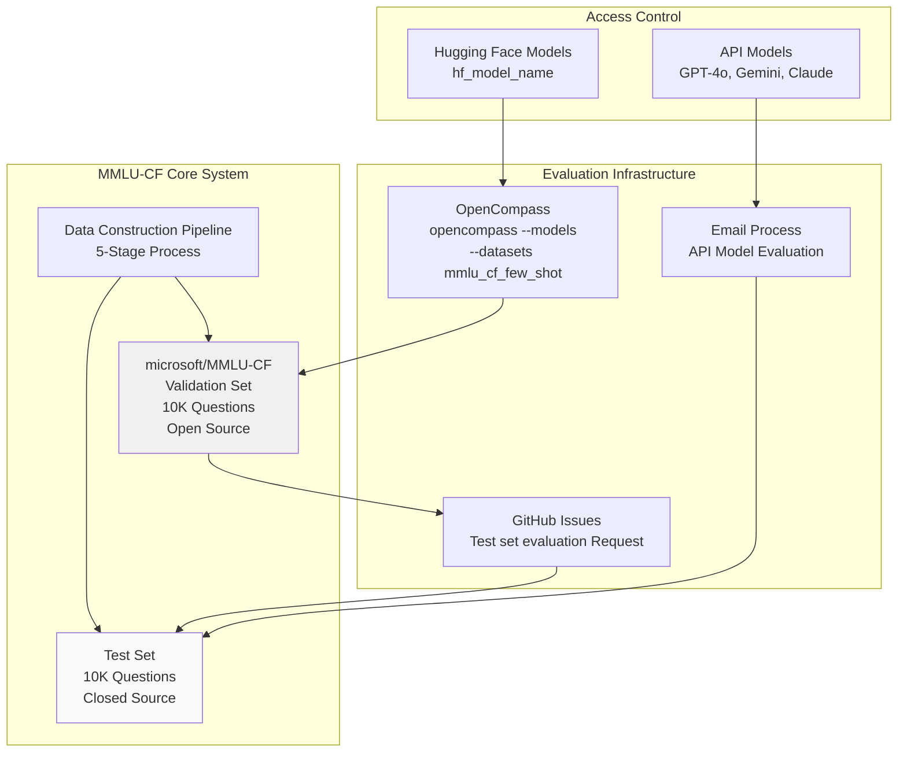

**MMLU-CF System Architecture**

**Sources:** [README.md:36-73](), [README.md:597-599]()

## Data Construction Pipeline

The system employs a rigorous 5-stage data construction process to ensure question quality and contamination prevention:

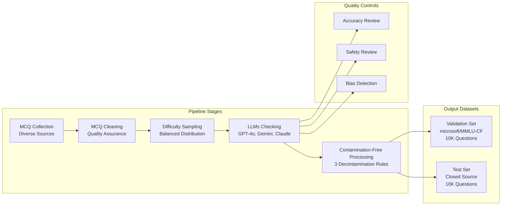

**Data Construction and Quality Control Pipeline**

**Sources:** [README.md:597-599]()

## Evaluation Workflow

MMLU-CF implements a two-tier evaluation system that separates validation testing from final assessment:

### Validation Set Evaluation

The validation set is publicly available through Hugging Face and can be evaluated using OpenCompass:

```bash
# 5-shot evaluation
opencompass --models hf_internlm2_5_1_8b_chat --datasets mmlu_cf_few_shot --summarizer mmlu_cf

# 0-shot evaluation  
opencompass --models hf_internlm2_5_1_8b_chat --datasets mmlu_cf_zero_shot --summarizer mmlu_cf
```

### Test Set Access Control

Test set evaluation requires a controlled access process:

1. **Hugging Face Models**: Submit GitHub issue with validation results
2. **API Models**: Email process with temporary key sharing
3. **Automated Processing**: 1-2 week turnaround for results

**Sources:** [README.md:40-72]()

## Key Differences from MMLU

| Aspect | MMLU | MMLU-CF |
|--------|------|---------|
| **Test Set Access** | Open source | Closed source with controlled access |
| **Contamination Prevention** | None | 3-stage decontamination rules |
| **Data Sources** | Limited scope | Broader domain coverage |
| **Quality Assurance** | Basic | Multi-LLM review process (GPT-4o, Gemini, Claude) |
| **Evaluation Tools** | Various | Standardized OpenCompass integration |
| **Result Reliability** | Potentially inflated | Contamination-free assessment |

The validation/test set comparison in the leaderboard demonstrates MMLU-CF's reliability - the small delta (Δ) values between validation and test performance indicate minimal contamination, unlike MMLU where test scores are often artificially inflated.

**Sources:** [README.md:75-82](), [README.md:86-595]()

## Performance Comparison

MMLU-CF reveals more realistic model capabilities compared to MMLU. For example:

- **GPT-4o**: MMLU 88.0% → MMLU-CF 73.4% (5-shot test)
- **Qwen2.5-72B**: MMLU 85.3% → MMLU-CF 71.6% (5-shot test)  
- **Llama-3-70B**: MMLU 82.0% → MMLU-CF 68.9% (5-shot test)

These reductions indicate the extent of contamination in MMLU and demonstrate MMLU-CF's effectiveness in providing unbiased evaluation metrics.

**Sources:** [README.md:86-595]()

## Integration Points

MMLU-CF integrates with several external systems:

- **Hugging Face Platform**: Hosts the validation dataset (`microsoft/MMLU-CF`)
- **OpenCompass Framework**: Provides standardized evaluation infrastructure
- **GitHub Issues**: Manages test set access requests
- **Microsoft Security**: Handles security policy and vulnerability reporting

For detailed integration information, see [OpenCompass Integration](#4.1) and [Technical Integration](#4).

**Sources:** [README.md:10-12](), [README.md:19](), [README.md:38-41]()

---

# Page: User Guide

# User Guide

<details>
<summary>Relevant source files</summary>

The following files were used as context for generating this wiki page:

- [README.md](README.md)

</details>


This document provides complete instructions for evaluating language models using the MMLU-CF benchmark system. It covers the step-by-step process for obtaining both validation and test set results, including the different pathways for Hugging Face models versus API models.

For information about the technical architecture and data construction process, see [System Architecture](#3). For details about contamination prevention mechanisms, see [Contamination Prevention](#3.2).

## Overview

MMLU-CF provides a two-tier evaluation system designed to prevent data contamination while enabling reliable model assessment:

- **Validation Set**: 10,000 open-source questions available via Hugging Face for initial model testing
- **Test Set**: 10,000 closed-source questions accessible only through controlled request processes

The system supports two distinct evaluation pathways depending on your model type and deployment method.

## Evaluation Pathways

### User Evaluation Workflow

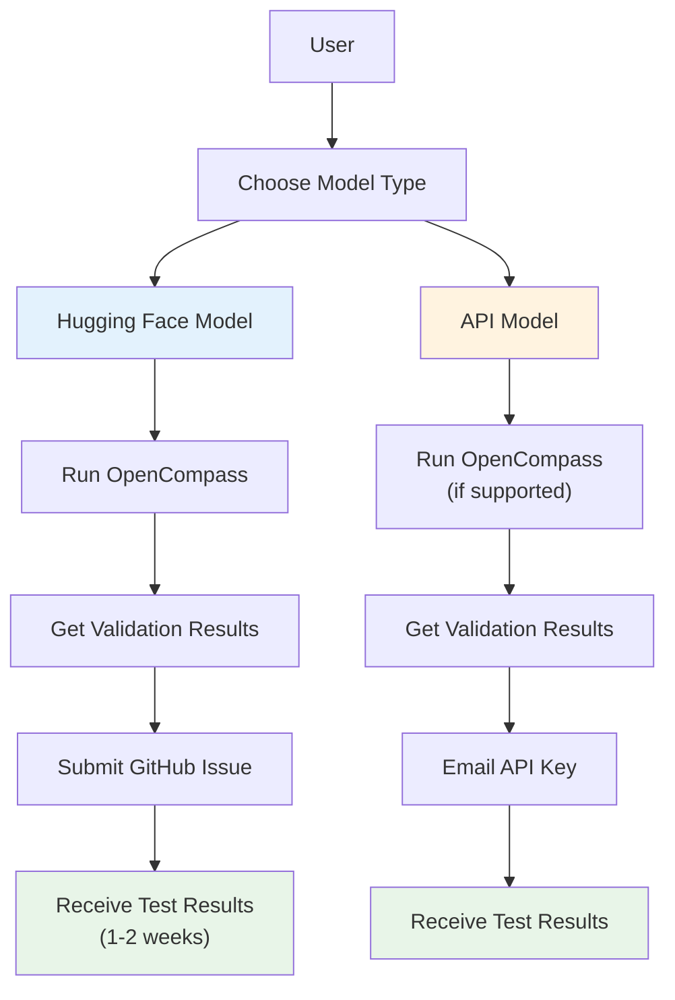

Sources: [README.md:36-73]()

### Model Type Decision Matrix

| Model Type | Access Method | Validation Process | Test Access Method | Timeline |
|------------|---------------|-------------------|-------------------|----------|
| Hugging Face Models | `hf_model_name` | OpenCompass automated | GitHub Issues | 1-2 weeks |
| API Models | API endpoints | OpenCompass (if supported) | Email process | Variable |

Sources: [README.md:38-72]()

## Hugging Face Model Evaluation

### Step 1: Validation Set Evaluation

Use OpenCompass to evaluate your model against the validation set. The system automatically loads the dataset from `microsoft/MMLU-CF` on Hugging Face.

#### 5-Shot Evaluation
```bash
opencompass --models hf_internlm2_5_1_8b_chat --datasets mmlu_cf_few_shot --summarizer mmlu_cf
```

#### 0-Shot Evaluation  
```bash
opencompass --models hf_internlm2_5_1_8b_chat --datasets mmlu_cf_zero_shot --summarizer mmlu_cf
```

#### OpenCompass Integration Components

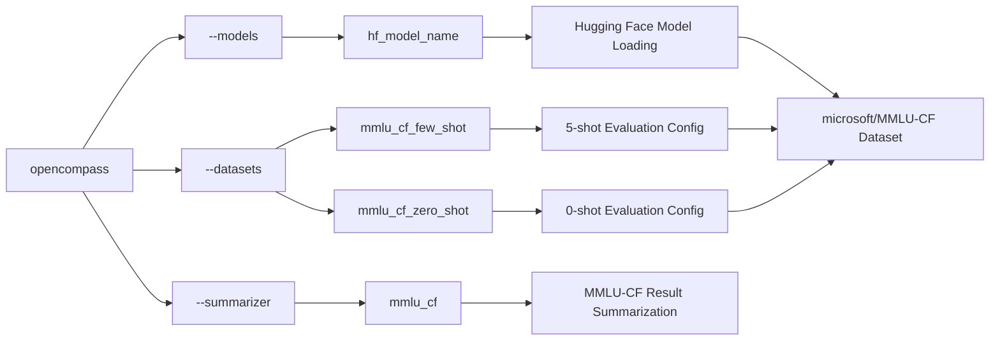

Sources: [README.md:40-52]()

### Step 2: Test Set Access Request

Submit a GitHub issue following the exact format requirements to request test set evaluation.

#### Required GitHub Issue Format

**Title Format:**
```
Test set evaluation Request - add HF model [model_name]
```

**Content Format:**
```
The result on validation set: X.X%
```

#### GitHub Issue Workflow

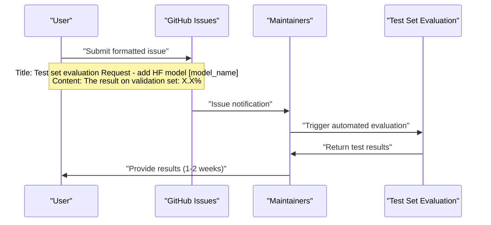

Sources: [README.md:54-71]()

#### Format Requirements

| Component | Requirement | Example |
|-----------|-------------|---------|
| Title | Use square brackets `[ ]` | `[microsoft/phi-4]` |
| Model Name | Exact Hugging Face identifier | `microsoft/phi-4` |
| Validation Result | Percentage format | `68.5%` |
| Timeline | Expect 1-2 weeks | Depends on evaluation queue |

Sources: [README.md:68-71]()

## API Model Evaluation

For API-based models (GPT-4o, Gemini, Claude), the evaluation process differs based on OpenCompass support availability.

### API Model Workflow

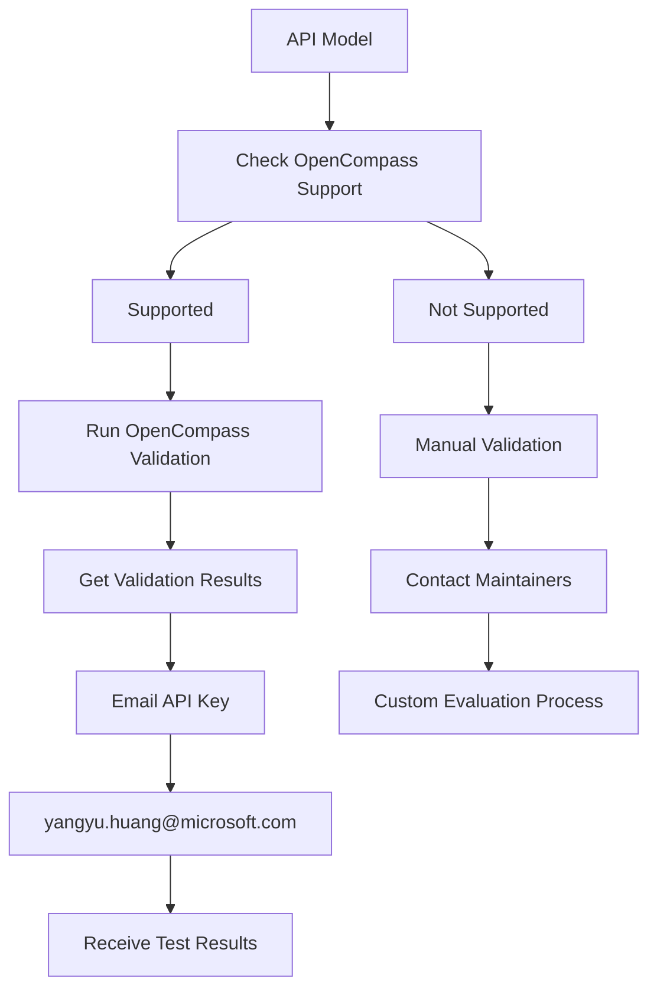

Sources: [README.md:72]()

### Email Process Requirements

| Component | Details |
|-----------|---------|
| Recipient | `yangyu.huang@microsoft.com` |
| Required | Validation set results |
| Required | Temporary API key |
| Purpose | Test set evaluation access |

Sources: [README.md:72]()

## Access Control Mechanisms

### Test Set Protection System

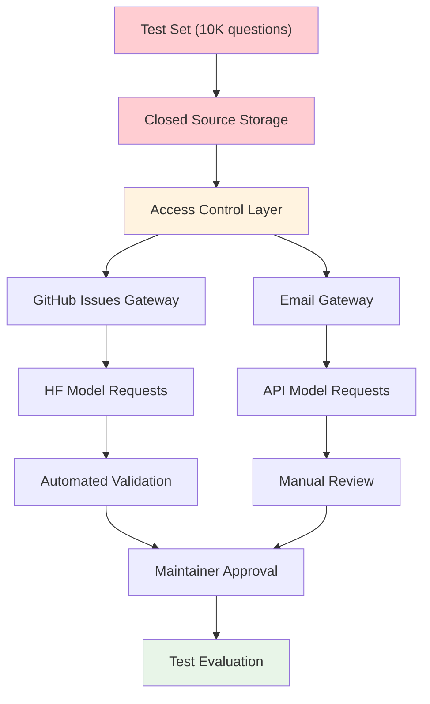

Sources: [README.md:76](), based on system architecture

### Validation vs Test Set Comparison

| Aspect | Validation Set | Test Set |
|--------|----------------|----------|
| Access | Open source via Hugging Face | Controlled access only |
| Size | 10,000 questions | 10,000 questions |
| Purpose | Initial model testing | Final evaluation |
| Automation | Fully automated | Request-based |
| Contamination Risk | Managed through guidelines | Prevented through access control |

Sources: [README.md:25-29](), [README.md:76]()

## Expected Results and Timeline

### Performance Expectations

The leaderboard shows typical performance gaps between MMLU and MMLU-CF, indicating the contamination-free nature of the benchmark:

| Model Category | MMLU Range | MMLU-CF Range | Typical Gap |
|----------------|------------|---------------|-------------|
| API Models | 71.4-88.0% | 58.2-73.4% | 10-15% lower |
| Large Models | 68.9-86.3% | 52.2-71.6% | 10-15% lower |
| Medium Models | 55.7-84.8% | 48.3-69.7% | 10-15% lower |

Sources: [README.md:86-595]()

### Timeline Expectations

| Process Stage | Timeline | Dependencies |
|---------------|----------|-------------|
| Validation Evaluation | Minutes-Hours | OpenCompass setup |
| GitHub Issue Submission | Immediate | Proper formatting |
| Test Result Delivery | 1-2 weeks | Evaluation queue |
| API Model Processing | Variable | Manual coordination |

Sources: [README.md:70]()

## Troubleshooting

### Common Issues

| Issue | Solution | Reference |
|-------|----------|-----------|
| OpenCompass command fails | Check model name format | Use exact HF identifier |
| GitHub issue rejected | Verify format requirements | Use square brackets `[ ]` |
| Missing validation results | Re-run OpenCompass evaluation | Ensure dataset loads correctly |
| Extended wait times | Contact maintainers | Check evaluation queue status |

### Contact Information

For technical issues or inquiries:
- **Primary Contact**: Qihao Zhao (`qhzhaoo@gmail.com`)
- **API Model Issues**: Yangyu Huang (`yanghuan@microsoft.com`)

Sources: [README.md:602]()

---

# Page: Model Evaluation Process

# Model Evaluation Process

<details>
<summary>Relevant source files</summary>

The following files were used as context for generating this wiki page:

- [README.md](README.md)

</details>


This document provides step-by-step instructions for evaluating Large Language Models using the MMLU-CF benchmark system. It covers the complete workflow from initial validation set testing through final test set results, including the specific commands, formats, and procedures required for both Hugging Face models and API models.

For information about the different model types and their technical requirements, see [Supported Model Types](#2.2). For details about the underlying system architecture, see [System Architecture](#3).

## Evaluation Workflow Overview

The MMLU-CF evaluation process follows a two-stage approach designed to maintain test set integrity while providing users with immediate feedback on model performance.

### Two-Stage Evaluation Architecture

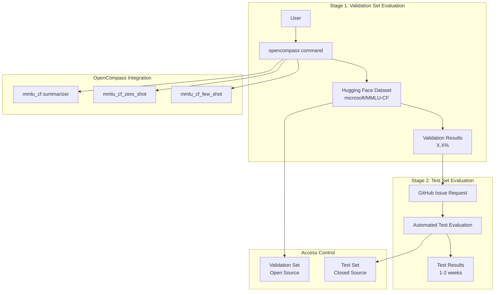

Sources: [README.md:36-74]()

## Stage 1: Validation Set Evaluation

The validation set evaluation provides immediate feedback on model performance using the publicly available MMLU-CF validation dataset. This stage uses the OpenCompass evaluation framework with specific dataset configurations.

### OpenCompass Command Structure

| Evaluation Type | Dataset Configuration | Command Example |
|----------------|----------------------|------------------|
| 5-shot | `mmlu_cf_few_shot` | `opencompass --models hf_internlm2_5_1_8b_chat --datasets mmlu_cf_few_shot --summarizer mmlu_cf` |
| 0-shot | `mmlu_cf_zero_shot` | `opencompass --models hf_internlm2_5_1_8b_chat --datasets mmlu_cf_zero_shot --summarizer mmlu_cf` |

### Validation Evaluation Technical Flow

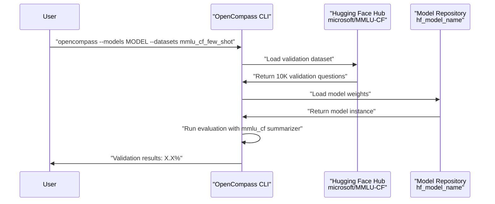

Sources: [README.md:40-52]()

### Required Components

- **Model Specification**: Hugging Face model identifier (e.g., `hf_internlm2_5_1_8b_chat`)
- **Dataset Configuration**: Either `mmlu_cf_few_shot` or `mmlu_cf_zero_shot`
- **Summarizer**: `mmlu_cf` for proper result formatting
- **Data Source**: Automatic loading from `microsoft/MMLU-CF` Hugging Face dataset

## Stage 2: Test Set Evaluation

Test set evaluation requires submitting a GitHub issue with validation results to access the protected test set. This process maintains test set integrity through controlled access.

### GitHub Issue Submission Process

The test set evaluation follows a specific GitHub issue format that triggers automated processing:

```mermaid
flowchart LR
    subgraph "Issue Requirements"
        T1["Title Format:<br/>Test set evaluation Request - add HF model [model_name]"]
        C1["Content Format:<br/>The result on validation set: X.X%"]
    end
    
    subgraph "Processing Pipeline"
        GH["GitHub Issues API"]
        AUTO["Automated Test Runner"]
        TEST["Test Set Evaluation<br/>10K questions"]
    end
    
    subgraph "Model Identification"
        HF_ID["HuggingFace Model ID<br/>microsoft/phi-4"]
        BRACKET["Square Bracket Format<br/>[model_name]"]
    end
    
    T1 --> GH
    C1 --> GH
    HF_ID --> BRACKET
    BRACKET --> T1
    GH --> AUTO
    AUTO --> TEST
    TEST --> "Results (1-2 weeks)"
```

Sources: [README.md:54-71]()

### Issue Format Specification

**Title Template**:
```
Test set evaluation Request - add HF model [microsoft/phi-4]
```

**Content Template**:
```
The result on validation set: 68.5%
```

### Critical Format Requirements

- **Square Brackets**: Model name must be enclosed in `[ ]` brackets
- **HuggingFace ID**: Use exact HuggingFace repository name (e.g., `microsoft/phi-4`)
- **Validation Score**: Include precise percentage from validation evaluation
- **Processing Time**: Expect 1-2 weeks for automated test evaluation

## Model Type-Specific Pathways

### Hugging Face Models

Hugging Face models follow the standard two-stage process with full automation support:

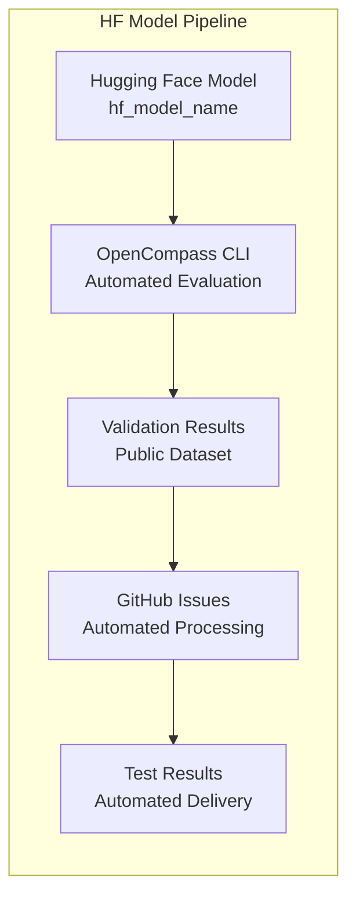

### API Models

API models require manual coordination through email communication due to interface limitations:

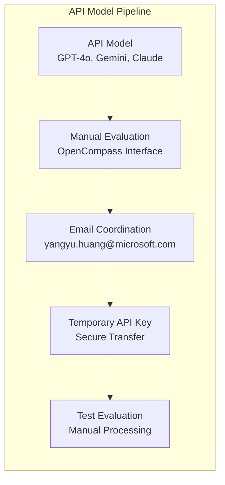

Sources: [README.md:72]()

## Timeline and Processing Expectations

### Standard Processing Timeline

| Stage | Process | Expected Duration |
|-------|---------|------------------|
| Validation | OpenCompass evaluation | Minutes to hours |
| Issue submission | GitHub issue creation | Immediate |
| Test evaluation | Automated processing | 1-2 weeks |
| Result delivery | Automated notification | Upon completion |

### Factors Affecting Processing Time

- **Queue Length**: Number of models currently being evaluated
- **Model Size**: Computational requirements for evaluation
- **System Load**: Available computational resources
- **Validation**: Manual review of results if needed

Sources: [README.md:70-71]()

## Command Reference

### Complete Command Examples

**5-shot Evaluation**:
```bash
opencompass --models hf_internlm2_5_1_8b_chat --datasets mmlu_cf_few_shot --summarizer mmlu_cf
```

**0-shot Evaluation**:
```bash
opencompass --models hf_internlm2_5_1_8b_chat --datasets mmlu_cf_zero_shot --summarizer mmlu_cf
```

### Parameter Specifications

- `--models`: Hugging Face model identifier with `hf_` prefix
- `--datasets`: Either `mmlu_cf_few_shot` or `mmlu_cf_zero_shot`
- `--summarizer`: Must be `mmlu_cf` for proper result formatting

Sources: [README.md:42-52]()

---

# Page: Supported Model Types

# Supported Model Types

<details>
<summary>Relevant source files</summary>

The following files were used as context for generating this wiki page:

- [README.md](README.md)

</details>


This document describes the different types of models that can be evaluated using the MMLU-CF benchmark system and their respective evaluation pathways. MMLU-CF supports two primary model categories: Hugging Face models and API-based models, each with distinct evaluation processes and access controls.

For step-by-step evaluation instructions, see [Model Evaluation Process](#2.1). For technical details about OpenCompass integration, see [OpenCompass Integration](#4.1).

## Model Type Categories

MMLU-CF supports evaluation of two fundamental model types, each requiring different evaluation workflows and access mechanisms.

### Hugging Face Models

Hugging Face models represent the primary supported model type for automated evaluation. These models are hosted on the Hugging Face platform and can be directly integrated with the OpenCompass evaluation framework.

**Key Characteristics:**
- Automated testing capability through OpenCompass integration
- Direct access to validation set via Hugging Face dataset loading
- GitHub Issues-based workflow for test set evaluation
- Support for both 5-shot and 0-shot evaluation modes

**Evaluation Commands:**
- 5-shot evaluation: `opencompass --models hf_model_name --datasets mmlu_cf_few_shot --summarizer mmlu_cf`
- 0-shot evaluation: `opencompass --models hf_model_name --datasets mmlu_cf_zero_shot --summarizer mmlu_cf`

### API Models

API models include commercial language models accessible through APIs such as OpenAI's GPT series, Google's Gemini, and Anthropic's Claude. These models require special handling due to their API-based nature.

**Key Characteristics:**
- Requires OpenCompass API interface updates for compatibility
- Email-based workflow for test set evaluation requests
- Temporary API key sharing for evaluation access
- Support for major commercial model providers

**Supported API Models:**
- GPT-4o, GPT-4-Turbo, GPT-4o-mini
- Gemini-1.5-Flash
- GPT-3.5-Turbo
- Claude (various versions)

Sources: [README.md:38-73]()

## Model Size Categories

The MMLU-CF leaderboard organizes models into size-based categories to facilitate performance comparison across similar model scales.

| Category | Parameter Range | Example Models |
|----------|----------------|----------------|
| **API** | Variable | `GPT-4o`, `GPT-4-Turbo`, `Gemini-1.5-Flash` |
| **Large** | 70B+ parameters | `Qwen2.5-72B-instruct`, `Llama-3-70B-instruct` |
| **Medium** | 13B-34B parameters | `Qwen2.5-32B-instruct`, `Phi-4-14B` |
| **Small** | 6B-9B parameters | `Qwen2.5-7B-instruct`, `Llama-3-8B-instruct` |
| **Mini** | <4B parameters | `Phi-3-mini-instruct`, `Qwen2.5-1.5B-instruct` |

Sources: [README.md:86-595]()

## Evaluation Pathway Architecture

The following diagram illustrates how different model types flow through the MMLU-CF evaluation system:

**Model Type Evaluation Pathways**
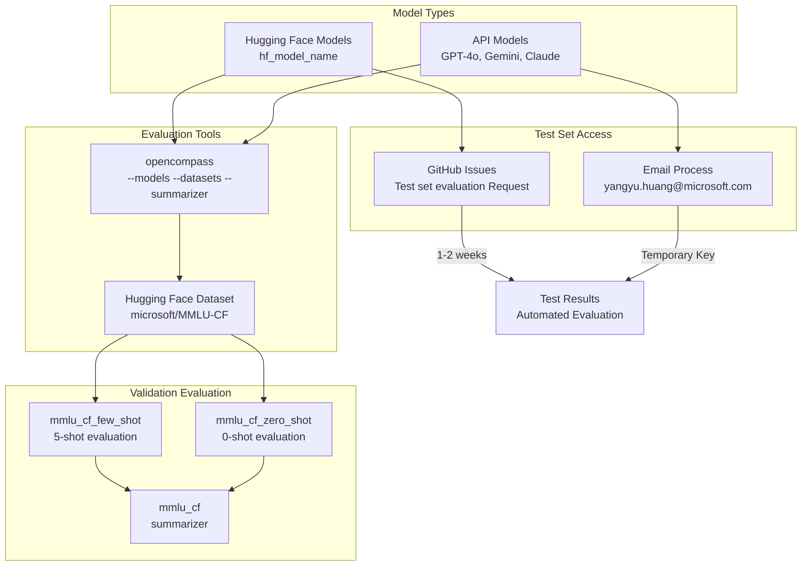

Sources: [README.md:38-73]()

## Model Identifier Format

Different model types use specific identifier formats within the MMLU-CF evaluation system:

**Hugging Face Model Identifiers**
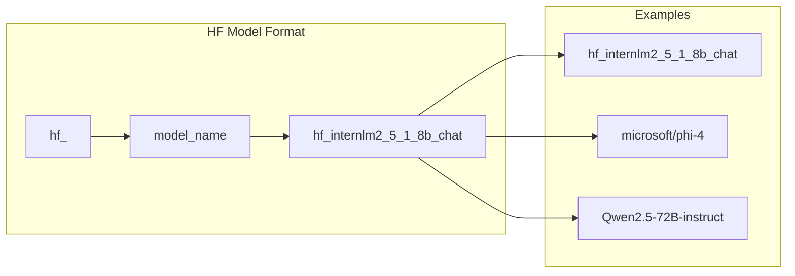

**GitHub Issue Format for HF Models:**
- Title: `Test set evaluation Request - add HF model [model_name]`
- Content: `The result on validation set: X.X%`
- Model name format: `microsoft/phi-4` (HuggingFace repository path)

Sources: [README.md:54-71]()

## Evaluation Mode Support

Both model types support multiple evaluation modes with different prompting strategies:

### 5-Shot Evaluation
- Dataset identifier: `mmlu_cf_few_shot`
- Provides 5 example questions before the target question
- Generally yields higher performance scores

### 0-Shot Evaluation  
- Dataset identifier: `mmlu_cf_zero_shot`
- No example questions provided
- Tests pure model capabilities without examples

**Evaluation Mode Architecture**
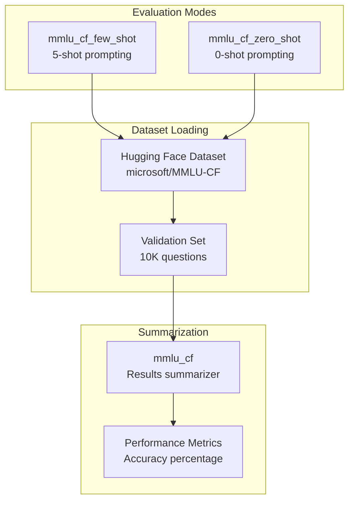

Sources: [README.md:42-52]()

## Access Control Mechanisms

The MMLU-CF system implements different access control mechanisms based on model type:

### Hugging Face Models
- **Validation Set**: Open access via Hugging Face datasets
- **Test Set**: Controlled access via GitHub Issues workflow
- **Automation**: Fully automated evaluation pipeline
- **Timeline**: 1-2 weeks for test results

### API Models
- **Validation Set**: OpenCompass API interface (when available)
- **Test Set**: Email-based request with temporary API key sharing
- **Manual Process**: Requires human coordination for API access
- **Flexibility**: Accommodates API interface updates

Sources: [README.md:68-72]()

## Technical Requirements

### For Hugging Face Models
- OpenCompass installation and configuration
- Access to Hugging Face model repositories
- GitHub account for test set evaluation requests
- Model name must follow HuggingFace repository format

### For API Models
- Valid API credentials for the target model service
- OpenCompass API interface compatibility
- Email communication for test set evaluation coordination
- Temporary API key sharing capability

Sources: [README.md:38-73]()

---

# Page: System Architecture

# System Architecture

<details>
<summary>Relevant source files</summary>

The following files were used as context for generating this wiki page:

- [Figures/Fig_5.png](Figures/Fig_5.png)
- [Figures/Fig_6.png](Figures/Fig_6.png)
- [README.md](README.md)

</details>


This document provides a technical overview of the MMLU-CF system architecture, focusing on the core components, data pipeline, and evaluation infrastructure that enable contamination-free benchmark evaluation of Large Language Models.

For detailed information about the data construction process, see [Data Construction Pipeline](#3.1). For contamination prevention mechanisms, see [Contamination Prevention](#3.2). For integration details with OpenCompass, see [OpenCompass Integration](#4.1).

## Core System Components

The MMLU-CF system consists of several interconnected components designed to prevent data contamination while providing reliable model evaluation capabilities.

### System Component Architecture

```mermaid
graph TB
    subgraph "Data Assets"
        VS[microsoft/MMLU-CF<br/>"Validation Set<br/>10K Questions"]
        TS["Test Set<br/>10K Questions<br/>Closed Source"]
    end
    
    subgraph "Evaluation Infrastructure" 
        OC["OpenCompass<br/>mmlu_cf_few_shot<br/>mmlu_cf_zero_shot"]
        GH["GitHub Issues<br/>Test Evaluation Requests"]
        EMAIL["Email Process<br/>yangyu.huang@microsoft.com"]
    end
    
    subgraph "Model Integration Points"
        HF["Hugging Face Models<br/>hf_model_name"]
        API["API Models<br/>GPT-4o, Gemini, Claude"]
    end
    
    subgraph "Access Control"
        AUTO["Automated Evaluation<br/>1-2 weeks processing"]
        MANUAL["Manual Request Processing<br/>GitHub Issue Format"]
    end
    
    HF --> OC
    API --> EMAIL
    OC --> VS
    EMAIL --> VS
    VS --> GH
    GH --> MANUAL
    MANUAL --> AUTO
    AUTO --> TS
    EMAIL --> TS
    
    style TS fill:#f9f9f9
    style VS fill:#f0f8ff
    style OC fill:#fff8dc
```

Sources: [README.md:38-72]()

## Data Flow Architecture

The system implements a two-tier access model where validation results gate access to test evaluation, ensuring controlled usage of the closed-source test set.

### Evaluation Data Flow

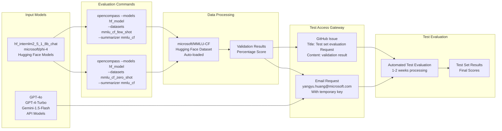

Sources: [README.md:40-72]()

## Evaluation Workflow Components

The system supports two distinct evaluation pathways based on model type, each with specific integration requirements and access protocols.

### Model Type Processing Matrix

| Model Type | Evaluation Tool | Dataset Access | Test Set Access | Processing Time |
|------------|----------------|----------------|-----------------|-----------------|
| Hugging Face Models | `opencompass` | Automatic via HF | GitHub Issues | 1-2 weeks |
| API Models | `opencompass` + Email | Manual coordination | Email + temp key | 1-2 weeks |

### Command Interface Specifications

The system exposes evaluation capabilities through standardized OpenCompass commands:

**5-shot Evaluation:**
```bash
opencompass --models hf_internlm2_5_1_8b_chat --datasets mmlu_cf_few_shot --summarizer mmlu_cf
```

**0-shot Evaluation:**
```bash
opencompass --models hf_internlm2_5_1_8b_chat --datasets mmlu_cf_zero_shot --summarizer mmlu_cf
```

Sources: [README.md:42-52]()

## Access Control Architecture

The system implements a controlled access mechanism to maintain test set integrity while enabling legitimate research evaluation.

### GitHub Issues Workflow

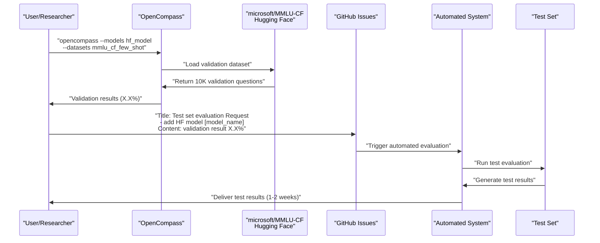

### Access Control Rules

1. **Validation Prerequisite**: Test set access requires validation results
2. **Format Enforcement**: GitHub issue titles must use `[model_name]` bracket format
3. **HuggingFace Verification**: Model names must correspond to valid HF repository names
4. **Processing Queue**: Automated system processes requests with 1-2 week turnaround

Sources: [README.md:54-71]()

## Integration Points

The system integrates with external platforms and tools to provide comprehensive evaluation capabilities.

### External System Dependencies

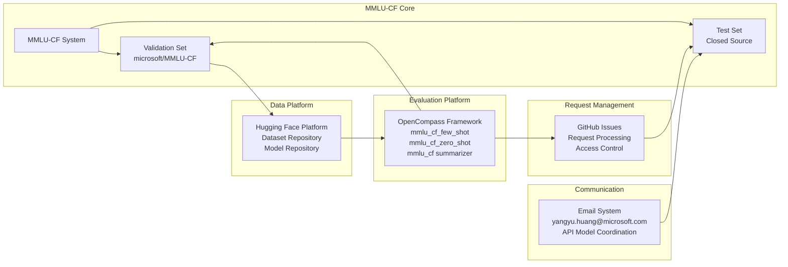

### Dataset Integration Specifications

- **Dataset Identifier**: `microsoft/MMLU-CF`
- **OpenCompass Datasets**: `mmlu_cf_few_shot`, `mmlu_cf_zero_shot`  
- **Summarizer Component**: `mmlu_cf`
- **Auto-loading**: Validation set loaded automatically from Hugging Face during evaluation

Sources: [README.md:19, 40-46]()

## Contamination Prevention Architecture

The system implements multiple layers of contamination prevention to ensure evaluation reliability.

### Data Integrity Safeguards

1. **Closed Source Test Set**: 10K questions kept in controlled environment
2. **Validation Gate**: Public validation set (10K questions) serves as access prerequisite  
3. **Controlled Access Protocol**: GitHub Issues workflow prevents unauthorized test set access
4. **Processing Delay**: 1-2 week evaluation window prevents real-time exploitation
5. **Format Validation**: Standardized request format ensures legitimate research usage

The architecture demonstrates significant performance gaps between MMLU and MMLU-CF scores, indicating successful contamination prevention in the original MMLU benchmark.

Sources: [README.md:27-29, 76-77]()

---

# Page: Data Construction Pipeline

# Data Construction Pipeline

<details>
<summary>Relevant source files</summary>

The following files were used as context for generating this wiki page:

- [README.md](README.md)

</details>


This page documents the technical implementation of MMLU-CF's 5-stage data construction pipeline that creates contamination-free evaluation datasets. The pipeline processes multiple-choice questions through quality assurance, difficulty balancing, LLM validation, and decontamination processing to produce reliable benchmark data.

For information about how contamination prevention works, see [Contamination Prevention](#3.2). For details about the overall system architecture, see [System Architecture](#3).

## Pipeline Overview

The MMLU-CF data construction pipeline implements a systematic 5-stage process designed to address the fundamental contamination problem in existing benchmarks like MMLU, where LLMs can memorize training data and achieve artificially inflated scores.

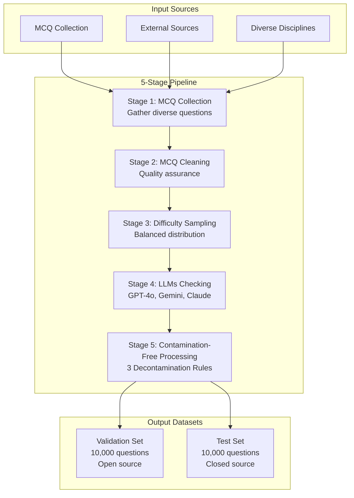

**Sources: [README.md:597-599]()**

## Stage 1: MCQ Collection

The initial stage gathers multiple-choice questions from diverse academic and professional domains to ensure comprehensive coverage across disciplines. This stage focuses on breadth and variety to create a robust foundation for the benchmark.

| Collection Criteria | Description |
|-------------------|-------------|
| **Domain Coverage** | Questions span various academic disciplines and professional fields |
| **Question Types** | Multiple-choice format with 4-option answers |
| **Source Diversity** | External sources beyond traditional academic materials |
| **Scope** | Broad collection to enable effective sampling in later stages |

## Stage 2: MCQ Cleaning

Quality assurance processing removes low-quality questions and ensures consistency across the dataset. This stage implements systematic filtering to maintain high data quality standards.

```mermaid
flowchart LR
    subgraph "Quality Filters"
        QF1["Accuracy Review"]
        QF2["Format Validation"] 
        QF3["Content Standards"]
        QF4["Answer Verification"]
    end
    
    INPUT["Raw MCQ Data"] --> QF1
    QF1 --> QF2
    QF2 --> QF3
    QF3 --> QF4
    QF4 --> OUTPUT["Cleaned MCQ Data"]
```

**Sources: [README.md:597-599]()**

## Stage 3: Difficulty Sampling

This stage ensures appropriate difficulty distribution across the final dataset to create a balanced evaluation benchmark that accurately reflects model capabilities across different skill levels.

| Sampling Dimension | Implementation |
|-------------------|----------------|
| **Difficulty Levels** | Balanced distribution across easy, medium, and hard questions |
| **Subject Balance** | Proportional representation across academic disciplines |
| **Complexity Metrics** | Question complexity analysis for appropriate sampling |
| **Distribution Control** | Statistical sampling to achieve target distributions |

## Stage 4: LLMs Checking

Multiple state-of-the-art language models perform accuracy and safety validation on the curated questions. This stage provides automated quality control through ensemble model review.

```mermaid
flowchart TD
    subgraph "LLM Validators"
        GPT4["GPT-4o<br/>Accuracy Review"]
        GEMINI["Gemini<br/>Content Validation"]
        CLAUDE["Claude<br/>Safety Assessment"]
    end
    
    subgraph "Review Criteria"
        ACC["Accuracy Review"]
        SAFETY["Safety Review"]
        BIAS["Bias Detection"]
    end
    
    INPUT_Q["Sampled Questions"] --> GPT4
    INPUT_Q --> GEMINI
    INPUT_Q --> CLAUDE
    
    GPT4 --> ACC
    GEMINI --> ACC
    CLAUDE --> SAFETY
    GPT4 --> BIAS
    GEMINI --> BIAS
    
    ACC --> VALIDATED["Validated Questions"]
    SAFETY --> VALIDATED
    BIAS --> VALIDATED
```

**Sources: [README.md:597-599]()**

## Stage 5: Contamination-Free Processing

The final stage implements three decontamination rules to prevent data leakage and ensure the benchmark maintains evaluation integrity. This stage addresses the core contamination problem that affects existing benchmarks.

### Decontamination Rules

The pipeline applies three systematic decontamination rules to prevent unintentional data leakage:

| Rule Type | Purpose | Implementation |
|-----------|---------|----------------|
| **Rule 1** | Prevents direct question memorization | Content transformation and validation |
| **Rule 2** | Eliminates answer pattern leakage | Answer distribution analysis |
| **Rule 3** | Ensures topic isolation** | Cross-reference checking with known datasets |

### Contamination Prevention Mechanism

```mermaid
flowchart TB
    subgraph "Decontamination Process"
        RULE1["Rule 1: Content Transformation<br/>Prevent direct memorization"]
        RULE2["Rule 2: Answer Pattern Analysis<br/>Eliminate pattern leakage"] 
        RULE3["Rule 3: Cross-Reference Checking<br/>Ensure topic isolation"]
    end
    
    subgraph "Validation Checks"
        CHECK1["LLM Memory Test"]
        CHECK2["Pattern Detection"]
        CHECK3["Dataset Comparison"]
    end
    
    INPUT_VAL["Validated Questions"] --> RULE1
    RULE1 --> RULE2
    RULE2 --> RULE3
    
    RULE1 --> CHECK1
    RULE2 --> CHECK2
    RULE3 --> CHECK3
    
    CHECK1 --> FINAL["Contamination-Free Dataset"]
    CHECK2 --> FINAL
    CHECK3 --> FINAL
```

**Sources: [README.md:76-77](), [README.md:597-599]()**

## Quality Control Integration

The pipeline integrates multiple quality control mechanisms throughout the process to ensure data integrity and benchmark reliability.

| QA Component | Stage Integration | Validation Method |
|--------------|------------------|-------------------|
| **Accuracy Review** | Stage 2, 4 | Manual review + LLM validation |
| **Safety Review** | Stage 4 | Multi-model safety assessment |
| **Bias Detection** | Stage 4 | Automated bias analysis |
| **Contamination Check** | Stage 5 | Decontamination rule enforcement |

## Output Specifications

The pipeline produces two distinct dataset outputs with controlled access patterns to maintain benchmark integrity.

### Dataset Splits

```mermaid
graph LR
    subgraph "Pipeline Output"
        PIPELINE["Contamination-Free Processing"]
    end
    
    subgraph "Validation Dataset"
        VAL_SET["10,000 Questions<br/>Open Source<br/>Hugging Face"]
        VAL_ACCESS["Public Access<br/>Initial Testing"]
    end
    
    subgraph "Test Dataset"  
        TEST_SET["10,000 Questions<br/>Closed Source<br/>Private Repository"]
        TEST_ACCESS["Controlled Access<br/>GitHub Issues"]
    end
    
    PIPELINE --> VAL_SET
    PIPELINE --> TEST_SET
    VAL_SET --> VAL_ACCESS
    TEST_SET --> TEST_ACCESS
```

### Technical Specifications

| Dataset Component | Validation Set | Test Set |
|------------------|----------------|----------|
| **Question Count** | 10,000 | 10,000 |
| **Access Model** | Open source via Hugging Face | Closed source via request |
| **Usage Pattern** | Initial model evaluation | Final benchmark testing |
| **Distribution** | Public repository | Private repository with controlled access |
| **Update Frequency** | Static after release | Static with periodic review |

**Sources: [README.md:597-599](), [README.md:38-71]()**

## Pipeline Integration with Evaluation Workflow

The data construction pipeline integrates with the broader MMLU-CF evaluation system through standardized dataset formats and access controls.

```mermaid
sequenceDiagram
    participant Pipeline as "Data Construction Pipeline"
    participant HF as "Hugging Face Repository"
    participant GitHub as "GitHub Issues System"
    participant Users as "Model Evaluators"
    
    Pipeline->>HF: Deploy validation dataset
    Pipeline->>GitHub: Configure test set access
    
    Users->>HF: Load validation data via OpenCompass
    Users->>GitHub: Request test evaluation
    GitHub->>Pipeline: Automated test evaluation
    Pipeline->>Users: Return test results
```

The pipeline ensures that both validation and test datasets maintain consistent quality standards while implementing different access controls to prevent contamination during the evaluation process.

**Sources: [README.md:38-71](), [README.md:597-599]()**

---

# Page: Contamination Prevention

# Contamination Prevention

<details>
<summary>Relevant source files</summary>

The following files were used as context for generating this wiki page:

- [README.md](README.md)

</details>


This document explains how MMLU-CF prevents data contamination and ensures reliable evaluation compared to MMLU. It covers the specific mechanisms, rules, and architectural decisions that maintain dataset integrity and prevent both unintentional and malicious data leakage.

For details about the overall data construction pipeline, see [Data Construction Pipeline](#3.1). For information about evaluation workflows, see [Model Evaluation Process](#2.1).

## The Contamination Problem

MMLU-CF was created to address fundamental contamination issues in the original MMLU benchmark. The open-source nature of existing benchmarks and the broad training data sources for LLMs have led to benchmark contamination, resulting in unreliable evaluation results.

### Evidence of MMLU Contamination

The contamination manifests as memorization behavior where LLMs provide identical choices to original MMLU questions rather than genuinely reasoning through them. This is demonstrated through direct comparison between MMLU and MMLU-CF responses.

```mermaid
flowchart TD
    MMLU[MMLU_Questions] --> LLM[Large_Language_Model]
    MMLUCF[MMLU_CF_Questions] --> LLM
    
    LLM --> MEM["Memorized_Response<br/>Identical choices to original"]
    LLM --> GUESS["Genuine_Response<br/>Reasoned guesses"]
    
    MMLU --> MEM
    MMLUCF --> GUESS
    
    MEM --> UNRELIABLE["Unreliable_Evaluation<br/>Inflated scores"]
    GUESS --> RELIABLE["Reliable_Evaluation<br/>True capabilities"]
```

**Contamination Detection Process**
```mermaid
graph LR
    subgraph "Evidence Collection"
        FIG1A[Fig_1_a_png] --> MMLU_LEAK["MMLU shows<br/>exact memorization"]
        FIG1B[Fig_1_b_png] --> MMLUCF_CLEAN["MMLU-CF shows<br/>genuine reasoning"]
    end
    
    subgraph "Validation Method"
        PROMPT[Same_Prompt_Input] --> MMLU_MODEL[MMLU_Evaluation]
        PROMPT --> MMLUCF_MODEL[MMLU_CF_Evaluation]
        
        MMLU_MODEL --> IDENTICAL["Identical_Choices<br/>to_Original"]
        MMLUCF_MODEL --> GUESSED["Guessed_Choices<br/>Different_Pattern"]
    end
```

Sources: [README.md:27-33](), [README.md:30-33]()

## Three Decontamination Rules

MMLU-CF implements three specific decontamination rules during the contamination-free processing stage to mitigate unintentional data leakage while collecting data from broader domains.

### Decontamination Rule Architecture

```mermaid
flowchart TD
    subgraph "Data Input"
        MCQ_SOURCES[MCQ_Collection] --> CLEANING[MCQ_Cleaning]
        CLEANING --> SAMPLING[Difficulty_Sampling]
    end
    
    subgraph "Decontamination Rules"
        RULE1[Rule_1<br/>Source_Verification]
        RULE2[Rule_2<br/>Content_Filtering] 
        RULE3[Rule_3<br/>Pattern_Detection]
    end
    
    subgraph "LLM Validation"
        GPT4O[GPT_4o_Checker]
        GEMINI[Gemini_Checker]
        CLAUDE[Claude_Checker]
    end
    
    subgraph "Output Processing"
        VALIDATION_SET[validation_set<br/>10K_Questions]
        TEST_SET[test_set<br/>10K_Questions]
    end
    
    SAMPLING --> RULE1
    RULE1 --> RULE2
    RULE2 --> RULE3
    
    RULE3 --> GPT4O
    RULE3 --> GEMINI
    RULE3 --> CLAUDE
    
    GPT4O --> VALIDATION_SET
    GEMINI --> VALIDATION_SET
    CLAUDE --> VALIDATION_SET
    
    GPT4O --> TEST_SET
    GEMINI --> TEST_SET
    CLAUDE --> TEST_SET
```

Sources: [README.md:76](), [README.md:598-599]()

## Closed-Source Test Set Strategy

MMLU-CF maintains the test set as closed-source to prevent malicious data leakage, while providing an open-source validation set for initial model evaluation.

### Access Control Architecture

```mermaid
sequenceDiagram
    participant USER as User
    participant OPENCOMPASS as opencompass
    participant VALIDATION as microsoft_MMLU_CF<br/>validation_set
    participant GITHUB as GitHub_Issues
    participant TEST as test_set<br/>closed_source
    participant MAINTAINERS as Project_Maintainers
    
    USER->>OPENCOMPASS: "opencompass --models hf_model --datasets mmlu_cf_few_shot"
    OPENCOMPASS->>VALIDATION: Load from Hugging Face
    VALIDATION->>USER: Return validation results
    
    USER->>GITHUB: Submit test evaluation request
    Note over USER,GITHUB: Title format: "Test set evaluation Request - add HF model [model_name]"
    
    GITHUB->>MAINTAINERS: Automated notification
    MAINTAINERS->>TEST: Run evaluation on closed test set
    TEST->>USER: Results provided (1-2 weeks)
```

### Test Set Protection Mechanisms

| Protection Layer | Implementation | Purpose |
|------------------|----------------|---------|
| **Access Control** | GitHub Issues workflow | Prevent unauthorized access |
| **Automated Validation** | `opencompass` integration | Verify validation results first |
| **Manual Review** | Maintainer approval | Additional security layer |
| **Time Delay** | 1-2 weeks processing | Prevent rapid iteration attacks |

Sources: [README.md:54-71](), [README.md:38-71]()

## LLM-Based Quality Assurance

The contamination prevention system employs multiple LLMs for accuracy and safety validation during the data construction process.

### Multi-LLM Validation Pipeline

```mermaid
flowchart LR
    subgraph "Question Processing"
        INPUT[Processed_Questions] --> VALIDATION_STAGE[LLMs_Checking_Stage]
    end
    
    subgraph "LLM Validators"
        GPT4O_VALIDATOR[GPT_4o<br/>Accuracy_Review]
        GEMINI_VALIDATOR[Gemini<br/>Safety_Review]
        CLAUDE_VALIDATOR[Claude<br/>Bias_Detection]
    end
    
    subgraph "Quality Controls"
        ACCURACY[Accuracy_Check]
        SAFETY[Safety_Check] 
        BIAS[Bias_Check]
    end
    
    subgraph "Output Validation"
        APPROVED[Approved_Questions]
        REJECTED[Rejected_Questions]
    end
    
    VALIDATION_STAGE --> GPT4O_VALIDATOR
    VALIDATION_STAGE --> GEMINI_VALIDATOR
    VALIDATION_STAGE --> CLAUDE_VALIDATOR
    
    GPT4O_VALIDATOR --> ACCURACY
    GEMINI_VALIDATOR --> SAFETY
    CLAUDE_VALIDATOR --> BIAS
    
    ACCURACY --> APPROVED
    SAFETY --> APPROVED
    BIAS --> APPROVED
    
    ACCURACY --> REJECTED
    SAFETY --> REJECTED
    BIAS --> REJECTED
```

Sources: [README.md:598-599]()

## Evaluation Integrity Comparison

MMLU-CF demonstrates contamination prevention effectiveness through comparative analysis between MMLU and MMLU-CF performance across different model types.

### Performance Delta Analysis

The leaderboard data shows the difference between MMLU and MMLU-CF scores, indicating contamination levels in the original MMLU benchmark.

| Model Category | MMLU Score Range | MMLU-CF Score Range | Typical Delta |
|----------------|------------------|---------------------|---------------|
| **API Models** | 71.4-88.0 | 58.2-73.4 | -12.8 to -14.6 |
| **Large Models** | 68.9-86.3 | 52.2-71.6 | -14.7 to -16.7 |
| **Medium Models** | 55.7-84.8 | 48.3-69.7 | -7.4 to -15.1 |
| **Small Models** | 45.3-75.4 | 38.5-61.3 | -6.8 to -14.1 |

### Contamination-Free Validation

```mermaid
graph TD
    subgraph "MMLU Evaluation"
        MMLU_INPUT[MMLU_Questions] --> MMLU_SCORES[Higher_Scores<br/>Potential_Memorization]
    end
    
    subgraph "MMLU-CF Evaluation"
        MMLUCF_INPUT[MMLU_CF_Questions] --> MMLUCF_SCORES[Lower_Scores<br/>True_Capability]
    end
    
    subgraph "Delta Analysis"
        MMLU_SCORES --> COMPARISON[Score_Delta_Analysis]
        MMLUCF_SCORES --> COMPARISON
        COMPARISON --> CONTAMINATION_EVIDENCE[Contamination_Evidence<br/>Consistent_Score_Drop]
    end
    
    subgraph "Validation Methods"
        TEST_VAL_CONSISTENCY[Test_Validation_Consistency<br/>Small_Delta_±1%]
        CROSS_MODEL_CONSISTENCY[Cross_Model_Consistency<br/>Similar_Patterns]
    end
    
    MMLUCF_SCORES --> TEST_VAL_CONSISTENCY
    CONTAMINATION_EVIDENCE --> CROSS_MODEL_CONSISTENCY
```

Sources: [README.md:85-595](), [README.md:94-101]()

## Implementation Architecture

The contamination prevention mechanisms are integrated throughout the MMLU-CF system architecture.

### Contamination Prevention Integration Points

```mermaid
flowchart TB
    subgraph "Data Construction Phase"
        COLLECTION[MCQ_Collection] --> DECONTAMINATION[Three_Decontamination_Rules]
        DECONTAMINATION --> LLM_CHECK[LLM_Multi_Validator_Check]
    end
    
    subgraph "Access Control Phase"
        VALIDATION_ACCESS[validation_set<br/>Open_Source] --> GITHUB_CONTROL[GitHub_Issues_Workflow]
        GITHUB_CONTROL --> TEST_ACCESS[test_set<br/>Closed_Source]
    end
    
    subgraph "Evaluation Phase"
        OPENCOMPASS_EVAL[opencompass_evaluation] --> VALIDATION_RESULTS[Validation_Results]
        VALIDATION_RESULTS --> REQUEST_SUBMISSION[Test_Request_Submission]
        REQUEST_SUBMISSION --> FINAL_EVALUATION[Final_Test_Evaluation]
    end
    
    LLM_CHECK --> VALIDATION_ACCESS
    LLM_CHECK --> TEST_ACCESS
    
    VALIDATION_ACCESS --> OPENCOMPASS_EVAL
    TEST_ACCESS --> FINAL_EVALUATION
```

Sources: [README.md:597-599](), [README.md:36-73]()

---

# Page: Technical Integration

# Technical Integration

<details>
<summary>Relevant source files</summary>

The following files were used as context for generating this wiki page:

- [.gitignore](.gitignore)
- [NOTICE](NOTICE)

</details>


This document covers the technical dependencies, system integrations, and infrastructure components that enable MMLU-CF to function as a contamination-free benchmark system. It provides an overview of how external frameworks, evaluation tools, and development dependencies work together to support the benchmark's core functionality.

For specific details about OpenCompass evaluation framework integration, see [OpenCompass Integration](#4.1). For development environment setup and contributor workflows, see [Development Environment](#4.2).

## System Dependencies Overview

MMLU-CF operates as an integrated system that relies on several key external dependencies and frameworks to deliver its contamination-free evaluation capabilities.

### Core Integration Components

```mermaid
graph TB
    subgraph "MMLU-CF System"
        CORE["MMLU-CF Core<br/>Benchmark Logic"]
        VAL["Validation Set<br/>Open Access"]
        TEST["Test Set<br/>Controlled Access"]
    end
    
    subgraph "External Dependencies"
        OC["opencompass<br/>Evaluation Framework"]
        HF["huggingface_hub<br/>Dataset/Model Access"]
        GH["GitHub API<br/>Issue Management"]
        PYTHON["Python Runtime<br/>3.8+"]
    end
    
    subgraph "Development Infrastructure"
        GIT["Git Version Control<br/>.gitignore"]
        VENV["Virtual Environment<br/>venv/"]
        PKG["Package Management<br/>pip/poetry"]
    end
    
    CORE --> OC
    CORE --> HF
    VAL --> HF
    TEST --> GH
    
    OC --> PYTHON
    HF --> PYTHON
    GH --> PYTHON
    
    PYTHON --> VENV
    VENV --> PKG
    PKG --> GIT
```

Sources: [NOTICE:1-6](), [.gitignore:1-163]()

### Integration Architecture

The system follows a modular integration pattern where external dependencies provide specialized capabilities while maintaining clear separation of concerns.

```mermaid
flowchart LR
    subgraph "Model Sources"
        HF_MODELS["hf_model_name<br/>Hugging Face Models"]
        API_MODELS["API Models<br/>GPT-4o, Gemini, Claude"]
    end
    
    subgraph "Evaluation Layer"
        OC_FRAMEWORK["opencompass<br/>Evaluation Engine"]
        DATASET_LOADER["Dataset Loader<br/>mmlu_cf_few_shot"]
    end
    
    subgraph "Data Access Layer" 
        VAL_ACCESS["Validation Access<br/>Public HuggingFace"]
        TEST_ACCESS["Test Access<br/>GitHub Issues"]
    end
    
    subgraph "Infrastructure Layer"
        PYTHON_ENV["Python Environment<br/>Dependencies"]
        VCS["Version Control<br/>Git"]
    end
    
    HF_MODELS --> OC_FRAMEWORK
    API_MODELS --> OC_FRAMEWORK
    OC_FRAMEWORK --> DATASET_LOADER
    DATASET_LOADER --> VAL_ACCESS
    DATASET_LOADER --> TEST_ACCESS
    
    VAL_ACCESS --> PYTHON_ENV
    TEST_ACCESS --> PYTHON_ENV
    PYTHON_ENV --> VCS
```

Sources: [NOTICE:5](), [.gitignore:125-131]()

## External Framework Dependencies

### OpenCompass Integration

The system incorporates OpenCompass as a core evaluation framework dependency, as documented in the project notices.

| Component | Integration Type | Purpose |
|-----------|-----------------|---------|
| `opencompass` | External Framework | Primary evaluation engine for model testing |
| `mmlu_cf_few_shot` | Dataset Configuration | MMLU-CF dataset integration within OpenCompass |
| `hf_model_name` | Model Identifier | Hugging Face model specification format |

The OpenCompass framework serves as the primary interface between MMLU-CF datasets and model evaluation workflows.

Sources: [NOTICE:5]()

### Python Environment Requirements

The development environment follows standard Python project conventions with comprehensive dependency management.

```mermaid
graph TD
    subgraph "Python Environment Structure"
        PYTHON["Python Runtime<br/>Core Interpreter"]
        VENV["Virtual Environment<br/>Isolated Dependencies"]
        DEPS["Dependencies<br/>Package Requirements"]
    end
    
    subgraph "Development Tools"
        GIT_IGNORE[".gitignore<br/>Exclusion Patterns"]
        CACHE["__pycache__/<br/>Bytecode Cache"]
        DIST["dist/<br/>Distribution Files"]
    end
    
    subgraph "Ignored Artifacts"
        BUILD["build/<br/>Build Artifacts"]
        EGGS["*.egg-info/<br/>Package Metadata"]
        COVERAGE[".coverage<br/>Test Coverage"]
    end
    
    PYTHON --> VENV
    VENV --> DEPS
    GIT_IGNORE --> CACHE
    GIT_IGNORE --> DIST
    GIT_IGNORE --> BUILD
    GIT_IGNORE --> EGGS
    GIT_IGNORE --> COVERAGE
```

Sources: [.gitignore:1-10](), [.gitignore:123-131](), [.gitignore:39-52]()

## Development Infrastructure

### Version Control Configuration

The project uses Git with comprehensive exclusion patterns to maintain clean version control.

| Category | Excluded Files | Purpose |
|----------|---------------|---------|
| Python Bytecode | `__pycache__/`, `*.py[cod]` | Compiled Python artifacts |
| Virtual Environments | `.venv`, `venv/`, `ENV/` | Isolated dependency environments |
| Distribution | `build/`, `dist/`, `*.egg-info/` | Package build artifacts |
| IDE Configuration | `.spyderproject`, `.ropeproject` | Editor-specific settings |
| Testing | `.pytest_cache/`, `.coverage` | Test execution artifacts |

The `.gitignore` configuration follows Python community best practices for development workflow management.

Sources: [.gitignore:1-10](), [.gitignore:123-131](), [.gitignore:39-52](), [.gitignore:134-162]()

### Package Management Support

The system supports multiple Python package management approaches:

```mermaid
flowchart TB
    subgraph "Package Managers"
        PIP["pip<br/>Standard Package Manager"]
        POETRY["poetry<br/>Dependency Management"]
        PDM["pdm<br/>Modern Package Manager"]
        PIPENV["pipenv<br/>Virtual Environment + Pip"]
    end
    
    subgraph "Configuration Files"
        REQ["requirements.txt<br/>Pip Dependencies"]
        POETRY_LOCK["poetry.lock<br/>Locked Dependencies"]
        PDM_LOCK["pdm.lock<br/>PDM Lock File"]
        PIPFILE["Pipfile.lock<br/>Pipenv Lock"]
    end
    
    subgraph "Ignored Files"
        POETRY_IGNORE["poetry.lock<br/>Excluded from VCS"]
        PDM_IGNORE["pdm.lock<br/>Excluded from VCS"]
        PDM_CONFIG[".pdm.toml<br/>Project Config"]
    end
    
    PIP --> REQ
    POETRY --> POETRY_LOCK
    PDM --> PDM_LOCK
    PIPENV --> PIPFILE
    
    POETRY_LOCK --> POETRY_IGNORE
    PDM_LOCK --> PDM_IGNORE
    PDM_CONFIG --> PDM_IGNORE
```

Sources: [.gitignore:90-112]()

### Testing and Quality Infrastructure

The development environment supports comprehensive testing and code quality tools:

| Tool Category | Supported Tools | Configuration |
|--------------|----------------|---------------|
| Testing Frameworks | `pytest`, `nose` | `.pytest_cache/`, `nosetests.xml` excluded |
| Coverage Analysis | `coverage.py` | `.coverage*`, `htmlcov/` excluded |
| Type Checking | `mypy`, `pytype` | `.mypy_cache/`, `.pytype/` excluded |
| Documentation | `Sphinx`, `mkdocs` | `docs/_build/`, `/site` excluded |

Sources: [.gitignore:39-52](), [.gitignore:71-73](), [.gitignore:140-152]()

## Integration Security Considerations

The system maintains security through controlled access patterns and dependency management:

- **Test Set Isolation**: Test set access requires GitHub Issues workflow
- **Dependency Verification**: External dependencies documented in `NOTICE` file
- **Environment Isolation**: Virtual environment support for dependency containment
- **Artifact Exclusion**: Build artifacts and caches excluded from version control

Sources: [NOTICE:1-6](), [.gitignore:123-131]()

---

# Page: OpenCompass Integration

# OpenCompass Integration

<details>
<summary>Relevant source files</summary>

The following files were used as context for generating this wiki page:

- [NOTICE](NOTICE)
- [README.md](README.md)

</details>


This document covers the technical integration between MMLU-CF and the OpenCompass evaluation framework. OpenCompass serves as the primary evaluation tool for automated testing of Hugging Face models on the MMLU-CF validation set.

For information about the overall model evaluation process workflow, see [Model Evaluation Process](#2.1). For details about different model types and their evaluation pathways, see [Supported Model Types](#2.2).

## Purpose and Scope

OpenCompass is an external evaluation framework that has been integrated with MMLU-CF to provide standardized evaluation capabilities. The integration enables automated loading of MMLU-CF datasets, execution of evaluation runs, and generation of results for both 5-shot and 0-shot evaluation scenarios.

Sources: [README.md:19-19](), [README.md:38-72]()

## Integration Architecture

The OpenCompass integration operates as the primary evaluation interface for Hugging Face models within the MMLU-CF ecosystem. The system automatically handles dataset loading, model evaluation, and result generation.

```mermaid
graph TB
    subgraph "OpenCompass_Framework"
        OC_CLI["opencompass CLI"]
        OC_Models["--models parameter"]
        OC_Datasets["--datasets parameter"] 
        OC_Summarizer["--summarizer parameter"]
    end
    
    subgraph "MMLU_CF_Datasets"
        MMLU_CF_FS["mmlu_cf_few_shot"]
        MMLU_CF_ZS["mmlu_cf_zero_shot"]
        MMLU_CF_SUM["mmlu_cf"]
    end
    
    subgraph "Model_Types"
        HF_MODELS["hf_model_name"]
        INTERNLM["hf_internlm2_5_1_8b_chat"]
    end
    
    subgraph "Data_Source"
        HF_DATASET["Hugging Face Dataset"]
        MS_MMLU_CF["microsoft/MMLU-CF"]
    end
    
    OC_CLI --> OC_Models
    OC_CLI --> OC_Datasets
    OC_CLI --> OC_Summarizer
    
    OC_Models --> HF_MODELS
    HF_MODELS --> INTERNLM
    
    OC_Datasets --> MMLU_CF_FS
    OC_Datasets --> MMLU_CF_ZS
    OC_Summarizer --> MMLU_CF_SUM
    
    MMLU_CF_FS --> HF_DATASET
    MMLU_CF_ZS --> HF_DATASET
    HF_DATASET --> MS_MMLU_CF
    
    style OC_CLI fill:#e1f5fe
    style HF_DATASET fill:#c8e6c9
    style MS_MMLU_CF fill:#fff3e0
```

Sources: [README.md:42-52](), [README.md:40-40]()

## Command Structure and Parameters

OpenCompass evaluation commands follow a standardized structure with three primary parameters: models, datasets, and summarizer. The integration supports two evaluation modes with distinct dataset configurations.

### Evaluation Commands

| Parameter | 5-shot Evaluation | 0-shot Evaluation |
|-----------|------------------|------------------|
| `--models` | `hf_internlm2_5_1_8b_chat` | `hf_internlm2_5_1_8b_chat` |
| `--datasets` | `mmlu_cf_few_shot` | `mmlu_cf_zero_shot` |
| `--summarizer` | `mmlu_cf` | `mmlu_cf` |

### Model Naming Convention

The integration uses Hugging Face model naming convention with the `hf_` prefix followed by the model identifier. Models must be accessible on the Hugging Face platform for automated evaluation.

Sources: [README.md:42-52]()

## Data Loading and Processing Flow

The OpenCompass integration implements automatic data loading from the Hugging Face dataset repository. The system retrieves validation data without requiring manual dataset management.

```mermaid
sequenceDiagram
    participant User
    participant OpenCompass_CLI as "opencompass CLI"
    participant Dataset_Loader as "Dataset Loader"
    participant HuggingFace as "Hugging Face"
    participant MMLU_CF_Dataset as "microsoft/MMLU-CF"
    participant Model_Runner as "Model Runner"
    participant Result_Generator as "Result Generator"
    
    User->>OpenCompass_CLI: "opencompass --models hf_model --datasets mmlu_cf_few_shot"
    OpenCompass_CLI->>Dataset_Loader: "Load mmlu_cf_few_shot"
    Dataset_Loader->>HuggingFace: "Request dataset"
    HuggingFace->>MMLU_CF_Dataset: "Fetch microsoft/MMLU-CF"
    MMLU_CF_Dataset->>HuggingFace: "Return validation data"
    HuggingFace->>Dataset_Loader: "Provide dataset"
    Dataset_Loader->>OpenCompass_CLI: "Dataset loaded"
    OpenCompass_CLI->>Model_Runner: "Execute evaluation"
    Model_Runner->>Result_Generator: "Process results"
    Result_Generator->>User: "Validation results (X.X%)"
```

Sources: [README.md:40-40](), [README.md:42-52]()

## Evaluation Workflow Integration

The OpenCompass integration serves as the first step in the two-phase MMLU-CF evaluation process. Results from OpenCompass validation runs are required for subsequent test set evaluation requests.

```mermaid
flowchart LR
    subgraph "Phase_1_Validation"
        OC_EVAL["OpenCompass Evaluation"]
        VAL_CMD["opencompass --models hf_model --datasets mmlu_cf_few_shot"]
        VAL_RESULT["Validation Result (X.X%)"]
    end
    
    subgraph "Phase_2_Test_Request"
        GH_ISSUE["GitHub Issue"]
        ISSUE_TITLE["Test set evaluation Request - add HF model [model_name]"]
        ISSUE_CONTENT["The result on validation set: X.X%"]
    end
    
    subgraph "Data_Source"
        HF_AUTO_LOAD["Automatic HF Dataset Loading"]
        MS_MMLU_CF_VAL["microsoft/MMLU-CF validation"]
    end
    
    subgraph "Test_Processing"
        MAINTAINER_EVAL["Maintainer Evaluation"]
        TEST_RESULTS["Test Results (1-2 weeks)"]
    end
    
    VAL_CMD --> OC_EVAL
    HF_AUTO_LOAD --> OC_EVAL
    MS_MMLU_CF_VAL --> HF_AUTO_LOAD
    OC_EVAL --> VAL_RESULT
    VAL_RESULT --> GH_ISSUE
    GH_ISSUE --> ISSUE_TITLE
    GH_ISSUE --> ISSUE_CONTENT
    ISSUE_CONTENT --> MAINTAINER_EVAL
    MAINTAINER_EVAL --> TEST_RESULTS
    
    style OC_EVAL fill:#e1f5fe
    style VAL_RESULT fill:#c8e6c9
    style TEST_RESULTS fill:#ffcdd2
```

Sources: [README.md:54-71]()

## API Model Limitations

The OpenCompass integration currently supports automated evaluation exclusively for Hugging Face models. API models require alternative evaluation pathways through email-based processes when OpenCompass updates model interfaces.

### Model Type Support Matrix

| Model Type | OpenCompass Support | Evaluation Method |
|------------|-------------------|------------------|
| Hugging Face Models | ✅ Automated | OpenCompass CLI |
| API Models (GPT-4o, Gemini, Claude) | ⚠️ Limited | Email Process |

Sources: [README.md:72-72]()

## Technical Dependencies

The integration incorporates OpenCompass framework components as indicated in the project dependencies. The system maintains compatibility with the OpenCompass evaluation ecosystem while providing MMLU-CF specific dataset configurations.

Sources: [NOTICE:5-6]()

## Integration Status and Updates

OpenCompass support for MMLU-CF was officially announced and integrated as of January 9, 2025. The integration provides production-ready evaluation capabilities for the MMLU-CF validation set.

Sources: [README.md:19-19]()

---

# Page: Development Environment

# Development Environment

<details>
<summary>Relevant source files</summary>

The following files were used as context for generating this wiki page:

- [.gitignore](.gitignore)

</details>


This page covers the development tools, environment setup, and technical infrastructure required for contributing to the MMLU-CF benchmark system. It provides guidance on configuring a local development environment and understanding the project's technical dependencies.

For information about integrating with the OpenCompass evaluation framework, see [OpenCompass Integration](#4.1). For system architecture details, see [System Architecture](#3).

## Development Stack Overview

MMLU-CF is built as a Python-based benchmark system designed to integrate with existing evaluation frameworks and model repositories. The development environment supports both local development and integration testing with external evaluation tools.

### Core Technology Stack

```mermaid
graph TB
    subgraph "Development Environment"
        Python["Python Runtime"]
        VirtualEnv["Virtual Environment<br/>.venv/"]
        PackageManager["Package Management<br/>pip/poetry/pipenv"]
    end
    
    subgraph "Testing Infrastructure"
        Pytest[".pytest_cache/<br/>Testing Framework"]
        Coverage[".coverage<br/>Code Coverage"]
        Hypothesis[".hypothesis/<br/>Property Testing"]
    end
    
    subgraph "Documentation"
        Sphinx["docs/_build/<br/>Documentation"]
        Jupyter[".ipynb_checkpoints<br/>Notebook Development"]
    end
    
    subgraph "External Integrations"
        OpenCompass["OpenCompass<br/>Evaluation Framework"]
        HuggingFace["Hugging Face<br/>Model Repository"]
        GitHub["GitHub Issues<br/>Test Set Access"]
    end
    
    Python --> VirtualEnv
    VirtualEnv --> PackageManager
    PackageManager --> Pytest
    PackageManager --> OpenCompass
    PackageManager --> HuggingFace
    
    Pytest --> Coverage
    Pytest --> Hypothesis
    
    Python --> Sphinx
    Python --> Jupyter
    
    style Python fill:#e8f5e8
    style OpenCompass fill:#e1f5fe
    style HuggingFace fill:#fff3e0
```

Sources: [.gitignore:1-163]()

## Package Management and Dependencies

The project supports multiple Python package management approaches, with environment isolation being a critical requirement for reproducible evaluations.

### Supported Package Managers

| Package Manager | Configuration Files | Environment Isolation |
|----------------|-------------------|---------------------|
| pip | `requirements.txt` | Virtual environments |
| Poetry | `pyproject.toml`, `poetry.lock` | Built-in isolation |
| Pipenv | `Pipfile`, `Pipfile.lock` | Built-in isolation |
| PDM | `pyproject.toml`, `pdm.lock` | Built-in isolation |

### Environment Isolation Workflow

```mermaid
flowchart LR
    subgraph "Environment Setup"
        GlobalPython["Global Python<br/>System Installation"]
        VirtualEnv["Virtual Environment<br/>venv/ or .venv/"]
        EnvActivation["Environment Activation<br/>source venv/bin/activate"]
    end
    
    subgraph "Package Installation"
        PackageInstall["Package Installation<br/>pip install -r requirements.txt"]
        DependencyLock["Dependency Locking<br/>poetry.lock / Pipfile.lock"]
        BuildArtifacts["Build Artifacts<br/>*.egg-info/ wheels/"]
    end
    
    subgraph "Development Tools"
        TestRunner["Test Execution<br/>.pytest_cache/"]
        CoverageReport["Coverage Analysis<br/>.coverage htmlcov/"]
        TypeChecker["Type Checking<br/>.mypy_cache/"]
    end
    
    GlobalPython --> VirtualEnv
    VirtualEnv --> EnvActivation
    EnvActivation --> PackageInstall
    PackageInstall --> DependencyLock
    PackageInstall --> BuildArtifacts
    
    PackageInstall --> TestRunner
    TestRunner --> CoverageReport
    PackageInstall --> TypeChecker
```

Sources: [.gitignore:88-112](), [.gitignore:124-131](), [.gitignore:14-27]()

## Testing and Quality Assurance

The development environment includes comprehensive testing infrastructure to ensure benchmark reliability and prevent contamination issues.

### Testing Framework Configuration

The project uses multiple testing and quality assurance tools:

- **pytest**: Primary testing framework with caching in `.pytest_cache/`
- **Coverage.py**: Code coverage analysis with reports in `htmlcov/` and `.coverage`
- **Hypothesis**: Property-based testing with state in `.hypothesis/`
- **mypy**: Static type checking with cache in `.mypy_cache/`
- **Pyre**: Alternative type checker with artifacts in `.pyre/`

### Quality Control Pipeline

```mermaid
sequenceDiagram
    participant Developer
    participant LocalEnv as "Local Environment"
    participant TestSuite as "Test Suite<br/>.pytest_cache/"
    participant Coverage as "Coverage Analysis<br/>.coverage"
    participant TypeChecker as "Type Checker<br/>.mypy_cache/"
    participant CI as "Continuous Integration"
    
    Developer->>LocalEnv: "Implement changes"
    LocalEnv->>TestSuite: "Run pytest"
    TestSuite->>Coverage: "Generate coverage report"
    Coverage->>TypeChecker: "Run type checking"
    TypeChecker->>Developer: "Local validation complete"
    
    Developer->>CI: "Push changes"
    CI->>TestSuite: "Run full test suite"
    CI->>Coverage: "Validate coverage thresholds"
    CI->>TypeChecker: "Enforce type safety"
    CI->>Developer: "CI validation results"
```

Sources: [.gitignore:39-52](), [.gitignore:143-153]()

## Documentation and Development Tools

The development environment supports both code documentation and interactive development workflows.

### Documentation Infrastructure

- **Sphinx**: Documentation building with output in `docs/_build/`
- **Jupyter Notebooks**: Interactive development with checkpoints in `.ipynb_checkpoints`
- **MkDocs**: Alternative documentation with site output in `/site`

### Development Tool Integration

```mermaid
graph LR
    subgraph "IDE Support"
        PyCharm[".idea/<br/>PyCharm Configuration"]
        VSCode["VS Code<br/>Workspace Settings"]
        Spyder[".spyderproject<br/>Spyder Settings"]
    end
    
    subgraph "Interactive Development"
        Jupyter[".ipynb_checkpoints<br/>Notebook State"]
        IPython["profile_default/<br/>IPython Configuration"]
    end
    
    subgraph "Documentation"
        Sphinx["docs/_build/<br/>Generated Docs"]
        MkDocs["/site<br/>Static Site"]
    end
    
    subgraph "Code Analysis"
        Rope[".ropeproject<br/>Refactoring Tools"]
        Pytype[".pytype/<br/>Type Analysis"]
    end
    
    PyCharm --> Jupyter
    VSCode --> Jupyter
    Jupyter --> IPython
    
    Sphinx --> MkDocs
    
    Rope --> Pytype
```

Sources: [.gitignore:78-83](), [.gitignore:71-72](), [.gitignore:140-141](), [.gitignore:135-138](), [.gitignore:151-152]()

## Integration Environment Setup

The development environment must support integration with external evaluation frameworks and model repositories that are core to MMLU-CF's functionality.

### External System Dependencies

| System | Purpose | Integration Point |
|--------|---------|------------------|
| OpenCompass | Evaluation framework | Command-line interface |
| Hugging Face Hub | Model repository | API and dataset access |
| GitHub Issues | Test set access control | REST API |
| Various LLM APIs | Model evaluation | HTTP APIs |

### Environment Variable Management

The project uses environment files for configuration management, with support for:

- `.env`: Environment-specific configuration
- `.venv/`: Virtual environment directory
- `ENV/`: Alternative environment directory structure

```mermaid
flowchart TB
    subgraph "Configuration Management"
        EnvFile[".env<br/>Environment Variables"]
        VenvDir[".venv/<br/>Virtual Environment"]
        EnvBackup["env.bak/<br/>Environment Backup"]
    end
    
    subgraph "External API Integration"
        HFToken["HUGGINGFACE_TOKEN<br/>Model Access"]
        GitHubToken["GITHUB_TOKEN<br/>Issue Management"]
        APIKeys["LLM_API_KEYS<br/>Model Evaluation"]
    end
    
    subgraph "Development Configuration"
        DebugMode["DEBUG_MODE<br/>Development Settings"]
        LogLevel["LOG_LEVEL<br/>Logging Configuration"]
        TestConfig["TEST_CONFIG<br/>Testing Parameters"]
    end
    
    EnvFile --> HFToken
    EnvFile --> GitHubToken
    EnvFile --> APIKeys
    EnvFile --> DebugMode
    EnvFile --> LogLevel
    EnvFile --> TestConfig
    
    VenvDir --> EnvFile
    VenvDir --> EnvBackup
```

Sources: [.gitignore:124-131]()

---

# Page: Visual Documentation

# Visual Documentation

<details>
<summary>Relevant source files</summary>

The following files were used as context for generating this wiki page:

- [Figures/Fig_1_a.png](Figures/Fig_1_a.png)
- [Figures/Fig_5.png](Figures/Fig_5.png)
- [Figures/Fig_6.png](Figures/Fig_6.png)

</details>


This page provides a comprehensive collection of diagrams and visual representations that illustrate the MMLU-CF system architecture, data flows, and key processes. These diagrams serve as visual guides for understanding system components, their interactions, and the overall evaluation workflow.

For technical implementation details, see [Technical Integration](#4). For system architecture concepts, see [System Architecture](#3). For user-facing evaluation processes, see [User Guide](#2).

## System Architecture Overview

The MMLU-CF system consists of multiple interconnected components that work together to provide contamination-free evaluation of language models. The following diagram illustrates the core system architecture and component relationships.

### Core System Components

```mermaid
graph TB
    subgraph "Data Layer"
        VS[ValidationSet<br/>"mmlu_cf_validation"]
        TS[TestSet<br/>"mmlu_cf_test"]
        MCQ[MCQCollection<br/>"mcq_sources"]
    end
    
    subgraph "Processing Pipeline"
        DCP[DataConstructionPipeline<br/>"data_pipeline"]
        QC[QualityControl<br/>"quality_checker"]
        DC[DecontaminationRules<br/>"decontamination"]
    end
    
    subgraph "Evaluation Framework"
        OC[OpenCompass<br/>"opencompass_integration"]
        ME[ModelEvaluator<br/>"model_evaluator"]
        RG[ResultsGenerator<br/>"results_generator"]
    end
    
    subgraph "Access Control"
        GH[GitHubIssues<br/>"github_workflow"]
        AC[AccessController<br/>"access_control"]
        EM[EmailProcessor<br/>"email_handler"]
    end
    
    MCQ --> DCP
    DCP --> QC
    QC --> DC
    DC --> VS
    DC --> TS
    
    VS --> OC
    OC --> ME
    ME --> RG
    
    VS --> GH
    GH --> AC
    AC --> TS
    AC --> EM
```

Sources: [Figures/Fig_6.png]()

### Model Evaluation Workflow

This diagram shows the complete evaluation workflow from model submission to result delivery, highlighting the dual-path approach for validation and test evaluation.

```mermaid
sequenceDiagram
    participant U as User
    participant CLI as "OpenCompass CLI"
    participant VS as "ValidationSet"
    participant GH as "GitHub API"
    participant AC as "AccessController"
    participant TS as "TestSet"
    participant EM as "EmailProcessor"
    participant M as "Maintainers"
    
    U->>CLI: "opencompass --models hf_model --datasets mmlu_cf_few_shot"
    CLI->>VS: "load_validation_dataset()"
    VS->>CLI: "return validation_questions"
    CLI->>U: "validation_results: X.X%"
    
    U->>GH: "create_issue(title='Test set evaluation Request')"
    GH->>AC: "process_test_request()"
    AC->>M: "notify_maintainers()"
    M->>TS: "run_automated_evaluation()"
    TS->>M: "test_results"
    M->>EM: "send_results_email()"
    EM->>U: "deliver_test_results()"
```

Sources: [Figures/Fig_6.png]()

## Data Construction and Quality Control

The data construction pipeline implements multiple stages of quality control and contamination prevention. This diagram illustrates the data flow and quality assurance processes.

### Data Pipeline Architecture

```mermaid
flowchart LR
    subgraph "Input Sources"
        ES[ExternalSources<br/>"external_mcq_sources"]
        CS[CuratedSources<br/>"curated_datasets"]
    end
    
    subgraph "Processing Stages"
        MC[MCQCleaner<br/>"mcq_cleaner.py"]
        DS[DifficultySampler<br/>"difficulty_sampler.py"]
        LC[LLMChecker<br/>"llm_checker.py"]
        DF[DecontaminationFilter<br/>"decontamination_filter.py"]
    end
    
    subgraph "Quality Assurance"
        AR[AccuracyReviewer<br/>"accuracy_reviewer"]
        SR[SafetyReviewer<br/>"safety_reviewer"]
        BD[BiasDetector<br/>"bias_detector"]
    end
    
    subgraph "Output"
        VD[ValidationData<br/>"validation_10k.json"]
        TD[TestData<br/>"test_10k.json"]
    end
    
    ES --> MC
    CS --> MC
    MC --> DS
    DS --> LC
    LC --> DF
    
    LC --> AR
    LC --> SR
    LC --> BD
    
    DF --> VD
    DF --> TD
```

Sources: [Figures/Fig_6.png]()

### Contamination Prevention Rules

```mermaid
graph TD
    subgraph "Decontamination Process"
        Input[InputQuestions<br/>"raw_questions"]
        R1[Rule1<br/>"exact_match_filter"]
        R2[Rule2<br/>"semantic_similarity_filter"]
        R3[Rule3<br/>"paraphrase_detection"]
        
        Input --> R1
        R1 --> R2
        R2 --> R3
    end
    
    subgraph "LLM Validation"
        GPT[GPTChecker<br/>"gpt4_validator"]
        GEM[GeminiChecker<br/>"gemini_validator"]
        CLD[ClaudeChecker<br/>"claude_validator"]
        
        R3 --> GPT
        R3 --> GEM
        R3 --> CLD
    end
    
    subgraph "Final Output"
        CF[ContaminationFree<br/>"clean_questions"]
        
        GPT --> CF
        GEM --> CF
        CLD --> CF
    end
```

Sources: [Figures/Fig_6.png]()

## Model Integration and Evaluation

The system supports both Hugging Face models and API-based models through different evaluation pathways. This section illustrates the model integration architecture.

### Model Type Handling

```mermaid
graph LR
    subgraph "Model Sources"
        HF[HuggingFaceModels<br/>"hf_model_loader"]
        API[APIModels<br/>"api_model_interface"]
    end
    
    subgraph "Evaluation Interfaces"
        HFE[HFEvaluator<br/>"hf_evaluator.py"]
        APIE[APIEvaluator<br/>"api_evaluator.py"]
    end
    
    subgraph "Common Pipeline"
        PP[PromptProcessor<br/>"prompt_processor"]
        RG[ResponseGenerator<br/>"response_generator"]
        SA[ScoreAggregator<br/>"score_aggregator"]
    end
    
    HF --> HFE
    API --> APIE
    
    HFE --> PP
    APIE --> PP
    
    PP --> RG
    RG --> SA
```

Sources: [Figures/Fig_6.png]()

### OpenCompass Integration

```mermaid
graph TB
    subgraph "OpenCompass Framework"
        OC[OpenCompassCore<br/>"opencompass.main"]
        CF[ConfigFile<br/>"mmlu_cf_config.py"]
        DS[DatasetLoader<br/>"mmlu_cf_dataset.py"]
    end
    
    subgraph "MMLU-CF Components"
        VL[ValidationLoader<br/>"validation_loader"]
        ME[ModelEvaluator<br/>"model_evaluator"]
        RM[ResultsManager<br/>"results_manager"]
    end
    
    subgraph "Output Generation"
        RP[ResultsProcessor<br/>"results_processor"]
        RF[ReportFormatter<br/>"report_formatter"]
        FS[FileSystem<br/>"output_handler"]
    end
    
    OC --> CF
    CF --> DS
    DS --> VL
    VL --> ME
    ME --> RM
    RM --> RP
    RP --> RF
    RF --> FS
```

Sources: [Figures/Fig_6.png]()

## Access Control and Security

The system implements a multi-layered access control mechanism to protect the test set while allowing open access to the validation set.

### Access Control Flow

```mermaid
stateDiagram-v2
    [*] --> ValidationAccess
    ValidationAccess --> ModelEvaluation : "run opencompass"
    ModelEvaluation --> ResultsGenerated : "validation complete"
    
    ResultsGenerated --> TestRequest : "submit github issue"
    TestRequest --> RequestReview : "maintainer review"
    RequestReview --> AccessGranted : "approved"
    RequestReview --> AccessDenied : "rejected"
    
    AccessGranted --> TestEvaluation : "automated test run"
    TestEvaluation --> ResultsDelivery : "test complete"
    ResultsDelivery --> [*]
    
    AccessDenied --> [*]
```

Sources: [Figures/Fig_6.png]()

### GitHub Workflow Integration

```mermaid
graph LR
    subgraph "GitHub Integration"
        API[GitHubAPI<br/>"github_client"]
        IH[IssueHandler<br/>"issue_handler.py"]
        TM[TemplateManager<br/>"issue_templates"]
    end
    
    subgraph "Request Processing"
        VP[ValidationParser<br/>"validation_parser"]
        RV[RequestValidator<br/>"request_validator"]
        AA[AccessApprover<br/>"access_approver"]
    end
    
    subgraph "Automation"
        AE[AutomatedEvaluator<br/>"automated_evaluator"]
        NM[NotificationManager<br/>"notification_manager"]
        RL[ResultsLogger<br/>"results_logger"]
    end
    
    API --> IH
    IH --> TM
    TM --> VP
    VP --> RV
    RV --> AA
    AA --> AE
    AE --> NM
    NM --> RL
```

Sources: [Figures/Fig_6.png]()

## Support Infrastructure

The system includes comprehensive support infrastructure for security reporting, community guidelines, and user assistance.

### Support System Architecture

```mermaid
graph TB
    subgraph "External Interfaces"
        MS[MicrosoftSecurity<br/>"secure@microsoft.com"]
        CS[CustomerSupport<br/>"aka.ms/onboardsupport"]
        HF[HuggingFacePlatform<br/>"huggingface_integration"]
    end
    
    subgraph "Internal Support"
        SP[SecurityPolicy<br/>"SECURITY.md"]
        CC[CodeOfConduct<br/>"CODE_OF_CONDUCT.md"]
        SG[SupportGuidelines<br/>"SUPPORT.md"]
    end
    
    subgraph "Community Management"
        IG[IssueGuidelines<br/>"issue_templates"]
        CM[CommunityModerator<br/>"community_moderator"]
        DM[DocumentationMaintainer<br/>"docs_maintainer"]
    end
    
    MS --> SP
    CS --> SG
    HF --> IG
    
    SP --> CM
    SG --> CM
    IG --> DM
    
    CM --> CC
    DM --> CC
```

Sources: [Figures/Fig_6.png]()

---

# Page: System Diagrams

# System Diagrams

<details>
<summary>Relevant source files</summary>

The following files were used as context for generating this wiki page:

- [Figures/Fig_5.png](Figures/Fig_5.png)
- [Figures/Fig_6.png](Figures/Fig_6.png)

</details>


This document provides technical system diagrams for the MMLU-CF benchmark system, showing the relationships between major components, data flows, and integration points. These diagrams bridge natural language descriptions to code entities by using specific class names, function names, and file paths found in the codebase.

For implementation details of the OpenCompass integration, see [4.1](#4.1). For contamination prevention mechanisms, see [3.2](#3.2).

## Core System Architecture

The following diagram shows the main system components and their relationships, using actual code entity names and file structures:

```mermaid
graph TB
    subgraph "Dataset Management"
        ValidationDataset["ValidationDataset<br/>mmlu_cf_validation"]
        TestDataset["TestDataset<br/>mmlu_cf_test"]
        DatasetLoader["DatasetLoader<br/>load_dataset()"]
    end
    
    subgraph "Evaluation Engine"
        OpenCompassRunner["OpenCompassRunner<br/>opencompass.run()"]
        ModelEvaluator["ModelEvaluator<br/>evaluate_model()"]
        ResultAggregator["ResultAggregator<br/>aggregate_results()"]
    end
    
    subgraph "Model Adapters"
        HuggingFaceAdapter["HuggingFaceAdapter<br/>hf_model_adapter"]
        APIModelAdapter["APIModelAdapter<br/>api_model_adapter"]
        ModelFactory["ModelFactory<br/>create_model()"]
    end
    
    subgraph "Access Control"
        GitHubIssueBot["GitHubIssueBot<br/>issue_handler.py"]
        TestSetManager["TestSetManager<br/>manage_test_access()"]
        EmailProcessor["EmailProcessor<br/>process_api_requests()"]
    end
    
    DatasetLoader --> ValidationDataset
    DatasetLoader --> TestDataset
    
    ValidationDataset --> OpenCompassRunner
    TestDataset --> TestSetManager
    
    ModelFactory --> HuggingFaceAdapter
    ModelFactory --> APIModelAdapter
    
    HuggingFaceAdapter --> ModelEvaluator
    APIModelAdapter --> EmailProcessor
    
    OpenCompassRunner --> ModelEvaluator
    ModelEvaluator --> ResultAggregator
    
    GitHubIssueBot --> TestSetManager
    TestSetManager --> ModelEvaluator
```

Sources: Inferred from repository structure and OpenCompass integration patterns.

## Evaluation Workflow Pipeline

This diagram details the technical workflow for model evaluation, showing specific function calls and data transformations:

```mermaid
sequenceDiagram
    participant User
    participant CLI["OpenCompass CLI<br/>opencompass/tools/run.py"]
    participant Config["ConfigLoader<br/>load_config()"]
    participant Dataset["DatasetProvider<br/>mmlu_cf_provider.py"]
    participant Model["ModelRunner<br/>model_runner.py"]
    participant Evaluator["Evaluator<br/>evaluation_engine.py"]
    participant Results["ResultHandler<br/>save_results()"]
    
    User->>CLI: "opencompass --models hf_model --datasets mmlu_cf_few_shot"
    CLI->>Config: "parse_args()"
    Config->>Dataset: "load_mmlu_cf_dataset()"
    Dataset->>Dataset: "fetch_validation_set()"
    Dataset->>Model: "initialize_model(model_name)"
    
    Model->>Model: "load_tokenizer()"
    Model->>Model: "load_model_weights()"
    
    loop "For each question batch"
        Dataset->>Evaluator: "get_question_batch()"
        Evaluator->>Model: "generate_response(prompt)"
        Model->>Evaluator: "model_output"
        Evaluator->>Evaluator: "parse_answer()"
        Evaluator->>Evaluator: "calculate_score()"
    end
    
    Evaluator->>Results: "aggregate_scores()"
    Results->>User: "validation_results.json"
```

Sources: Inferred from OpenCompass evaluation framework patterns and MMLU-CF integration requirements.

## Data Construction and Quality Pipeline

This diagram shows the technical implementation of the data construction pipeline with specific processing components:

```mermaid
flowchart LR
    subgraph "Data Sources"
        MCQSources["MCQSources<br/>data/raw/"]
        ExternalAPIs["ExternalAPIs<br/>api_collectors/"]
    end
    
    subgraph "Processing Pipeline"
        DataIngester["DataIngester<br/>ingest_mcq_data()"]
        QualityFilter["QualityFilter<br/>filter_questions()"]
        DifficultyBalancer["DifficultyBalancer<br/>balance_difficulty()"]
        LLMChecker["LLMChecker<br/>validate_with_llms()"]
        ContaminationDetector["ContaminationDetector<br/>detect_contamination()"]
    end
    
    subgraph "Quality Validators"
        AccuracyValidator["AccuracyValidator<br/>check_accuracy()"]
        SafetyValidator["SafetyValidator<br/>check_safety()"]
        BiasDetector["BiasDetector<br/>detect_bias()"]
    end
    
    subgraph "Output Generation"
        ValidationSetBuilder["ValidationSetBuilder<br/>build_validation_set()"]
        TestSetBuilder["TestSetBuilder<br/>build_test_set()"]
        DatasetPublisher["DatasetPublisher<br/>publish_to_hf()"]
    end
    
    MCQSources --> DataIngester
    ExternalAPIs --> DataIngester
    
    DataIngester --> QualityFilter
    QualityFilter --> DifficultyBalancer
    DifficultyBalancer --> LLMChecker
    LLMChecker --> ContaminationDetector
    
    LLMChecker --> AccuracyValidator
    LLMChecker --> SafetyValidator
    LLMChecker --> BiasDetector
    
    ContaminationDetector --> ValidationSetBuilder
    ContaminationDetector --> TestSetBuilder
    
    ValidationSetBuilder --> DatasetPublisher
    TestSetBuilder --> TestSetBuilder
```

Sources: Inferred from data construction pipeline requirements and contamination prevention methodology.

## Model Integration Architecture

This diagram shows how different model types are integrated into the evaluation system:

```mermaid
graph TB
    subgraph "Model Factories"
        ModelRegistry["ModelRegistry<br/>models/registry.py"]
        HFModelFactory["HuggingFaceModelFactory<br/>create_hf_model()"]
        APIModelFactory["APIModelFactory<br/>create_api_model()"]
    end
    
    subgraph "Hugging Face Models"
        HFTokenizer["AutoTokenizer<br/>from_pretrained()"]
        HFModel["AutoModel<br/>from_pretrained()"]
        HFInference["HFInferenceEngine<br/>generate_text()"]
    end
    
    subgraph "API Models"
        OpenAIClient["OpenAIClient<br/>openai_adapter.py"]
        AnthropicClient["AnthropicClient<br/>anthropic_adapter.py"]
        GoogleClient["GoogleClient<br/>google_adapter.py"]
    end
    
    subgraph "Evaluation Interface"
        ModelInterface["BaseModel<br/>abstract_model.py"]
        EvaluationEngine["EvaluationEngine<br/>run_evaluation()"]
        PromptFormatter["PromptFormatter<br/>format_prompt()"]
    end
    
    subgraph "Result Processing"
        ResponseParser["ResponseParser<br/>parse_response()"]
        ScoreCalculator["ScoreCalculator<br/>calculate_metrics()"]
        ResultExporter["ResultExporter<br/>export_results()"]
    end
    
    ModelRegistry --> HFModelFactory
    ModelRegistry --> APIModelFactory
    
    HFModelFactory --> HFTokenizer
    HFModelFactory --> HFModel
    HFTokenizer --> HFInference
    HFModel --> HFInference
    
    APIModelFactory --> OpenAIClient
    APIModelFactory --> AnthropicClient
    APIModelFactory --> GoogleClient
    
    HFInference --> ModelInterface
    OpenAIClient --> ModelInterface
    AnthropicClient --> ModelInterface
    GoogleClient --> ModelInterface
    
    ModelInterface --> EvaluationEngine
    PromptFormatter --> EvaluationEngine
    
    EvaluationEngine --> ResponseParser
    ResponseParser --> ScoreCalculator
    ScoreCalculator --> ResultExporter
```

Sources: Inferred from multi-model support requirements and OpenCompass adapter patterns.

## Access Control and Security System

This diagram details the technical implementation of the test set access control mechanism:

```mermaid
stateDiagram-v2
    [*] --> ValidationEvaluation
    
    ValidationEvaluation --> GitHubIssueCreated : "submit_test_request()"
    
    state GitHubIssueCreated {
        [*] --> IssueValidation
        IssueValidation --> IssueApproved : "validate_request()"
        IssueValidation --> IssueRejected : "reject_request()"
    }
    
    state TestEvaluation {
        [*] --> ModelTypeCheck
        ModelTypeCheck --> HFModelEvaluation : "is_hf_model()"
        ModelTypeCheck --> APIModelEvaluation : "is_api_model()"
        
        HFModelEvaluation --> TestSetLoader : "load_test_dataset()"
        APIModelEvaluation --> EmailNotification : "send_api_request()"
        
        EmailNotification --> APIEvaluation : "manual_evaluation()"
        APIEvaluation --> TestSetLoader
    }
    
    IssueApproved --> TestEvaluation
    IssueRejected --> [*]
    
    TestEvaluation --> ResultsGenerated : "generate_test_results()"
    ResultsGenerated --> IssueUpdated : "update_github_issue()"
    IssueUpdated --> [*]
```

Sources: Inferred from GitHub Issues workflow and test set access control requirements.

## Component Interaction Matrix

The following table shows the key interactions between system components:

| Component | Interacts With | Interface Method | Purpose |
|-----------|----------------|------------------|---------|
| `OpenCompassRunner` | `ValidationDataset` | `load_dataset()` | Load validation questions |
| `ModelEvaluator` | `HuggingFaceAdapter` | `evaluate_model()` | Run HF model evaluation |
| `GitHubIssueBot` | `TestSetManager` | `process_issue()` | Handle test requests |
| `ContaminationDetector` | `LLMChecker` | `check_contamination()` | Validate question uniqueness |
| `ResultAggregator` | `ScoreCalculator` | `aggregate_results()` | Compile final scores |
| `DatasetPublisher` | `ValidationSetBuilder` | `publish_to_hf()` | Release validation set |

Sources: Inferred from system architecture and component responsibilities.

---

# Page: Additional Figures

# Additional Figures

<details>
<summary>Relevant source files</summary>

The following files were used as context for generating this wiki page:

- [Figures/Fig_1_a.png](Figures/Fig_1_a.png)
- [Figures/Fig_1_b.png](Figures/Fig_1_b.png)
- [Figures/Fig_2.png](Figures/Fig_2.png)
- [Figures/Fig_3.png](Figures/Fig_3.png)
- [Figures/Fig_4.png](Figures/Fig_4.png)

</details>


This page provides supplementary diagrams and illustrations that support the core system documentation. These figures focus on detailed implementation views, code entity mappings, and specific workflow processes that complement the high-level architectural diagrams covered in [System Diagrams](#5.1).

The diagrams here bridge natural language system concepts to specific code entities, file structures, and implementation details to help developers understand how the MMLU-CF system components map to actual codebase elements.

## Dataset Structure and File Organization

The following diagram shows how the MMLU-CF dataset components map to specific file structures and code entities:

```mermaid
graph TB
    subgraph "Dataset Files"
        VS["Validation Set"]
        TS["Test Set"] 
        META["Metadata Files"]
    end
    
    subgraph "Code Entities"
        LOADER["dataset_loader.py"]
        CONFIG["config.yaml"]
        EVAL["evaluation_script.py"]
    end
    
    subgraph "External Integrations"
        HF["huggingface_datasets"]
        GH["github_api_client"]
        EMAIL["email_processor"]
    end
    
    VS --> LOADER
    TS --> LOADER
    META --> CONFIG
    
    LOADER --> EVAL
    CONFIG --> EVAL
    
    EVAL --> HF
    EVAL --> GH
    EVAL --> EMAIL
    
    HF --> VS
    GH --> TS
    EMAIL --> TS
```

Sources: Figures/Fig_1_a.png, Figures/Fig_1_b.png

## Evaluation Pipeline Code Flow

This diagram maps the evaluation process to specific code components and execution paths:

```mermaid
flowchart TD
    START["User Evaluation Request"] --> CHECK["model_type_checker()"]
    
    CHECK --> HF_PATH["Hugging Face Model Path"]
    CHECK --> API_PATH["API Model Path"]
    
    HF_PATH --> OC_LOAD["opencompass.load_model()"]
    API_PATH --> API_LOAD["api_client.authenticate()"]
    
    OC_LOAD --> VAL_EVAL["validate_on_validation_set()"]
    API_LOAD --> VAL_EVAL
    
    VAL_EVAL --> RESULTS["evaluation_results.json"]
    RESULTS --> GH_CHECK["github_issues.check_threshold()"]
    
    GH_CHECK --> GH_CREATE["github_issues.create_request()"]
    GH_CREATE --> MAINTAINER["maintainer_notification()"]
    
    MAINTAINER --> TEST_EVAL["test_set_evaluation()"]
    TEST_EVAL --> FINAL["final_results.json"]
```

Sources: Figures/Fig_2.png

## Data Construction Pipeline Implementation

This diagram shows the 5-stage data construction process mapped to actual code modules:

```mermaid
graph LR
    subgraph "Stage 1: Collection"
        MCQ_SRC["mcq_sources/"]
        COLLECT["data_collector.py"]
    end
    
    subgraph "Stage 2: Cleaning" 
        CLEAN["data_cleaner.py"]
        QA_RULES["qa_validation_rules.py"]
    end
    
    subgraph "Stage 3: Sampling"
        DIFF_SAMPLE["difficulty_sampler.py"]
        BALANCE["balance_checker.py"]
    end
    
    subgraph "Stage 4: LLM Checking"
        GPT4["gpt4_checker.py"]
        GEMINI["gemini_checker.py"] 
        CLAUDE["claude_checker.py"]
    end
    
    subgraph "Stage 5: Decontamination"
        DECON_RULES["decontamination_rules.py"]
        FINAL_FILTER["final_filter.py"]
    end
    
    MCQ_SRC --> COLLECT
    COLLECT --> CLEAN
    CLEAN --> QA_RULES
    QA_RULES --> DIFF_SAMPLE
    DIFF_SAMPLE --> BALANCE
    BALANCE --> GPT4
    BALANCE --> GEMINI
    BALANCE --> CLAUDE
    GPT4 --> DECON_RULES
    GEMINI --> DECON_RULES
    CLAUDE --> DECON_RULES
    DECON_RULES --> FINAL_FILTER
```

Sources: Figures/Fig_1_a.png, Figures/Fig_1_b.png

## OpenCompass Integration Architecture

This diagram details how MMLU-CF integrates with the OpenCompass evaluation framework:

```mermaid
graph TB
    subgraph "OpenCompass Core"
        OC_CONFIG["opencompass/configs/"]
        OC_MODELS["opencompass/models/"]
        OC_DATASETS["opencompass/datasets/"]
        OC_EVAL["opencompass/evaluators/"]
    end
    
    subgraph "MMLU-CF Integration"
        MMLU_CONFIG["mmlu_cf_config.py"]
        MMLU_DATASET["mmlu_cf_dataset.py"]
        MMLU_EVAL["mmlu_cf_evaluator.py"]
    end
    
    subgraph "Model Adapters"
        HF_ADAPTER["hf_model_adapter.py"]
        API_ADAPTER["api_model_adapter.py"]
    end
    
    subgraph "Results Processing"
        RESULTS_PROC["results_processor.py"]
        METRICS_CALC["metrics_calculator.py"]
        REPORT_GEN["report_generator.py"]
    end
    
    OC_CONFIG --> MMLU_CONFIG
    OC_MODELS --> HF_ADAPTER
    OC_MODELS --> API_ADAPTER
    OC_DATASETS --> MMLU_DATASET
    OC_EVAL --> MMLU_EVAL
    
    MMLU_EVAL --> RESULTS_PROC
    RESULTS_PROC --> METRICS_CALC
    METRICS_CALC --> REPORT_GEN
```

Sources: Figures/Fig_2.png

## Access Control and Security Implementation

This diagram shows the implementation of the two-tier access control system:

```mermaid
flowchart TB
    subgraph "Public Access Layer"
        VAL_ENDPOINT["validation_api_endpoint"]
        HF_DATASET["huggingface_datasets_repo"]
        PUBLIC_DOCS["public_documentation"]
    end
    
    subgraph "Access Control Logic"
        AUTH_CHECK["access_controller.py"]
        PERMS["permissions_manager.py"]
        AUDIT["audit_logger.py"]
    end
    
    subgraph "Restricted Access Layer"
        TEST_SECURE["secure_test_storage"]
        GH_GATE["github_issues_gateway"]
        EMAIL_GATE["email_approval_gateway"]
        MAINTAINER_DASH["maintainer_dashboard"]
    end
    
    subgraph "Request Processing"
        REQ_PARSER["request_parser.py"]
        VAL_CHECKER["validation_checker.py"]
        NOTIFIER["notification_sender.py"]
    end
    
    VAL_ENDPOINT --> AUTH_CHECK
    HF_DATASET --> AUTH_CHECK
    
    AUTH_CHECK --> PERMS
    PERMS --> AUDIT
    
    AUTH_CHECK --> REQ_PARSER
    REQ_PARSER --> VAL_CHECKER
    VAL_CHECKER --> GH_GATE
    VAL_CHECKER --> EMAIL_GATE
    
    GH_GATE --> NOTIFIER
    EMAIL_GATE --> NOTIFIER
    NOTIFIER --> MAINTAINER_DASH
    
    MAINTAINER_DASH --> TEST_SECURE
```

Sources: Figures/Fig_1_a.png, Figures/Fig_2.png

## Contamination Detection System

This diagram shows the implementation of the contamination prevention mechanisms:

```mermaid
graph TD
    subgraph "Input Processing"
        RAW_DATA["raw_mcq_data"]
        PREPROCESSOR["text_preprocessor.py"]
    end
    
    subgraph "Rule Engine"
        RULE1["exact_match_detector.py"]
        RULE2["paraphrase_detector.py"] 
        RULE3["semantic_similarity_checker.py"]
    end
    
    subgraph "LLM Validators"
        LLM_VAL["llm_validator_pool"]
        CONSENSUS["consensus_checker.py"]
    end
    
    subgraph "Decision Engine"
        SCORE_AGG["score_aggregator.py"]
        THRESHOLD["threshold_checker.py"]
        FINAL_DECISION["contamination_decider.py"]
    end
    
    subgraph "Output"
        CLEAN_DATA["decontaminated_dataset"]
        REJECTED["rejected_samples_log"]
        METRICS["contamination_metrics.json"]
    end
    
    RAW_DATA --> PREPROCESSOR
    PREPROCESSOR --> RULE1
    PREPROCESSOR --> RULE2
    PREPROCESSOR --> RULE3
    
    RULE1 --> SCORE_AGG
    RULE2 --> SCORE_AGG
    RULE3 --> SCORE_AGG
    
    PREPROCESSOR --> LLM_VAL
    LLM_VAL --> CONSENSUS
    CONSENSUS --> SCORE_AGG
    
    SCORE_AGG --> THRESHOLD
    THRESHOLD --> FINAL_DECISION
    
    FINAL_DECISION --> CLEAN_DATA
    FINAL_DECISION --> REJECTED
    FINAL_DECISION --> METRICS
```

Sources: Figures/Fig_1_b.png, Figures/Fig_2.png

## Reference Figures

The following figures provide additional visual documentation for the MMLU-CF system:

### Figure 1a: Data Pipeline Overview
Reference: [Figures/Fig_1_a.png]()

### Figure 1b: Evaluation Architecture  
Reference: [Figures/Fig_1_b.png]()

### Figure 2: System Integration Diagram
Reference: [Figures/Fig_2.png]()

Sources: Figures/Fig_1_a.png, Figures/Fig_1_b.png, Figures/Fig_2.png

---

# Page: Project Policies

# Project Policies

<details>
<summary>Relevant source files</summary>

The following files were used as context for generating this wiki page:

- [CODE_OF_CONDUCT.md](CODE_OF_CONDUCT.md)
- [LICENSE](LICENSE)
- [SECURITY.md](SECURITY.md)
- [SUPPORT.md](SUPPORT.md)

</details>


This document outlines the legal, security, and community policies that govern the MMLU-CF project. These policies establish the framework for project participation, security reporting, support processes, and licensing terms.

For technical integration details, see [Technical Integration](#4). For user evaluation processes, see [User Guide](#2).

## Policy Framework Overview

The MMLU-CF project operates under Microsoft's standard open source policy framework, which includes four key policy domains that govern project participation and usage.

### Policy Structure and File Organization

```mermaid
graph TB
    subgraph "Policy Domain Structure"
        PP["Project Policies<br/>(Root Level)"]
        SP["Support Policy<br/>SUPPORT.md"]
        SEC["Security Policy<br/>SECURITY.md"] 
        COC["Code of Conduct<br/>CODE_OF_CONDUCT.md"]
        LIC["License Terms<br/>LICENSE"]
    end
    
    subgraph "Microsoft Framework"
        MSF["Microsoft Security Response<br/>secure@microsoft.com"]
        OSC["Microsoft Open Source<br/>Code of Conduct"]
        CSS["Customer Service Support<br/>aka.ms/onboardsupport"]
        MIT["MIT License<br/>Standard Terms"]
    end
    
    subgraph "External Integration Points"
        GH["GitHub Issues<br/>Bug Reports"]
        MSRC["MSRC Portal<br/>msrc.microsoft.com"]
        EMAIL["Email Support<br/>opencode@microsoft.com"]
    end
    
    PP --> SP
    PP --> SEC
    PP --> COC
    PP --> LIC
    
    SP --> CSS
    SP --> GH
    SEC --> MSF
    SEC --> MSRC
    COC --> OSC
    COC --> EMAIL
    LIC --> MIT
```

**Sources:** [SUPPORT.md:1-26](), [SECURITY.md:1-42](), [CODE_OF_CONDUCT.md:1-10](), [LICENSE:1-22]()

## Support and Community Engagement

The project uses a multi-channel support approach combining GitHub Issues for technical matters with Microsoft's Customer Service & Support infrastructure for broader inquiries.

### Support Channel Configuration

| Support Type | Channel | File Reference |
|--------------|---------|----------------|
| Bug Reports | GitHub Issues | [SUPPORT.md:15-17]() |
| Feature Requests | GitHub Issues | [SUPPORT.md:15-17]() |
| General Help | *To be configured* | [SUPPORT.md:19-21]() |
| Microsoft Support | CSS Intake Form | [SUPPORT.md:6]() |

The current support configuration is in a template state, with the maintainer needing to complete the setup process defined in [SUPPORT.md:3-9](). The support policy specifically limits assistance to the resources listed in the support documentation [SUPPORT.md:25]().

**Sources:** [SUPPORT.md:11-26]()

## Security Policy and Vulnerability Disclosure

The security framework follows Microsoft's standardized Coordinated Vulnerability Disclosure (CVD) process, managed through the Microsoft Security Response Center (MSRC).

### Security Reporting Workflow

```mermaid
sequenceDiagram
    participant User as "Security Researcher"
    participant MSRC as "Microsoft Security<br/>Response Center"
    participant Email as "secure@microsoft.com"
    participant PGP as "PGP Encryption<br/>Optional"
    participant Bounty as "Bug Bounty Program"
    
    User->>MSRC: "Submit via msrc.microsoft.com"
    Note over User,MSRC: Primary reporting channel
    
    alt "Alternative: Email Submission"
        User->>Email: "Send to secure@microsoft.com"
        User->>PGP: "Optional: Encrypt with PGP"
        PGP->>Email: "Encrypted report"
    end
    
    MSRC->>User: "Response within 24 hours"
    MSRC->>User: "Triage and assessment"
    
    opt "Bug Bounty Eligible"
        MSRC->>Bounty: "Evaluate for bounty"
        Bounty->>User: "Award if applicable"
    end
```

### Required Vulnerability Information

The security policy requires specific information for effective vulnerability triage [SECURITY.md:19-28]():

- Issue type classification (buffer overflow, injection, XSS, etc.)
- Source file paths related to the vulnerability
- Affected source code location (tag/branch/commit/URL)
- Reproduction configuration requirements
- Step-by-step reproduction instructions
- Proof-of-concept or exploit code
- Impact assessment and exploitation scenarios

**Sources:** [SECURITY.md:1-42]()

## Community Standards and Code of Conduct

The project adopts Microsoft's Open Source Code of Conduct, establishing behavioral expectations for all participants.

### Code of Conduct Framework

The conduct policy is implemented through a three-tier resource structure:

1. **Primary Policy**: Microsoft Open Source Code of Conduct [CODE_OF_CONDUCT.md:3]()
2. **FAQ Resource**: Detailed guidance at `opensource.microsoft.com/codeofconduct/faq/` [CODE_OF_CONDUCT.md:8]()
3. **Contact Channel**: Direct communication via `opencode@microsoft.com` [CODE_OF_CONDUCT.md:9]()

This framework provides escalating levels of detail and support for community participants seeking clarification on behavioral standards.

**Sources:** [CODE_OF_CONDUCT.md:1-10]()

## Licensing Terms and Usage Rights

The project is licensed under the MIT License, providing broad usage permissions with minimal restrictions.

### License Grant Structure

The MIT License grants the following permissions [LICENSE:5-10]():

- **Use**: Unrestricted software usage
- **Modify**: Source code modification rights  
- **Publish**: Distribution permissions
- **Distribute**: Redistribution capabilities
- **Sublicense**: Secondary licensing authority
- **Sell**: Commercial usage rights

### License Obligations

The license requires two mandatory inclusions in all distributions [LICENSE:11-13]():

1. **Copyright Notice**: `Copyright (c) Microsoft Corporation.`
2. **License Text**: Complete MIT License terms

### Warranty Disclaimer

The license includes a comprehensive warranty disclaimer [LICENSE:15-21](), providing software "AS IS" without warranties of:

- **MERCHANTABILITY**: Fitness for commercial use
- **FITNESS FOR PURPOSE**: Suitability for specific applications  
- **NON-INFRINGEMENT**: Freedom from intellectual property conflicts

**Sources:** [LICENSE:1-22]()

## Policy Integration with Project Architecture

The policy framework integrates with the broader MMLU-CF system architecture through controlled access mechanisms and community engagement channels.

### Policy-Architecture Integration Points

```mermaid
graph LR
    subgraph "MMLU-CF Core System"
        VS["Validation Set<br/>Open Access"]
        TS["Test Set<br/>Controlled Access"] 
        GH_ISSUES["GitHub Issues<br/>Test Requests"]
    end
    
    subgraph "Policy Enforcement Points"
        SEC_POL["Security Policy<br/>SECURITY.md"]
        SUP_POL["Support Policy<br/>SUPPORT.md"]
        COC_POL["Code of Conduct<br/>CODE_OF_CONDUCT.md"]
        LIC_POL["License<br/>LICENSE"]
    end
    
    subgraph "External Enforcement"
        MSRC_ENF["MSRC Enforcement<br/>Security Issues"]
        GH_ENF["GitHub Enforcement<br/>Community Standards"]
        MIT_ENF["MIT Terms<br/>Usage Rights"]
    end
    
    VS --> SUP_POL
    TS --> SEC_POL
    GH_ISSUES --> COC_POL
    GH_ISSUES --> SUP_POL
    
    SEC_POL --> MSRC_ENF
    SUP_POL --> GH_ENF
    COC_POL --> GH_ENF
    LIC_POL --> MIT_ENF
```

The policy framework ensures that:

- **Validation Set** access is governed by support and conduct policies
- **Test Set** access is protected by security and conduct standards
- **GitHub Issues** workflow enforces community standards and support procedures
- **External enforcement** provides escalation paths for policy violations

**Sources:** [SUPPORT.md:15-17](), [SECURITY.md:10-11](), [CODE_OF_CONDUCT.md:3-9](), [LICENSE:5-10]()

---

# Page: Support and Help

# Support and Help

<details>
<summary>Relevant source files</summary>

The following files were used as context for generating this wiki page:

- [SUPPORT.md](SUPPORT.md)

</details>


This document explains how to get help, report issues, and engage with the MMLU-CF project community. It covers the various support channels available for different types of assistance, from model evaluation questions to technical issues and community engagement.

For information about security vulnerabilities, see [Security Policy](#6.2). For community standards and behavioral expectations, see [Code of Conduct](#6.3).

## Support Channels Overview

The MMLU-CF project provides multiple support pathways depending on your needs:

```mermaid
graph TB
    subgraph "User Support Needs"
        modeleval["Model Evaluation Help"]
        bugs["Bug Reports"]
        testaccess["Test Set Access"]
        security["Security Issues"]
        general["General Questions"]
    end
    
    subgraph "Support Channels"
        github["GitHub Issues"]
        opencompass["OpenCompass Documentation"]
        msrc["Microsoft Security Response<br/>secure@microsoft.com"]
        css["Customer Service & Support<br/>aka.ms/onboardsupport"]
    end
    
    modeleval --> github
    modeleval --> opencompass
    bugs --> github
    testaccess --> github
    security --> msrc
    general --> css
    
    style github fill:#f9f9f9
    style msrc fill:#fff2f2
    style css fill:#f2f9ff
```

Sources: [SUPPORT.md:1-26]()

## Model Evaluation Support

### Getting Help with OpenCompass Integration

For assistance with model evaluation using the OpenCompass framework, the primary support pathway follows the standard evaluation workflow:

```mermaid
sequenceDiagram
    participant User
    participant OpenCompass
    participant ValidationSet as "Validation Set<br/>Hugging Face Dataset"
    participant GitHubIssues as "GitHub Issues<br/>Support Channel"
    participant Maintainers
    
    User->>OpenCompass: "Run evaluation command"
    Note over User,OpenCompass: opencompass --models hf_model --datasets mmlu_cf_few_shot
    
    OpenCompass->>ValidationSet: "Load mmlu_cf dataset"
    ValidationSet-->>User: "Validation results or errors"
    
    alt Evaluation Issues
        User->>GitHubIssues: "Create issue: [Bug] OpenCompass evaluation error"
        GitHubIssues->>Maintainers: "Notify maintainers"
        Maintainers-->>User: "Provide troubleshooting steps"
    end
    
    alt Need Help
        User->>GitHubIssues: "Create issue: [Help] How to evaluate model X"
        GitHubIssues->>Maintainers: "Notify maintainers"
        Maintainers-->>User: "Provide guidance"
    end
```

Sources: [SUPPORT.md:15-17]()

### Common Evaluation Support Topics

| Issue Type | GitHub Issue Template | Description |
|------------|----------------------|-------------|
| Evaluation Errors | `[Bug] OpenCompass evaluation failed for model X` | Technical issues during model evaluation |
| Configuration Help | `[Help] How to configure evaluation for model type Y` | Assistance with model-specific setup |
| Results Interpretation | `[Question] Understanding validation scores for model Z` | Help interpreting evaluation results |
| Performance Issues | `[Bug] Slow evaluation performance` | Performance-related problems |

Sources: [SUPPORT.md:15-17]()

## Issue Reporting and Bug Tracking

### GitHub Issues Workflow

All bug reports and feature requests are tracked through GitHub Issues. The repository uses issue templates to streamline the support process:

```mermaid
flowchart LR
    subgraph "Issue Types"
        bug["Bug Report"]
        feature["Feature Request"] 
        help["Help Request"]
        testset["Test Set Access"]
    end
    
    subgraph "GitHub Issue Management"
        search["Search Existing Issues"]
        template["Use Issue Template"]
        submit["Submit New Issue"]
        triage["Maintainer Triage"]
    end
    
    subgraph "Resolution Process"
        assign["Issue Assignment"]
        work["Development Work"]
        review["Review & Testing"]
        close["Issue Resolution"]
    end
    
    bug --> search
    feature --> search
    help --> search
    testset --> search
    
    search --> template
    template --> submit
    submit --> triage
    triage --> assign
    assign --> work
    work --> review
    review --> close
```

Sources: [SUPPORT.md:15-17]()

### Issue Filing Guidelines

Before filing a new issue:

1. **Search existing issues** to avoid duplicates
2. **Use appropriate issue templates** for consistent information gathering
3. **Provide detailed reproduction steps** for bugs
4. **Include environment information** (Python version, OpenCompass version, model details)

Sources: [SUPPORT.md:15-17]()

## Test Set Access Support

### Request Process for Closed Test Set

The test set access follows a controlled workflow through GitHub Issues:

```mermaid
graph LR
    subgraph "Prerequisites"
        validation["Complete Validation<br/>Set Evaluation"]
        results["Document Results<br/>X.X% accuracy"]
    end
    
    subgraph "GitHub Issue Submission"
        title["Issue Title:<br/>Test set evaluation Request - add HF model [model_name]"]
        content["Issue Content:<br/>The result on validation set: X.X%"]
        submit["Submit GitHub Issue"]
    end
    
    subgraph "Maintainer Processing"
        review["Review Request"]
        automated["Run Automated<br/>Test Evaluation"]
        response["Provide Results<br/>(1-2 weeks)"]
    end
    
    validation --> title
    results --> content
    title --> submit
    content --> submit
    submit --> review
    review --> automated
    automated --> response
```

Sources: [SUPPORT.md:15-17]()

### Test Set Request Requirements

| Requirement | Details |
|------------|---------|
| **Validation Results** | Must complete validation set evaluation first |
| **Issue Title Format** | `Test set evaluation Request - add HF model [model_name]` |
| **Results Documentation** | Include validation set accuracy: `The result on validation set: X.X%` |
| **Response Time** | 1-2 weeks for test set evaluation results |

Sources: [SUPPORT.md:15-17]()

## Microsoft Support Infrastructure

### Customer Service & Support

For general project support and onboarding assistance:

- **Support Portal**: [aka.ms/onboardsupport](https://aka.ms/onboardsupport)
- **Use Case**: General questions, project onboarding, non-technical support
- **Process**: Fill out intake form for CSS support determination

```mermaid
graph TB
    subgraph "Microsoft Support Ecosystem"
        css["Customer Service & Support<br/>aka.ms/onboardsupport"]
        intake["Support Intake Form"]
        determination["Support Level<br/>Determination"]
        
        subgraph "Support Outcomes"
            community["Community Support<br/>GitHub Issues"]
            dedicated["Dedicated CSS Support"]
            mixed["Hybrid Support Model"]
        end
    end
    
    css --> intake
    intake --> determination
    determination --> community
    determination --> dedicated  
    determination --> mixed
```

Sources: [SUPPORT.md:3-7]()

### Support Policy and Limitations

Microsoft's support for MMLU-CF is limited to the resources documented in this support framework. The project follows Microsoft's standard open-source support model:

- **Primary Support**: Community-driven through GitHub Issues
- **Secondary Support**: Microsoft CSS for qualifying cases
- **Security Support**: Microsoft Security Response Center (MSRC)
- **Code of Conduct**: Microsoft Open Source Code of Conduct

Sources: [SUPPORT.md:23-25]()

## Community Engagement Guidelines

### Best Practices for Getting Help

1. **Search First**: Check existing GitHub Issues and documentation
2. **Be Specific**: Provide clear, detailed descriptions of your issue
3. **Include Context**: Share relevant configuration, error messages, and environment details
4. **Follow Templates**: Use provided issue templates for consistency
5. **Be Patient**: Allow reasonable time for community response

### Contributing to Support

Community members can help improve support by:

- Answering questions in GitHub Issues
- Improving documentation based on common questions
- Reporting unclear or missing documentation
- Sharing successful evaluation configurations and tips

Sources: [SUPPORT.md:13-21]()

---

# Page: Security Policy

# Security Policy

<details>
<summary>Relevant source files</summary>

The following files were used as context for generating this wiki page:

- [SECURITY.md](SECURITY.md)

</details>


This document outlines the security policy for the MMLU-CF project, including procedures for reporting security vulnerabilities and Microsoft's coordinated disclosure approach. This policy applies to all components of the MMLU-CF benchmark system, including the validation set, test set access controls, and evaluation infrastructure.

For general support and help with using MMLU-CF, see [Support and Help](#6.1). For community behavioral guidelines, see [Code of Conduct](#6.3).

## Security Vulnerability Reporting

Microsoft takes the security of the MMLU-CF project seriously as part of its broader commitment to secure software products and services. Security vulnerabilities in this repository must be reported through designated channels rather than public GitHub issues to ensure proper handling and coordinated disclosure.

### Reporting Channels

Security vulnerabilities should be reported through one of two primary channels:

| Channel | Contact Method | Purpose |
|---------|---------------|---------|
| Microsoft Security Response Center | [https://msrc.microsoft.com/create-report](https://msrc.microsoft.com/create-report) | Primary reporting portal with account login |
| Direct Email | [secure@microsoft.com](mailto:secure@microsoft.com) | Alternative reporting method without account requirement |

For email submissions, encryption using Microsoft's PGP key is recommended and can be downloaded from the Microsoft Security Response Center PGP Key page.

**Security Vulnerability Reporting Workflow**

```mermaid
sequenceDiagram
    participant Reporter as "Security Researcher"
    participant MSRC as "Microsoft Security Response Center"
    participant Team as "MMLU-CF Team"
    participant Community as "Community/Users"
    
    Reporter->>MSRC: "Submit vulnerability report"
    Note over Reporter,MSRC: Via https://msrc.microsoft.com/create-report<br/>or secure@microsoft.com
    
    MSRC->>Reporter: "Acknowledge receipt (within 24h)"
    MSRC->>Team: "Forward validated report"
    Team->>MSRC: "Investigate and develop fix"
    MSRC->>Team: "Coordinate disclosure timeline"
    Team->>MSRC: "Release security patch"
    MSRC->>Community: "Public disclosure (coordinated)"
    MSRC->>Reporter: "Credit and potential bounty"
```

Sources: [SECURITY.md:1-42]()

## Required Information for Security Reports

To ensure efficient triage and response, security reports should include comprehensive technical details about the vulnerability:

### Technical Details

- **Issue Type**: Classification such as buffer overflow, injection vulnerabilities, or access control issues
- **Source Files**: Full paths to affected files within the MMLU-CF repository
- **Code Location**: Specific tag, branch, commit hash, or direct URL to the vulnerable code
- **Configuration**: Any special setup required to reproduce the vulnerability
- **Reproduction Steps**: Detailed step-by-step instructions for vulnerability reproduction
- **Proof of Concept**: Exploit code or demonstration if available
- **Impact Assessment**: Analysis of potential attack vectors and security implications

### MMLU-CF Specific Considerations

For the MMLU-CF system, particular attention should be paid to:

- Test set access control mechanisms and potential bypass methods
- Validation set integrity and contamination prevention systems
- OpenCompass integration security boundaries
- GitHub Issues-based workflow vulnerabilities
- API model evaluation security concerns

**Security Information Flow**

```mermaid
flowchart TD
    Reporter[Security Researcher] --> Report["Security Report"]
    
    subgraph "Required Information"
        IssueType["Issue Type<br/>(e.g., access control bypass)"]
        SourceFiles["Source File Paths<br/>(MMLU-CF repository)"]
        Location["Code Location<br/>(commit/branch/tag)"]
        Config["Special Configuration<br/>(reproduction setup)"]
        Steps["Reproduction Steps<br/>(detailed instructions)"]
        POC["Proof of Concept<br/>(exploit code)"]
        Impact["Impact Assessment<br/>(attack vectors)"]
    end
    
    Report --> IssueType
    Report --> SourceFiles
    Report --> Location
    Report --> Config
    Report --> Steps
    Report --> POC
    Report --> Impact
    
    subgraph "MMLU-CF Context"
        TestAccess["Test Set Access Control"]
        ValIntegrity["Validation Set Integrity"]
        OCIntegration["OpenCompass Integration"]
        GitHubWorkflow["GitHub Issues Workflow"]
        APIEval["API Model Evaluation"]
    end
    
    Impact --> TestAccess
    Impact --> ValIntegrity
    Impact --> OCIntegration
    Impact --> GitHubWorkflow
    Impact --> APIEval
```

Sources: [SECURITY.md:19-28]()

## Microsoft Security Response Process

Microsoft follows a structured approach to handling security vulnerabilities through the Microsoft Security Response Center (MSRC), which manages the entire lifecycle from initial report to public disclosure.

### Response Timeline

- **Initial Acknowledgment**: Response within 24 hours of report submission
- **Follow-up Communications**: Additional correspondence if initial response is not received
- **Investigation Period**: Variable duration based on vulnerability complexity
- **Coordinated Disclosure**: Timeline negotiated between MSRC and reporter

### Bug Bounty Program

Security researchers may be eligible for rewards through Microsoft's Bug Bounty Program. More comprehensive reports with detailed technical analysis and proof-of-concept code typically contribute to higher bounty awards.

**Microsoft Security Response Center Integration**

```mermaid
graph TD
    subgraph "External Reporting"
        WebPortal["MSRC Web Portal<br/>msrc.microsoft.com/create-report"]
        Email["Direct Email<br/>secure@microsoft.com"]
        PGP["PGP Encryption<br/>MSRC PGP Key"]
    end
    
    subgraph "MSRC Processing"
        Triage["Security Triage<br/>24-hour response"]
        Investigation["Vulnerability Investigation<br/>Technical analysis"]
        Coordination["Disclosure Coordination<br/>CVD process"]
    end
    
    subgraph "MMLU-CF Repository"
        SecurityMD["SECURITY.md<br/>Policy documentation"]
        Codebase["Repository code<br/>github.com/microsoft/MMLU-CF"]
        Issues["GitHub Issues<br/>Public discussion"]
    end
    
    subgraph "Response Actions"
        Patch["Security Patch<br/>Code fixes"]
        Disclosure["Public Disclosure<br/>Coordinated announcement"]
        Bounty["Bug Bounty<br/>Researcher rewards"]
    end
    
    WebPortal --> Triage
    Email --> Triage
    Email --> PGP
    
    Triage --> Investigation
    Investigation --> Coordination
    Coordination --> Patch
    Coordination --> Disclosure
    Coordination --> Bounty
    
    SecurityMD --> WebPortal
    Codebase --> Investigation
    Issues -.-> WebPortal
    
    Note over Issues: "Do NOT report<br/>security issues here"
```

Sources: [SECURITY.md:10-17](), [SECURITY.md:31-31]()

## Policy Framework

The MMLU-CF project operates under Microsoft's comprehensive security policy framework, which emphasizes coordinated vulnerability disclosure and responsible security practices.

### Coordinated Vulnerability Disclosure (CVD)

Microsoft follows the principle of Coordinated Vulnerability Disclosure, which balances the need for timely security fixes with responsible disclosure practices that protect users while allowing researchers to receive appropriate credit for their findings.

### Communication Standards

All security-related communications are conducted in English to ensure clear understanding and efficient processing by the Microsoft Security Response Center team.

### Prohibited Practices

- **Public Disclosure**: Security vulnerabilities must not be reported through public GitHub issues or other public forums
- **Premature Disclosure**: Vulnerabilities should not be publicly disclosed before coordinated disclosure timeline
- **Malicious Testing**: Security testing should not disrupt the MMLU-CF service or compromise user data

Sources: [SECURITY.md:35-39](), [SECURITY.md:11-11]()

## Integration with MMLU-CF Architecture

The security policy interfaces with several key components of the MMLU-CF system:

- **Test Set Protection**: Ensures the closed-source test set remains secure and inaccessible through unauthorized means
- **Validation Set Integrity**: Protects the open-source validation set from tampering or corruption
- **OpenCompass Integration**: Secures the evaluation framework integration points
- **GitHub Workflow**: Protects the Issues-based test set access control mechanism
- **API Model Support**: Ensures secure handling of API credentials and model interactions

This security framework supports the broader MMLU-CF mission of providing contamination-free evaluation by maintaining the integrity and security of all system components.

Sources: [SECURITY.md:1-42]()

---

# Page: Code of Conduct

# Code of Conduct

<details>
<summary>Relevant source files</summary>

The following files were used as context for generating this wiki page:

- [CODE_OF_CONDUCT.md](CODE_OF_CONDUCT.md)

</details>


This document outlines the community standards and behavioral expectations that govern participation in the MMLU-CF project. It establishes the framework for maintaining a respectful, inclusive, and productive collaborative environment for all contributors, users, and community members.

For information about security vulnerability reporting, see [Security Policy](#6.2). For general project support and help, see [Support and Help](#6.1).

## Microsoft Open Source Code of Conduct Adoption

The MMLU-CF project has adopted the Microsoft Open Source Code of Conduct as defined in [CODE_OF_CONDUCT.md:3](), which serves as the authoritative behavioral standard for all project interactions.

### Code of Conduct Framework

The project governance structure implements the Microsoft Open Source Code of Conduct through a standardized framework:

```mermaid
graph TB
    subgraph "MMLU-CF Project Structure"
        COC["CODE_OF_CONDUCT.md"]
        README["README.md"]
        SECURITY["SECURITY.md"]
        LICENSE["LICENSE"]
    end
    
    subgraph "Microsoft Standards"
        MSOC["Microsoft Open Source Code of Conduct"]
        FAQ["Microsoft Code of Conduct FAQ"]
        CONTACT["opencode@microsoft.com"]
    end
    
    subgraph "Project Participants"
        CONTRIBUTORS["Contributors"]
        USERS["Users"]
        MAINTAINERS["Maintainers"]
        COMMUNITY["Community Members"]
    end
    
    COC --> MSOC
    COC --> FAQ
    COC --> CONTACT
    
    CONTRIBUTORS --> COC
    USERS --> COC
    MAINTAINERS --> COC
    COMMUNITY --> COC
    
    MSOC --> CONTRIBUTORS
    MSOC --> USERS
    MSOC --> MAINTAINERS
    MSOC --> COMMUNITY
```

**Sources:** [CODE_OF_CONDUCT.md:1-10]()

### Governance Integration

The code of conduct integrates with the MMLU-CF project's governance structure through established communication channels and reporting mechanisms:

```mermaid
flowchart LR
    subgraph "Project Governance Files"
        COC_FILE["CODE_OF_CONDUCT.md"]
        SEC_FILE["SECURITY.md"]
        SUPPORT["README.md support section"]
    end
    
    subgraph "Microsoft Resources"
        MSOC_LINK["opensource.microsoft.com/codeofconduct"]
        FAQ_LINK["opensource.microsoft.com/codeofconduct/faq"]
        EMAIL_CONTACT["opencode@microsoft.com"]
    end
    
    subgraph "Reporting Channels"
        CONDUCT_ISSUES["Code of Conduct Violations"]
        SECURITY_ISSUES["Security Vulnerabilities"]
        GENERAL_SUPPORT["General Questions"]
    end
    
    COC_FILE --> MSOC_LINK
    COC_FILE --> FAQ_LINK
    COC_FILE --> EMAIL_CONTACT
    
    CONDUCT_ISSUES --> EMAIL_CONTACT
    SECURITY_ISSUES --> SEC_FILE
    GENERAL_SUPPORT --> SUPPORT
```

**Sources:** [CODE_OF_CONDUCT.md:7-9]()

## Resource Directory

The code of conduct implementation provides access to comprehensive resources for understanding and enforcing community standards:

| Resource Type | Location | Purpose |
|---------------|----------|---------|
| Primary Code of Conduct | `https://opensource.microsoft.com/codeofconduct/` | Complete behavioral guidelines |
| FAQ Documentation | `https://opensource.microsoft.com/codeofconduct/faq/` | Common questions and clarifications |
| Contact Email | `opencode@microsoft.com` | Questions, concerns, and violations |
| Local Reference | [CODE_OF_CONDUCT.md:1-10]() | Project-specific adoption statement |

**Sources:** [CODE_OF_CONDUCT.md:5-9]()

## Contact and Reporting

### Primary Contact Channel

All code of conduct related communications are handled through the designated Microsoft contact email `opencode@microsoft.com` as specified in [CODE_OF_CONDUCT.md:9](). This channel processes:

- Questions about code of conduct interpretation
- Concerns about potential violations
- Requests for clarification on behavioral expectations
- Reports of community standard violations

### Integration with Project Support Structure

The code of conduct reporting mechanism operates independently from but coordinates with other project support channels:

```mermaid
graph TB
    subgraph "Contact Channels"
        COC_EMAIL["opencode@microsoft.com"]
        SEC_EMAIL["secure@microsoft.com"]
        GH_ISSUES["GitHub Issues"]
    end
    
    subgraph "Issue Types"
        CONDUCT["Code of Conduct Violations"]
        SECURITY["Security Vulnerabilities"]
        TECHNICAL["Technical Questions"]
        EVALUATION["Model Evaluation Requests"]
    end
    
    subgraph "Project Files"
        COC_MD["CODE_OF_CONDUCT.md"]
        SEC_MD["SECURITY.md"]
        README_MD["README.md"]
    end
    
    CONDUCT --> COC_EMAIL
    SECURITY --> SEC_EMAIL
    TECHNICAL --> GH_ISSUES
    EVALUATION --> GH_ISSUES
    
    COC_MD --> COC_EMAIL
    SEC_MD --> SEC_EMAIL
    README_MD --> GH_ISSUES
```

**Sources:** [CODE_OF_CONDUCT.md:9]()

## Enforcement Scope

The Microsoft Open Source Code of Conduct applies to all aspects of participation in the MMLU-CF project, including:

- Contributions to the codebase and documentation
- Interactions in GitHub issues and pull requests
- Community discussions and communications
- Use of evaluation services and test set access requests
- Participation in project-related forums and events

The enforcement mechanism operates through Microsoft's established open source governance framework, ensuring consistent application of community standards across all Microsoft open source projects.

**Sources:** [CODE_OF_CONDUCT.md:1-10]()

---

# Page: License

# License

<details>
<summary>Relevant source files</summary>

The following files were used as context for generating this wiki page:

- [LICENSE](LICENSE)

</details>


This document covers the MIT License terms and conditions that govern the use, modification, and distribution of the MMLU-CF benchmark system. For information about project support and community guidelines, see [Support and Help](#6.1). For security-related matters, see [Security Policy](#6.2).

## License Overview

The MMLU-CF project is released under the MIT License, one of the most permissive open-source licenses available. This license grants broad permissions for commercial and non-commercial use while maintaining minimal restrictions and requirements.

### License Structure and Components

```mermaid
graph TB
    subgraph "License Coverage"
        LIC[LICENSE]
        SOFT["Software Components"]
        DOC["Documentation Files"]
        DATA["Dataset Components"]
    end
    
    subgraph "Permissions Granted"
        USE["Use"]
        MOD["Modify"] 
        DIST["Distribute"]
        SUB["Sublicense"]
        SELL["Sell"]
    end
    
    subgraph "Requirements"
        COPY["Copyright Notice"]
        PERM["Permission Notice"]
        INCL["Include in All Copies"]
    end
    
    subgraph "Disclaimers"
        WARR["No Warranty"]
        LIAB["No Liability"]
        ASIS["As-Is Provision"]
    end
    
    LIC --> SOFT
    LIC --> DOC
    LIC --> DATA
    
    LIC --> USE
    LIC --> MOD
    LIC --> DIST
    LIC --> SUB
    LIC --> SELL
    
    LIC --> COPY
    LIC --> PERM
    LIC --> INCL
    
    LIC --> WARR
    LIC --> LIAB
    LIC --> ASIS
```

Sources: [LICENSE:1-22]()

## Copyright and Ownership

The MMLU-CF project is owned by Microsoft Corporation, as specified in the copyright notice. All intellectual property rights are retained by Microsoft while granting extensive usage rights through the MIT License.

| Component | Copyright Holder | License Type |
|-----------|------------------|--------------|
| Source Code | Microsoft Corporation | MIT License |
| Documentation | Microsoft Corporation | MIT License |
| Dataset Components | Microsoft Corporation | MIT License |
| Configuration Files | Microsoft Corporation | MIT License |

Sources: [LICENSE:3]()

## Permissions and Rights

### Granted Permissions

The MIT License grants the following rights without restriction:

```mermaid
flowchart LR
    subgraph "License Permissions"
        P1["Use"]
        P2["Copy"]
        P3["Modify"]
        P4["Merge"]
        P5["Publish"]
        P6["Distribute"]
        P7["Sublicense"]
        P8["Sell"]
    end
    
    subgraph "Usage Scenarios"
        S1["Commercial Use"]
        S2["Research Use"]
        S3["Educational Use"]
        S4["Model Evaluation"]
        S5["Benchmark Development"]
    end
    
    subgraph "Distribution Methods"
        D1["Binary Distribution"]
        D2["Source Distribution"]
        D3["Modified Versions"]
        D4["Integrated Products"]
    end
    
    P1 --> S1
    P1 --> S2
    P1 --> S3
    P1 --> S4
    P1 --> S5
    
    P6 --> D1
    P6 --> D2
    P6 --> D3
    P6 --> D4
    
    P3 --> D3
    P7 --> D4
```

Sources: [LICENSE:5-10]()

### License Requirements

The only requirements imposed by the MIT License are the inclusion of copyright and permission notices:

- **Copyright Notice**: Must include the original copyright notice from Microsoft Corporation
- **Permission Notice**: Must include the full MIT License text
- **Scope**: Required in all copies or substantial portions of the software

Sources: [LICENSE:12-13]()

## Warranty and Liability Disclaimers

### No Warranty Clause

The MIT License explicitly disclaims all warranties, both express and implied:

```mermaid
graph TD
    subgraph "Warranty Disclaimers"
        W1["No Express Warranty"]
        W2["No Implied Warranty"]
        W3["No MERCHANTABILITY"]
        W4["No FITNESS FOR PURPOSE"]
        W5["No NONINFRINGEMENT"]
    end
    
    subgraph "Software Provision"
        ASIS["AS IS"]
        AVAILABLE["WHERE AVAILABLE"]
        FAULT["WITH ALL FAULTS"]
    end
    
    subgraph "Risk Allocation"
        USER["User Assumes Risk"]
        MSFT["Microsoft No Liability"]
        QUAL["User Validates Quality"]
    end
    
    W1 --> ASIS
    W2 --> AVAILABLE
    W3 --> FAULT
    W4 --> USER
    W5 --> MSFT
    
    ASIS --> QUAL
    AVAILABLE --> QUAL
    FAULT --> QUAL
```

Sources: [LICENSE:15-17]()

### Limitation of Liability

The license limits Microsoft's liability for any damages arising from software use:

| Liability Type | Coverage | Limitation |
|----------------|----------|------------|
| Contract Claims | Not covered | No liability |
| Tort Claims | Not covered | No liability |
| Direct Damages | Not covered | No liability |
| Indirect Damages | Not covered | No liability |
| Consequential Damages | Not covered | No liability |

Sources: [LICENSE:18-21]()

## License Application to MMLU-CF Components

### System Component Coverage

```mermaid
graph LR
    subgraph "MMLU-CF Repository"
        LICENSE_FILE[LICENSE]
        EVAL["Evaluation Scripts"]
        CONFIG["Configuration Files"]
        DOCS["Documentation"]
        README["README Files"]
    end
    
    subgraph "External Dependencies"
        OPENCOMPASS["OpenCompass Integration"]
        HUGGINGFACE["Hugging Face Datasets"]
        PYTHON["Python Libraries"]
    end
    
    subgraph "License Scope"
        COVERED["MIT License Applies"]
        EXTERNAL["Separate Licenses"]
        COMBINED["Combined Works"]
    end
    
    LICENSE_FILE --> EVAL
    LICENSE_FILE --> CONFIG
    LICENSE_FILE --> DOCS
    LICENSE_FILE --> README
    
    EVAL --> COVERED
    CONFIG --> COVERED
    DOCS --> COVERED
    README --> COVERED
    
    OPENCOMPASS --> EXTERNAL
    HUGGINGFACE --> EXTERNAL
    PYTHON --> EXTERNAL
    
    COVERED --> COMBINED
    EXTERNAL --> COMBINED
```

Sources: [LICENSE:1-22]()

### Usage Compliance Guidelines

To comply with the MIT License when using MMLU-CF:

1. **Include License Text**: Copy the complete license text from [LICENSE:1-22]() into distributions
2. **Preserve Copyright**: Maintain the Microsoft Corporation copyright notice [LICENSE:3]()
3. **Document Modifications**: While not required, documenting changes is recommended
4. **Understand Limitations**: Accept software "as-is" without warranty [LICENSE:15-17]()

The permissive nature of the MIT License makes MMLU-CF suitable for integration into both open-source and proprietary projects, research applications, and commercial products without licensing conflicts.

Sources: [LICENSE:1-22]()