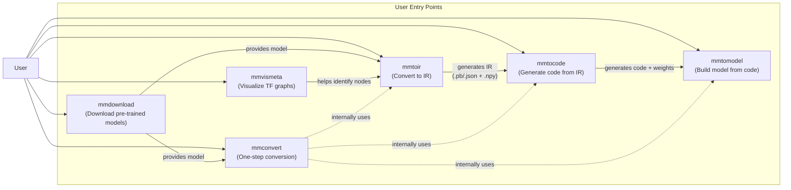

<!-- source: DeepWiki mcp.deepwiki.com · repo microsoft/MMdnn · page 1 Overview · fetched 2026-10-26 -->

# Overview

<details>
<summary>Relevant source files</summary>

The following files were used as context for generating this wiki page:

- [README.md](README.md)
- [mmdnn/conversion/caffe/caffe_emitter.py](mmdnn/conversion/caffe/caffe_emitter.py)
- [mmdnn/conversion/cntk/cntk_emitter.py](mmdnn/conversion/cntk/cntk_emitter.py)
- [mmdnn/conversion/keras/keras2_emitter.py](mmdnn/conversion/keras/keras2_emitter.py)
- [mmdnn/conversion/mxnet/mxnet_emitter.py](mmdnn/conversion/mxnet/mxnet_emitter.py)
- [mmdnn/conversion/mxnet/mxnet_parser.py](mmdnn/conversion/mxnet/mxnet_parser.py)
- [mmdnn/conversion/onnx/onnx_emitter.py](mmdnn/conversion/onnx/onnx_emitter.py)
- [mmdnn/conversion/pytorch/pytorch_emitter.py](mmdnn/conversion/pytorch/pytorch_emitter.py)
- [mmdnn/conversion/tensorflow/README.md](mmdnn/conversion/tensorflow/README.md)
- [setup.py](setup.py)

</details>


MMdnn is a comprehensive cross-framework tool for converting, visualizing, and diagnosing deep learning models. The name "MM" stands for model management, and "dnn" is the acronym of deep neural network. This document provides an overview of MMdnn's architecture, components, and workflow.

## Purpose and Scope

MMdnn enables the interoperability of deep learning models across different frameworks by:
1. **Model Conversion**: Transforming models between frameworks (e.g., TensorFlow to PyTorch)
2. **Model Retraining**: Generating code snippets for retraining or inference
3. **Model Visualization**: Displaying network architecture
4. **Model Deployment**: Providing guidance for deployment to various platforms

For details about model deployment, see [Model Deployment](#1.2).

## Core Architecture

MMdnn uses an Intermediate Representation (IR) as a bridge between different deep learning frameworks. This design allows any supported source framework to be converted to any supported target framework through a two-step process.

### Model Conversion Pipeline

```mermaid
flowchart TD
    subgraph "Source Frameworks"
        TF["TensorFlow"]
        Keras["Keras"]
        Caffe["Caffe"]
        MXNet["MXNet"]
        CNTK["CNTK"]
        PyTorch["PyTorch"]
        Darknet["Darknet"]
        CoreML["CoreML"]
    end
    
    subgraph "Intermediate Representation (IR)"
        IRGraph["IR Graph (.pb/.json)"]
        IRWeights["IR Weights (.npy)"]
    end
    
    subgraph "Target Frameworks"
        TF2["TensorFlow"]
        Keras2["Keras"]
        Caffe2["Caffe"]
        MXNet2["MXNet"]
        CNTK2["CNTK"]
        PyTorch2["PyTorch"]
        ONNX["ONNX"]
        CoreML2["CoreML"]
    end
    
    subgraph "Parsers"
        TFParser["TensorFlow Parser"]
        KerasParser["Keras Parser"]
        CaffeParser["Caffe Parser"]
        MXNetParser["MXNet Parser"]
        CNTKParser["CNTK Parser"]
        PyTorchParser["PyTorch Parser"]
        DarknetParser["Darknet Parser"]
        CoreMLParser["CoreML Parser"]
    end
    
    subgraph "Emitters"
        TFEmitter["TensorFlow Emitter"]
        KerasEmitter["Keras Emitter"]
        CaffeEmitter["Caffe Emitter"]
        MXNetEmitter["MXNet Emitter"]
        CNTKEmitter["CNTK Emitter"]
        PyTorchEmitter["PyTorch Emitter"]
        ONNXEmitter["ONNX Emitter"]
        CoreMLEmitter["CoreML Emitter"]
    end
    
    TF --> TFParser
    Keras --> KerasParser
    Caffe --> CaffeParser
    MXNet --> MXNetParser
    CNTK --> CNTKParser
    PyTorch --> PyTorchParser
    Darknet --> DarknetParser
    CoreML --> CoreMLParser
    
    TFParser --> IRGraph
    KerasParser --> IRGraph
    CaffeParser --> IRGraph
    MXNetParser --> IRGraph
    CNTKParser --> IRGraph
    PyTorchParser --> IRGraph
    DarknetParser --> IRGraph
    CoreMLParser --> IRGraph
    
    TFParser --> IRWeights
    KerasParser --> IRWeights
    CaffeParser --> IRWeights
    MXNetParser --> IRWeights
    CNTKParser --> IRWeights
    PyTorchParser --> IRWeights
    DarknetParser --> IRWeights
    CoreMLParser --> IRWeights
    
    IRGraph --> TFEmitter
    IRGraph --> KerasEmitter
    IRGraph --> CaffeEmitter
    IRGraph --> MXNetEmitter
    IRGraph --> CNTKEmitter
    IRGraph --> PyTorchEmitter
    IRGraph --> ONNXEmitter
    IRGraph --> CoreMLEmitter
    
    IRWeights --> TFEmitter
    IRWeights --> KerasEmitter
    IRWeights --> CaffeEmitter
    IRWeights --> MXNetEmitter
    IRWeights --> CNTKEmitter
    IRWeights --> PyTorchEmitter
    IRWeights --> ONNXEmitter
    IRWeights --> CoreMLEmitter
    
    TFEmitter --> TF2
    KerasEmitter --> Keras2
    CaffeEmitter --> Caffe2
    MXNetEmitter --> MXNet2
    CNTKEmitter --> CNTK2
    PyTorchEmitter --> PyTorch2
    ONNXEmitter --> ONNX
    CoreMLEmitter --> CoreML2
```



Sources: [README.md:7-19](), [mmdnn/conversion/caffe/caffe_emitter.py](), [mmdnn/conversion/keras/keras2_emitter.py](), [mmdnn/conversion/pytorch/pytorch_emitter.py](), [mmdnn/conversion/onnx/onnx_emitter.py](), [mmdnn/conversion/mxnet/mxnet_emitter.py](), [mmdnn/conversion/cntk/cntk_emitter.py](), [mmdnn/conversion/mxnet/mxnet_parser.py]()

The conversion process consists of two main components:

1. **Parsers**: Framework-specific modules that convert source models to IR. Each parser understands the format of a specific framework and extracts the network structure and weights to create a standardized IR.

2. **Emitters**: Framework-specific modules that convert IR to target frameworks. Each emitter takes the IR and generates code and weights for a specific target framework.

### Intermediate Representation (IR)

The IR serves as the bridge between frameworks and consists of:

- **IR Graph**: A protobuf binary file (.pb/.json) that stores the network architecture
- **IR Weights**: A NumPy (.npy) file that stores pre-trained weights in NHWC (channel last) format

Sources: [README.md:212-217]()

## Command-Line Tools

MMdnn provides several command-line tools for model conversion and visualization:



Sources: [setup.py:89-97](), [README.md:84-95](), [README.md:119-147]()

### Tool Descriptions

1. **mmconvert**: One-step conversion from source framework to target framework
   - Usage: `mmconvert -sf [source_framework] -in [input_model] -iw [input_weights] -df [destination_framework] -om [output_model]`

2. **mmdownload**: Download pre-trained models
   - Usage: `mmdownload -f [framework] -n [model_name] -o [output_dir]`

3. **mmtoir**: Convert source model to Intermediate Representation
   - Usage: `mmtoir -f [framework] -in [input_model] -iw [input_weights] -o [output_name]`

4. **mmtocode**: Generate target framework code from IR
   - Usage: `mmtocode -f [framework] -n [IR_model] -w [IR_weights] -o [output_code] -ow [output_weights]`

5. **mmtomodel**: Build model from generated code
   - Usage: `mmtomodel -f [framework] -in [input_code] -iw [input_weights] -o [output_model]`

6. **mmvismeta**: Visualize TensorFlow graph (for TensorFlow models only)
   - Usage: `mmvismeta [meta_file] [log_dir]`

## Framework Support

MMdnn supports conversion between numerous deep learning frameworks:

### Source Frameworks
- Caffe
- CNTK (Microsoft Cognitive Toolkit)
- CoreML
- Keras
- MXNet
- PyTorch
- TensorFlow
- Darknet (Source only, Experimental)

### Target Frameworks
- Caffe
- CNTK
- CoreML
- Keras
- MXNet
- ONNX (Destination only)
- PyTorch
- TensorFlow

### Tested Models

The following table shows which models have been tested for conversion between frameworks:

| Models | Caffe | Keras | TensorFlow | CNTK | MXNet | PyTorch | CoreML | ONNX |
|:-----:|:-----:|:-----:|:----------:|:----:|:-----:|:--------:|:------:|:-----:|
| VGG 19 | ✓ | ✓ | ✓ | ✓ | ✓ | ✓ | ✓ | ✓ |
| Inception V1 | ✓ | ✓ | ✓ | ✓ | ✓ | ✓ | ✓ | ✓ |
| Inception V3 | ✓ | ✓ | ✓ | ✓ | ✓ | ✓ | ✓ | ✓ |
| Inception V4 | ✓ | ✓ | ✓ | o | ✓ | ✓ | ✓ | ✓ |
| ResNet V1 | × | ✓ | ✓ | o | ✓ | ✓ | ✓ | ✓ |
| ResNet V2 | ✓ | ✓ | ✓ | ✓ | ✓ | ✓ | ✓ | ✓ |
| MobileNet V1 | × | ✓ | ✓ | o | ✓ | ✓ | ✓ | ✓ |
| MobileNet V2 | × | ✓ | ✓ | o | ✓ | ✓ | ✓ | ✓ |
| Xception | ✓ | ✓ | ✓ | o | × | ✓ | ✓ | ✓ |
| SqueezeNet | ✓ | ✓ | ✓ | ✓ | ✓ | ✓ | ✓ | ✓ |
| DenseNet | ✓ | ✓ | ✓ | ✓ | ✓ | ✓ | ✓ | ✓ |
| NASNet | × | ✓ | ✓ | o | ✓ | ✓ | ✓ | × |
| ResNext | ✓ | ✓ | ✓ | ✓ | ✓ | ✓ | ✓ | ✓ |

Sources: [README.md:97-108](), [README.md:111-128](), [mmdnn/conversion/tensorflow/README.md:7-17]()

**Legend**:
- ✓: Correctness tested
- o: Some difference after conversion
- ×: Cannot be converted

## Installation

MMdnn can be installed via pip:

```
pip install mmdnn
```

Or for the latest development version:

```
pip install -U git+https://github.com/Microsoft/MMdnn.git@master
```

Docker images are also available:

```
docker pull mmdnn/mmdnn:cpu.small
docker run -it mmdnn/mmdnn:cpu.small
```

Sources: [README.md:47-81](), [setup.py:9-98]()

## Example Usage

Here's a simple example of converting a TensorFlow ResNet V2 152 model to PyTorch:

```bash
# Download the model
mmdownload -f tensorflow -n resnet_v2_152 -o ./

# Convert to PyTorch
mmconvert -sf tensorflow -in imagenet_resnet_v2_152.ckpt.meta -iw imagenet_resnet_v2_152.ckpt --dstNodeName MMdnn_Output -df pytorch -om tf_resnet_to_pth.pth
```

Sources: [README.md:133-139]()

## Detailed IR Conversion Process

```mermaid
flowchart LR
    subgraph "Source Model"
        ModelDef["Model Definition"]
        Weights["Model Weights"]
    end
    
    subgraph "Parser Process"
        GraphBuilder["Graph Builder<br>(framework-specific)"]
        DataInjector["Weight Injector"]
        NodeMapper["Node Mapper"]
    end
    
    subgraph "Intermediate Representation"
        IRGraph["IR Graph (.pb/.json)"]
        IRWeights["IR Weights (.npy)"]
    end
    
    subgraph "Emitter Process"
        CodeGen["Code Generator"]
        WeightTransform["Weight Transformer"]
        LayerHelpers["Layer Helper Functions"]
    end
    
    subgraph "Target Model"
        TargetCode["Model Code"]
        TargetWeights["Model Weights"]
        TargetModel["Final Model"]
    end
    
    ModelDef --> GraphBuilder
    Weights --> DataInjector
    GraphBuilder --> |"framework-specific graph"| NodeMapper
    DataInjector --> |"inject weights"| NodeMapper
    NodeMapper --> |"convert nodes"| IRGraph
    NodeMapper --> |"convert weights"| IRWeights
    
    IRGraph --> |"traverse nodes"| CodeGen
    IRWeights --> WeightTransform
    CodeGen --> |"generate code"| TargetCode
    CodeGen --> |"generate helpers"| LayerHelpers
    WeightTransform --> |"transform weights"| TargetWeights
    
    LayerHelpers --> TargetCode
    TargetCode --> |"combined into"| TargetModel
    TargetWeights --> |"loaded by"| TargetModel
```



Sources: [mmdnn/conversion/caffe/caffe_emitter.py:198-240](), [mmdnn/conversion/keras/keras2_emitter.py:113-146](), [mmdnn/conversion/pytorch/pytorch_emitter.py:148-192](), [mmdnn/conversion/onnx/onnx_emitter.py:146-228](), [mmdnn/conversion/mxnet/mxnet_emitter.py:369-463](), [mmdnn/conversion/cntk/cntk_emitter.py:183-219](), [mmdnn/conversion/mxnet/mxnet_parser.py:427-513]()

This diagram illustrates the detailed conversion process:

1. **Parser Process**:
   - The framework-specific graph builder extracts the model architecture
   - The weight injector loads and prepares weights from the source model
   - The node mapper converts framework-specific nodes to standardized IR nodes

2. **Emitter Process**:
   - The code generator traverses IR nodes to generate target framework code
   - The weight transformer converts weights to the format required by the target framework
   - Helper functions are generated to support layer operations in the target framework

## Conclusion

MMdnn provides a comprehensive solution for cross-framework deep learning model conversion. By using an Intermediate Representation as a bridge, it enables conversion between various deep learning frameworks with minimal loss of information. The tool's command-line utilities make the conversion process straightforward for users, supporting both one-step conversion and step-by-step conversion for more control.

For more detailed information about specific components or frameworks, refer to the other sections of this documentation.

---

