<!-- source: DeepWiki mcp.deepwiki.com · repo microsoft/MMdnn · page 1.1 System Architecture · fetched 2026-10-26 -->

# System Architecture

Relevant source files

The following files were used as context for generating this wiki page:

- [README.md](README.md)
- [mmdnn/conversion/caffe/caffe_emitter.py](mmdnn/conversion/caffe/caffe_emitter.py)
- [mmdnn/conversion/cntk/cntk_emitter.py](mmdnn/conversion/cntk/cntk_emitter.py)
- [mmdnn/conversion/mxnet/mxnet_emitter.py](mmdnn/conversion/mxnet/mxnet_emitter.py)
- [mmdnn/conversion/mxnet/mxnet_parser.py](mmdnn/conversion/mxnet/mxnet_parser.py)
- [mmdnn/conversion/onnx/onnx_emitter.py](mmdnn/conversion/onnx/onnx_emitter.py)
- [mmdnn/conversion/tensorflow/README.md](mmdnn/conversion/tensorflow/README.md)
- [mmdnn/conversion/tensorflow/tensorflow_emitter.py](mmdnn/conversion/tensorflow/tensorflow_emitter.py)
- [mmdnn/conversion/tensorflow/tensorflow_frozenparser.py](mmdnn/conversion/tensorflow/tensorflow_frozenparser.py)
- [mmdnn/conversion/tensorflow/tensorflow_graph.py](mmdnn/conversion/tensorflow/tensorflow_graph.py)
- [mmdnn/conversion/tensorflow/tensorflow_parser.py](mmdnn/conversion/tensorflow/tensorflow_parser.py)
- [setup.py](setup.py)

This document outlines the system architecture of MMdnn, a cross-framework deep learning model converter. It describes the core components of the system, how they interact to achieve model conversion functionality, and the overall design principles. For information about using specific command-line tools, see [Command-Line Tools](#1.2).

## Overview of MMdnn Architecture

MMdnn uses a hub-and-spoke architecture with a unified Intermediate Representation (IR) at its core. This design enables conversion between any supported frameworks through a two-step process: first converting from source framework to IR, then from IR to target framework.

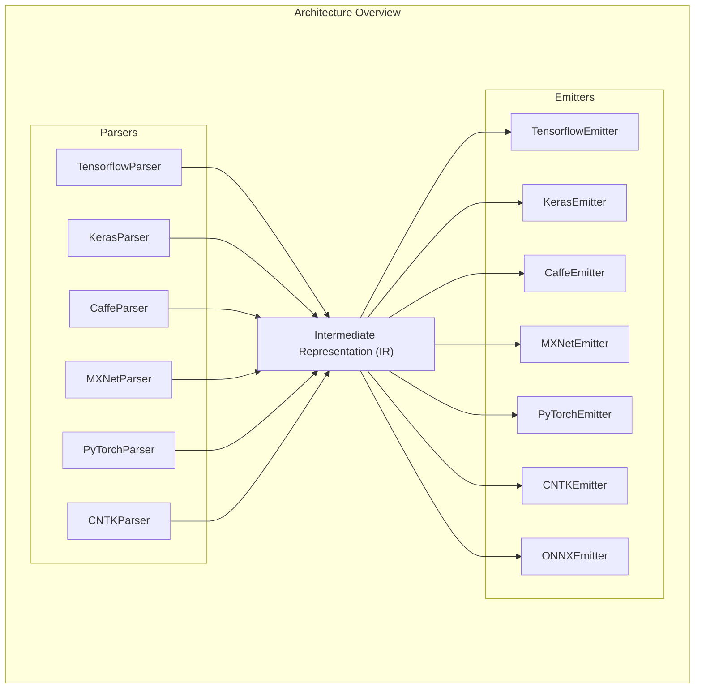

Sources: [README.md:85-106]()

## Model Conversion Pipeline

The conversion process involves multiple steps orchestrated by the command-line tools and implemented by parser and emitter classes.

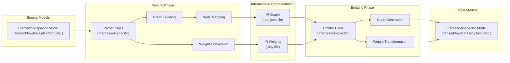

Sources: [README.md:85-106](), [mmdnn/conversion/tensorflow/tensorflow_parser.py:100-145](), [mmdnn/conversion/caffe/caffe_emitter.py:114-140]()

## Core Components

### Parser Base Class

All framework-specific parsers inherit from a common `Parser` base class, implementing methods to extract model structure and weights into the IR format.

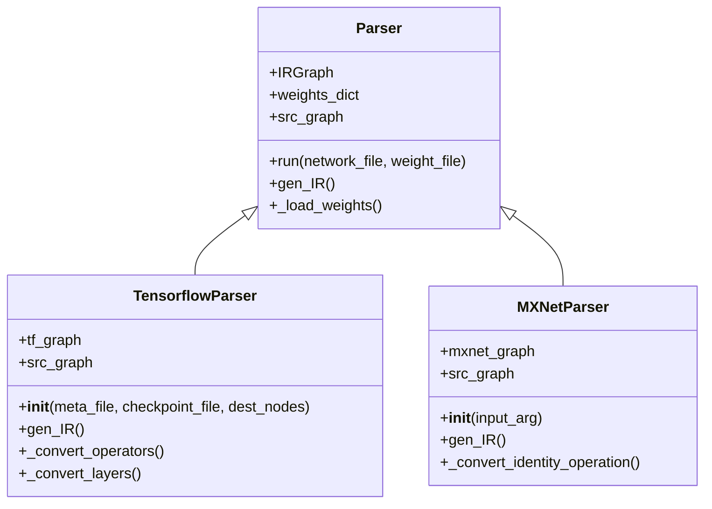

Sources: [mmdnn/conversion/tensorflow/tensorflow_parser.py:22-58](), [mmdnn/conversion/mxnet/mxnet_parser.py:17-40]()

### Emitter Base Class

Framework-specific emitters inherit from a common `Emitter` base class, implementing methods to convert IR to target framework model code and weights.

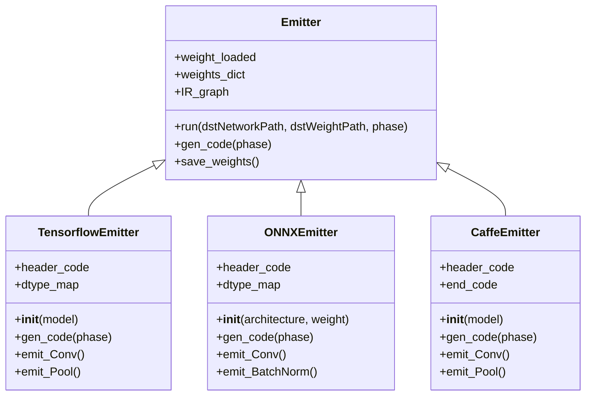

Sources: [mmdnn/conversion/tensorflow/tensorflow_emitter.py:16-35](), [mmdnn/conversion/onnx/onnx_emitter.py:9-35](), [mmdnn/conversion/caffe/caffe_emitter.py:23-112]()

### Intermediate Representation (IR)

The IR format serves as the common language between parsers and emitters. It consists of two main parts:

1. **IR Graph**: Network architecture stored in protobuf (.pb) or JSON format
2. **IR Weights**: Model parameters stored as NumPy arrays (.npy)

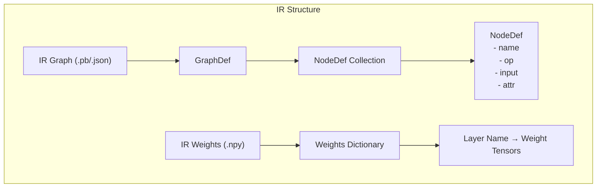

The IR is defined using Protocol Buffers, with the core structure in `graph.proto`. The IR weights are stored in NumPy format, which provides a universal representation for tensors across frameworks.

Sources: [README.md:211-217]()

## Framework-Specific Parsers

### TensorFlow Parser

The TensorFlow parser supports multiple input formats:

1. **Checkpoint files**: Meta (.meta) + checkpoint (.ckpt) files
2. **Frozen graph**: Protobuf (.pb) files
3. **SavedModel**: Directory containing saved model

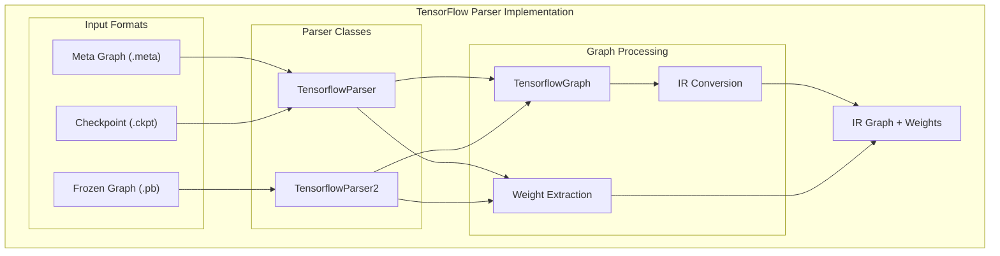

TensorFlow parser handles the complex TensorFlow computation graph by traversing it topologically and converting each operation to the corresponding IR node. The parser uses pattern matching to recognize common neural network layers that may be composed of multiple operations in TensorFlow.

Sources: [mmdnn/conversion/tensorflow/tensorflow_parser.py:22-424](), [mmdnn/conversion/tensorflow/tensorflow_frozenparser.py:16-102](), [mmdnn/conversion/tensorflow/tensorflow_graph.py:11-105]()

### Other Framework Parsers

Each framework parser implements specific logic to extract model architecture and weights from its source format. For example:

- **MXNet Parser**: Handles symbol JSON and parameter files
- **PyTorch Parser**: Uses PyTorch's tracing capability to extract computational graphs
- **Caffe Parser**: Processes prototxt and caffemodel files

## Framework-Specific Emitters

### TensorFlow Emitter

The TensorFlow emitter generates Python code that rebuilds the neural network using TensorFlow APIs:

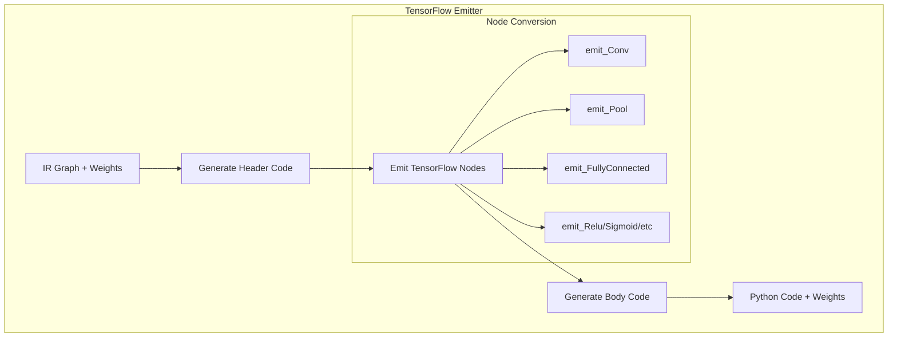

The TensorFlow emitter implements specific methods for each type of layer, such as `emit_Conv`, `emit_Pool`, and `emit_FullyConnected`, which generate the TensorFlow code to recreate these layers.

Sources: [mmdnn/conversion/tensorflow/tensorflow_emitter.py:16-142]()

### ONNX Emitter

The ONNX emitter creates ONNX model files by translating IR nodes to ONNX operators:

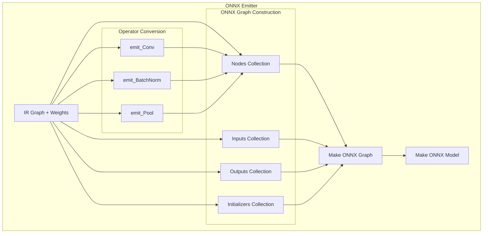

Sources: [mmdnn/conversion/onnx/onnx_emitter.py:9-319]()

### Caffe Emitter

The Caffe emitter generates Python code that constructs Caffe models:

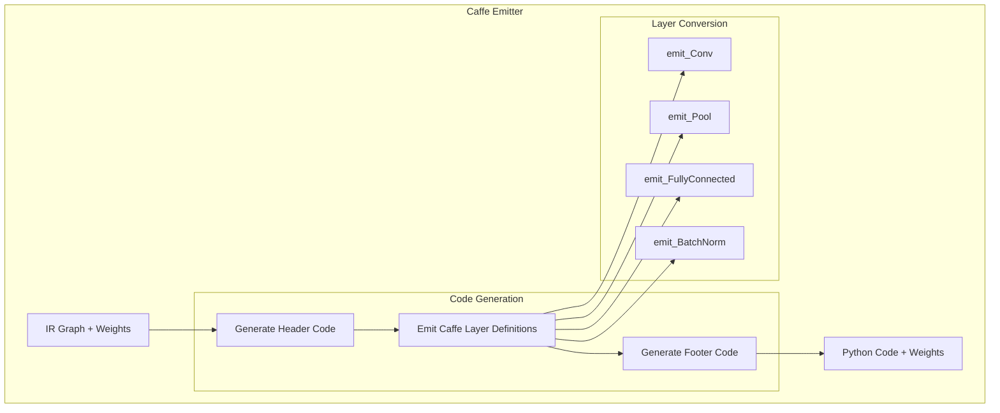

The Caffe emitter processes the IR graph topologically and emits Caffe layer definitions with appropriate parameters.

Sources: [mmdnn/conversion/caffe/caffe_emitter.py:23-668]()

## Command-Line Workflow

The conversion process is exposed through a set of command-line tools that provide a user-friendly interface to the underlying architecture:

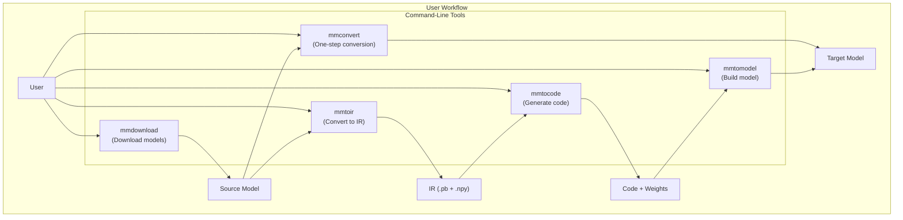

These command-line tools are defined as entry points in `setup.py`, which maps each command to its corresponding implementation script:

Sources: [setup.py:89-96]()

## Testing Infrastructure

MMdnn includes a comprehensive testing infrastructure to validate model conversions:

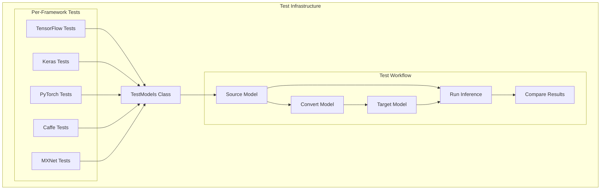

Tests verify conversion accuracy by:
1. Running inference on source models with test inputs
2. Running inference on converted models with the same inputs
3. Comparing outputs to ensure they match within acceptable tolerances

Sources: [README.md:107-127]()

## Cross-Framework Compatibility Table

The table below shows the support status for various frameworks as source and target:

| Model Type | Source | Target |
|------------|--------|--------|
| TensorFlow | ✓ | ✓ |
| Keras | ✓ | ✓ |
| PyTorch | ✓ | ✓ |
| Caffe | ✓ | ✓ |
| MXNet | ✓ | ✓ |
| CNTK | ✓ | ✓ |
| CoreML | ✓ | ✓ |
| ONNX | ✗ | ✓ |
| Darknet | ✓ | ✗ |

Sources: [README.md:94-106]()

## Conclusion

The MMdnn architecture provides a flexible and extensible system for converting deep learning models between frameworks. By using an intermediate representation, it decouples source and target frameworks, making it easier to add support for new frameworks and maintain existing ones.

The system's modular design with separate parsers and emitters, combined with a common IR format, enables a wide range of conversion possibilities while maintaining a clear separation of concerns within the codebase.

---

