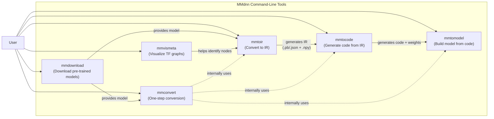
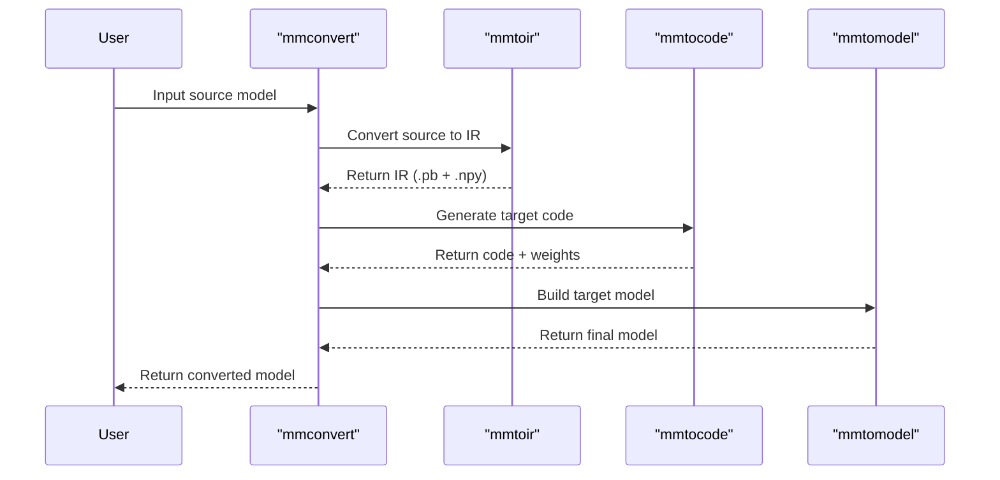
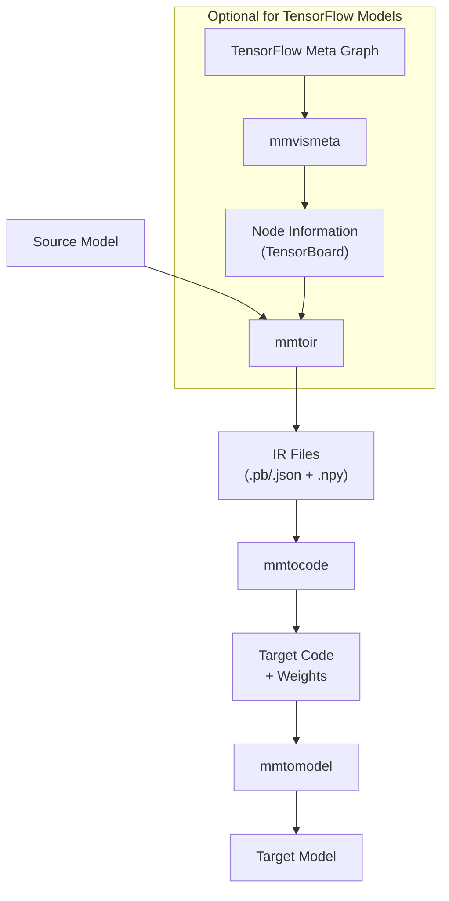
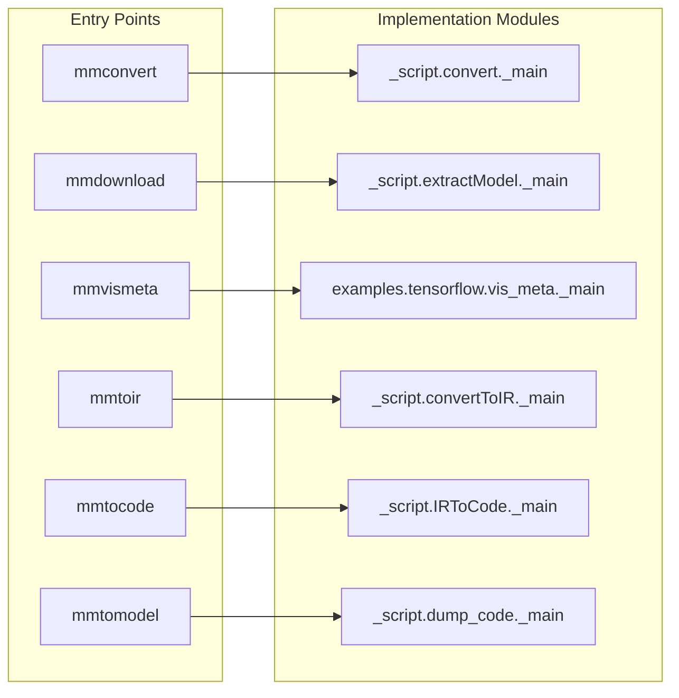

<!-- source: DeepWiki mcp.deepwiki.com · repo microsoft/MMdnn · page 1.2 Command-Line Tools · fetched 2026-10-26 -->

# Command-Line Tools

<details>
<summary>Relevant source files</summary>

The following files were used as context for generating this wiki page:

- [README.md](README.md)
- [mmdnn/conversion/_script/convertToIR.py](mmdnn/conversion/_script/convertToIR.py)
- [mmdnn/conversion/_script/extractModel.py](mmdnn/conversion/_script/extractModel.py)
- [mmdnn/conversion/examples/caffe/extractor.py](mmdnn/conversion/examples/caffe/extractor.py)
- [mmdnn/conversion/examples/keras/extractor.py](mmdnn/conversion/examples/keras/extractor.py)
- [mmdnn/conversion/pytorch/pytorch_graph.py](mmdnn/conversion/pytorch/pytorch_graph.py)
- [mmdnn/conversion/pytorch/pytorch_parser.py](mmdnn/conversion/pytorch/pytorch_parser.py)
- [mmdnn/conversion/tensorflow/README.md](mmdnn/conversion/tensorflow/README.md)
- [setup.py](setup.py)

</details>


This page documents the command-line tools provided by MMdnn for model conversion, visualization, and management. The MMdnn framework provides several utility commands that allow users to convert models between different deep learning frameworks via an intermediate representation (IR). For information about the IR format itself, see [Intermediate Representation](#2).

## Overview

MMdnn provides six main command-line tools that can be used individually or in sequence to accomplish model conversion:



Sources: [setup.py:89-96](), [README.md:132-136]()

## Installation

The MMdnn command-line tools are installed automatically when you install the MMdnn package:

```bash
pip install mmdnn
```

Alternatively, you can install the latest development version from GitHub:

```bash
pip install -U git+https://github.com/Microsoft/MMdnn.git@master
```

Sources: [README.md:47-61]()

## Command-Line Tools in Detail

### mmconvert

The `mmconvert` tool provides one-step conversion from a source framework to a target framework via the IR.

#### Usage

```
mmconvert -sf SOURCE_FRAMEWORK -in NETWORK_FILE -iw WEIGHTS_FILE -df TARGET_FRAMEWORK -om OUTPUT_MODEL_NAME [OPTIONS]
```

#### Key Parameters

| Parameter | Description |
|-----------|-------------|
| `-sf`, `--srcFramework` | Source framework name (caffe, keras, tensorflow, etc.) |
| `-in`, `--inputNetwork` | Path to the model network file of the source framework |
| `-iw`, `--inputWeight` | Path to the model weights file of the source framework |
| `-df`, `--dstFramework` | Target framework name (caffe, keras, tensorflow, etc.) |
| `-om`, `--outputModel` | Output model name |
| `--dstNodeName` | [TensorFlow] Output nodes' name of the graph |
| `--inNodeName` | [TensorFlow] Input nodes' name of the graph |
| `--inputShape` | Input shape of the model (used for some frameworks) |

#### Example

Convert a TensorFlow ResNet V2 152 model to PyTorch:

```bash
mmdownload -f tensorflow -n resnet_v2_152 -o ./
mmconvert -sf tensorflow -in imagenet_resnet_v2_152.ckpt.meta -iw imagenet_resnet_v2_152.ckpt --dstNodeName MMdnn_Output -df pytorch -om tf_resnet_to_pth.pth
```

Sources: [README.md:132-138](), [mmdnn/conversion/tensorflow/README.md:40-44]()

### mmdownload

The `mmdownload` tool downloads pre-trained models from various frameworks.

#### Usage

```
mmdownload -f FRAMEWORK [-n NETWORK_NAME] [-o OUTPUT_PATH]
```

#### Key Parameters

| Parameter | Description |
|-----------|-------------|
| `-f`, `--framework` | Framework name (caffe, keras, tensorflow, etc.) |
| `-n`, `--network` | Network name (optional, shows available models if omitted) |
| `-p`, `-o`, `--path` | Path to save the downloaded model |
| `-i`, `--image` | Test image path (for inference testing) |
| `-l`, `--label` | Path of label file (for classification results) |

#### Example

List available TensorFlow models:

```bash
mmdownload -f tensorflow

Supported models: ['inception_v3_frozen', 'resnet_v2_200', 'inception_v1', 'mobilenet_v1_1.0', 'mobilenet_v2_1.0_224', 'resnet_v2_152', 'vgg16', 'mobilenet_v1_1.0_frozen', 'resnet_v1_50', 'resnet_v2_50', 'inception_v3', 'inception_resnet_v2', 'resnet_v1_152', 'inception_v1_frozen', 'vgg19', 'nasnet-a_large']
```

Download a specific model:

```bash
mmdownload -f tensorflow -n resnet_v2_152 -o ./
```

Sources: [mmdnn/conversion/_script/extractModel.py:24-126](), [mmdnn/conversion/examples/caffe/extractor.py:13-90](), [mmdnn/conversion/examples/keras/extractor.py:15-99]()

### mmtoir

The `mmtoir` tool converts models from their original framework format to the MMdnn Intermediate Representation (IR).

#### Usage

```
mmtoir -f SOURCE_FRAMEWORK [-n NETWORK_FILE] [-w WEIGHTS_FILE] -o OUTPUT_PATH [OPTIONS]
```

#### Key Parameters

| Parameter | Description |
|-----------|-------------|
| `-f`, `--srcFramework` | Source framework name |
| `-n`, `-in`, `--network` | Path to the model network file (not needed for all frameworks) |
| `-w`, `-iw`, `--weights` | Path to the model weights file |
| `-d`, `-o`, `--dstPath` | Output path for IR files (will generate .pb, .json, and .npy files) |
| `--inputShape` | Input shape of the model (required for some frameworks) |
| `--dstNodeName` | [TensorFlow] Output nodes' name of the graph |
| `--inNodeName` | [TensorFlow] Input nodes' name of the graph |

#### Example

Convert a TensorFlow model to IR:

```bash
mmtoir -f tensorflow -w mobilenet_v1_1.0_224/frozen_graph.pb --inNodeName input --inputShape 224,224,3 --dstNodeName MobilenetV1/Predictions/Softmax -o mobilenet_v1
```

Sources: [mmdnn/conversion/_script/convertToIR.py:6-202](), [mmdnn/conversion/tensorflow/README.md:118-123]()

### mmtocode

The `mmtocode` tool generates framework-specific code from the IR.

#### Usage

```
mmtocode -f TARGET_FRAMEWORK -n IR_NETWORK_FILE -w IR_WEIGHTS_FILE -o OUTPUT_CODE_FILE [-ow OUTPUT_WEIGHTS_FILE]
```

#### Key Parameters

| Parameter | Description |
|-----------|-------------|
| `-f`, `--framework` | Target framework name |
| `-n`, `--IRModelPath` | Path to the IR network file (.pb) |
| `-w`, `--IRWeightPath` | Path to the IR weights file (.npy) |
| `-o`, `--dstModelPath` | Output path for generated code |
| `-ow` | Output path for weights |

#### Example

Generate Caffe code from IR:

```bash
mmtocode -f caffe -n mobilenet_v1.pb -w mobilenet_v1.npy -o tf_mobilenet.py -ow tf_mobilenet.npy
```

Sources: [mmdnn/conversion/tensorflow/README.md:125-130](), [mmdnn/conversion/tensorflow/README.md:146-150]()

### mmtomodel

The `mmtomodel` tool uses the generated code and weights to build a framework-specific model.

#### Usage

```
mmtomodel -f TARGET_FRAMEWORK -in CODE_FILE -iw WEIGHTS_FILE -o OUTPUT_MODEL [--dump_tag DUMP_TAG]
```

#### Key Parameters

| Parameter | Description |
|-----------|-------------|
| `-f`, `--framework` | Target framework name |
| `-in`, `--inputModel` | Path to the generated code file |
| `-iw`, `--inputWeight` | Path to the weights file |
| `-o`, `--outputModel` | Output model name |
| `--dump_tag` | [TensorFlow] Specifies the model type (SERVING or TRAINING) |

#### Example

Generate a Caffe model from code and weights:

```bash
mmtomodel -f caffe -in tf_mobilenet.py -iw tf_mobilenet.npy -o tf_mobilenet
```

For TensorFlow:

```bash
mmtomodel -f tensorflow -in tf_resnet152.py -iw resnet152.npy -o tf_resnet152 --dump_tag SERVING
```

Sources: [mmdnn/conversion/tensorflow/README.md:132-138](), [mmdnn/conversion/tensorflow/README.md:157-162]()

### mmvismeta

The `mmvismeta` tool visualizes TensorFlow MetaGraph files to help identify input and output nodes for conversion.

#### Usage

```
mmvismeta META_FILE OUTPUT_LOG_DIR
```

#### Example

```bash
mmvismeta imagenet_resnet_v2_152.ckpt.meta ./logs/
```

This will start a TensorBoard server to visualize the graph.

Sources: [mmdnn/conversion/tensorflow/README.md:99-110]()

## Conversion Workflows

There are two primary workflows for model conversion in MMdnn:

1. **One-step conversion** using `mmconvert`
2. **Step-by-step conversion** using the individual tools: `mmtoir`, `mmtocode`, and `mmtomodel`

### One-Step Conversion Workflow



Sources: [README.md:133-138]()

### Step-by-Step Conversion Workflow



Sources: [mmdnn/conversion/tensorflow/README.md:115-138]()

## Framework Support Matrix

The following table shows the frameworks supported by the MMdnn command-line tools:

| Framework | Source (mmtoir) | Target (mmtocode/mmtomodel) |
|-----------|:---------------:|:---------------------------:|
| Caffe | ✓ | ✓ |
| CNTK | ✓ | ✓ |
| CoreML | ✓ | ✓ |
| Keras | ✓ | ✓ |
| MXNet | ✓ | ✓ |
| ONNX | ✓ | ✓ |
| PyTorch | ✓ | ✓ |
| TensorFlow | ✓ | ✓ |
| Darknet | ✓ | ✗ |

Sources: [README.md:97-105]()

## Implementation Details

The command-line tools are defined as entry points in the MMdnn package:



Sources: [setup.py:89-96]()

## Common Usage Patterns

### Converting TensorFlow Models to Caffe

```bash
# One-step conversion
mmconvert -sf tensorflow -iw mobilenet_v1_1.0_224/frozen_graph.pb --inNodeName input --inputShape 224,224,3 --dstNodeName MobilenetV1/Predictions/Softmax -df caffe -om tf_mobilenet

# Step-by-step conversion
mmtoir -f tensorflow -w mobilenet_v1_1.0_224/frozen_graph.pb --inNodeName input --inputShape 224,224,3 --dstNodeName MobilenetV1/Predictions/Softmax -o mobilenet_v1
mmtocode -f caffe -n mobilenet_v1.pb -w mobilenet_v1.npy -o tf_mobilenet.py -ow tf_mobilenet.npy
mmtomodel -f caffe -in tf_mobilenet.py -iw tf_mobilenet.npy -o tf_mobilenet
```

Sources: [mmdnn/conversion/tensorflow/README.md:64-68](), [mmdnn/conversion/tensorflow/README.md:118-138]()

### Converting Keras Models to CNTK

```bash
# Download a Keras model
mmdownload -f keras -n inception_v3 -o ./

# Convert the model to CNTK
mmconvert -sf keras -in imagenet_inception_v3.h5 -df cntk -om keras_inception_v3_cntk
```

Sources: [README.md:166]()

### Converting MXNet Models to TensorFlow

```bash
# Download an MXNet model (example assumes you have the model files)
# Convert the model to TensorFlow
mmconvert -sf mxnet -in resnet-50-symbol.json -iw resnet-50-0000.params -df tensorflow -om mxnet_resnet50_tf
```

Sources: [README.md:170]()

## Conclusion

The MMdnn command-line tools provide a comprehensive suite of utilities for converting deep learning models between different frameworks. Users can choose between a simple one-step conversion using `mmconvert` or a more detailed step-by-step approach using the individual tools (`mmtoir`, `mmtocode`, and `mmtomodel`) for greater control and debugging capabilities.

For more information about the specific frameworks supported and their conversion details, refer to the corresponding framework-specific pages in the MMdnn documentation.

---

