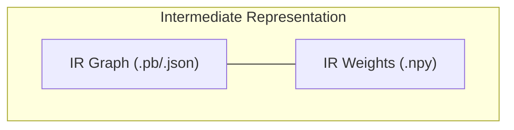
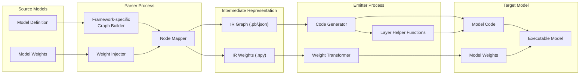
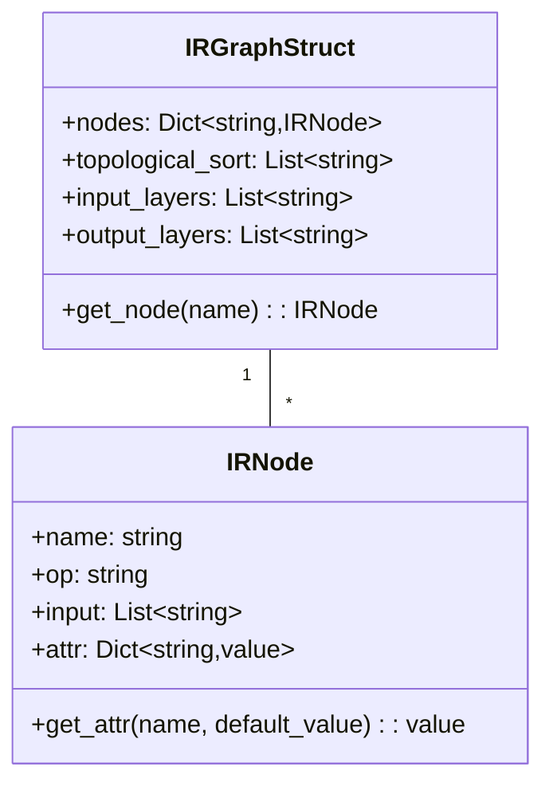
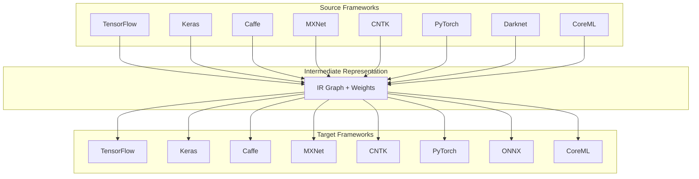

<!-- source: DeepWiki mcp.deepwiki.com · repo microsoft/MMdnn · page 2 Intermediate Representation · fetched 2026-10-26 -->

# Intermediate Representation

<details>
<summary>Relevant source files</summary>

The following files were used as context for generating this wiki page:

- [README.md](README.md)
- [mmdnn/conversion/caffe/caffe_emitter.py](mmdnn/conversion/caffe/caffe_emitter.py)
- [mmdnn/conversion/cntk/cntk_emitter.py](mmdnn/conversion/cntk/cntk_emitter.py)
- [mmdnn/conversion/mxnet/mxnet_emitter.py](mmdnn/conversion/mxnet/mxnet_emitter.py)
- [mmdnn/conversion/mxnet/mxnet_parser.py](mmdnn/conversion/mxnet/mxnet_parser.py)
- [mmdnn/conversion/onnx/onnx_emitter.py](mmdnn/conversion/onnx/onnx_emitter.py)
- [mmdnn/conversion/tensorflow/README.md](mmdnn/conversion/tensorflow/README.md)
- [mmdnn/conversion/tensorflow/tensorflow_emitter.py](mmdnn/conversion/tensorflow/tensorflow_emitter.py)
- [mmdnn/conversion/tensorflow/tensorflow_frozenparser.py](mmdnn/conversion/tensorflow/tensorflow_frozenparser.py)
- [mmdnn/conversion/tensorflow/tensorflow_graph.py](mmdnn/conversion/tensorflow/tensorflow_graph.py)
- [mmdnn/conversion/tensorflow/tensorflow_parser.py](mmdnn/conversion/tensorflow/tensorflow_parser.py)
- [setup.py](setup.py)

</details>


The Intermediate Representation (IR) is the core component of MMdnn that serves as a bridge between different deep learning frameworks. It provides a unified format to represent neural network models, enabling seamless conversion between various frameworks like TensorFlow, PyTorch, Caffe, MXNet, CNTK, and others.

## Purpose and Role

The IR functions as the central hub in the MMdnn conversion pipeline. Rather than creating N×(N-1) direct converters between N frameworks, MMdnn uses the IR as an intermediary step, reducing complexity to just N parsers and N emitters. This approach enables MMdnn to support conversion between multiple frameworks while maintaining a modular and extensible architecture.

## IR Structure Overview



The IR consists of two main components:
1. **IR Graph** - Stores the network architecture in Protocol Buffers format (.pb or .json)
2. **IR Weights** - Stores the model weights in NumPy native format (.npy)

Sources: [README.md:211-215]()

## The IR in the MMdnn Conversion Pipeline



This diagram illustrates the complete conversion pipeline, showing how models move from source frameworks through the IR to target frameworks.

Sources: [README.md:84-106](), [mmdnn/conversion/tensorflow/tensorflow_parser.py:1-300](), [mmdnn/conversion/tensorflow/tensorflow_emitter.py:1-100]()

## IR Data Format

The IR uses the following data formats:

- **Graph Format**: Protocol Buffers (protobuf) for network architecture
- **Weights Format**: NumPy arrays for model parameters
- **Data Layout**: NHWC (channel-last) format
- **File Extensions**: 
  - `.pb` or `.json` for graph structure
  - `.npy` for weights

Sources: [README.md:211-215]()

## IR Components in Detail

### IR Graph

The IR Graph represents the network architecture as a collection of nodes and edges, where:

- **Nodes** represent operations (layers, activations, etc.)
- **Edges** represent tensor connections between operations

Each node in the IR Graph contains:

| Property | Description |
|----------|-------------|
| `name` | Unique identifier for the node |
| `op` | Operation type (e.g., Conv, Pool, FullyConnected) |
| `input` | List of input nodes |
| `attr` | Dictionary of attributes specific to the operation |
| `_output_shapes` | Shape information for the node's outputs |

Sources: [mmdnn/conversion/tensorflow/tensorflow_parser.py:397-435](), [mmdnn/conversion/mxnet/mxnet_parser.py:266-272]()

### IR Weights

IR Weights store all the learnable parameters of the model (e.g., convolutional filters, dense layer weights, batch normalization parameters) as NumPy arrays, organized in a hierarchical dictionary structure:

```
weights_dict = {
    'layer_name_1': {
        'weights': numpy_array,
        'bias': numpy_array
    },
    'layer_name_2': {
        'weights': numpy_array,
        'bias': numpy_array,
        'mean': numpy_array,  # For batch normalization
        'var': numpy_array,   # For batch normalization
        'scale': numpy_array  # For batch normalization
    },
    ...
}
```

Sources: [mmdnn/conversion/tensorflow/tensorflow_parser.py:101-125](), [mmdnn/conversion/mxnet/mxnet_parser.py:152-180]()

## IR Node Structure



The diagram illustrates the structure of an IR node and its relationship with the overall IR graph.

Sources: [mmdnn/conversion/caffe/caffe_emitter.py:32-36](), [mmdnn/conversion/tensorflow/tensorflow_emitter.py:16-27]()

## Conversion Process

### From Source Model to IR (Parser)

The parser converts a model from its native framework to the IR format:

1. **Graph Building**: Creates a framework-specific graph representation
2. **Weight Extraction**: Extracts weights from the source model
3. **Node Mapping**: Maps framework-specific operations to IR operations
4. **IR Generation**: Builds the IR graph and weights files

Example parser implementation pattern:

```python
def gen_IR(self):
    for layer in self.src_graph.topological_sort:
        current_node = self.src_graph.get_node(layer)
        
        if hasattr(self, "rename_" + current_node.type):
            # Call type-specific conversion function
            func = getattr(self, "rename_" + current_node.type)
            func(current_node)
        else:
            # Handle unknown node type
            self.rename_UNKNOWN(current_node)
```

Sources: [mmdnn/conversion/tensorflow/tensorflow_parser.py:410-424](), [mmdnn/conversion/mxnet/mxnet_parser.py:253-263]()

### From IR to Target Model (Emitter)

The emitter converts the IR to a target framework model:

1. **Code Generation**: Generates framework-specific code from IR nodes
2. **Weight Transformation**: Transforms weights to framework-specific format
3. **Layer Helper Functions**: Creates helper functions for complex operations
4. **Model Building**: Builds an executable model in the target framework

Example emitter implementation pattern:

```python
def gen_code(self, phase):
    self.add_body(0, self.header_code)
    
    for layer in self.IR_graph.topological_sort:
        current_node = self.IR_graph.get_node(layer)
        
        if hasattr(self, "emit_" + current_node.type):
            # Call type-specific emission function
            func = getattr(self, "emit_" + current_node.type)
            line = func(current_node)
            if line != None:
                self.add_body(1, line)
        else:
            # Handle unknown node type
            print("Emitter has not supported operator [%s]." % (current_node.type))
            self.emit_UNKNOWN(current_node)
```

Sources: [mmdnn/conversion/onnx/onnx_emitter.py:59-88](), [mmdnn/conversion/tensorflow/tensorflow_emitter.py:74-89](), [mmdnn/conversion/caffe/caffe_emitter.py:114-140]()

## Framework Support through IR

The following diagram shows how the IR connects various deep learning frameworks in MMdnn:



Sources: [README.md:84-106](), [setup.py:78-83]()

## Command-Line Usage

The IR is primarily accessed through the following MMdnn command-line tools:

| Command | Description |
|---------|-------------|
| `mmtoir` | Converts source model to IR format |
| `mmtocode` | Generates code from IR for target framework |
| `mmtomodel` | Builds model from generated code and weights |
| `mmconvert` | One-step conversion that combines the above |

Example workflow using IR:

```bash
# Convert from source model to IR
mmtoir -f tensorflow -w mobilenet_v1_1.0_224/frozen_graph.pb --inNodeName input --inputShape 224,224,3 --dstNodeName MobilenetV1/Predictions/Softmax -o mobilenet_v1

# Convert IR to target framework code
mmtocode -f caffe -n mobilenet_v1.pb -w mobilenet_v1.npy -o tf_mobilenet.py -ow tf_mobilenet.npy

# Build model from generated code
mmtomodel -f caffe -in tf_mobilenet.py -iw tf_mobilenet.npy -o tf_mobilenet
```

Sources: [setup.py:89-96](), [README.md:119-138]()

## Implementation Classes

The IR is implemented through several key classes:

1. **IRGraph**: Represents the entire network as a graph
2. **IRGraphNode**: Represents a single node (operation) in the graph
3. **Parser**: Base class for all framework parsers that convert to IR
4. **Emitter**: Base class for all framework emitters that convert from IR

Sources: [mmdnn/conversion/tensorflow/tensorflow_graph.py:11-104](), [mmdnn/conversion/tensorflow/tensorflow_parser.py:22-66]()

## Cross-Framework Data Format Handling

One of the key challenges in model conversion is handling different data formats across frameworks. The IR standardizes on the NHWC (channel-last) format, but many frameworks use NCHW (channel-first). The parsers and emitters handle these conversions:

- **Parsers**: Convert framework-specific formats to NHWC for IR
- **Emitters**: Convert from IR's NHWC to the target framework's format

For example, the transpose operations in various emitters handle this conversion:

```python
# From MXNet Emitter
@staticmethod
def transpose(data, dim):
    if dim == 1:
        data = data.transpose((2, 1, 0))
    elif dim == 2:
        data = data.transpose((3, 2, 0, 1))
    elif dim == 3:
        data = data.transpose((4, 3, 0, 1, 2))
    else:
        raise ValueError("The weight of dim {} cannot transpose" % dim)
    return data
```

Sources: [mmdnn/conversion/mxnet/mxnet_emitter.py:299-310](), [mmdnn/conversion/tensorflow/tensorflow_emitter.py:373-378]()

## Summary

The Intermediate Representation in MMdnn provides a unified format for representing deep learning models, facilitating conversion between different frameworks. By separating the model architecture (IR Graph) from the weights (IR Weights), MMdnn can efficiently handle the conversion process while maintaining the necessary information for accurate model reproduction in the target framework.

---

