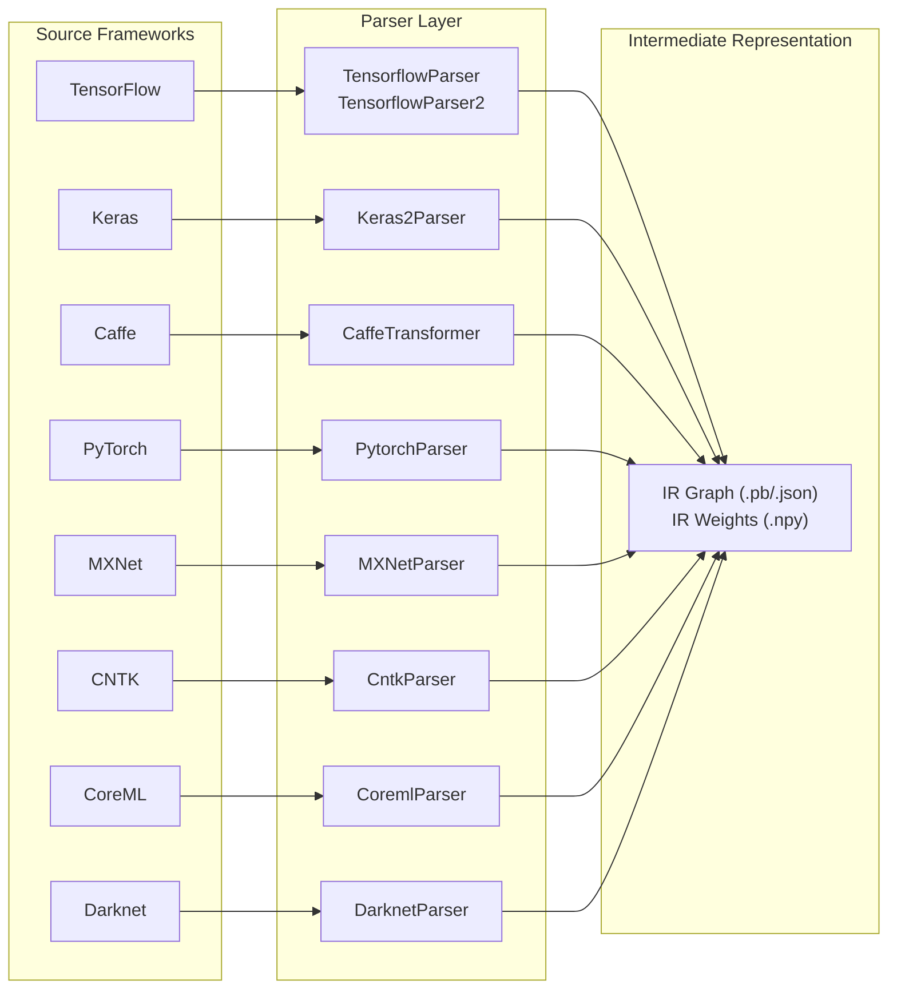
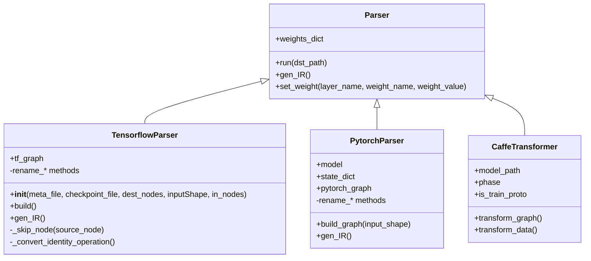
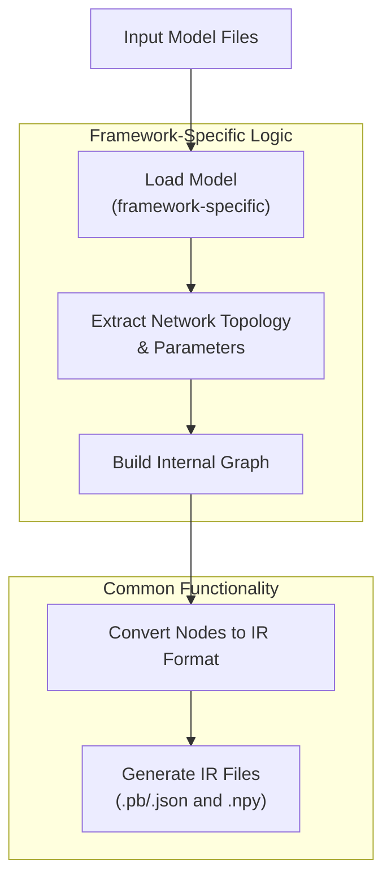
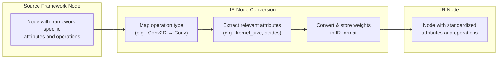

<!-- source: DeepWiki mcp.deepwiki.com · repo microsoft/MMdnn · page 3 Framework Parsers · fetched 2026-10-26 -->

# Framework Parsers

<details>
<summary>Relevant source files</summary>

The following files were used as context for generating this wiki page:

- [mmdnn/conversion/_script/convertToIR.py](mmdnn/conversion/_script/convertToIR.py)
- [mmdnn/conversion/caffe/graph.py](mmdnn/conversion/caffe/graph.py)
- [mmdnn/conversion/caffe/mapper.py](mmdnn/conversion/caffe/mapper.py)
- [mmdnn/conversion/caffe/network.py](mmdnn/conversion/caffe/network.py)
- [mmdnn/conversion/caffe/resolver.py](mmdnn/conversion/caffe/resolver.py)
- [mmdnn/conversion/caffe/shape.py](mmdnn/conversion/caffe/shape.py)
- [mmdnn/conversion/caffe/transformer.py](mmdnn/conversion/caffe/transformer.py)
- [mmdnn/conversion/common/IR/IR_graph.py](mmdnn/conversion/common/IR/IR_graph.py)
- [mmdnn/conversion/pytorch/pytorch_graph.py](mmdnn/conversion/pytorch/pytorch_graph.py)
- [mmdnn/conversion/pytorch/pytorch_parser.py](mmdnn/conversion/pytorch/pytorch_parser.py)
- [mmdnn/conversion/tensorflow/tensorflow_emitter.py](mmdnn/conversion/tensorflow/tensorflow_emitter.py)
- [mmdnn/conversion/tensorflow/tensorflow_frozenparser.py](mmdnn/conversion/tensorflow/tensorflow_frozenparser.py)
- [mmdnn/conversion/tensorflow/tensorflow_graph.py](mmdnn/conversion/tensorflow/tensorflow_graph.py)
- [mmdnn/conversion/tensorflow/tensorflow_parser.py](mmdnn/conversion/tensorflow/tensorflow_parser.py)

</details>


Framework Parsers are fundamental components in the MMdnn model conversion pipeline. They are responsible for extracting neural network model information from source deep learning frameworks and converting it into MMdnn's Intermediate Representation (IR). This page documents the architecture, implementation, and workflow of these parsers.

For information about the Intermediate Representation format itself, see [Intermediate Representation](#2). For details about converting from IR to target frameworks, see [Framework Emitters](#4).

## Overview

MMdnn uses a three-stage conversion process: 
1. **Parsing** - Convert source framework models to IR
2. **Transformation** - Optimize or modify the IR (optional)
3. **Emitting** - Convert IR to target framework models

Framework Parsers handle the first stage, serving as bridges between source frameworks and the IR format.



Sources: [mmdnn/conversion/tensorflow/tensorflow_parser.py:22-32](). [mmdnn/conversion/_script/convertToIR.py:14-116]()

## Common Parser Architecture

All parsers inherit from a base `Parser` class and follow a common pattern:

1. Load the source model
2. Extract model topology (nodes, connections)
3. Extract parameters (weights, biases)
4. Convert framework-specific layer types to IR operations
5. Generate the IR graph and weights files

Each parser implements framework-specific logic while adhering to this common pattern.



Sources: [mmdnn/conversion/tensorflow/tensorflow_parser.py:22-32, 232-424](). [mmdnn/conversion/pytorch/pytorch_parser.py:17-453](). [mmdnn/conversion/caffe/transformer.py:302-368]()

## Parser Workflow

The general workflow of the parsers consists of several key steps:



### 1. Model Loading

Each parser implements its own method to load the model from framework-specific files:

- **TensorFlow**: Loads `.meta` and checkpoint files, or frozen model (`.pb`) files
- **PyTorch**: Loads `.pth` model files
- **Caffe**: Loads `.prototxt` and `.caffemodel` files
- **Others**: Each has its own loading mechanism based on the framework's format

Sources: [mmdnn/conversion/tensorflow/tensorflow_parser.py:232-319](). [mmdnn/conversion/pytorch/pytorch_parser.py:72-94](). [mmdnn/conversion/caffe/transformer.py:17-44]()

### 2. Graph Extraction

After loading the model, parsers extract the computational graph:

- **TensorFlow**: Extracts graph from TensorFlow's native GraphDef structure
- **PyTorch**: Uses PyTorch's tracing capabilities to extract graph information
- **Caffe**: Constructs a graph from the layer definitions in the prototxt file

This step creates an internal representation of the model as a directed graph.

Sources: [mmdnn/conversion/tensorflow/tensorflow_graph.py:57-104](). [mmdnn/conversion/pytorch/pytorch_graph.py:147-254](). [mmdnn/conversion/caffe/graph.py:217-316]()

### 3. IR Generation

The parsers then traverse this internal graph and convert each node to the corresponding IR node:



Each parser implements a series of `rename_*` methods that handle the conversion of specific operation types:

- `rename_Conv`, `rename_BatchNormalization`, `rename_Relu`, etc.

These methods extract the necessary attributes and convert them to the IR format.

Sources: [mmdnn/conversion/tensorflow/tensorflow_parser.py:521-727](). [mmdnn/conversion/pytorch/pytorch_parser.py:223-452](). [mmdnn/conversion/caffe/mapper.py:95-327]()

## Key Parser Implementations

### TensorFlow Parser

MMdnn provides two TensorFlow parsers:

1. **TensorflowParser**: For `.meta` and checkpoint files
   - Handles graph structure from MetaGraphDef
   - Extracts weights from checkpoint files

2. **TensorflowParser2**: For frozen model files
   - Works with serialized GraphDef format
   - Handles quantized models

Both parsers deal with TensorFlow's graph structure and convert it to IR format.

Sources: [mmdnn/conversion/tensorflow/tensorflow_parser.py:22-509](). [mmdnn/conversion/tensorflow/tensorflow_frozenparser.py:16-971]()

### Caffe Parser

The Caffe parser implementation consists of several key components:

1. **CaffeTransformer**: Main entry point for Caffe model conversion
2. **GraphBuilder**: Builds a graph from Caffe prototxt
3. **DataInjector**: Associates parameters from caffemodel with nodes
4. **NodeMapper**: Maps Caffe layer types to IR operations

The parser handles Caffe's layer-based architecture and converts it to the node-based IR format.

Sources: [mmdnn/conversion/caffe/transformer.py:302-609](). [mmdnn/conversion/caffe/graph.py:217-458](). [mmdnn/conversion/caffe/mapper.py:22-327]()

### PyTorch Parser

The PyTorch parser:

1. Loads a PyTorch model
2. Uses tracing to capture the computational graph
3. Extracts model parameters from state_dict
4. Maps PyTorch operations to IR operations

It has different implementations for different PyTorch versions (0.4.0 and 1.5.1+).

Sources: [mmdnn/conversion/pytorch/pytorch_parser.py:17-452](). [mmdnn/conversion/pytorch/pytorch_graph.py:52-256]()

## Parser Selection and Usage

The parser selection is handled by the `_convert` function in `convertToIR.py`, which:

1. Accepts command-line arguments specifying the source framework and model files
2. Instantiates the appropriate parser based on the source framework
3. Runs the parser to generate IR files

```python
# Example usage (command line):
mmtoir -f tensorflow -in model.pb -o model_ir --inputShape 224,224,3
```

This invokes the TensorFlow parser to convert a model to IR format.

Sources: [mmdnn/conversion/_script/convertToIR.py:6-122]()

## Handling Framework-Specific Features

Each parser addresses unique challenges specific to its framework:

### TensorFlow-specific Handling

- **Skip specific nodes**: TensorFlow graphs often contain nodes that don't affect the model computation (e.g., training operations). The parser filters these out.
  
  ```python
  skip_prefix = [
      "^",
      "train_op",
      "save",
      "gradients",
      "init",
      "global_step",
      "distort_image",
      "Adagrad",
  ]
  ```

- **Padding conversion**: Converts TensorFlow's padding approach to IR's format.

Sources: [mmdnn/conversion/tensorflow/tensorflow_parser.py:24-41, 371-388]()

### Caffe-specific Handling

- **Batch Normalization**: Caffe's BatchNorm is often followed by a Scale layer. The parser fuses these.
- **Layer parameter extraction**: Extracts parameters like kernel_shape, strides from Caffe's layer parameters.

Sources: [mmdnn/conversion/caffe/mapper.py:42-77, 257-265](). [mmdnn/conversion/caffe/transformer.py:221-237]()

### PyTorch-specific Handling

- **Shape inference**: PyTorch's dynamic computation graph requires explicit shape inference.
- **Version compatibility**: Different parsing approaches for different PyTorch versions.

Sources: [mmdnn/conversion/pytorch/pytorch_parser.py:119-160, 147-256]()

## Common Challenges and Solutions

### 1. Different Node Representation

Each framework represents computational nodes differently:
- TensorFlow uses a graph of operations
- Caffe organizes by layers
- PyTorch uses a dynamic computation graph

Solution: Each parser creates its own internal graph representation that maps to the IR format.

### 2. Weight Format Differences

Weight tensors are stored in different formats across frameworks:
- TensorFlow: [filter_height, filter_width, in_channels, out_channels]
- Caffe: [out_channels, in_channels, filter_height, filter_width]

Solution: Parsers reshape and transpose weights to a common format.

Sources: [mmdnn/conversion/tensorflow/tensorflow_parser.py:534-547](). [mmdnn/conversion/caffe/transformer.py:100-159]()

### 3. Operator Mapping

Each framework has unique operators that need mapping to a common IR representation.

Solution: Parsers implement `rename_*` methods for each operator type to standardize the operation.

Sources: [mmdnn/conversion/tensorflow/tensorflow_parser.py:521-727](). [mmdnn/conversion/pytorch/pytorch_parser.py:223-452](). [mmdnn/conversion/caffe/mapper.py:95-327]()

## Extending with New Parsers

To add support for a new framework, you need to:

1. Create a new parser class that inherits from the base `Parser` class
2. Implement the required methods:
   - Model loading
   - Graph extraction
   - Node conversion
   - IR generation
3. Add the parser to the parser selection logic in `convertToIR.py`

The modular design allows for relatively straightforward extension to new frameworks.

Sources: [mmdnn/conversion/_script/convertToIR.py:6-122]()

## Supported Frameworks

MMdnn currently supports the following frameworks as source:

| Framework | Parser Class | Model File Formats |
|-----------|--------------|-------------------|
| TensorFlow | TensorflowParser, TensorflowParser2 | .pb, .meta + checkpoint |
| Keras | Keras2Parser | .h5, .json + .h5 |
| Caffe | CaffeTransformer | .prototxt + .caffemodel |
| PyTorch | PytorchParser | .pth |
| MXNet | MXNetParser | .json + .params |
| CNTK | CntkParser | .model |
| CoreML | CoremlParser | .mlmodel |
| Darknet | DarknetParser | .cfg + .weights |

Sources: [mmdnn/conversion/_script/convertToIR.py:14-116]()

---

