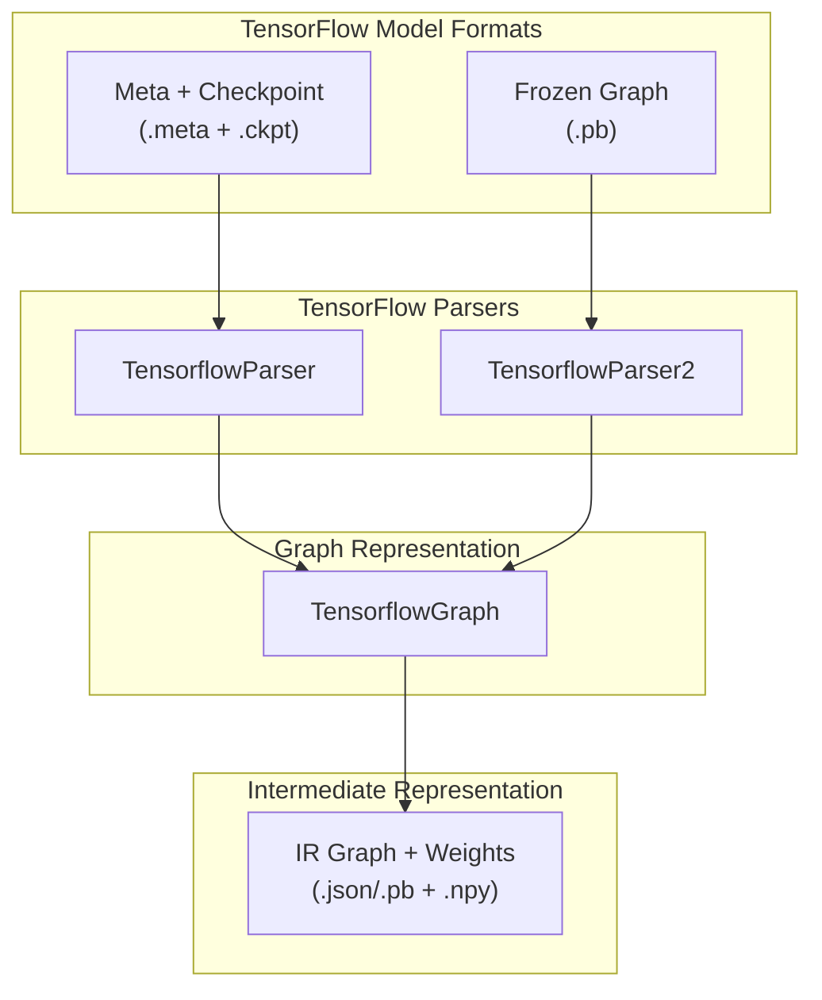
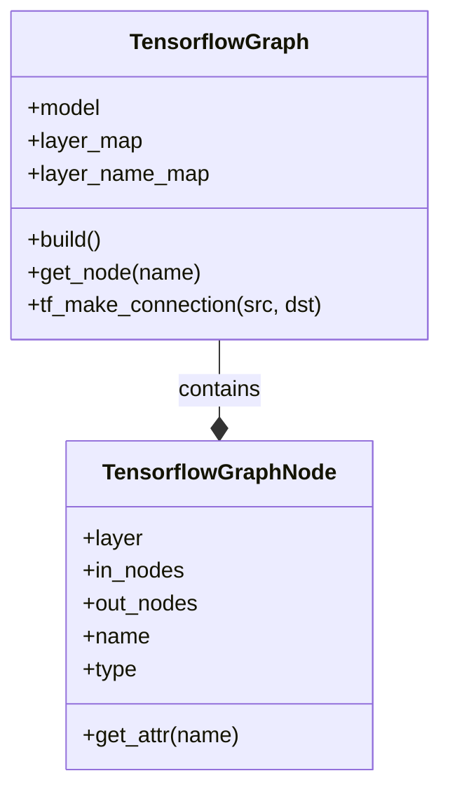
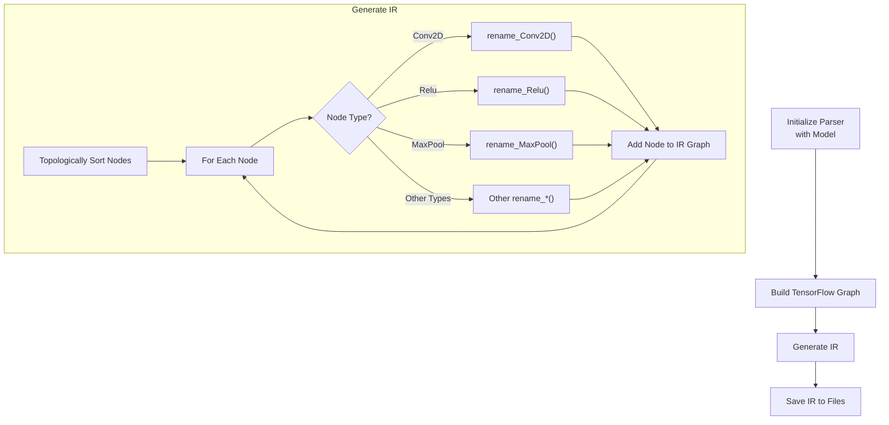
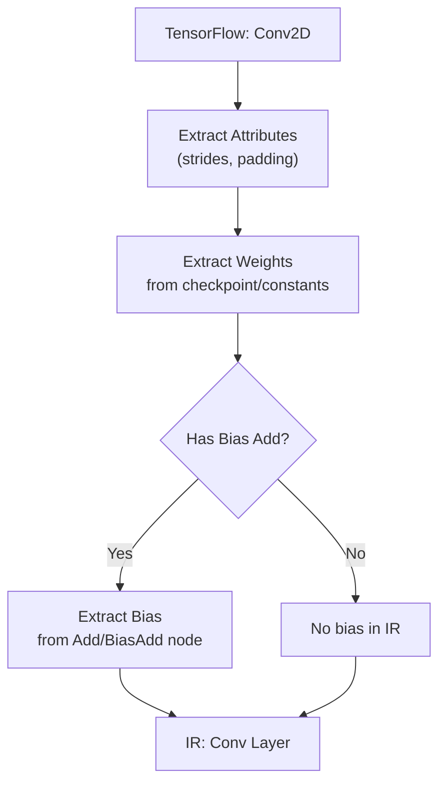

<!-- source: DeepWiki mcp.deepwiki.com · repo microsoft/MMdnn · page 3.1 TensorFlow Parser · fetched 2026-10-26 -->

# TensorFlow Parser

<details>
<summary>Relevant source files</summary>

The following files were used as context for generating this wiki page:

- [mmdnn/conversion/tensorflow/tensorflow_emitter.py](mmdnn/conversion/tensorflow/tensorflow_emitter.py)
- [mmdnn/conversion/tensorflow/tensorflow_frozenparser.py](mmdnn/conversion/tensorflow/tensorflow_frozenparser.py)
- [mmdnn/conversion/tensorflow/tensorflow_graph.py](mmdnn/conversion/tensorflow/tensorflow_graph.py)
- [mmdnn/conversion/tensorflow/tensorflow_parser.py](mmdnn/conversion/tensorflow/tensorflow_parser.py)

</details>


This page provides detailed documentation of the TensorFlow parser in MMdnn. The TensorFlow parser converts TensorFlow models into MMdnn's Intermediate Representation (IR), enabling translation between TensorFlow and other deep learning frameworks. For information about the general IR format, please see [Intermediate Representation](#2).

## Overview

The TensorFlow parser is responsible for extracting the graph structure and weights from TensorFlow models and converting them into MMdnn's standardized IR format. MMdnn provides two parser implementations to handle different types of TensorFlow model formats:

1. `TensorflowParser` - Processes checkpointed models (meta files + checkpoint files)
2. `TensorflowParser2` - Processes frozen graph models (.pb files)



Sources: [mmdnn/conversion/tensorflow/tensorflow_parser.py:22-1072](), [mmdnn/conversion/tensorflow/tensorflow_frozenparser.py:16-1188]()

## Parser Types

### TensorflowParser

`TensorflowParser` processes TensorFlow models stored as meta and checkpoint files. It provides capabilities for:

- Loading model architecture from meta files
- Loading weights from checkpoint files
- Extracting subgraphs using specified input and output nodes
- Converting the TensorFlow graph to IR

The parser initializes with:

```python
def __init__(self, meta_file, checkpoint_file, dest_nodes, inputShape=None, in_nodes=None):
    # Loads model and builds graph
```

Sources: [mmdnn/conversion/tensorflow/tensorflow_parser.py:232-319]()

### TensorflowParser2

`TensorflowParser2` processes frozen TensorFlow models (.pb files) which contain both the graph definition and weights in a single file. It provides similar functionality to `TensorflowParser` but is adapted for the frozen model format:

```python
def __init__(self, frozen_file, inputshape, in_nodes, dest_nodes):
    # Loads frozen model and builds graph
```

Sources: [mmdnn/conversion/tensorflow/tensorflow_frozenparser.py:108-180]()

## Graph Representation

Both parsers use a common graph representation through the `TensorflowGraph` class, which provides a structure to represent the TensorFlow computation graph:



Key components:
- `TensorflowGraphNode`: Represents a single operation in the TensorFlow graph
- `TensorflowGraph`: Contains the collection of nodes and their connections

Sources: [mmdnn/conversion/tensorflow/tensorflow_graph.py:11-105]()

## Conversion Process

The conversion process from TensorFlow to IR follows these steps:



The core of the conversion process is in the `gen_IR()` method, which processes each node in the TensorFlow graph:

1. Nodes are processed in topological order
2. For each node type, a specific `rename_*` method is called
3. These methods convert TensorFlow operations to equivalent IR operations
4. Weights and attributes are transferred to the IR

Sources: [mmdnn/conversion/tensorflow/tensorflow_parser.py:410-423](), [mmdnn/conversion/tensorflow/tensorflow_frozenparser.py:381-397]()

## Operation Mapping

The parsers contain numerous specialized methods to convert different TensorFlow operations to IR. Here's a table of common TensorFlow operations and their corresponding IR operations:

| TensorFlow Operation | Parser Method | IR Operation |
|----------------------|---------------|--------------|
| Conv2D | rename_Conv2D | Conv |
| Relu | rename_Relu | Relu |
| MaxPool | rename_MaxPool | Pool (type=MAX) |
| AvgPool | rename_AvgPool | Pool (type=AVG) |
| MatMul | rename_MatMul | FullyConnected |
| FusedBatchNorm | rename_FusedBatchNorm | BatchNorm |
| Placeholder | rename_Placeholder | DataInput |
| Add | rename_Add | Add |
| Concat/ConcatV2 | rename_ConcatV2 | Concat |
| Reshape | rename_Reshape | Reshape |
| Softmax | rename_Softmax | Softmax |

The parser also handles many other operations including:
- Element-wise operations (Add, Mul, Sub)
- Activation functions (Relu, Sigmoid, Tanh)
- Tensor manipulation (Reshape, Squeeze, Transpose)
- And many more specialized operations

Sources: [mmdnn/conversion/tensorflow/tensorflow_parser.py:512-1071](), [mmdnn/conversion/tensorflow/tensorflow_frozenparser.py:538-1188]()

## Handling Node Attributes and Weights

The parsers extract and convert node attributes and weights during the conversion process. Here's how some common attributes are handled:

### Convolution Layers

For Conv2D operations, the parser:
1. Extracts kernel shape, strides, and padding information
2. Converts TensorFlow's padding format to IR's padding format
3. Extracts weights from the checkpoint data
4. Checks for and handles bias addition nodes



Sources: [mmdnn/conversion/tensorflow/tensorflow_parser.py:521-549]()

### Batch Normalization

For FusedBatchNorm operations, the parser:
1. Extracts epsilon value
2. Extracts scale (gamma), bias (beta), mean, and variance from the checkpoint data
3. Sets appropriate flags for scale and bias usage

Sources: [mmdnn/conversion/tensorflow/tensorflow_parser.py:774-817]()

## Usage Examples

### Converting a TensorFlow Meta+Checkpoint Model

```python
from mmdnn.conversion.tensorflow.tensorflow_parser import TensorflowParser

# Initialize parser with meta file, checkpoint file, and output node names
parser = TensorflowParser(
    "model.meta",  # Meta file path
    "model.ckpt",  # Checkpoint file path
    ["output_node"],  # Output node names
)

# Generate IR
parser.gen_IR()

# Save IR to files
parser.save_to_proto("ir_model.json")  # Save graph structure
parser.save_weights("ir_weights.npy")  # Save weights
```

### Converting a Frozen TensorFlow Model

```python
from mmdnn.conversion.tensorflow.tensorflow_frozenparser import TensorflowParser2

# Initialize parser with frozen model, input shape, input node names, and output node names
parser = TensorflowParser2(
    "frozen_model.pb",  # Frozen model path
    [224, 224, 3],  # Input shape (excluding batch dimension)
    ["input"],  # Input node names
    ["output"]  # Output node names
)

# Generate IR
parser.gen_IR()

# Save IR to files
parser.save_to_proto("ir_model.json")  # Save graph structure
parser.save_weights("ir_weights.npy")  # Save weights
```

## Summary

The TensorFlow Parser in MMdnn is a sophisticated component that converts TensorFlow models into a framework-agnostic Intermediate Representation. It supports both checkpoint-based models and frozen models, handles a wide variety of TensorFlow operations, and carefully preserves the structure and weights of the original model.

By using specialized methods for each operation type, the parser ensures accurate conversion of TensorFlow-specific attributes and behaviors to the standardized IR format, enabling further conversion to other deep learning frameworks supported by MMdnn.

---

