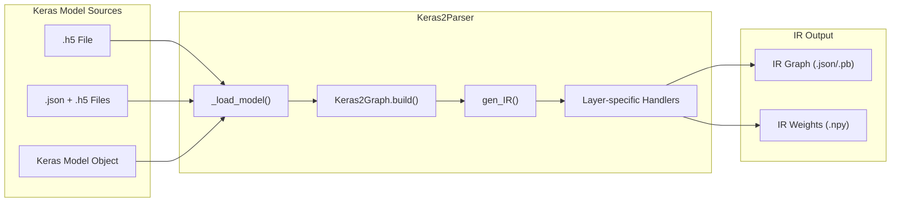
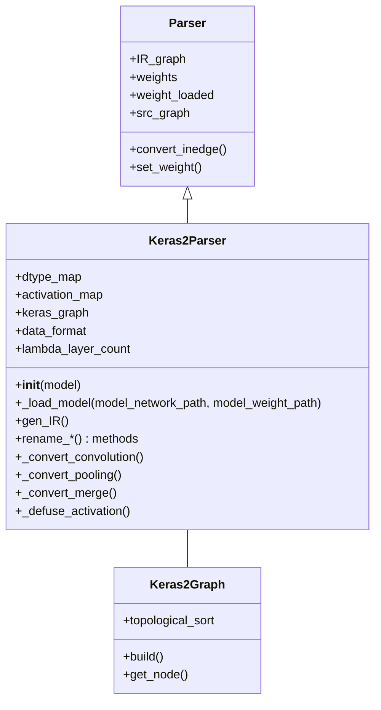
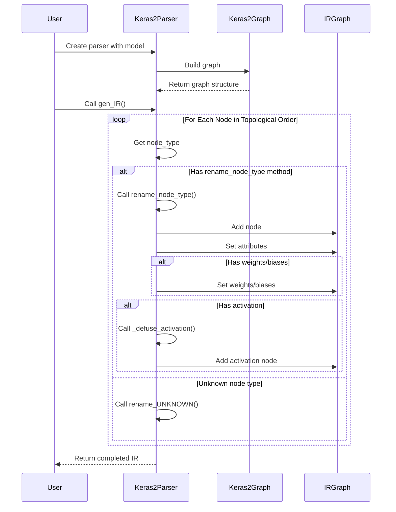
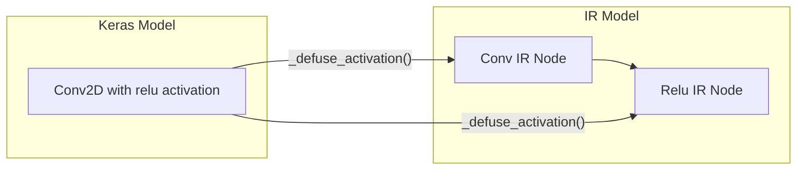

<!-- source: DeepWiki mcp.deepwiki.com · repo microsoft/MMdnn · page 3.2 Keras Parser · fetched 2026-10-26 -->

# Keras Parser

<details>
<summary>Relevant source files</summary>

The following files were used as context for generating this wiki page:

- [mmdnn/conversion/common/IR/ops.pbtxt](mmdnn/conversion/common/IR/ops.pbtxt)
- [mmdnn/conversion/keras/keras2_parser.py](mmdnn/conversion/keras/keras2_parser.py)

</details>


## Purpose and Scope

The Keras Parser is a component of the MMdnn framework responsible for parsing Keras models and converting them to the Intermediate Representation (IR) format. This component serves as a bridge, enabling Keras models to be converted to other deep learning frameworks supported by MMdnn. 

For information about the overall conversion pipeline, see [System Architecture](#1.1). For details on the Intermediate Representation format, see [Intermediate Representation](#2).

## Overview

The Keras Parser takes a Keras model (in various formats) as input and produces two IR files:
- A graph structure file (`.json` or `.pb`)
- A weights file (`.npy`) 

These files represent the model structure and parameters in a framework-agnostic format that can be used by MMdnn emitters to generate models for target frameworks.



Sources: [mmdnn/conversion/keras/keras2_parser.py:97-152]()

## Implementation Details

The Keras Parser is implemented in the `Keras2Parser` class which inherits from the base `Parser` class in the MMdnn framework.



Sources: [mmdnn/conversion/keras/keras2_parser.py:18-33](), [mmdnn/conversion/keras/keras2_parser.py:134-136]()

### Key Components

1. **Type Mappings**: Dictionaries that map Keras data types and activations to their IR equivalents
   - `dtype_map`: Maps Keras data types to IR data types
   - `activation_map`: Maps Keras activation functions to IR operations

2. **Model Loading**: Methods to load Keras models in various formats
   - Direct loading of `.h5` files
   - Loading from model definition (`.json`) and weights (`.h5`) files
   - Handling of custom objects (e.g., MobileNet components)

3. **Graph Building**: Uses `Keras2Graph` to construct a graph representation of the model

4. **IR Generation**: Converts the Keras graph to IR format
   - Traverses the graph in topological order
   - Applies layer-specific handlers
   - Manages weights and biases

Sources: [mmdnn/conversion/keras/keras2_parser.py:20-41](), [mmdnn/conversion/keras/keras2_parser.py:44-90](), [mmdnn/conversion/keras/keras2_parser.py:140-152]()

## Model Loading

The Keras Parser supports loading models in multiple formats:

| Format | Description | Implementation |
|--------|-------------|----------------|
| Model file | A `.h5` file containing both model architecture and weights | `_keras.models.load_model()` |
| Model architecture + weights | Separate `.json` (architecture) and `.h5` (weights) files | `model_from_json()` + `load_weights()` |
| Model object | An in-memory Keras model object | Direct use |

The parser handles custom objects that may be present in the model:
- MobileNet's `relu6` activation
- MobileNet's `DepthwiseConv2D` layer

Sources: [mmdnn/conversion/keras/keras2_parser.py:44-90](), [mmdnn/conversion/keras/keras2_parser.py:97-130]()

## IR Conversion Process

The conversion from Keras model to IR follows these steps:



The key method is `gen_IR()`, which:
1. Iterates through nodes in topological order
2. Determines the node type
3. Calls the appropriate `rename_X` method based on the node type
4. Adds the node to the IR graph
5. Sets node attributes, weights, and biases
6. Handles activations separately using `_defuse_activation()`

Sources: [mmdnn/conversion/keras/keras2_parser.py:140-152](), [mmdnn/conversion/keras/keras2_parser.py:216-232]()

## Layer Support

The Keras Parser supports a wide range of Keras layer types, mapping them to corresponding IR operations:

| Category | Keras Layers | IR Operations |
|----------|--------------|---------------|
| Input | InputLayer | DataInput |
| Convolution | Conv1D, Conv2D, Conv3D, *Transpose variants | Conv, ConvTranspose |
| Pooling | MaxPooling1D/2D/3D, AveragePooling1D/2D/3D, GlobalPooling variants | Pool |
| Core | Dense | FullyConnected |
| | Flatten | Flatten |
| | Reshape | Reshape |
| Merge | Add, Concatenate, Multiply | Add, Concat, Mul |
| Normalization | BatchNormalization | BatchNorm |
| Recurrent | LSTM, GRU | LSTM, GRU |
| Activation | Activation, ReLU, LeakyReLU | Relu, LeakyRelu, other activations |
| Other | ZeroPadding2D, Dropout, Embedding, UpSampling2D, Lambda | Pad, Dropout, Embedding, etc. |

The parser also supports specialized layers:
- SeparableConv2D
- DepthwiseConv2D
- Cropping layers (Cropping1D/2D/3D)

Sources: [mmdnn/conversion/keras/keras2_parser.py:423-794](), [mmdnn/conversion/common/IR/ops.pbtxt:1-824]()

### Layer-Specific Handlers

For each supported layer type, the parser provides a dedicated `rename_X` method that:
1. Creates a new IR node
2. Copies basic information (name, operation type)
3. Sets layer-specific attributes
4. Handles input edges
5. Manages weights and biases if present
6. Processes any activation function attached to the layer

Common operations are abstracted into helper methods:
- `_convert_convolution()`: Handles all convolution types
- `_convert_pooling()`: Handles all pooling types
- `_convert_merge()`: Handles merge operations
- `_convert_padding_api()`: Handles padding operations
- `_defuse_activation()`: Separates activations from layers

Sources: [mmdnn/conversion/keras/keras2_parser.py:234-307](), [mmdnn/conversion/keras/keras2_parser.py:309-353](), [mmdnn/conversion/keras/keras2_parser.py:355-371]()

## Data Format Handling

The Keras Parser supports both `channels_first` (NCHW) and `channels_last` (NHWC) data formats. The parser:

1. Determines the data format from the Keras backend configuration
2. Sets the appropriate data format attribute in IR nodes
3. Adjusts tensor dimensions based on the data format
4. Handles axis parameters correctly based on the data format

```python
# Example: Detection and conversion of data format
if source_node.keras_layer.data_format == 'channels_last':
    target_node.attr["data_format"].s = "NHWC"
elif source_node.keras_layer.data_format == 'channels_first':
    target_node.attr["data_format"].s = "NCHW"
```

Sources: [mmdnn/conversion/keras/keras2_parser.py:188-194](), [mmdnn/conversion/keras/keras2_parser.py:284-285]()

## Activation Handling

The Keras Parser handles activations in two ways:

1. **Standalone activation layers**: Directly mapped to corresponding IR operations
2. **Integrated activations**: Separated from their parent layers using `_defuse_activation()`



The activation mapping dictionary defines corresponding IR operations for Keras activations:

| Keras Activation | IR Operation |
|------------------|--------------|
| relu | Relu |
| softmax | Softmax |
| sigmoid | Sigmoid |
| tanh | Tanh |
| elu | Elu |
| relu6 | Relu6 |
| softplus | Softplus |
| softsign | Softsign |
| hard_sigmoid | HardSigmoid |

Sources: [mmdnn/conversion/keras/keras2_parser.py:31-41](), [mmdnn/conversion/keras/keras2_parser.py:216-232](), [mmdnn/conversion/keras/keras2_parser.py:406-417]()

## Weight Management

For layers with weights and biases, the parser:

1. Extracts weights from the Keras layer
2. Converts them to the appropriate format for the IR
3. Stores them in the IR weights object

This process varies by layer type:
- For convolution layers, weights are stored as `weights` and `bias`
- For separable convolution, weights are stored as `depthwise_filter` and `pointwise_filter`
- For dense layers, weights are stored as `weights` and `bias`
- For batch normalization, weights are stored as `scale`, `bias`, `mean`, and `var`

Sources: [mmdnn/conversion/keras/keras2_parser.py:244-266](), [mmdnn/conversion/keras/keras2_parser.py:535-539](), [mmdnn/conversion/keras/keras2_parser.py:695-713]()

## Error Handling

The parser implements several error handling strategies:

1. For unsupported layer types, it prints a warning and calls `rename_UNKNOWN()`
2. For custom Lambda layers, it attempts to find a corresponding handler by name
3. For model loading issues, it provides detailed error messages

Sources: [mmdnn/conversion/keras/keras2_parser.py:148-150](), [mmdnn/conversion/keras/keras2_parser.py:393-404](), [mmdnn/conversion/keras/keras2_parser.py:667-674]()

## Usage Example

The Keras Parser is typically used via command-line tools, but can also be used programmatically:

```python
# Example usage
from mmdnn.conversion.keras.keras2_parser import Keras2Parser

# Option 1: Load from .h5 file
parser = Keras2Parser('model.h5')

# Option 2: Load from .json and .h5 files
parser = Keras2Parser(('model.json', 'model_weights.h5'))

# Generate IR
parser.gen_IR()

# Access IR graph and weights
ir_graph = parser.IR_graph
ir_weights = parser.weights
```

The parser is most commonly used through the `mmtoir` command-line tool:

```
mmtoir -f keras -w model_weights.h5 -o output_prefix -n model.json
```

Or through the all-in-one `mmconvert` tool:

```
mmconvert -sf keras -iw model_weights.h5 -in model.json -df tensorflow -om output_model.pb
```

---

