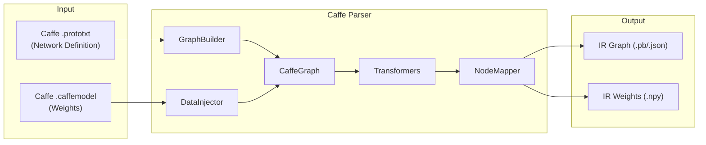
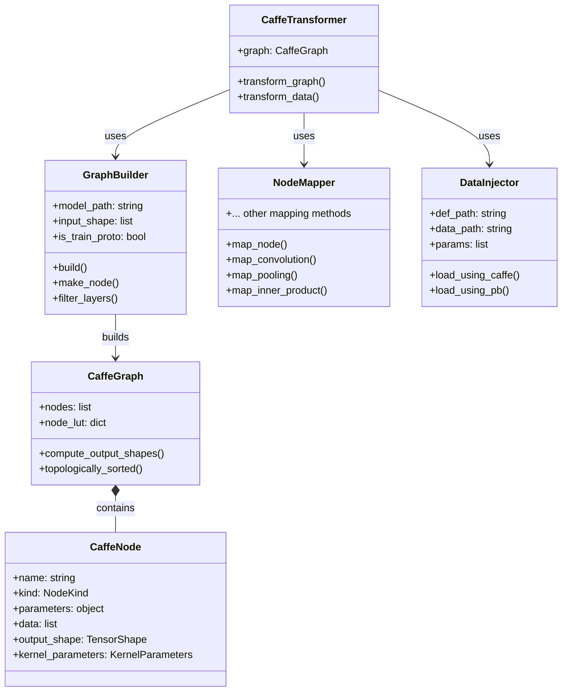
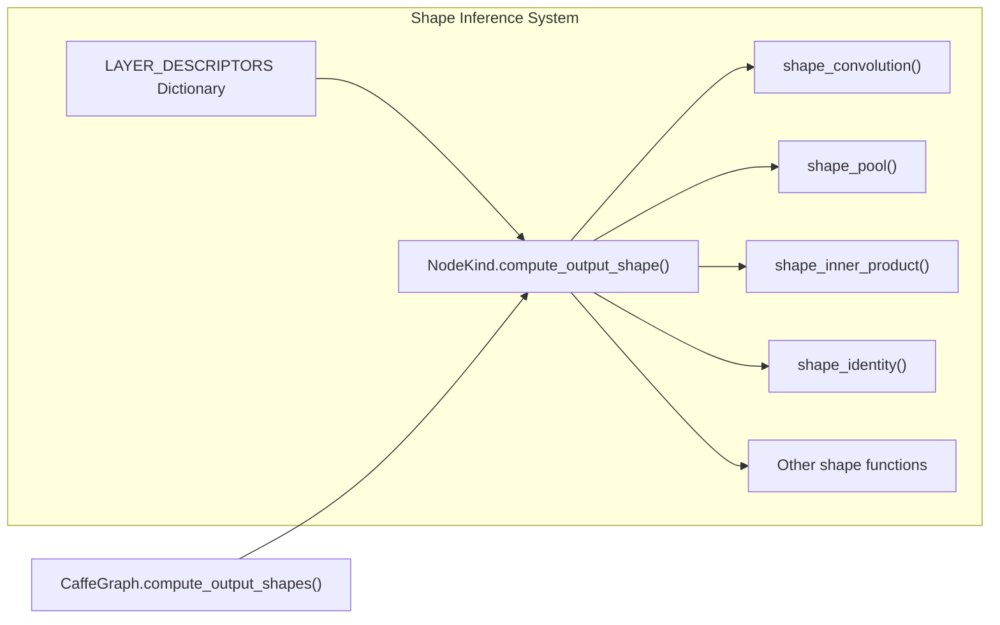
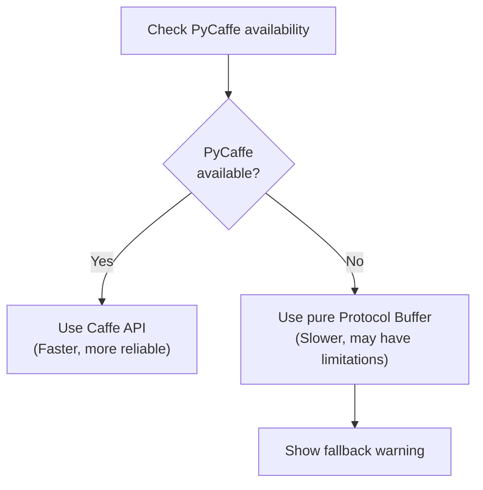

<!-- source: DeepWiki mcp.deepwiki.com · repo microsoft/MMdnn · page 3.3 Caffe Parser · fetched 2026-10-26 -->

# Caffe Parser

Relevant source files

The following files were used as context for generating this wiki page:

- [mmdnn/conversion/caffe/graph.py](mmdnn/conversion/caffe/graph.py)
- [mmdnn/conversion/caffe/mapper.py](mmdnn/conversion/caffe/mapper.py)
- [mmdnn/conversion/caffe/network.py](mmdnn/conversion/caffe/network.py)
- [mmdnn/conversion/caffe/resolver.py](mmdnn/conversion/caffe/resolver.py)
- [mmdnn/conversion/caffe/shape.py](mmdnn/conversion/caffe/shape.py)
- [mmdnn/conversion/caffe/transformer.py](mmdnn/conversion/caffe/transformer.py)
- [mmdnn/conversion/common/IR/IR_graph.py](mmdnn/conversion/common/IR/IR_graph.py)

The Caffe Parser is a component of the MMdnn model conversion system that transforms models from the Caffe framework into MMdnn's Intermediate Representation (IR). This document explains the architecture, workflow, and key components of the Caffe Parser subsystem.

For information about other parsers in the system, see [Framework Parsers](#3). For details about the IR format, see [Intermediate Representation](#2).

## 1. Overview

The Caffe Parser translates Caffe models (defined by .prototxt and .caffemodel files) into the standardized IR format. It handles the conversion of network topology, layer parameters, and weights, enabling interoperability with other deep learning frameworks through MMdnn.

Sources: [mmdnn/conversion/caffe/graph.py](), [mmdnn/conversion/caffe/transformer.py](), [mmdnn/conversion/caffe/mapper.py]()

## 2. Key Components

The Caffe Parser consists of several cooperating classes that handle different aspects of the conversion process.

Sources: [mmdnn/conversion/caffe/graph.py:217-296](), [mmdnn/conversion/caffe/transformer.py:302-422](), [mmdnn/conversion/caffe/mapper.py:22-327]()

### 2.1 GraphBuilder

The `GraphBuilder` class parses a Caffe model definition (.prototxt) and constructs a graph representation of the network.

Key responsibilities:
- Loading the Caffe model definition
- Filtering layers based on phase (train/test)
- Creating `CaffeNode` instances for each layer
- Building the network topology by connecting nodes
- Computing output shapes for each node

Sources: [mmdnn/conversion/caffe/graph.py:318-455]()

### 2.2 CaffeGraph and CaffeNode

These classes represent the structure of a Caffe model:

- `CaffeGraph`: Contains a collection of nodes and provides methods for traversal and manipulation
- `CaffeNode`: Represents a single layer in the Caffe model, with its parameters, shape information, and connections

`CaffeNode` stores important properties:
- Layer type (kind)
- Parameters and kernel parameters
- Data (weights and biases)
- Output shape
- Connections to parent and child nodes

Sources: [mmdnn/conversion/caffe/graph.py:139-215](), [mmdnn/conversion/caffe/graph.py:217-316]()

### 2.3 DataInjector

The `DataInjector` loads parameters from a Caffe model weights file (.caffemodel) and associates them with the corresponding nodes in the graph.

It supports two loading methods:
1. Using PyCaffe (if available)
2. Falling back to a pure protocol buffer implementation (slower but doesn't require Caffe installation)

Sources: [mmdnn/conversion/caffe/transformer.py:12-89](), [mmdnn/conversion/caffe/resolver.py:6-51]()

### 2.4 NodeMapper

The `NodeMapper` class maps Caffe layer types to IR operations. It contains methods for each supported layer type to extract parameters and convert them to the IR format.

Examples of supported layer types:
- Convolution/Deconvolution
- Pooling/Unpooling
- Inner Product (Fully Connected)
- Batch Normalization
- Activation functions (ReLU, Sigmoid, Tanh)
- Element-wise operations
- And many more

Sources: [mmdnn/conversion/caffe/mapper.py:22-327]()

### 2.5 Shape Inference

The shape inference system predicts the output shape of each layer based on its parameters and input shape.

Sources: [mmdnn/conversion/caffe/shape.py:1-142](), [mmdnn/conversion/caffe/graph.py:60-110]()

## 3. Conversion Workflow

The conversion process follows these steps:

1. **Initialization**:
   - Create a `CaffeTransformer` with paths to model definition and weights
   - Determine if using train or test phase
   - Set input shape if required

2. **Graph Building**:
   - `GraphBuilder` loads and parses the .prototxt file
   - Create nodes for each layer and build network topology
   - Compute output shapes for all nodes

3. **Parameter Loading**:
   - `DataInjector` loads parameters from .caffemodel
   - Associate parameters with corresponding nodes

4. **Graph Transformation**:
   - Apply transformers like `BatchNormScaleBiasFuser` to optimize the graph
   - Reshape parameters for compatibility with IR format

5. **Node Mapping**:
   - Map each Caffe node to its IR counterpart using `NodeMapper`
   - Extract and convert parameters to IR format

The final result is an IR graph and associated weights that can be emitted to other frameworks.

Sources: [mmdnn/conversion/caffe/transformer.py:302-422]()

## 4. Supported Layer Types

The Caffe Parser supports a wide range of layer types. The mapping from Caffe layers to IR operations is defined in the `NodeMapper` class.

| Caffe Layer Type | IR Operation | Handler Method |
|------------------|--------------|---------------|
| Convolution | Conv | map_convolution |
| Deconvolution | ConvTranspose | map_deconvolution |
| Pooling | Pool | map_pooling |
| InnerProduct | FullyConnected | map_inner_product |
| BatchNorm | BatchNorm | map_batch_norm |
| Scale | Affine/Mul | map_scale |
| ReLU | Relu | map_relu |
| Sigmoid | Sigmoid | map_sigmoid |
| Tanh | Tanh | map_tanh |
| Softmax | Softmax | map_softmax |
| Concat | Concat | map_concat |
| Eltwise | Add/Mul/Max | map_eltwise |
| Dropout | Dropout | map_dropout |
| LRN | LRN | map_lrn |
| Flatten | Flatten | map_flatten |
| Reshape | Reshape | map_reshape |
| ELU | ELU | map_elu |
| PReLU | PRelu | map_p_re_lu |
| ... | ... | ... |

Sources: [mmdnn/conversion/caffe/mapper.py:80-327](), [mmdnn/conversion/caffe/graph.py:60-110]()

## 5. Handling Special Cases

### 5.1 Train vs Test Protobuf

The Caffe Parser can handle both deployment (.prototxt) and train/val (.prototxt) model definitions. For train/val prototxt, special processing is required:

- Remove loss layers except the last one
- Remove layers that have 'label' in their inputs
- Add a prediction layer if the last layer is a loss layer
- Set input dimensions based on the provided input_shape

Sources: [mmdnn/conversion/caffe/graph.py:326-374]()

### 5.2 Fallback Mechanism

If PyCaffe is not available, the parser falls back to a pure protocol buffer implementation:

Sources: [mmdnn/conversion/caffe/resolver.py:6-51](), [mmdnn/conversion/caffe/transformer.py:12-89]()

### 5.3 Shape Computation

Shape computation uses different approaches depending on PyCaffe availability:

- With PyCaffe: Uses Caffe's built-in shape inference
- Without PyCaffe: Uses custom shape inference functions

The shape computation is essential for correctly converting the model topology and ensuring dimensional compatibility.

Sources: [mmdnn/conversion/caffe/graph.py:255-279](), [mmdnn/conversion/caffe/shape.py:1-142]()

## 6. Common Challenges and Limitations

1. **Layer Support**: Not all Caffe layers have direct equivalents in other frameworks. The parser handles known layers, but custom or obscure layers may require special handling.

2. **Parameter Reshaping**: Different frameworks use different parameter ordering conventions. The Caffe Parser reshapes parameters appropriately for the target framework.

3. **Custom Layers**: User-defined layers in Caffe models may not be properly converted without additional implementation.

4. **Dependency on PyCaffe**: While the parser has a fallback mechanism, performance and reliability are better with PyCaffe installed.

Sources: [mmdnn/conversion/caffe/transformer.py:100-159]()

## 7. Integration with MMdnn

The Caffe Parser is integrated into the broader MMdnn system through the command-line tools, particularly:

- `mmtoir` - Converts a Caffe model to IR
- `mmconvert` - Performs end-to-end conversion from Caffe to other frameworks

When used through these tools, the parser automatically handles the necessary steps to convert a Caffe model to IR, which can then be converted to other frameworks using the appropriate emitter.

---

