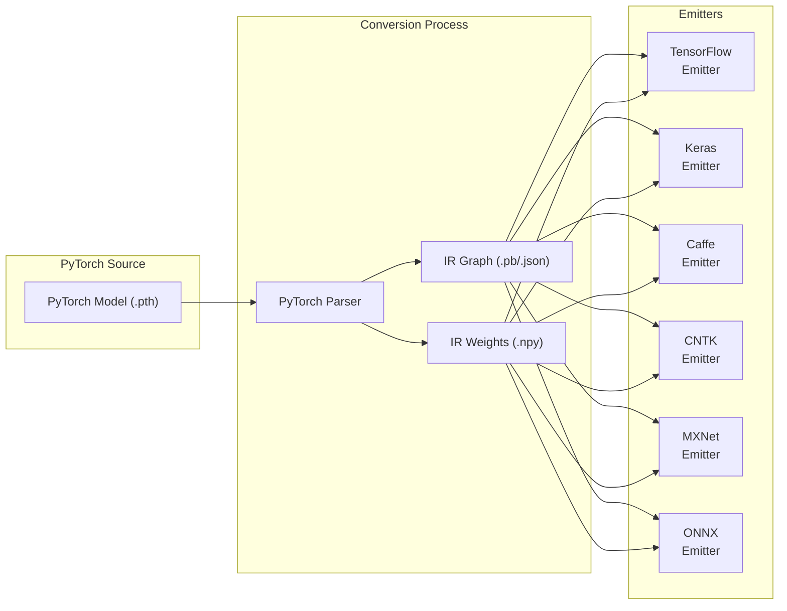
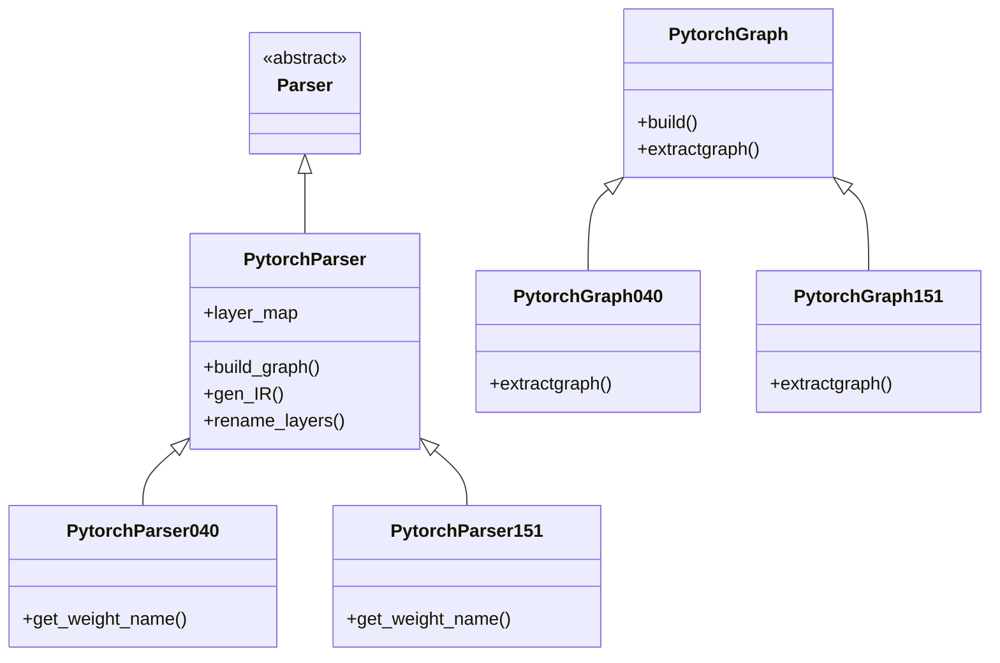
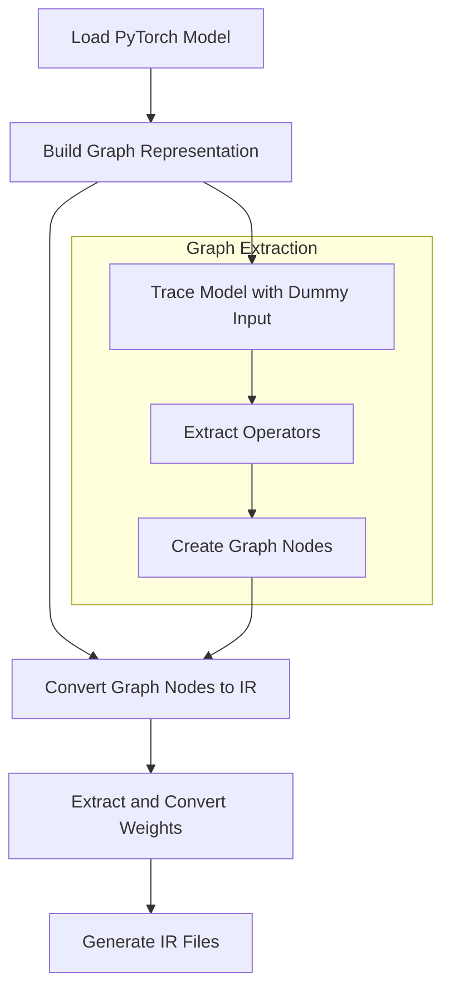
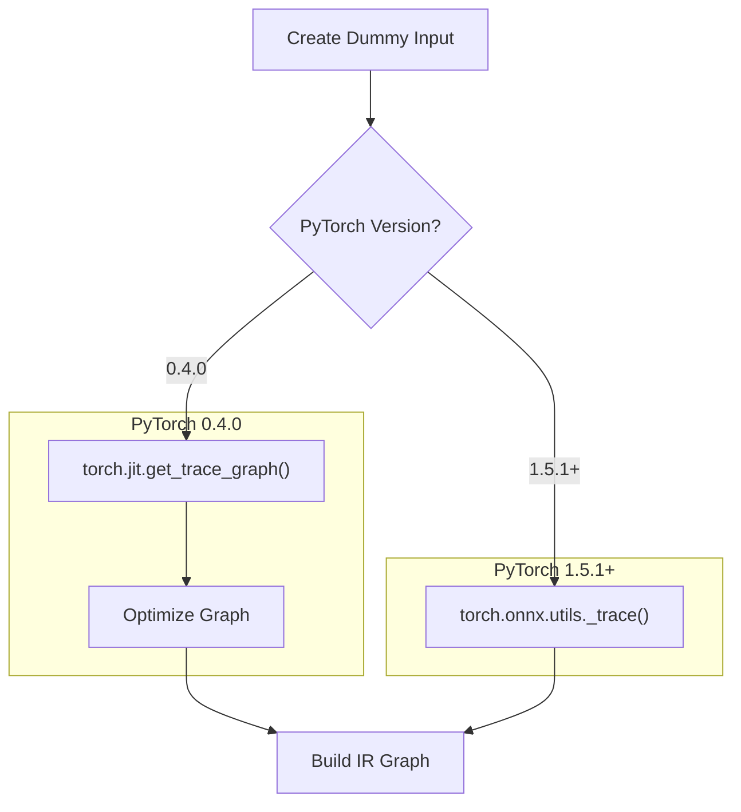

<!-- source: DeepWiki mcp.deepwiki.com · repo microsoft/MMdnn · page 3.4 PyTorch Parser · fetched 2026-10-26 -->

# PyTorch Parser

<details>
<summary>Relevant source files</summary>

The following files were used as context for generating this wiki page:

- [mmdnn/conversion/_script/convertToIR.py](mmdnn/conversion/_script/convertToIR.py)
- [mmdnn/conversion/cntk/README.md](mmdnn/conversion/cntk/README.md)
- [mmdnn/conversion/keras/README.md](mmdnn/conversion/keras/README.md)
- [mmdnn/conversion/mxnet/README.md](mmdnn/conversion/mxnet/README.md)
- [mmdnn/conversion/pytorch/README.md](mmdnn/conversion/pytorch/README.md)
- [mmdnn/conversion/pytorch/pytorch_graph.py](mmdnn/conversion/pytorch/pytorch_graph.py)
- [mmdnn/conversion/pytorch/pytorch_parser.py](mmdnn/conversion/pytorch/pytorch_parser.py)

</details>


## Purpose and Scope
The PyTorch Parser is a component within the MMdnn framework that converts PyTorch models into MMdnn's Intermediate Representation (IR). This enables PyTorch models to be converted to other deep learning frameworks supported by MMdnn. For information about converting IR to PyTorch, see the PyTorch Emitter page [PyTorch Emitter](#4.4).

Sources: [mmdnn/conversion/pytorch/pytorch_parser.py:17-54](), [mmdnn/conversion/pytorch/README.md:1-12]()

## Architecture and Workflow

### Parser in the Conversion Pipeline



The PyTorch Parser extracts the computational graph structure and weights from a PyTorch model and transforms them into MMdnn's Intermediate Representation (IR). This IR can then be consumed by various framework-specific emitters to generate models for target frameworks.

Sources: [mmdnn/conversion/_script/convertToIR.py:87-97]()

## Implementation Details

### Class Hierarchy



The PyTorch Parser is implemented with version-specific classes to handle different PyTorch versions:
- `PytorchParser040` for PyTorch 0.4.0
- `PytorchParser151` for PyTorch 1.5.1 and later

This design allows the parser to accommodate API changes between PyTorch versions.

Sources: [mmdnn/conversion/pytorch/pytorch_parser.py:17-56](), [mmdnn/conversion/pytorch/pytorch_parser.py:518-536](), [mmdnn/conversion/pytorch/pytorch_graph.py:52-101](), [mmdnn/conversion/pytorch/pytorch_graph.py:147-218](), [mmdnn/conversion/pytorch/pytorch_graph.py:219-256]()

### Conversion Process

The conversion process follows these key steps:

1. **Model Loading**: The parser loads a PyTorch model from a .pth file
2. **Graph Extraction**: The model's computational graph is extracted using PyTorch's JIT tracing
3. **Node Mapping**: Each node in the PyTorch graph is mapped to an equivalent IR node
4. **Weight Extraction**: Weights are extracted from the model's state_dict
5. **IR Generation**: The parser generates the IR graph and weights files



Sources: [mmdnn/conversion/pytorch/pytorch_parser.py:72-114](), [mmdnn/conversion/pytorch/pytorch_graph.py:118-144]()

### Layer Mapping

The PyTorch Parser maps PyTorch/ONNX operators to IR operators using a predefined `layer_map`:

| PyTorch/ONNX Operator | IR Operator |
|----------------------|------------|
| onnx::Conv | Conv |
| onnx::Flatten | Flatten |
| onnx::Gemm | FullyConnected |
| onnx::MaxPool | Maxpool |
| onnx::AveragePool | Avgpool |
| onnx::GlobalAveragePool | GAvgpool |
| onnx::Dropout | Dropout |
| onnx::BatchNormalization | BatchNormalization |
| onnx::Add | Add |
| onnx::Concat | Concat |
| onnx::Relu | Relu |
| onnx::Tanh | Tanh |
| onnx::Sigmoid | Sigmoid |
| onnx::Mul | Mul |
| onnx::Pad | Pad |

For each supported operator, there is a corresponding `rename_X` method that handles the conversion logic.

Sources: [mmdnn/conversion/pytorch/pytorch_parser.py:19-54](), [mmdnn/conversion/pytorch/pytorch_parser.py:223-451]()

## Usage

### Command Line Interface

To convert a PyTorch model to IR format using the command line:

```bash
mmtoir -f pytorch -n model.pth --inputShape 3,224,224 -d output_name
```

This will generate:
- `output_name.json`: IR network structure in JSON format
- `output_name.pb`: IR network structure in ProtoBuf format
- `output_name.npy`: IR weights in NumPy format

Note that specifying `--inputShape` is mandatory for PyTorch models since PyTorch is a dynamic framework.

For one-step conversion to another framework (e.g., TensorFlow):

```bash
mmconvert -sf pytorch -iw model.pth -df tensorflow -om tf_model.pb --inputShape 3,224,224
```

Sources: [mmdnn/conversion/pytorch/README.md:39-53](), [mmdnn/conversion/_script/convertToIR.py:87-97]()

## Version Handling

The parser automatically detects PyTorch version and selects the appropriate implementation:

```python
# In convertToIR.py
if torch.__version__ == "0.4.0":
    parser = PytorchParser040(model, inputshape[0])
else:
    parser = PytorchParser151(model, inputshape[0])
```

This approach ensures compatibility with different PyTorch versions without requiring user intervention.

Sources: [mmdnn/conversion/_script/convertToIR.py:92-97]()

## Graph Extraction

The graph extraction process varies by PyTorch version:

- PyTorch 0.4.0: Uses `torch.jit.get_trace_graph()`
- PyTorch 1.5.1+: Uses `torch.onnx.utils._trace()`



Sources: [mmdnn/conversion/pytorch/pytorch_graph.py:152-161](), [mmdnn/conversion/pytorch/pytorch_graph.py:224-232]()

## Tested Models

The PyTorch Parser has been tested with the following models:

| Model | Status |
|-------|--------|
| Vgg16 | ✓ |
| Inception_v3 | ✓ |
| ResNet 50 | ✓ |
| MobileNet V1 | ✓ |
| Tiny-yolo | ✓ |

Where ✓ indicates correctness has been tested.

Sources: [mmdnn/conversion/pytorch/README.md:5-19]()

## Limitations

The PyTorch Parser has several known limitations:

1. **Data Format Conversions**: The main dataflow in a converted network changes from NHWC (channel last) to NCHW (channel first) format. Some operators (like Concat) with axis may not transform correctly and might need manual correction.

2. **No RNN Support**: Currently, no RNN-related operations are supported.

3. **Model Type Restrictions**: The parser supports models saved with architecture and weights but does not support models saved with only weights.

```python
# Supported models contain architecture and weights
model = torch.load(architecture_weight_file)  # <class 'torchvision.models.alexnet.AlexNet'>

# Unsupported models only contain weights
m = torch.load(only_weight_file)  # <class 'collections.OrderedDict'>
```

Sources: [mmdnn/conversion/pytorch/README.md:96-119]()

## Troubleshooting

If you encounter the error "AttributeError: 'collections.OrderedDict' object has no attribute 'state_dict'", it's because you are trying to convert a PyTorch model that only includes weights. You should save a new model with architecture using:

```python
torch.save(model, filename)
```

To load a converted PyTorch model:

```python
import torch
import imp
import numpy as np
MainModel = imp.load_source('MainModel', "converted_model.py")

the_model = torch.load("converted_model.pth")
the_model.eval()

# Prepare input
x = np.random.random([224,224,3])
x = np.transpose(x, (2, 0, 1))
x = np.expand_dims(x, 0).copy()
data = torch.from_numpy(x)
data = torch.autograd.Variable(data, requires_grad=False).float()

# Run inference
predict = the_model(data)
```

Sources: [mmdnn/conversion/pytorch/README.md:114-141]()

---

