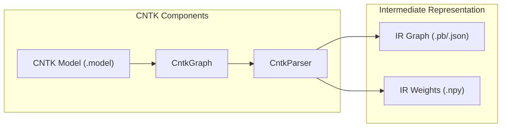
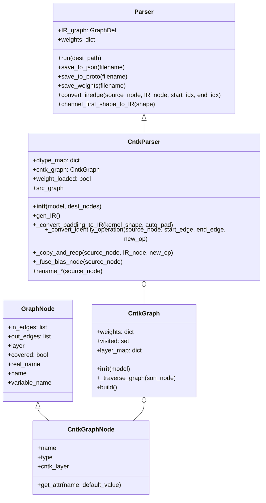
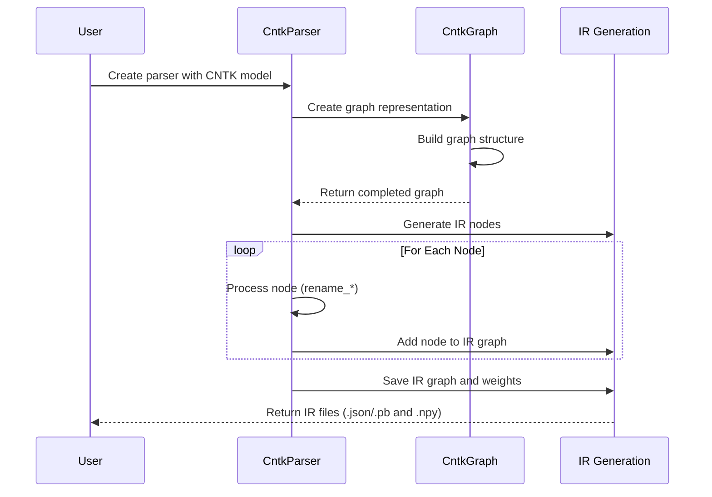

<!-- source: DeepWiki mcp.deepwiki.com · repo microsoft/MMdnn · page 3.5 CNTK Parser · fetched 2026-10-26 -->

# CNTK Parser

<details>
<summary>Relevant source files</summary>

The following files were used as context for generating this wiki page:

- [docs/supported.jpg](docs/supported.jpg)
- [mmdnn/conversion/cntk/cntk_graph.py](mmdnn/conversion/cntk/cntk_graph.py)
- [mmdnn/conversion/cntk/cntk_parser.py](mmdnn/conversion/cntk/cntk_parser.py)
- [mmdnn/conversion/common/DataStructure/graph.py](mmdnn/conversion/common/DataStructure/graph.py)
- [mmdnn/conversion/common/DataStructure/parser.py](mmdnn/conversion/common/DataStructure/parser.py)
- [mmdnn/conversion/keras/keras2_graph.py](mmdnn/conversion/keras/keras2_graph.py)

</details>


## Purpose and Scope

The CNTK Parser is a component in the MMdnn framework responsible for converting models from Microsoft Cognitive Toolkit (CNTK) format to MMdnn's Intermediate Representation (IR). This parser enables CNTK models to be converted to other deep learning frameworks supported by MMdnn, including TensorFlow, Keras, PyTorch, and others. For information about converting models to CNTK format, see CNTK Emitter.

Sources: [mmdnn/conversion/cntk/cntk_parser.py:1-446]()

## CNTK Parser in MMdnn Architecture

The CNTK Parser is one of several framework-specific parsers in the MMdnn architecture. It takes CNTK models as input and transforms them into an IR graph and weights, which can then be used by emitters to generate models in other frameworks.



Sources: [mmdnn/conversion/cntk/cntk_parser.py:17-446](), [mmdnn/conversion/cntk/cntk_graph.py:10-143]()

## Core Components

The CNTK Parser implementation consists of several key components:

### CntkParser Class

The `CntkParser` class is the main entry point for converting CNTK models to IR. It inherits from the base `Parser` class and implements framework-specific functionality for CNTK.

Key responsibilities:
- Load CNTK models
- Build graph representation
- Convert CNTK operations to IR operations
- Extract and transform weights



Sources: [mmdnn/conversion/cntk/cntk_parser.py:17-446](), [mmdnn/conversion/common/DataStructure/parser.py:1-105]()

### CntkGraph and CntkGraphNode Classes

The `CntkGraph` class builds a graph representation of the CNTK model. It traverses the model structure, creates `CntkGraphNode` instances for each layer, and establishes connections between nodes.

`CntkGraphNode` extends the base `GraphNode` class to represent CNTK-specific operations and properties.

Sources: [mmdnn/conversion/cntk/cntk_graph.py:10-143](), [mmdnn/conversion/common/DataStructure/graph.py:1-164]()

## Conversion Workflow

The CNTK Parser follows a specific workflow to convert CNTK models to IR:



### Initialization

When a `CntkParser` is created, it:
1. Loads the CNTK model
2. Creates a `CntkGraph` instance
3. Builds the graph representation of the model

```python
def __init__(self, model, dest_nodes = None):
    super(CntkParser, self).__init__()

    if not os.path.exists(model):
        raise ValueError('Cntk model [{}] can not be found!'.format(model))
    model = _cntk.Function.load(model)
    self.weight_loaded = True

    # Build network graph
    self.cntk_graph = CntkGraph(model)
    self.cntk_graph.build()
```

Sources: [mmdnn/conversion/cntk/cntk_parser.py:37-47]()

### Graph Building

The `CntkGraph` class traverses the CNTK model structure to build a graph representation:

1. Start from the model output node
2. Traverse backward through inputs
3. Create nodes for each operation
4. Establish connections between nodes

Sources: [mmdnn/conversion/cntk/cntk_graph.py:54-95]()

### IR Generation

The `gen_IR` method iterates through the topologically sorted nodes and converts each node to its IR equivalent:

```python
def gen_IR(self):
    for layer in self.src_graph.topological_sort:
        current_node = self.src_graph.get_node(layer)
        node_type = current_node.type
        if hasattr(self, "rename_" + node_type):
            func = getattr(self, "rename_" + node_type)
            func(current_node)
        else:
            self.rename_UNKNOWN(current_node)
```

For each node, it calls the appropriate `rename_*` method based on the node type, which converts the node to the corresponding IR operation.

Sources: [mmdnn/conversion/cntk/cntk_parser.py:73-81]()

## Supported CNTK Operations

The CNTK Parser supports a wide range of CNTK operations, each handled by a specific `rename_*` method. Here's a summary of supported operations:

| CNTK Operation | IR Operation | Method |
|----------------|--------------|--------|
| Convolution | Conv | rename_Convolution |
| ReLU | Relu | rename_ReLU |
| Plus | Add | rename_Plus |
| Minus | Sub | rename_Minus |
| Times | FullyConnected | rename_Times |
| Reshape | Reshape | rename_Reshape |
| MaxPooling | Pool | rename_MaxPooling |
| AveragePooling | Pool | rename_AveragePooling |
| BatchNormalization | BatchNorm | rename_BatchNormalization |
| ElementTimes | Mul | rename_ElementTimes |
| Splice | Concat | rename_Splice |
| Slice | Slice | rename_Slice |
| DataInput | DataInput | rename_DataInput |
| Dense | FullyConnected | rename_Dense |
| Convolution2D | Conv + Relu | rename_Convolution2D |
| Activation | Relu (or other) | rename_Activation |
| StableSigmoid | Sigmoid | rename_StableSigmoid |
| Dropout | - | rename_Dropout |
| Log | Log | rename_Log |
| Exp | Exp | rename_Exp |
| Reciprocal | Reciprocal | rename_Reciprocal |

Sources: [mmdnn/conversion/cntk/cntk_parser.py:160-456]()

### Layer Conversion Examples

#### Convolution

The `rename_Convolution` method converts CNTK Convolution layers to IR Conv operations:

```python
def rename_Convolution(self, source_node):
    IR_node = self._convert_identity_operation(source_node, new_op="Conv")

    for input in source_node.layer.inputs:
        if input.name.endswith("W"):
            W = self.get_ndarray(input)
            break

    W = self.channel_first_conv_kernel_to_IR(W)
    self.set_weight(source_node.name, 'weights', W)

    attributes = CntkParser._get_attribute(source_node.layer, 'strides')

    kwargs = dict()
    kwargs['strides'] = [1] + list(attributes['strides'])[1:] + [1]
    kwargs['dilations'] = [1] + list(attributes['dilation'])[1:] + [1]
    kwargs['kernel_shape'] = list(W.shape)
    padding = attributes['autoPadding'][1:]

    for pad in padding:
        assert pad == padding[0]

    kwargs['auto_pad'] = 'SAME_LOWER' if padding[0] else 'VALID'
    kwargs['pads'] = self._convert_padding_to_IR(kwargs['kernel_shape'][:-2], padding)

    kwargs['use_bias'] = self._fuse_bias_node(source_node)

    assign_IRnode_values(IR_node, kwargs)
```

Sources: [mmdnn/conversion/cntk/cntk_parser.py:160-187]()

#### Pooling

The `rename_Pooling` method is a generalized method for handling both max and average pooling:

```python
def rename_Pooling(self, source_node):
    IR_node = self._convert_identity_operation(source_node, new_op='Pool')
    dim = len(IR_node.attr['_output_shapes'].list.shape[0].dim)
    kwargs = {}

    # strides
    kwargs['strides'] = list(source_node.get_attr('strides')) + [1]
    if len(kwargs['strides']) < dim:
        kwargs['strides'] = [1] + kwargs['strides']

    # window_shape
    kwargs['kernel_shape'] = list(source_node.get_attr('poolingWindowShape')) + [1]
    if len(kwargs['kernel_shape']) < dim:
        kwargs['kernel_shape'] = [1] + kwargs['kernel_shape']

    # pool type
    pool_type = source_node.get_attr('poolingType')
    if pool_type == _cntk.MAX_POOLING:
        kwargs['pooling_type'] = 'MAX'
    elif pool_type == _cntk.AVG_POOLING:
        kwargs['pooling_type'] = 'AVG'
    else:
        raise ValueError("Unknown pooling type [{}].".format(pool_type))

    # padding
    padding = source_node.get_attr('autoPadding')
    if len(padding) >= dim - 1:
        padding = padding[1:]
    elif len(padding) < dim - 2:
        padding.extend([padding[-1]] * (dim - len(padding) - 2))
    for pad in padding:
        assert pad == padding[-1]
    kwargs['auto_pad'] = 'SAME_LOWER' if padding[0] else 'VALID'
    kwargs['pads'] = self._convert_padding_to_IR(kwargs['kernel_shape'][1:-1], padding)

    assign_IRnode_values(IR_node, kwargs)
```

Sources: [mmdnn/conversion/cntk/cntk_parser.py:266-301]()

## Utility Functions

The CNTK Parser includes several utility functions to facilitate the conversion process:

### Data Type Mapping

The `dtype_map` dictionary maps CNTK data types to their corresponding IR data types:

```python
dtype_map = {
    0 : graph_pb2.DT_UNDEFINED,
    np.float32 : graph_pb2.DT_FLOAT32,
    np.float64 : graph_pb2.DT_FLOAT64,
    3 : graph_pb2.DT_INT32,
    4 : graph_pb2.DT_UINT8,
    5 : graph_pb2.DT_INT16,
    6 : graph_pb2.DT_INT8,
    7 : graph_pb2.DT_STRING,
    9 : graph_pb2.DT_INT64
}
```

Sources: [mmdnn/conversion/cntk/cntk_parser.py:19-29]()

### Converting Padding

The `_convert_padding_to_IR` method converts CNTK padding format to IR padding format:

```python
@staticmethod
def _convert_padding_to_IR(kernel_shape, auto_pad):
    lower = []
    upper = []
    for idx in range(0, len(kernel_shape)):
        if auto_pad[idx] == False:
            lower += [0]
            upper += [0]
        else:
            q = kernel_shape[idx] // 2
            lower += [q] if kernel_shape[idx] % 2 else [q - 1]
            upper += [q]

    return [0] + lower + [0, 0] + upper + [0]
```

Sources: [mmdnn/conversion/cntk/cntk_parser.py:50-63]()

### Handling Weights

The `get_ndarray` method extracts weight values from CNTK parameters or constants:

```python
@staticmethod
def get_ndarray(variable):
    if variable.is_parameter:
        return variable.as_parameter().asarray()
    elif variable.is_constant:
        return variable.as_constant().asarray()
    else:
        raise ValueError("Unknown variable [{}].".format(variable))
```

Sources: [mmdnn/conversion/cntk/cntk_parser.py:136-145]()

## Usage Example

The CNTK Parser is typically used through the MMdnn command-line interfaces, particularly the `mmtoir` tool. Here's an example of how to convert a CNTK model to IR:

```bash
# Convert CNTK model to IR
mmtoir -f cntk -w model.model -o converted_model

# This generates:
# - converted_model.json (IR structure)
# - converted_model.pb (IR structure in protobuf format)
# - converted_model.npy (IR weights)
```

The resulting IR files can then be used with MMdnn emitters to convert to other frameworks.

## Limitations and Known Issues

1. Not all CNTK operations are supported. Unsupported operations will trigger a `rename_UNKNOWN` call, which raises an error.

2. Some complex network structures might not be converted correctly, especially those with custom operations or unusual connections.

3. The `Dropout` layer is effectively ignored in the conversion process, as it's not needed for inference.

Sources: [mmdnn/conversion/cntk/cntk_parser.py:128-133](), [mmdnn/conversion/cntk/cntk_parser.py:371-377]()

---

