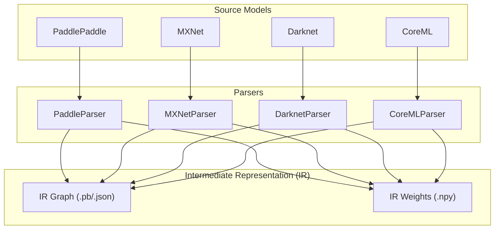
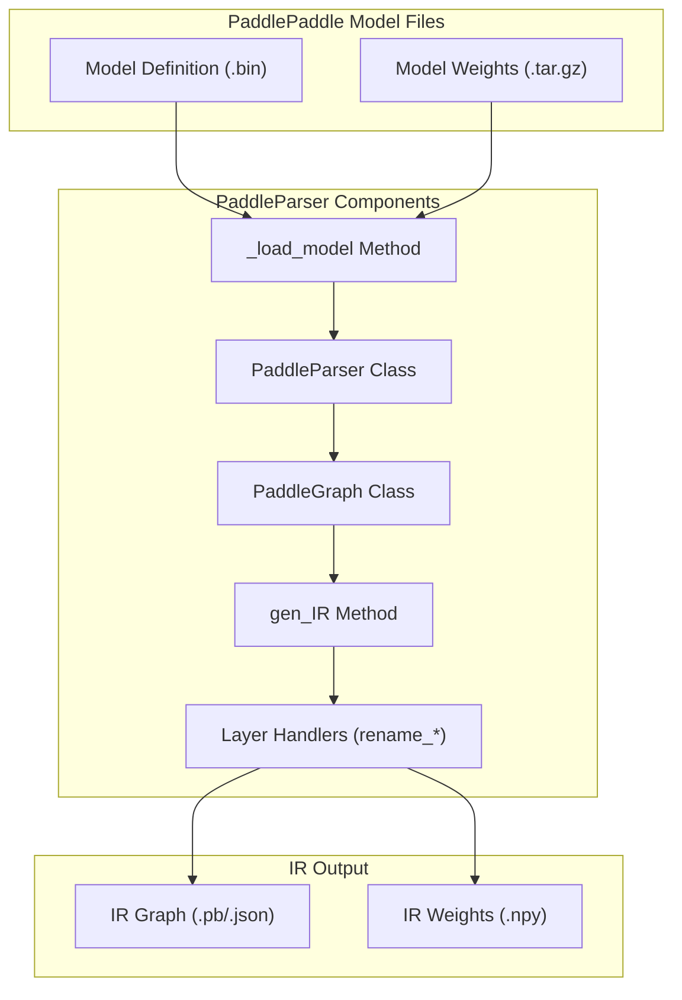
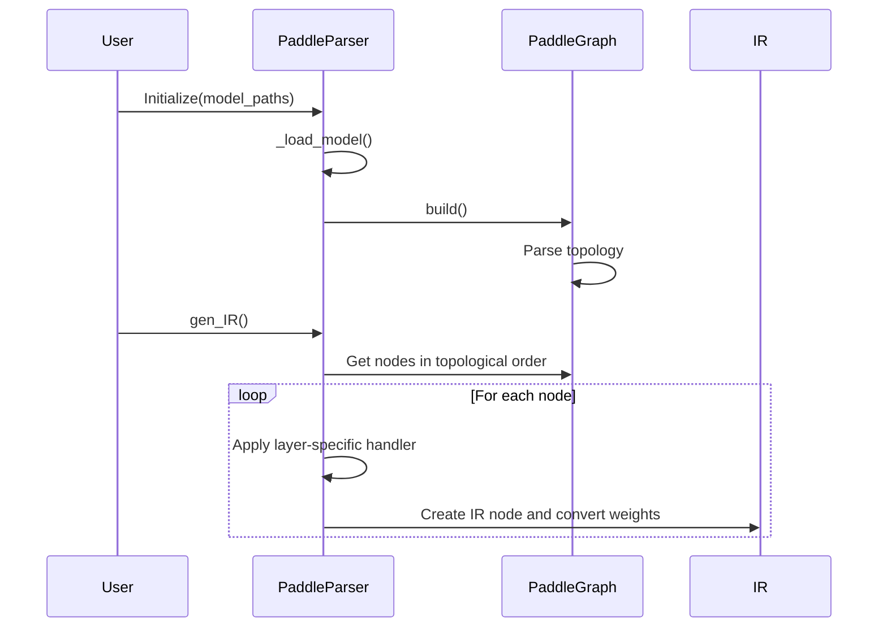

<!-- source: DeepWiki mcp.deepwiki.com · repo microsoft/MMdnn · page 3.6 Other Parsers · fetched 2026-10-26 -->

# Other Parsers

<details>
<summary>Relevant source files</summary>

The following files were used as context for generating this wiki page:

- [mmdnn/conversion/examples/paddle/__init__.py](mmdnn/conversion/examples/paddle/__init__.py)
- [mmdnn/conversion/examples/paddle/extract_model.py](mmdnn/conversion/examples/paddle/extract_model.py)
- [mmdnn/conversion/examples/paddle/extractor.py](mmdnn/conversion/examples/paddle/extractor.py)
- [mmdnn/conversion/examples/paddle/imagenet_test.py](mmdnn/conversion/examples/paddle/imagenet_test.py)
- [mmdnn/conversion/paddle/paddle_graph.py](mmdnn/conversion/paddle/paddle_graph.py)
- [mmdnn/conversion/paddle/paddle_parser.py](mmdnn/conversion/paddle/paddle_parser.py)

</details>


This document provides information about additional parsers in MMdnn that convert models from frameworks other than the main ones. While the primary parsers (TensorFlow, Keras, Caffe, PyTorch, and CNTK) are covered in their respective documentation ([TensorFlow Parser](#3.1), [Keras Parser](#3.2), [Caffe Parser](#3.3), [PyTorch Parser](#3.4), and [CNTK Parser](#3.5)), this page focuses on parsers for MXNet, Darknet, PaddlePaddle, and CoreML frameworks.

## 1. Parser Integration in MMdnn Architecture

In the MMdnn conversion pipeline, parsers are responsible for transforming models from their native framework formats into the Intermediate Representation (IR). Each parser is specifically designed to handle the unique characteristics of its source framework.

### Parser Position in Conversion Pipeline



Sources: [mmdnn/conversion/paddle/paddle_parser.py:21-32](), [mmdnn/conversion/paddle/paddle_graph.py:11-53]()

## 2. PaddlePaddle Parser

The PaddlePaddle parser converts models created with the PaddlePaddle framework to the MMdnn IR format. This parser is implemented in the `PaddleParser` class, which inherits from the base `Parser` class.

### PaddlePaddle Parser Architecture



Sources: [mmdnn/conversion/paddle/paddle_parser.py:59-89](), [mmdnn/conversion/paddle/paddle_graph.py:33-53]()

### Conversion Workflow

The PaddlePaddle parser follows these key steps during model conversion:

1. **Model Loading**: The parser loads the model definition and weights from the provided files
2. **Graph Building**: Constructs a graph representation of the model using `PaddleGraph`
3. **IR Generation**: Processes nodes in topological order and converts them to the IR format
4. **Layer Handling**: Applies specific handlers for different layer types



Sources: [mmdnn/conversion/paddle/paddle_parser.py:113-123](), [mmdnn/conversion/paddle/paddle_graph.py:44-52]()

### Supported Layer Types

The PaddlePaddle parser supports the following layer mappings:

| PaddlePaddle Layer Type | IR Layer Type |
|-------------------------|---------------|
| data                    | InputLayer    |
| exconv                  | Conv          |
| addto                   | Add           |
| batch_norm              | BatchNormalization |
| pool                    | Pooling       |
| fc                      | Dense         |
| norm                    | LRN           |

Sources: [mmdnn/conversion/paddle/paddle_parser.py:46-56]()

### Supported Activation Functions

The parser can convert these activation functions:

| PaddlePaddle Activation | IR Activation |
|-------------------------|---------------|
| relu                    | Relu          |
| softmax                 | Softmax       |
| sigmoid                 | Sigmoid       |
| tanh                    | Tanh          |
| elu                     | Elu           |
| relu6                   | Relu6         |
| softplus                | Softplus      |
| softsign                | Softsign      |
| hard_sigmoid            | HardSigmoid   |

Sources: [mmdnn/conversion/paddle/paddle_parser.py:34-44]()

### Layer-Specific Processing

The parser includes specialized handlers for different layer types. For example:

- `rename_Conv`: Processes convolutional layers, extracting parameters like kernel size, stride, and padding
- `rename_BatchNormalization`: Handles batch normalization, converting parameters like gamma, beta, mean, and variance
- `rename_Pooling`: Converts pooling layers, handling parameters like pool type, kernel size, and stride
- `rename_Dense`: Processes fully connected layers, handling weights and biases

Each handler adds a node to the IR graph and sets its attributes according to the layer's parameters.

Sources: [mmdnn/conversion/paddle/paddle_parser.py:208-267](), [mmdnn/conversion/paddle/paddle_parser.py:309-393](), [mmdnn/conversion/paddle/paddle_parser.py:397-472](), [mmdnn/conversion/paddle/paddle_parser.py:475-535]()

### Pre-trained Model Support

MMdnn includes support for downloading and converting pre-trained PaddlePaddle models through the `paddle_extractor` class. Currently supported architectures include:

- ResNet50
- ResNet101
- VGG16

Sources: [mmdnn/conversion/examples/paddle/extractor.py:16-36]()

## 3. Other Framework Parsers

### MXNet Parser

The MXNet parser converts models from the MXNet deep learning framework to MMdnn IR. Similar to other parsers, it loads the model definition and weights, builds a graph representation, and generates the IR by processing each node.

### Darknet Parser

The Darknet parser is specialized for converting models from the Darknet framework, which is commonly used for YOLO object detection models. It handles the specific format of Darknet configuration files and weights.

### CoreML Parser

The CoreML parser converts models created for Apple's CoreML framework to the MMdnn IR format. This enables CoreML models to be converted to other frameworks supported by MMdnn.

## 4. Usage Examples

### Command-line Usage

To convert a PaddlePaddle model to IR using the command-line interface:

```bash
mmtoir -f paddle --inputWeight model.tar.gz --inputNetwork model.bin -o output_prefix
```

This generates `output_prefix.json` (or `.pb`) and `output_prefix.npy` files representing the model in IR format.

### Downloading Pre-trained Models

Pre-trained PaddlePaddle models can be downloaded using the `paddle_extractor`:

```python
from mmdnn.conversion.examples.paddle.extractor import paddle_extractor

# Download a pre-trained ResNet50 model
model_files = paddle_extractor.download('resnet50', './models')
```

Sources: [mmdnn/conversion/examples/paddle/extractor.py:76-106]()

### Model Inference

The extractor also provides methods for model inference:

```python
from mmdnn.conversion.examples.paddle.extractor import paddle_extractor

# Run inference on an image using a pre-trained model
result = paddle_extractor.inference('resnet50', model_files, './', 'image.jpg')
```

Sources: [mmdnn/conversion/examples/paddle/extractor.py:113-155]()

---

