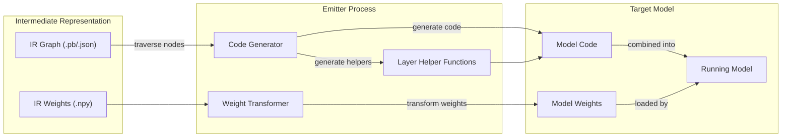
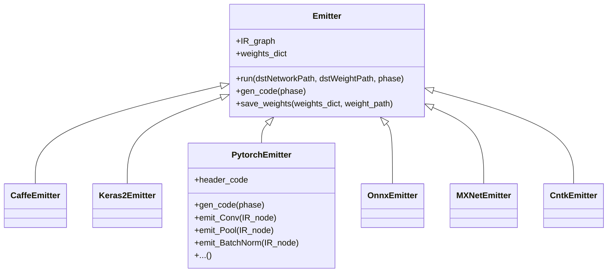
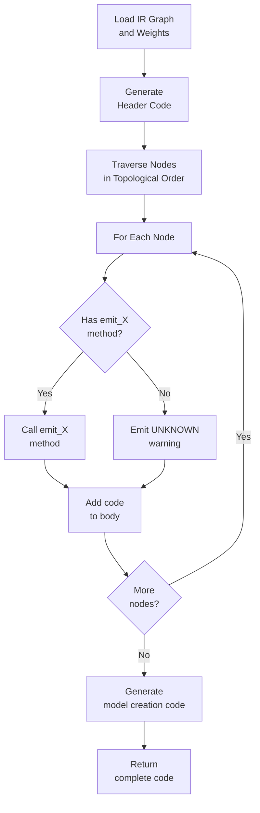

<!-- source: DeepWiki mcp.deepwiki.com · repo microsoft/MMdnn · page 4 Framework Emitters · fetched 2026-10-26 -->

# Framework Emitters

<details>
<summary>Relevant source files</summary>

The following files were used as context for generating this wiki page:

- [mmdnn/conversion/caffe/caffe_emitter.py](mmdnn/conversion/caffe/caffe_emitter.py)
- [mmdnn/conversion/cntk/cntk_emitter.py](mmdnn/conversion/cntk/cntk_emitter.py)
- [mmdnn/conversion/keras/keras2_emitter.py](mmdnn/conversion/keras/keras2_emitter.py)
- [mmdnn/conversion/mxnet/mxnet_emitter.py](mmdnn/conversion/mxnet/mxnet_emitter.py)
- [mmdnn/conversion/mxnet/mxnet_parser.py](mmdnn/conversion/mxnet/mxnet_parser.py)
- [mmdnn/conversion/onnx/onnx_emitter.py](mmdnn/conversion/onnx/onnx_emitter.py)
- [mmdnn/conversion/pytorch/pytorch_emitter.py](mmdnn/conversion/pytorch/pytorch_emitter.py)

</details>


Framework Emitters are a core component of the MMdnn model conversion pipeline. They transform the Intermediate Representation (IR) of neural network models into target framework-specific code and weights. This page documents the architecture, implementation, and usage of emitters in MMdnn.

For information about converting models to Intermediate Representation, see [Framework Parsers](#3).

## Overview

Framework Emitters are responsible for generating executable code and model weights that reproduce the original model's functionality in a target deep learning framework. Each supported framework has a dedicated emitter that understands the target framework's API and conventions.

The diagram below illustrates the role of emitters in the MMdnn conversion pipeline:



Sources: [mmdnn/conversion/common/DataStructure/emitter.py](https://github.com/microsoft/MMdnn), [mmdnn/conversion/pytorch/pytorch_emitter.py:89-116](), [mmdnn/conversion/keras/keras2_emitter.py:115-134]()

## Emitter Architecture

All framework-specific emitters inherit from a base `Emitter` class, which provides common functionality for traversing the IR graph, handling weights, and generating code structure.



Sources: [mmdnn/conversion/pytorch/pytorch_emitter.py:16-28](), [mmdnn/conversion/keras/keras2_emitter.py:18-29](), [mmdnn/conversion/caffe/caffe_emitter.py:23-36](), [mmdnn/conversion/onnx/onnx_emitter.py:9-19](), [mmdnn/conversion/mxnet/mxnet_emitter.py:18-43](), [mmdnn/conversion/cntk/cntk_emitter.py:21-36]()

### Common Emitter Structure

Each framework-specific emitter implements:

1. **Constructor** - Initializes the emitter with the IR model and loads weights if provided
2. **Header code** - Defines imports and utility functions needed for the target framework
3. **Code generation** - Traverses the IR graph and generates code for each node
4. **Layer emitters** - Methods to emit framework-specific code for each layer type
5. **Weight transformation** - Functions to transform weights from IR format to target format

Framework-specific emitters typically follow this pattern:

```python
class FrameworkEmitter(Emitter):
    def __init__(self, model):
        # Initialize with IR model
        super(FrameworkEmitter, self).__init__()
        self.IR_graph = IRGraph(model[0])
        self._load_weights(model[1])
        
    def gen_code(self, phase):
        # Generate code header
        self.add_body(0, self.header_code)
        
        # Process each node in topological order
        for layer in self.IR_graph.topological_sort:
            current_node = self.IR_graph.get_node(layer)
            node_type = current_node.type
            
            if hasattr(self, "emit_" + node_type):
                func = getattr(self, "emit_" + node_type)
                line = func(current_node)
                if line:
                    self.add_body(1, line)
            else:
                print("Emitter does not support [%s]." % node_type)
                
        # Generate model creation code
        self.add_body(1, "return model")
        
        return self.body_code
    
    def emit_Conv(self, IR_node):
        # Framework-specific code to create a convolution layer
        pass
```

Sources: [mmdnn/conversion/pytorch/pytorch_emitter.py:90-126](), [mmdnn/conversion/keras/keras2_emitter.py:115-146](), [mmdnn/conversion/mxnet/mxnet_emitter.py:80-160]()

## Code Generation Process

The process of generating code from IR follows these steps:

1. **Initialize** - Create the emitter with IR graph and weights
2. **Generate header** - Add framework imports and utility functions
3. **Traverse nodes** - For each node in topological order:
   - Identify node type
   - Call corresponding `emit_X` method
   - Add generated code to body
4. **Finalize model** - Generate code to construct the final model
5. **Return code** - Return the complete model code



Sources: [mmdnn/conversion/pytorch/pytorch_emitter.py:90-126](), [mmdnn/conversion/keras/keras2_emitter.py:115-145](), [mmdnn/conversion/caffe/caffe_emitter.py:114-139]()

## Supported Target Frameworks

MMdnn provides emitters for the following frameworks:

| Framework | Emitter Class | Key Features | Limitations |
|-----------|--------------|--------------|-------------|
| Caffe | `CaffeEmitter` | Supports most common layers | Limited RNN support |
| Keras | `Keras2Emitter` | Comprehensive layer support | Some custom layers may require additional code |
| PyTorch | `PytorchEmitter` | Good support for CNN architectures | Limited RNN support |
| ONNX | `OnnxEmitter` | Enables interoperability with many frameworks | - |
| MXNet | `MXNetEmitter` | Supports both symbolic and imperative APIs | - |
| CNTK | `CntkEmitter` | - | Limited maintenance |

Sources: [mmdnn/conversion/caffe/caffe_emitter.py:23](), [mmdnn/conversion/keras/keras2_emitter.py:18](), [mmdnn/conversion/pytorch/pytorch_emitter.py:16](), [mmdnn/conversion/onnx/onnx_emitter.py:9](), [mmdnn/conversion/mxnet/mxnet_emitter.py:18](), [mmdnn/conversion/cntk/cntk_emitter.py:21]()

## Layer Emission

Each emitter contains specialized methods for emitting code for different layer types. These methods have the naming pattern `emit_X` where X is the layer type in the IR. For example, `emit_Conv`, `emit_Pool`, etc.

Layer emission methods typically:

1. Extract layer parameters from the IR node
2. Generate code for creating the layer using the target framework's API
3. Connect the layer to its inputs
4. Handle framework-specific quirks or requirements

Example of a layer emission method (PyTorch Conv layer):

```python
def emit_Conv(self, IR_node):
    self.used_layers.add('Conv')
    
    # Get parameters from IR node
    dim = len(IR_node.get_attr('strides')) - 2
    in_channels = IR_node.get_attr('kernel_shape')[-2]
    filter = IR_node.get_attr('kernel_shape')[-1]
    kernel = IR_node.get_attr('kernel_shape')[:-2]
    strides = IR_node.get_attr('strides')[1:-1]
    group = IR_node.get_attr('group', 1)
    
    # Generate layer initialization code
    self.add_init(2, "self.{} = self.__conv({}, name='{}', in_channels={}, out_channels={}, kernel_size={}, stride={}, groups={}, bias={})".format(
        IR_node.variable_name,
        dim,
        IR_node.name,
        in_channels,
        filter,
        tuple(kernel),
        tuple(strides),
        group,
        IR_node.get_attr('use_bias')))
    
    # Generate forward pass code
    code = "{:<15} = self.{}({})".format(
        IR_node.variable_name,
        IR_node.variable_name,
        self._defuse_padding(IR_node))
    
    # Transform weights if needed
    if self.weight_loaded:
        if IR_node.type == 'DepthwiseConv':
            self.weights_dict[IR_node.name]['weights'] = np.swapaxes(self.weights_dict[IR_node.name]['weights'], -1, -2)
        self.weights_dict[IR_node.name]['weights'] = np.transpose(self.weights_dict[IR_node.name]['weights'], [dim + 1, dim] + list(range(0, dim)))
    
    return code
```

Sources: [mmdnn/conversion/pytorch/pytorch_emitter.py:149-190](), [mmdnn/conversion/keras/keras2_emitter.py:230-265](), [mmdnn/conversion/caffe/caffe_emitter.py:198-230]()

## Weight Handling

Emitters need to transform weights from the IR format to the target framework's format. This often involves:

1. Transposing weight matrices to match framework-specific tensor layouts
2. Reshaping weights to match expected dimensions
3. Splitting or combining weights for certain layer types

Different frameworks use different tensor layouts, requiring various transformations:

```python
# Example of weight transformation for Conv layers in PyTorch
if self.weight_loaded:
    if IR_node.type == 'DepthwiseConv':
        self.weights_dict[IR_node.name]['weights'] = np.swapaxes(self.weights_dict[IR_node.name]['weights'], -1, -2)
    self.weights_dict[IR_node.name]['weights'] = np.transpose(self.weights_dict[IR_node.name]['weights'], [dim + 1, dim] + list(range(0, dim)))
```

Sources: [mmdnn/conversion/pytorch/pytorch_emitter.py:185-188](), [mmdnn/conversion/keras/keras2_emitter.py:396-399](), [mmdnn/conversion/caffe/caffe_emitter.py:224-228]()

## Special Considerations

### Framework-Specific APIs

Each emitter must account for the unique APIs and conventions of the target framework:

```python
# PyTorch example
"{:<15} = F.relu({})".format(IR_node.variable_name, self.parent_variable_name(IR_node))

# Keras example
"{:<15} = layers.Activation(name='{}', activation='{}')({})".format(
    IR_node.variable_name, IR_node.name, 'relu', self.parent_variable_name(IR_node))

# Caffe example
"{:<15} = L.ReLU(n.{}, in_place={}, ntop=1)".format(
    IR_node.variable_name, self.parent_variable_name(IR_node), in_place)
```

Sources: [mmdnn/conversion/pytorch/pytorch_emitter.py:381-385](), [mmdnn/conversion/keras/keras2_emitter.py:159-166](), [mmdnn/conversion/caffe/caffe_emitter.py:530-535]()

### Layer Compatibility

Not all layers are supported across all frameworks. Emitters must handle unsupported layers by:

1. Providing alternative implementations
2. Emitting warnings or errors
3. Using custom implementations when available

```python
def emit_UNKNOWN(self, IR_node):
    print("FrameworkEmitter has not supported operator [%s]." % (IR_node.type))
```

Sources: [mmdnn/conversion/pytorch/pytorch_emitter.py:294-295](), [mmdnn/conversion/keras/keras2_emitter.py:282-283](), [mmdnn/conversion/caffe/caffe_emitter.py:369-370]()

### Data Format Differences

Frameworks use different default data formats (channels-first vs. channels-last). Emitters must handle these differences:

```python
# Convert from IR format to target framework format
if not self.data_format in MXNetEmitter.channels_last:
    weights = MXNetEmitter.transpose(weights, dim)
```

Sources: [mmdnn/conversion/mxnet/mxnet_emitter.py:428-430](), [mmdnn/conversion/caffe/caffe_emitter.py:224-228](), [mmdnn/conversion/mxnet/mxnet_parser.py:283-286]()

## Usage Example

Framework emitters are typically used through the MMdnn command-line interface:

```bash
# Convert from IR to target framework
mmtocode -f [TARGET_FRAMEWORK] -i model.pb -w model.npy -o converted_model.py

# Then build the model in the target framework
mmtomodel -f [TARGET_FRAMEWORK] -in converted_model.py -iw model.npy -o target_model
```

For direct API usage:

```python
from mmdnn.conversion.pytorch.pytorch_emitter import PytorchEmitter

# Create emitter with IR model and weights
emitter = PytorchEmitter(["model.pb", "model.npy"])

# Generate code
pytorch_code = emitter.gen_code()

# Save the generated code to a file
with open("model.py", "w") as f:
    f.write(pytorch_code)
    
# Save weights
emitter.run("model.py", "model_weights.npy")
```

Sources: [mmdnn/conversion/pytorch/pytorch_emitter.py:46-49](), [mmdnn/conversion/keras/keras2_emitter.py:32-50]()

## Conclusion

Framework Emitters are a key component of MMdnn, enabling the conversion of models between different deep learning frameworks. Each emitter handles the complexity of translating from the Intermediate Representation to a specific framework's conventions and APIs, accounting for differences in layer implementations, weight formats, and data layouts.

Understanding the architecture and functionality of Framework Emitters is essential for extending MMdnn to support new frameworks or layer types, as well as for troubleshooting conversion issues.

---

