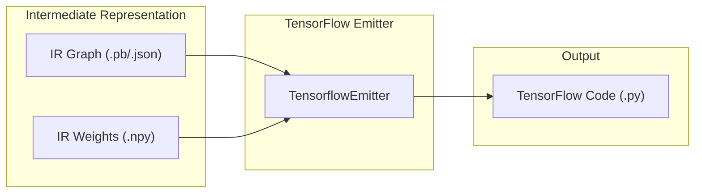
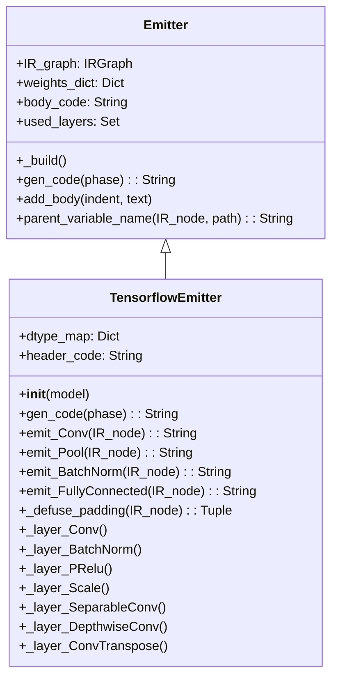
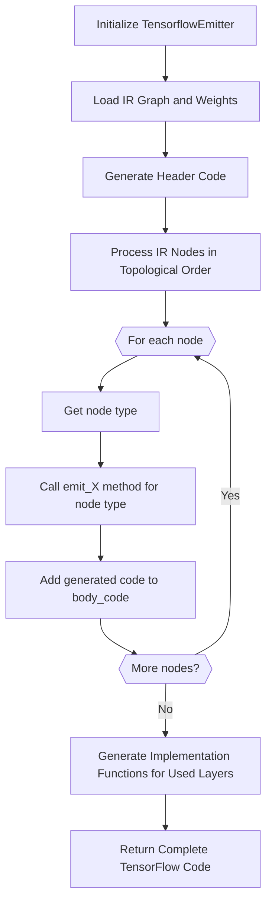

<!-- source: DeepWiki mcp.deepwiki.com · repo microsoft/MMdnn · page 4.1 TensorFlow Emitter · fetched 2026-10-26 -->

# TensorFlow Emitter

<details>
<summary>Relevant source files</summary>

The following files were used as context for generating this wiki page:

- [mmdnn/conversion/tensorflow/tensorflow_emitter.py](mmdnn/conversion/tensorflow/tensorflow_emitter.py)
- [mmdnn/conversion/tensorflow/tensorflow_frozenparser.py](mmdnn/conversion/tensorflow/tensorflow_frozenparser.py)
- [mmdnn/conversion/tensorflow/tensorflow_graph.py](mmdnn/conversion/tensorflow/tensorflow_graph.py)
- [mmdnn/conversion/tensorflow/tensorflow_parser.py](mmdnn/conversion/tensorflow/tensorflow_parser.py)

</details>


The TensorFlow Emitter is a component in the MMdnn framework responsible for converting models from the Intermediate Representation (IR) to executable TensorFlow code. This document details how the emitter works, its implementation, and its role in the model conversion pipeline. For information about the broader conversion process, see [Intermediate Representation](#2) and [Framework Emitters](#4).

## Purpose and Role

The TensorFlow Emitter takes IR format model files (protobuf files for graph structure and numpy files for weights) and generates:

1. Python code containing a complete TensorFlow model implementation
2. Weight loading mechanism for the converted model

This enables interoperability between different deep learning frameworks by allowing models from other frameworks to be used in TensorFlow.



Sources: [mmdnn/conversion/tensorflow/tensorflow_emitter.py:16-17](), [mmdnn/conversion/tensorflow/tensorflow_emitter.py:58-73]()

## Architecture and Implementation

### Class Structure

The TensorFlow Emitter is implemented as the `TensorflowEmitter` class that inherits from the base `Emitter` class in the MMdnn framework.



Sources: [mmdnn/conversion/tensorflow/tensorflow_emitter.py:16-108]()

### Key Components

1. **dtype_map**: Maps IR data types to TensorFlow data types
2. **header_code**: Template for the generated code's header (imports, weight loading function)
3. **used_layers**: Tracks which layer types are used in the model
4. **layers_codes**: Stores implementation code for layer functions

Sources: [mmdnn/conversion/tensorflow/tensorflow_emitter.py:18-27](), [mmdnn/conversion/tensorflow/tensorflow_emitter.py:30-55]()

## Code Generation Process

The code generation process follows a systematic approach to convert the IR graph to executable TensorFlow code:



The main code generation function is `gen_code()`, which:

1. Adds the header code to the output
2. Processes each node in the IR graph topologically
3. Calls the appropriate `emit_X` method for each node based on its type
4. Adds helper function implementations for the layers used in the model
5. Returns the complete TensorFlow code

Sources: [mmdnn/conversion/tensorflow/tensorflow_emitter.py:74-107]()

### Structure of Generated Code

The generated TensorFlow code has the following structure:

```
1. Import statements (tensorflow, numpy)
2. Weight dictionary initialization
3. Weight loading function
4. KitModel function that:
   - Loads weights
   - Defines the model architecture
   - Returns input and output tensors
5. Layer implementation functions (for Conv, BatchNorm, etc.)
```

Sources: [mmdnn/conversion/tensorflow/tensorflow_emitter.py:30-55](), [mmdnn/conversion/tensorflow/tensorflow_emitter.py:92-105]()

## Layer Handling

The TensorFlow Emitter handles various layer types through specialized `emit_X` methods. Each method takes an IR node and returns a string containing the TensorFlow code for that node.

### Common Layer Types

#### Convolution Layers

Handled by `emit_Conv` which:
- Processes input and padding
- Configures strides, groups, and other parameters
- Adds weights and biases
- Uses the `convolution` helper function for implementation

```python
# Simplified example of generated code for Conv layer
conv_layer = convolution(input_tensor, group=1, strides=[1, 1], padding='SAME', name='conv1')
```

Sources: [mmdnn/conversion/tensorflow/tensorflow_emitter.py:124-136](), [mmdnn/conversion/tensorflow/tensorflow_emitter.py:780-795]()

#### Pooling Layers

Handled by `emit_Pool` which:
- Determines pooling type (MAX or AVG)
- Handles global pooling if necessary
- Configures kernel shape, strides, and padding
- Returns appropriate TensorFlow pooling function

```python
# Simplified example of generated code for Pool layer
pool_layer = tf.nn.max_pool(input_tensor, [1, 2, 2, 1], [1, 2, 2, 1], padding='VALID', name='pool1')
```

Sources: [mmdnn/conversion/tensorflow/tensorflow_emitter.py:182-243]()

#### BatchNorm Layers

Handled by `emit_BatchNorm` which:
- Uses a helper function for implementation
- Handles mean, variance, scale, and bias parameters

```python
# Simplified example of generated code for BatchNorm layer
bn_layer = batch_normalization(input_tensor, variance_epsilon=0.001, name='bn1')
```

Sources: [mmdnn/conversion/tensorflow/tensorflow_emitter.py:507-514](), [mmdnn/conversion/tensorflow/tensorflow_emitter.py:807-814]()

#### Fully Connected Layers

Handled by `emit_FullyConnected` which:
- Initializes weights and biases
- Flattens input if needed
- Uses tf.layers.dense for implementation

```python
# Simplified example of generated code for FullyConnected layer
fc_flatten = tf.contrib.layers.flatten(input_tensor)
fc_layer = tf.layers.dense(fc_flatten, 1000, use_bias=True)
```

Sources: [mmdnn/conversion/tensorflow/tensorflow_emitter.py:281-316]()

### Implementation Functions

For complex layers, the emitter generates helper functions that are added to the output code. These include:

1. **_layer_Conv**: Implements convolution with support for grouped convolutions
2. **_layer_BatchNorm**: Implements batch normalization using TensorFlow's batch_normalization
3. **_layer_PRelu**: Implements PReLU activation function
4. **_layer_Scale**: Implements scaling operation
5. **_layer_SeparableConv**: Implements separable convolution
6. **_layer_DepthwiseConv**: Implements depthwise convolution
7. **_layer_ConvTranspose**: Implements transposed convolution

Sources: [mmdnn/conversion/tensorflow/tensorflow_emitter.py:780-866]()

## Weight Handling

Weights are loaded from the numpy file and stored in a dictionary for use during model initialization:

```python
# Weight loading function in generated code
def load_weights(weight_file):
    import numpy as np
    
    if weight_file == None:
        return
    
    try:
        weights_dict = np.load(weight_file, allow_pickle=True).item()
    except:
        weights_dict = np.load(weight_file, allow_pickle=True, encoding='bytes').item()
    
    return weights_dict
```

For each layer that uses weights, the emitter generates code to:
1. Extract weights from the dictionary
2. Create TensorFlow variables with the weights
3. Use these variables in the layer implementation

Sources: [mmdnn/conversion/tensorflow/tensorflow_emitter.py:38-49](), [mmdnn/conversion/tensorflow/tensorflow_emitter.py:782-794]()

## Utilities and Helper Methods

The emitter includes several utility methods to assist with the code generation process:

### _defuse_padding

Handles padding conversion between IR format and TensorFlow format. If the padding is not a standard type (VALID or SAME), it generates a `tf.pad` operation.

Sources: [mmdnn/conversion/tensorflow/tensorflow_emitter.py:138-165]()

### parent_variable_name

Gets the variable name of a parent node, handling special cases for constants.

Sources: [mmdnn/conversion/tensorflow/tensorflow_emitter.py:110-115]()

### _shapeToStr

Converts a shape attribute from the IR format to a string representation for TensorFlow.

Sources: [mmdnn/conversion/tensorflow/tensorflow_emitter.py:118-121]()

## Usage Example

The TensorFlow Emitter is typically used through the MMdnn command-line interface, but it can also be used programmatically:

```python
from mmdnn.conversion.tensorflow.tensorflow_emitter import TensorflowEmitter

# Initialize the emitter with IR files
emitter = TensorflowEmitter(["model.pb", "model.npy"])

# Generate code for test phase (is_train = False)
tf_code = emitter.gen_code("test")

# Save the generated code
with open("converted_model.py", "w") as f:
    f.write(tf_code)
```

The generated Python file can be used as follows:

```python
import tensorflow as tf
from converted_model import KitModel

# Load the model with weights
inputs, outputs = KitModel("model.npy")

# Use the model for inference
with tf.Session() as sess:
    sess.run(tf.global_variables_initializer())
    result = sess.run(outputs, feed_dict={inputs: input_data})
```

## Limitations and Considerations

1. Not all operations have direct equivalents in TensorFlow, and some advanced operations may require custom implementations

2. The emitter focuses on inference rather than training, although training can be enabled by setting the `phase` parameter to "train"

3. Some layer configurations might need manual adjustments after conversion

4. While the emitter supports many common operations, custom or unusual layer types may require manual handling

---

