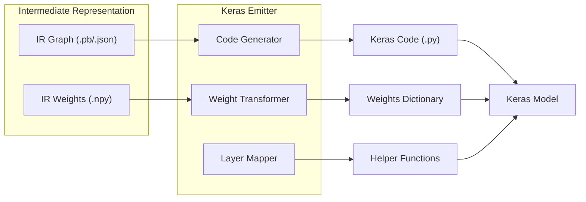
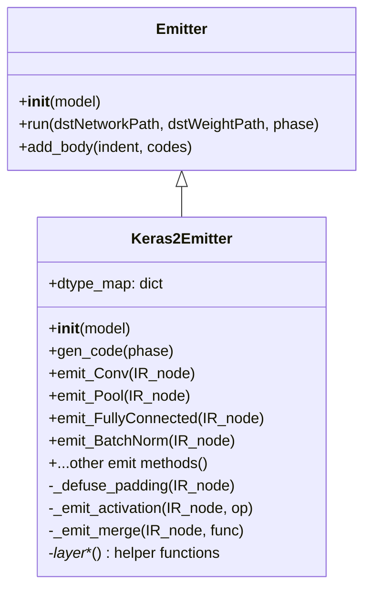

<!-- source: DeepWiki mcp.deepwiki.com · repo microsoft/MMdnn · page 4.2 Keras Emitter · fetched 2026-10-26 -->

# Keras Emitter

<details>
<summary>Relevant source files</summary>

The following files were used as context for generating this wiki page:

- [mmdnn/conversion/keras/keras2_emitter.py](mmdnn/conversion/keras/keras2_emitter.py)
- [mmdnn/conversion/pytorch/pytorch_emitter.py](mmdnn/conversion/pytorch/pytorch_emitter.py)

</details>


## Purpose and Scope

The Keras Emitter is a component in the MMdnn framework that converts the Intermediate Representation (IR) of neural network models into executable Keras code. This document explains the architecture, implementation, and usage of the Keras Emitter, focusing on how it translates IR graphs into Keras model definitions with proper weights.

For information about converting models to the IR format, see the [Framework Parsers](#3) documentation. For details about the IR format itself, see [Intermediate Representation](#2).

## Architecture

The Keras Emitter is part of the MMdnn model conversion pipeline, which follows a three-stage process: parse source models to IR, then emit IR to target frameworks.



Sources: [mmdnn/conversion/keras/keras2_emitter.py:18-46](), [mmdnn/conversion/keras/keras2_emitter.py:114-145]()

## Implementation

The Keras Emitter is implemented in the `Keras2Emitter` class, which inherits from the base `Emitter` class.



Sources: [mmdnn/conversion/keras/keras2_emitter.py:18-46]()

## Key Components

### 1. Code Generation

The code generation process begins with the `gen_code()` method, which:

1. Adds header code with imports and utility functions
2. Traverses the IR graph topologically
3. Generates layer-specific code for each node
4. Creates a Keras `Model` object connecting inputs and outputs
5. Adds helper functions for setting weights and specialized layers

```python
# Simplified code generation workflow
header_code    # Imports and utilities
↓
for each node in IR graph:
    emit_[node_type](node)  # Generate layer code
↓
model = Model(inputs=[...], outputs=[...])
↓
helper_functions  # Weight loading, custom layers
```

Sources: [mmdnn/conversion/keras/keras2_emitter.py:114-145]()

### 2. Layer Mapping

The emitter maps IR nodes to corresponding Keras layers using specialized `emit_*` methods for each layer type. For example:

| IR Node Type | Keras Layer | Implementation Method |
|-------------|-------------|----------------------|
| Conv | Conv1D/2D/3D | `emit_Conv()` |
| Pool | MaxPooling/AveragePooling | `emit_Pool()` |
| FullyConnected | Dense | `emit_FullyConnected()` |
| BatchNorm | BatchNormalization | `emit_BatchNorm()` |
| Concat | concatenate | `emit_Concat()` |
| Add | add | `emit_Add()` |
| Dropout | Dropout | `emit_Dropout()` |

Sources: [mmdnn/conversion/keras/keras2_emitter.py:148-167](), [mmdnn/conversion/keras/keras2_emitter.py:268-407]()

### 3. Weight Management

The emitter generates code to load and set weights correctly for each layer:

```python
# Weight loading function
def load_weights_from_file(weight_file):
    weights_dict = np.load(weight_file, allow_pickle=True).item()
    return weights_dict

# Weight setting function
def set_layer_weights(model, weights_dict):
    for layer in model.layers:
        if layer.name in weights_dict:
            cur_dict = weights_dict[layer.name]
            # Special handling for different layer types
            if layer.__class__.__name__ == "BatchNormalization":
                # Handle batch norm parameters
            elif layer.__class__.__name__ == "SeparableConv2D":
                # Handle separable conv parameters
            else:
                # Handle standard weights and biases
            model.get_layer(layer.name).set_weights(current_layer_parameters)
```

Sources: [mmdnn/conversion/keras/keras2_emitter.py:52-112]()

## Supported Operators and Layers

The Keras Emitter supports a wide range of neural network layers and operations:

### Basic Layers

- **Convolutional**: Conv1D/2D/3D, SeparableConv2D, DepthwiseConv2D, ConvTranspose
- **Pooling**: MaxPooling, AveragePooling, GlobalPooling
- **Core**: Dense (FullyConnected), Flatten, Reshape, Dropout
- **Normalization**: BatchNormalization, Scale, LRN
- **Recurrent**: LSTM, GRU

Sources: [mmdnn/conversion/keras/keras2_emitter.py:267-295](), [mmdnn/conversion/keras/keras2_emitter.py:408-446](), [mmdnn/conversion/keras/keras2_emitter.py:382-405](), [mmdnn/conversion/keras/keras2_emitter.py:574-598]()

### Activation Functions

- ReLU, LeakyReLU, PReLU, ReLU6
- Sigmoid, Tanh
- Softmax, ELU

Sources: [mmdnn/conversion/keras/keras2_emitter.py:499-521](), [mmdnn/conversion/keras/keras2_emitter.py:767-818]()

### Math Operations

- Add, Subtract, Multiply
- Concat, Split
- Minimum, Maximum

Sources: [mmdnn/conversion/keras/keras2_emitter.py:286-353](), [mmdnn/conversion/keras/keras2_emitter.py:563-571]()

### Utility Operators

- Padding, Cropping, UpSampling
- Shape, Squeeze, Unsqueeze
- Constant, Fill, Slice

Sources: [mmdnn/conversion/keras/keras2_emitter.py:602-740]()

## Special Handling

### Padding

The emitter handles padding carefully by analyzing the padding attributes in the IR node:

```python
def _defuse_padding(IR_node, in_scope=False):
    auto_pad = IR_node.get_attr('auto_pad')
    
    if auto_pad and auto_pad.startswith("SAME"):
        # Use 'same' padding in Keras
        return input_node, 'same'
    else:
        padding = IR_node.get_attr("pads")
        if padding:
            # Convert padding to Keras format
            padding = self._convert_padding(padding)
            if not is_valid_padding(padding):
                # Add explicit ZeroPadding layer
                input_node = IR_node.variable_name + '_input'
                self.add_body(1, "{} = layers.ZeroPadding{}D(padding = {})({})".format(
                    input_node, len(padding), padding, self.parent_variable_name(IR_node)))
            else:
                input_node = self.parent_variable_name(IR_node)
        else:
            input_node = self.parent_variable_name(IR_node)
        
        return input_node, 'valid'
```

Sources: [mmdnn/conversion/keras/keras2_emitter.py:188-227]()

### Custom Layers

For some operations without direct Keras equivalents, the emitter defines custom layer implementations:

- **Scale**: Custom layer for scaling operations
- **LRN**: Local Response Normalization
- **Group Convolution**: Implementation using Lambda layers
- **Custom activation functions**: Implemented when needed

Sources: [mmdnn/conversion/keras/keras2_emitter.py:1066-1105](), [mmdnn/conversion/keras/keras2_emitter.py:1143-1214]()

## Usage Example

The Keras Emitter generates a complete, self-contained Python file that can:

1. Load weights from a NumPy file
2. Build the Keras model structure
3. Set weights correctly for each layer
4. Provide a ready-to-use model instance

Typical usage from command line:

```bash
# Convert from TensorFlow to Keras
mmconvert -sf tensorflow -in inception_v3.pb -df keras -om keras_inception_v3.py

# Or step by step
mmtoir -sf tensorflow -in inception_v3.pb -o ir_inception_v3
mmtocode -f keras -in ir_inception_v3.pb -w ir_inception_v3.npy -o keras_inception_v3.py
```

The generated code follows this structure:

```python
# Imports
import keras
from keras.models import Model
from keras import layers
import keras.backend as K
import numpy as np

# Weight loading functions
def load_weights_from_file(weight_file): ...
def set_layer_weights(model, weights_dict): ...

# Model definition function
def KitModel(weight_file = None):
    global weights_dict
    weights_dict = load_weights_from_file(weight_file)
    
    # Input layers
    input_1 = layers.Input(name='input_1', shape=(299, 299, 3))
    
    # Model layers (generated for each node)
    conv2d_1 = layers.Conv2D(name='conv2d_1', filters=32, kernel_size=(3, 3), strides=(2, 2), padding='valid', use_bias=False)(input_1)
    # ... more layers ...
    
    # Model creation
    model = Model(inputs=[input_1], outputs=[softmax])
    set_layer_weights(model, weights_dict)
    return model

# Helper functions for custom layers
def convolution(weights_dict, name, input, group, conv_type, filters, **kwargs): ...
class Scale(Layer): ...
class LRN(Layer): ...
```

Sources: [mmdnn/conversion/keras/keras2_emitter.py:52-111](), [mmdnn/conversion/keras/keras2_emitter.py:114-145]()

## Limitations and Special Cases

1. **Group Convolutions**: Since Keras doesn't natively support group convolutions, they are implemented using Lambda layers to split and concatenate features.

2. **Custom Padding**: Complex padding patterns are handled by adding explicit ZeroPadding layers.

3. **Framework-Specific Operations**: Some operations available in source frameworks might require custom implementations in Keras.

4. **TensorFlow Backend Assumptions**: Some implementations assume the TensorFlow backend for Keras.

Sources: [mmdnn/conversion/keras/keras2_emitter.py:1109-1140](), [mmdnn/conversion/keras/keras2_emitter.py:188-227]()

---

