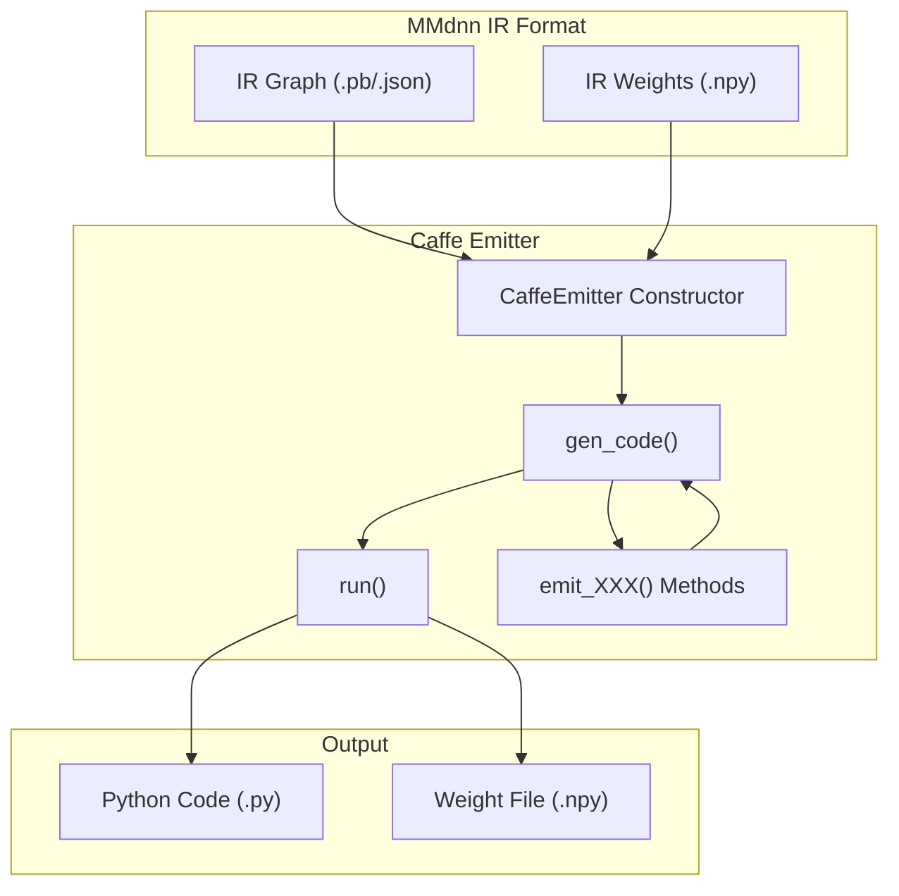
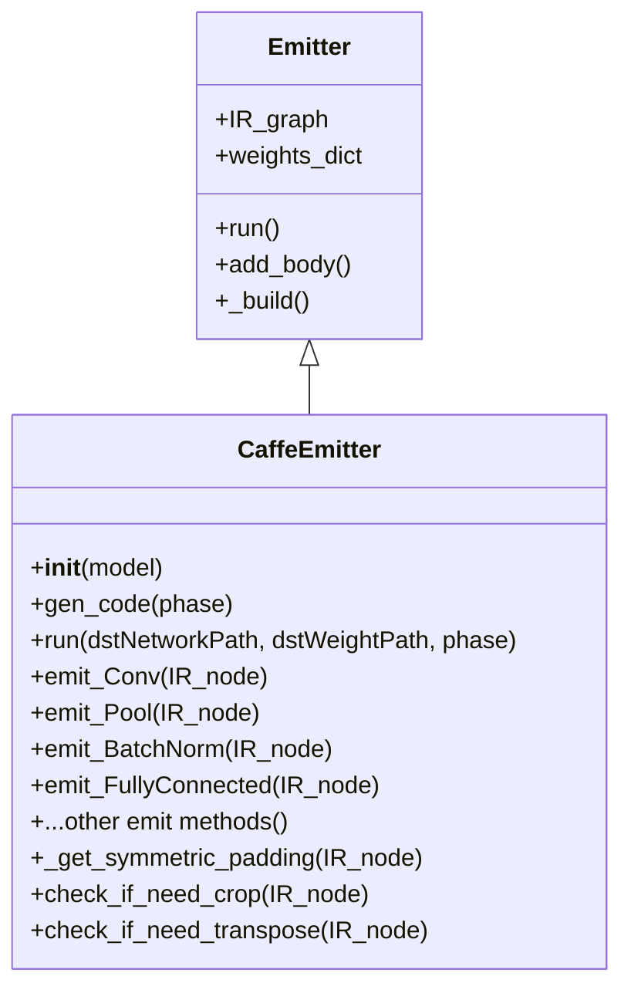
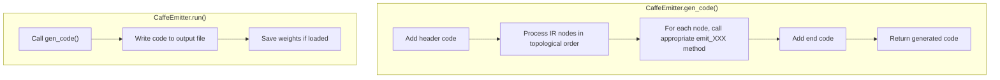
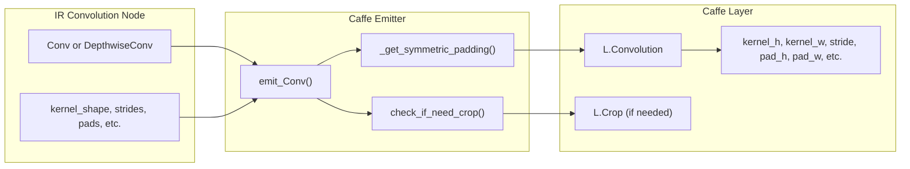
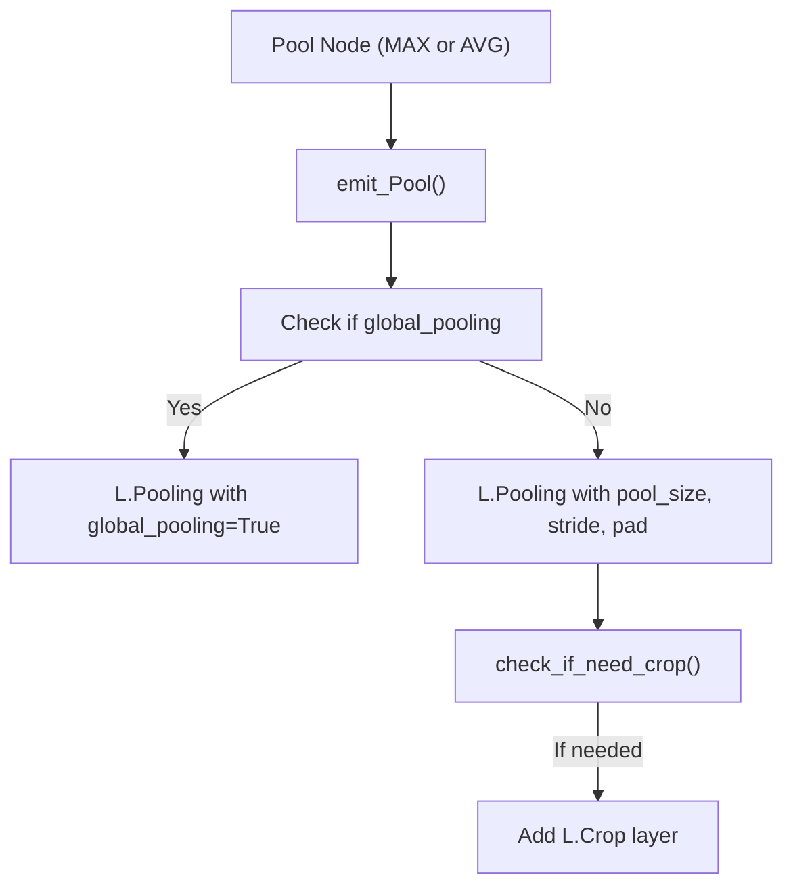
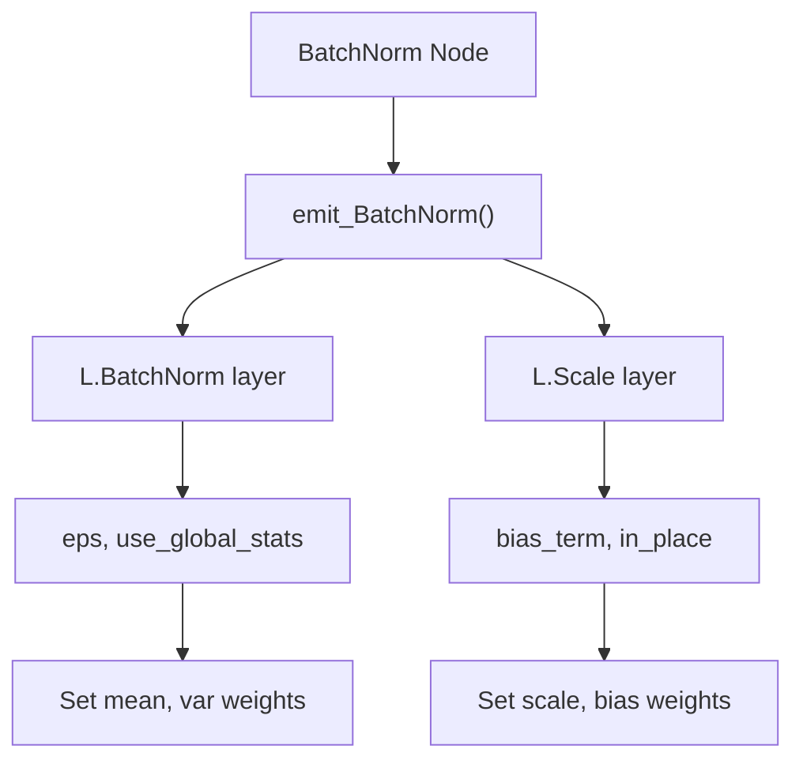
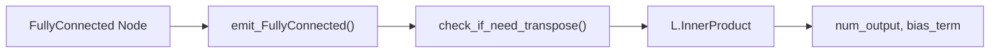

<!-- source: DeepWiki mcp.deepwiki.com · repo microsoft/MMdnn · page 4.3 Caffe Emitter · fetched 2026-10-26 -->

# Caffe Emitter

<details>
<summary>Relevant source files</summary>

The following files were used as context for generating this wiki page:

- [mmdnn/conversion/caffe/caffe_emitter.py](mmdnn/conversion/caffe/caffe_emitter.py)
- [mmdnn/conversion/cntk/cntk_emitter.py](mmdnn/conversion/cntk/cntk_emitter.py)
- [mmdnn/conversion/mxnet/mxnet_emitter.py](mmdnn/conversion/mxnet/mxnet_emitter.py)
- [mmdnn/conversion/mxnet/mxnet_parser.py](mmdnn/conversion/mxnet/mxnet_parser.py)
- [mmdnn/conversion/onnx/onnx_emitter.py](mmdnn/conversion/onnx/onnx_emitter.py)

</details>


## Purpose and Scope

The Caffe Emitter is a component in the MMdnn framework responsible for converting models from the MMdnn Intermediate Representation (IR) to Caffe format. It generates Python code that utilizes Caffe's API to rebuild the model architecture and loads the weights from the IR. For information about the overall MMdnn conversion pipeline, see [System Architecture](#1.1). For details on other emitters, see [Framework Emitters](#4).

## Architecture Overview



Sources: [mmdnn/conversion/caffe/caffe_emitter.py:23-35](), [mmdnn/conversion/caffe/caffe_emitter.py:114-147]()

The Caffe Emitter inherits from the base `Emitter` class and provides functionality to convert IR models to Caffe models. It processes the IR graph node by node, converting each operation into its Caffe equivalent.

## Key Components

### Class Structure



Sources: [mmdnn/conversion/caffe/caffe_emitter.py:23-647](), [mmdnn/conversion/common/DataStructure/emitter.py]()

### Generated Code Structure

The Caffe Emitter generates Python code with the following sections:

1. **Header**: Imports necessary libraries and defines helper functions
2. **KitModel function**: The main function that builds the Caffe model
3. **Other utility functions**: For making the network, generating weights, etc.

## Conversion Process

The conversion process follows these key steps:

1. Load the IR graph and weights
2. Generate the Python code header and initialization
3. Process each node in the IR graph in topological order
4. For each node, call the appropriate `emit_XXX` method based on the node type
5. Generate code to create the output network and save the model



Sources: [mmdnn/conversion/caffe/caffe_emitter.py:114-147](), [mmdnn/conversion/caffe/caffe_emitter.py:143-147]()

## Layer Conversion

The Caffe Emitter supports conversion of many common neural network layers. Below are some of the key layer conversions:

### Convolution Layers

The emitter handles both regular convolution and depthwise convolution, managing padding, strides, and dilation properly.



Sources: [mmdnn/conversion/caffe/caffe_emitter.py:198-295]()

Key aspects of convolution conversion:
- Handles padding with `_get_symmetric_padding` method
- May add a crop layer if the output shape doesn't match exactly
- Converts depthwise convolution by setting appropriate groups parameter
- Transposes weights correctly for the Caffe format

### Pooling Layers

Pooling layers are converted with special attention to padding and global pooling.



Sources: [mmdnn/conversion/caffe/caffe_emitter.py:297-339]()

### Batch Normalization

Batch Normalization conversion involves creating a BatchNorm layer followed by a Scale layer.



Sources: [mmdnn/conversion/caffe/caffe_emitter.py:402-435]()

### Fully Connected Layers

Fully connected (dense) layers are converted to Caffe's InnerProduct layers.



Sources: [mmdnn/conversion/caffe/caffe_emitter.py:390-400]()

## Weight Conversion

The Caffe Emitter handles weight conversion carefully since deep learning frameworks often have different weight formats:

1. **Convolution weights**: Transposed according to dimension requirements
2. **Depthwise convolution weights**: Swapped axes for Caffe's format
3. **Fully connected weights**: Transposed when necessary based on parent node's dimensions

The weights are saved to a separate .npy file that the generated Python code will load.

## Handling Padding and Output Shapes

One of the key challenges in converting to Caffe is handling padding correctly:

1. The `_get_symmetric_padding` method calculates appropriate padding values for Caffe layers
2. The `check_if_need_crop` method determines if a Crop layer is needed after operations like convolution or pooling
3. If necessary, a Crop layer is added to ensure exact output dimensions match the IR model

Sources: [mmdnn/conversion/caffe/caffe_emitter.py:154-182](), [mmdnn/conversion/caffe/caffe_emitter.py:262-295]()

## Supported Layer Types

The Caffe Emitter supports a wide range of layer types:

| Layer Type | Caffe Equivalent | Implementation Notes |
|------------|------------------|---------------------|
| Conv | L.Convolution | Supports groups, dilation, strides |
| DepthwiseConv | L.Convolution | Uses group parameter for depth multiplier |
| Pool | L.Pooling | Supports MAX, AVG with global pooling option |
| BatchNorm | L.BatchNorm + L.Scale | Two-layer implementation |
| FullyConnected | L.InnerProduct | Handles weight transposition |
| Relu | L.ReLU | Supports in-place operation |
| LeakyRelu | L.ReLU with negative_slope | - |
| PRelu | L.PReLU | - |
| Concat | L.Concat | Handles axis parameter |
| Add | L.Eltwise | Uses operation=1 (SUM) |
| Mul | L.Eltwise | Uses operation=0 (PRODUCT) |
| Sub | L.Eltwise | Uses coefficient [1, -1] |
| LRN | L.LRN | Preserves all parameters |
| Flatten | L.Flatten | - |
| Softmax | L.Softmax | - |
| Tanh | L.TanH | - |
| Sigmoid | L.Sigmoid | - |
| Dropout | L.Dropout | Supports in-place operation |
| Elu | L.ELU | Supports in-place operation |
| Reshape | L.Reshape | - |
| UpSampling2D | L.Deconvolution | Special configuration for upsampling |

Sources: [mmdnn/conversion/caffe/caffe_emitter.py:198-668]()

## Generated Code Example

The Caffe Emitter generates Python code that follows this structure:

```python
# Imports and helper functions
import numpy as np
import caffe
from caffe import layers as L
from caffe import params as P
from caffe import to_proto

_weights_dict = dict()

def load_weights(weight_file):
    # Load weights from .npy file
    ...

def KitModel(weight_file = None):
    # Create the Caffe network
    n = caffe.NetSpec()
    
    # Define all layers
    n.data = L.Input(...)
    n.conv1 = L.Convolution(...)
    ...
    
    return n

def make_net(prototxt):
    # Save the network architecture
    ...

def gen_weight(weight_file, model, prototxt):
    # Load and set model weights
    ...

# Main block for command-line usage
if __name__=='__main__':
    # Parse arguments
    # Generate model and weights
    ...
```

Sources: [mmdnn/conversion/caffe/caffe_emitter.py:38-112]()

## Usage

The Caffe Emitter is typically used through the MMdnn command-line interface:

```
mmconvert -sf [source_framework] -in [input_network] -iw [input_weights] -df caffe -om [output_model_path]
```

Or directly through the API:

```python
from mmdnn.conversion.caffe.caffe_emitter import CaffeEmitter

# Create emitter with IR model
emitter = CaffeEmitter('path/to/ir_model.json')

# Generate code
python_code = emitter.gen_code()

# Save to files
emitter.run('path/to/output.py', 'path/to/output_weights.npy')
```

The generated Python script can then be used to create Caffe model files:

```
python output.py -w output_weights.npy -p model.prototxt -m model.caffemodel
```

## Limitations and Special Considerations

1. **Asymmetric Padding**: Caffe only supports symmetric padding natively. For asymmetric padding, the emitter adds a Crop layer after the operation.

2. **Layer Support**: Not all IR operations have direct Caffe equivalents. Some advanced operations may not be fully supported.

3. **ReLU6**: Handled specially with either a Clip layer or a regular ReLU depending on Caffe version.

4. **Data Format**: The emitter assumes and converts to NCHW format as required by Caffe.

Sources: [mmdnn/conversion/caffe/caffe_emitter.py:631-635]()

## Summary

The Caffe Emitter is a crucial component of the MMdnn framework that enables conversion from various deep learning frameworks to Caffe. It handles the complex task of mapping IR nodes to Caffe layers, managing weight transformations, and generating executable Python code that produces Caffe models.

---

