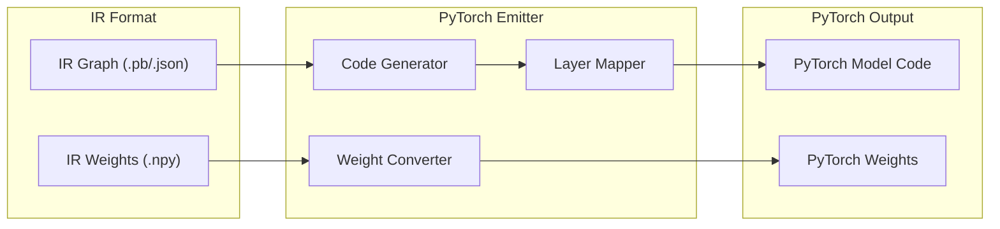
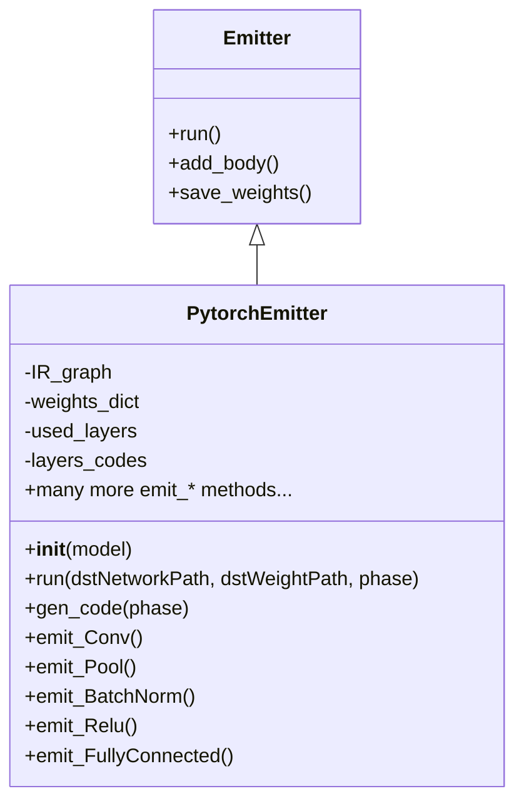
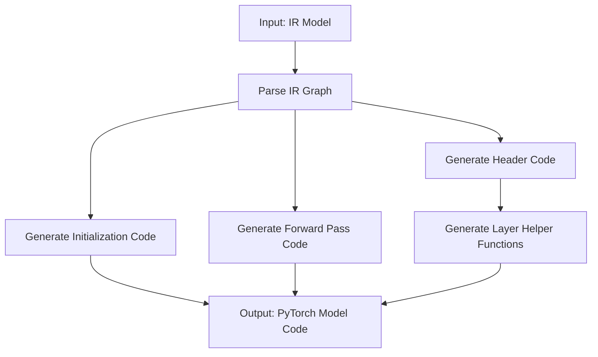
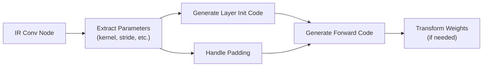
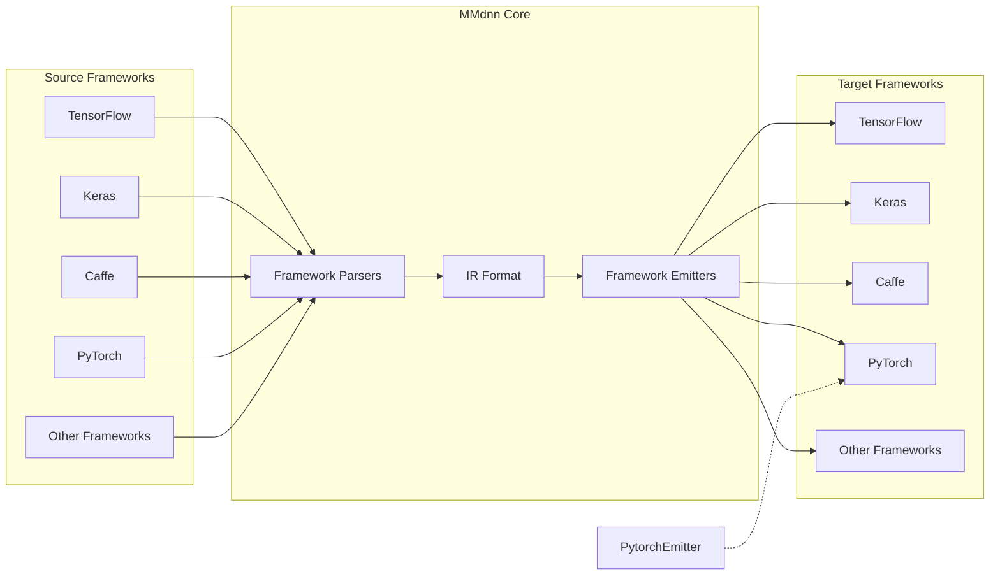

<!-- source: DeepWiki mcp.deepwiki.com · repo microsoft/MMdnn · page 4.4 PyTorch Emitter · fetched 2026-10-26 -->

# PyTorch Emitter

<details>
<summary>Relevant source files</summary>

The following files were used as context for generating this wiki page:

- [mmdnn/conversion/keras/keras2_emitter.py](mmdnn/conversion/keras/keras2_emitter.py)
- [mmdnn/conversion/pytorch/pytorch_emitter.py](mmdnn/conversion/pytorch/pytorch_emitter.py)

</details>


The PyTorch Emitter is a component within the MMdnn framework responsible for converting neural network models from the Intermediate Representation (IR) format to executable PyTorch code. This page documents the architecture, implementation details, and supported operations of the PyTorch Emitter system.

## 1. Overview

The PyTorch Emitter serves as a crucial part of the MMdnn model conversion pipeline. After a source model has been parsed into the Intermediate Representation (IR) format (see [Framework Parsers](#3)), the PyTorch Emitter converts this IR into functional PyTorch code that can be executed to reproduce the original model's behavior.



Sources: [mmdnn/conversion/pytorch/pytorch_emitter.py:16-16](), [mmdnn/conversion/pytorch/pytorch_emitter.py:90-126]()

## 2. Architecture

The PyTorch Emitter is implemented as the `PytorchEmitter` class that inherits from the base `Emitter` class. The emitter takes an IR model as input and generates PyTorch code by traversing the IR graph and converting each node to equivalent PyTorch operations.



Sources: [mmdnn/conversion/pytorch/pytorch_emitter.py:16-46](), [mmdnn/conversion/pytorch/pytorch_emitter.py:90-126]()

### 2.1 Key Components

1. **IR Graph Processing**: The emitter processes an IR graph, which represents the structure of the neural network.

2. **Code Generation System**: The emitter generates Python code for a PyTorch model with three main sections:
   - Header code: Imports and helper functions
   - Initialization code: Sets up the model class and parameters
   - Body code: Implements the forward pass of the model

3. **Weight Conversion**: The emitter handles the conversion of weights from the IR format to PyTorch tensor format, performing necessary transformations.

4. **Layer Mapping**: Each IR node type is mapped to corresponding PyTorch operations via emit_* methods.

Sources: [mmdnn/conversion/pytorch/pytorch_emitter.py:66-126]()

## 3. Implementation Details

### 3.1 Code Generation Approach

The PyTorch Emitter generates a complete PyTorch model class (`KitModel`) that inherits from `nn.Module`. The generated code includes:

1. **Imports** - PyTorch libraries and dependencies
2. **Weight loading function** - To load the pre-trained weights
3. **Model class definition** - With `__init__` and `forward` methods
4. **Layer helper functions** - For layer initialization



Sources: [mmdnn/conversion/pytorch/pytorch_emitter.py:66-88](), [mmdnn/conversion/pytorch/pytorch_emitter.py:90-126]()

### 3.2 Weight Handling

The PyTorch Emitter handles weight conversion with the following steps:

1. Loads weights from a NumPy file
2. Transforms weights as necessary (e.g., reshaping, transposing dimensions)
3. Generates code to assign weights to PyTorch layers

For example, with Convolutional layers, weights are transposed to match PyTorch's expected format:

```python
# For Conv layers
self.weights_dict[IR_node.name]['weights'] = np.transpose(
    self.weights_dict[IR_node.name]['weights'], 
    [dim + 1, dim] + list(range(0, dim))
)
```

Sources: [mmdnn/conversion/pytorch/pytorch_emitter.py:185-188](), [mmdnn/conversion/pytorch/pytorch_emitter.py:75-85]()

## 4. Supported Operations

The PyTorch Emitter supports a wide range of neural network operations. Below is a table of key supported operations and their corresponding implementations:

| IR Operation | PyTorch Implementation | Implementation Method |
|--------------|------------------------|----------------------|
| Conv | nn.Conv1d/Conv2d/Conv3d | emit_Conv |
| Pool | F.max_pool/avg_pool | emit_Pool |
| BatchNorm | nn.BatchNorm1d/2d/3d | emit_BatchNorm |
| FullyConnected | nn.Linear | emit_FullyConnected |
| Activation Functions | F.relu, F.tanh, F.sigmoid, etc. | emit_Relu, emit_Tanh, emit_Sigmoid |
| Reshape | torch.reshape | emit_Reshape |
| Flatten | .view | emit_Flatten |
| Concat | torch.cat | emit_Concat |
| Add/Sub/Mul | +, -, * operators | emit_Add, emit_Sub, emit_Mul |
| ReduceMean | torch.mean | emit_ReduceMean |
| Pad | F.pad | emit_Pad |
| Split | torch.split | emit_Split |
| Unsqueeze | .unsqueeze | emit_Unsqueeze |
| LRN | F.local_response_norm | emit_LRN |

Sources: [mmdnn/conversion/pytorch/pytorch_emitter.py:149-813]()

### 4.1 Layer Implementation Example: Convolution

The convolution implementation demonstrates how IR nodes are converted to PyTorch code:



The emitter handles convolution by:
1. Extracting parameters from the IR node
2. Creating initialization code for the convolution layer
3. Handling padding (if needed)
4. Generating forward pass code
5. Transforming weights to match PyTorch's format

Sources: [mmdnn/conversion/pytorch/pytorch_emitter.py:149-190](), [mmdnn/conversion/pytorch/pytorch_emitter.py:890-901]()

## 5. Customization and Extension

The PyTorch Emitter can be extended to support new operations by adding new `emit_*` methods. The architecture is designed to be modular, making it straightforward to add support for new layer types.

### 5.1 Adding a New Operation

To add support for a new operation:

1. Implement a new `emit_*` method in the `PytorchEmitter` class
2. Handle parameter extraction from the IR node
3. Generate appropriate PyTorch code
4. Manage any weight transformations required

If the operation requires helper functions, these can be added as `_layer_*` methods.

Sources: [mmdnn/conversion/pytorch/pytorch_emitter.py:879-1023]()

## 6. Usage

The PyTorch Emitter is typically used as part of the MMdnn conversion pipeline, either directly through the `mmtocode` command-line tool or as part of the full conversion process with `mmconvert`.

```python
# Example usage in code
from mmdnn.conversion.pytorch.pytorch_emitter import PytorchEmitter

# Initialize the emitter with an IR model
emitter = PytorchEmitter(model_path)

# Generate PyTorch code
pytorch_code = emitter.gen_code('test')

# Save the generated code and weights
emitter.run(output_code_path, output_weights_path)
```

For command-line usage, see the [Command-Line Tools](#1.2) documentation.

Sources: [mmdnn/conversion/pytorch/pytorch_emitter.py:46-49]()

## 7. Integration with MMdnn Pipeline

The PyTorch Emitter is one of several framework-specific emitters in the MMdnn framework. It integrates with the overall conversion pipeline as illustrated below:



The PyTorch Emitter is responsible for the IR → PyTorch conversion step in this pipeline.

Sources: [mmdnn/conversion/pytorch/pytorch_emitter.py:16-16]()

---

