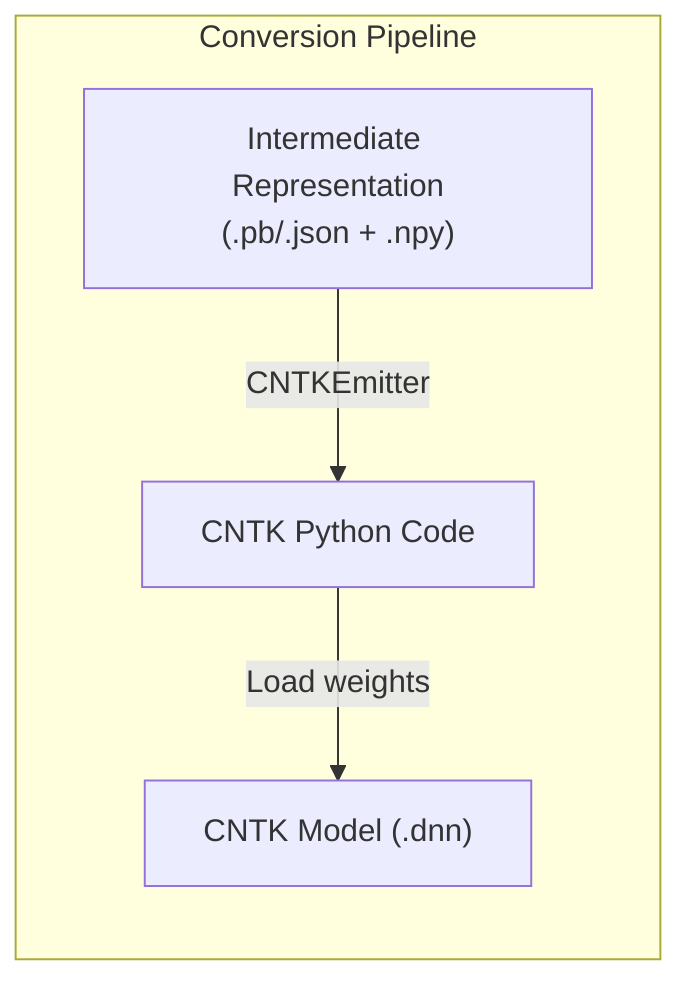
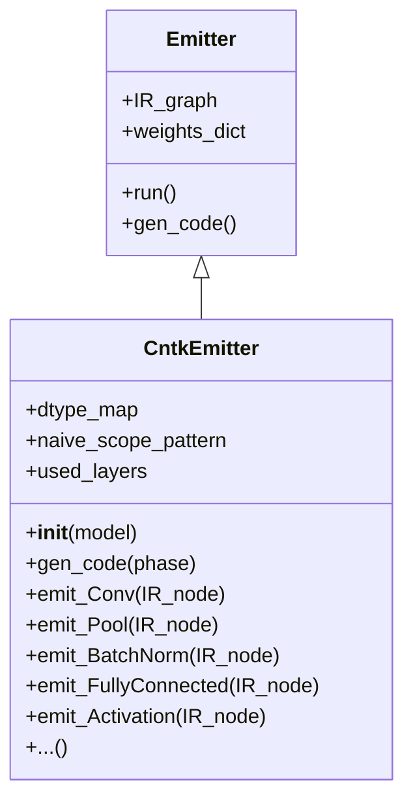
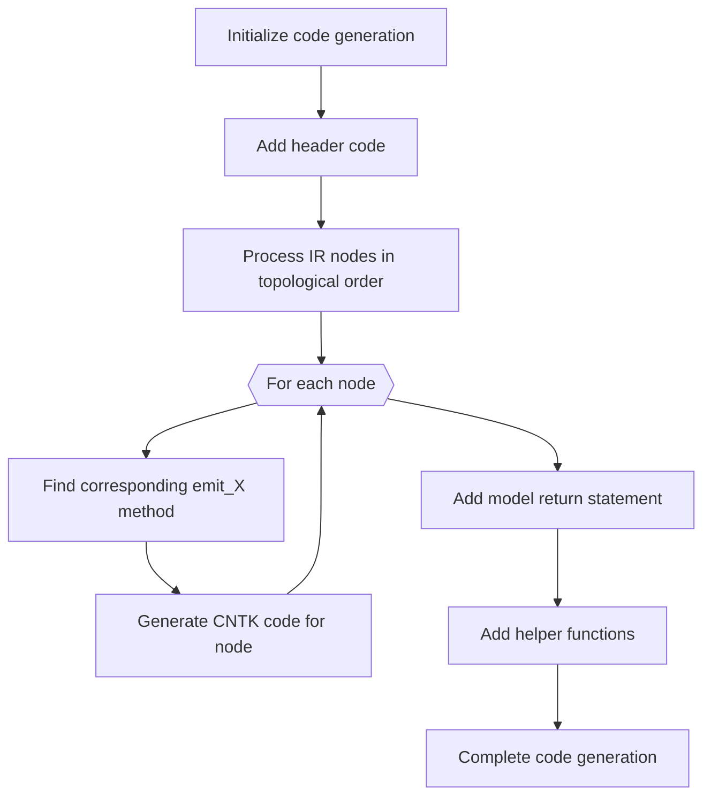
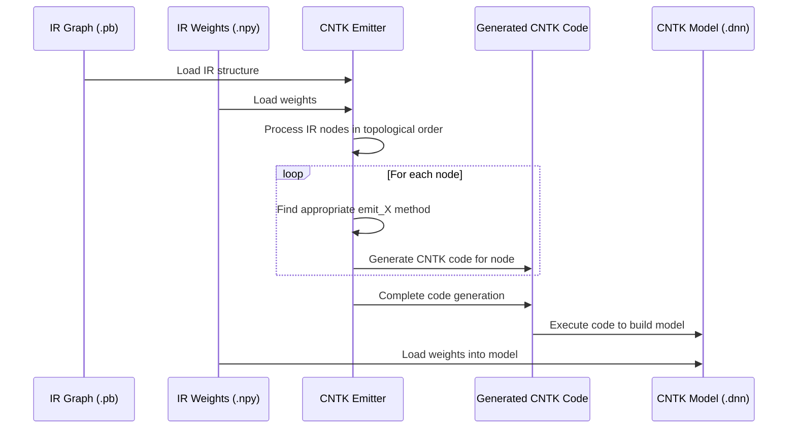
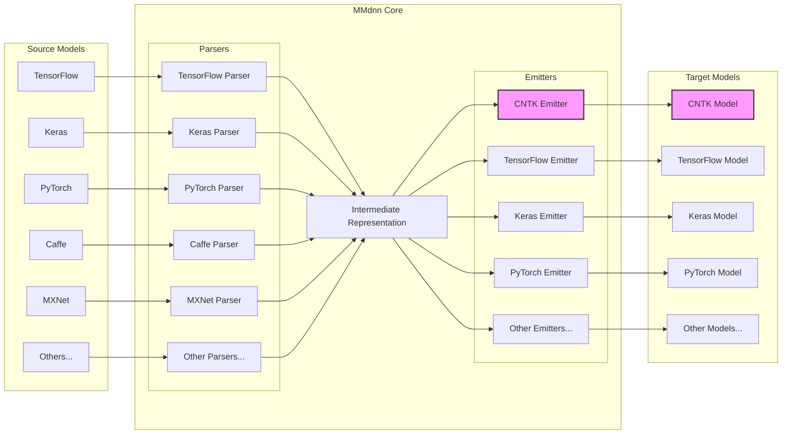

<!-- source: DeepWiki mcp.deepwiki.com · repo microsoft/MMdnn · page 4.5 CNTK Emitter · fetched 2026-10-26 -->

# CNTK Emitter

<details>
<summary>Relevant source files</summary>

The following files were used as context for generating this wiki page:

- [docs/keras2cntk.md](docs/keras2cntk.md)
- [docs/tf2pytorch.md](docs/tf2pytorch.md)
- [mmdnn/conversion/caffe/caffe_emitter.py](mmdnn/conversion/caffe/caffe_emitter.py)
- [mmdnn/conversion/cntk/cntk_emitter.py](mmdnn/conversion/cntk/cntk_emitter.py)
- [mmdnn/conversion/examples/coreml/test_tfcoreml.py](mmdnn/conversion/examples/coreml/test_tfcoreml.py)
- [mmdnn/conversion/mxnet/mxnet_emitter.py](mmdnn/conversion/mxnet/mxnet_emitter.py)
- [mmdnn/conversion/mxnet/mxnet_parser.py](mmdnn/conversion/mxnet/mxnet_parser.py)
- [mmdnn/conversion/onnx/onnx_emitter.py](mmdnn/conversion/onnx/onnx_emitter.py)

</details>


The CNTK Emitter is a component of the MMdnn framework that converts the Intermediate Representation (IR) to Microsoft Cognitive Toolkit (CNTK) format. It enables the conversion of deep learning models from various frameworks (such as TensorFlow, Keras, PyTorch, etc.) to CNTK-compatible models for deployment, inference, or further training.

## Overview

The CNTK Emitter transforms the framework-agnostic Intermediate Representation (IR) into CNTK code and model files. It's a crucial component in the model conversion pipeline when targeting the Microsoft Cognitive Toolkit as the destination framework.



Sources: [mmdnn/conversion/cntk/cntk_emitter.py:21-50](https://github.com/microsoft/MMdnn/blob/master/mmdnn/conversion/cntk/cntk_emitter.py:21-50)

## Architecture

The CNTK Emitter follows the emitter design pattern in MMdnn and specializes in generating CNTK code from the IR. It processes the IR graph in topological order, converting each operation to its CNTK equivalent.



Sources: [mmdnn/conversion/cntk/cntk_emitter.py:21-111](https://github.com/microsoft/MMdnn/blob/master/mmdnn/conversion/cntk/cntk_emitter.py:21-111)

## Key Components

### 1. Initialization and Setup

The CntkEmitter initializes by loading the IR graph and weights:

```python
def __init__(self, model):
    # Load model (IR graph) and weights
    # Build IR graph
    # Initialize emitter
```

Sources: [mmdnn/conversion/cntk/cntk_emitter.py:37-50](https://github.com/microsoft/MMdnn/blob/master/mmdnn/conversion/cntk/cntk_emitter.py:37-50)

### 2. Code Generation

The `gen_code` method is the main driver that generates CNTK code from the IR:



Sources: [mmdnn/conversion/cntk/cntk_emitter.py:81-110](https://github.com/microsoft/MMdnn/blob/master/mmdnn/conversion/cntk/cntk_emitter.py:81-110)

### 3. Layer Conversion

The emitter contains numerous `emit_X` methods, each designed to convert a specific type of operation from IR to CNTK:

| IR Layer Type | CNTK Implementation | Function |
|---------------|---------------------|----------|
| Conv          | convolution         | `emit_Conv` |
| Pool          | pooling             | `emit_Pool` |
| BatchNorm     | batch_normalization | `emit_BatchNorm` |
| FullyConnected| dense               | `emit_FullyConnected` |
| Relu          | ops.relu            | `emit_Relu` |
| Softmax       | ops.softmax         | `emit_Softmax` |
| Tanh          | ops.tanh            | `emit_Tanh` |
| Sigmoid       | ops.sigmoid         | `emit_Sigmoid` |
| Add           | element-wise addition | `emit_Add` |
| Mul           | element-wise multiplication | `emit_Mul` |
| Concat        | cntk.splice         | `emit_Concat` |

Sources: 
- [mmdnn/conversion/cntk/cntk_emitter.py:183-219](https://github.com/microsoft/MMdnn/blob/master/mmdnn/conversion/cntk/cntk_emitter.py:183-219)
- [mmdnn/conversion/cntk/cntk_emitter.py:222-261](https://github.com/microsoft/MMdnn/blob/master/mmdnn/conversion/cntk/cntk_emitter.py:222-261)
- [mmdnn/conversion/cntk/cntk_emitter.py:416-424](https://github.com/microsoft/MMdnn/blob/master/mmdnn/conversion/cntk/cntk_emitter.py:416-424)
- [mmdnn/conversion/cntk/cntk_emitter.py:294-310](https://github.com/microsoft/MMdnn/blob/master/mmdnn/conversion/cntk/cntk_emitter.py:294-310)
- [mmdnn/conversion/cntk/cntk_emitter.py:330-352](https://github.com/microsoft/MMdnn/blob/master/mmdnn/conversion/cntk/cntk_emitter.py:330-352)

### 4. Helper Functions

The emitter contains various helper functions for common tasks:

```python
def _defuse_padding(self, IR_node):
    # Handle padding conversion from IR to CNTK
    
def is_valid_padding(auto_pad, pads):
    # Check if padding is valid
    
def is_ceil_mode(pads):
    # Check ceiling mode for pooling
```

Sources: [mmdnn/conversion/cntk/cntk_emitter.py:113-180](https://github.com/microsoft/MMdnn/blob/master/mmdnn/conversion/cntk/cntk_emitter.py:113-180)

## Conversion Process

The CNTK Emitter follows this process to convert an IR model to a CNTK model:



Sources: [mmdnn/conversion/cntk/cntk_emitter.py:81-110](https://github.com/microsoft/MMdnn/blob/master/mmdnn/conversion/cntk/cntk_emitter.py:81-110)

## Supported Operations

The CNTK Emitter supports a wide range of operations found in neural networks:

1. **Data Input/Output**: `emit_DataInput`
2. **Convolution Operations**: `emit_Conv`, `emit_DepthwiseConv`, `emit_ConvTranspose`
3. **Pooling Operations**: `emit_Pool`
4. **Normalization**: `emit_BatchNorm`, `emit_LRN`
5. **Activations**: `emit_Relu`, `emit_Tanh`, `emit_Sigmoid`, `emit_Softmax`, `emit_LeakyRelu`, `emit_Relu6`
6. **Shape Operations**: `emit_Reshape`, `emit_Flatten`, `emit_Squeeze`
7. **Element-wise Operations**: `emit_Add`, `emit_Mul`, `emit_Sub`
8. **Others**: `emit_Dropout`, `emit_FullyConnected`, `emit_Constant`, `emit_Concat`, `emit_Pad`

Sources:
- [mmdnn/conversion/cntk/cntk_emitter.py:268-276](https://github.com/microsoft/MMdnn/blob/master/mmdnn/conversion/cntk/cntk_emitter.py:268-276)
- [mmdnn/conversion/cntk/cntk_emitter.py:183-219](https://github.com/microsoft/MMdnn/blob/master/mmdnn/conversion/cntk/cntk_emitter.py:183-219)
- [mmdnn/conversion/cntk/cntk_emitter.py:222-261](https://github.com/microsoft/MMdnn/blob/master/mmdnn/conversion/cntk/cntk_emitter.py:222-261)
- [mmdnn/conversion/cntk/cntk_emitter.py:416-424](https://github.com/microsoft/MMdnn/blob/master/mmdnn/conversion/cntk/cntk_emitter.py:416-424)
- [mmdnn/conversion/cntk/cntk_emitter.py:339-352](https://github.com/microsoft/MMdnn/blob/master/mmdnn/conversion/cntk/cntk_emitter.py:339-352)
- [mmdnn/conversion/cntk/cntk_emitter.py:534-543](https://github.com/microsoft/MMdnn/blob/master/mmdnn/conversion/cntk/cntk_emitter.py:534-543)
- [mmdnn/conversion/cntk/cntk_emitter.py:322-327](https://github.com/microsoft/MMdnn/blob/master/mmdnn/conversion/cntk/cntk_emitter.py:322-327)
- [mmdnn/conversion/cntk/cntk_emitter.py:366-391](https://github.com/microsoft/MMdnn/blob/master/mmdnn/conversion/cntk/cntk_emitter.py:366-391)
- [mmdnn/conversion/cntk/cntk_emitter.py:294-310](https://github.com/microsoft/MMdnn/blob/master/mmdnn/conversion/cntk/cntk_emitter.py:294-310)
- [mmdnn/conversion/cntk/cntk_emitter.py:402-414](https://github.com/microsoft/MMdnn/blob/master/mmdnn/conversion/cntk/cntk_emitter.py:402-414)
- [mmdnn/conversion/cntk/cntk_emitter.py:426-444](https://github.com/microsoft/MMdnn/blob/master/mmdnn/conversion/cntk/cntk_emitter.py:426-444)

## Data Type Mapping

The CNTK Emitter provides a mapping between IR data types and CNTK/NumPy data types:

| IR Data Type | CNTK/NumPy Data Type |
|--------------|----------------------|
| DT_FLOAT16   | np.float16           |
| DT_FLOAT32   | np.float32           |
| DT_FLOAT64   | np.float64           |
| DT_INT16     | np.float16           |
| DT_INT32     | np.float32           |
| DT_INT64     | np.float64           |
| DT_UINT8     | np.uint8             |
| DT_UINT16    | np.uint16            |

Note: CNTK does not natively support integer types for computation, so integer types are mapped to corresponding float types.

Sources: [mmdnn/conversion/cntk/cntk_emitter.py:23-32](https://github.com/microsoft/MMdnn/blob/master/mmdnn/conversion/cntk/cntk_emitter.py:23-32)

## Usage Example

Below is an example of converting a Keras model to CNTK using MMdnn, which utilizes the CNTK Emitter:

### One-step Conversion

```bash
mmconvert -sf keras -iw imagenet_inception_v3.h5 -df cntk -om keras_to_cntk_inception_v3.dnn
```

### Step-by-step Conversion

```bash
# Step 1: Convert to IR
mmtoir -f keras -w imagenet_inception_v3.h5 -o converted

# Step 2: Generate CNTK code from IR
mmtocode -f cntk -d converted_cntk.py -n converted.pb -w converted.npy

# Step 3: Build CNTK model from generated code
mmtomodel -f cntk -in converted_cntk -iw converted.npy -o cntk_inception_v3.dnn
```

This process:
1. Converts the Keras model to IR
2. Uses the CNTK Emitter to generate CNTK code from the IR
3. Builds a CNTK model file (.dnn) from the generated code and weights

Sources: [docs/keras2cntk.md:39-97](https://github.com/microsoft/MMdnn/blob/master/docs/keras2cntk.md:39-97)

## Limitations and Considerations

1. **Data Type Support**: CNTK doesn't natively support integer types, so these are mapped to floating-point types.
2. **RNN Support**: Limited support for recurrent neural networks.
3. **Custom Layers**: May not fully support custom or specialized layers.
4. **Weight Transformation**: Weights may need to be transposed or reshaped to match CNTK's expected format.

Sources:
- [mmdnn/conversion/cntk/cntk_emitter.py:23-32](https://github.com/microsoft/MMdnn/blob/master/mmdnn/conversion/cntk/cntk_emitter.py:23-32)
- [mmdnn/conversion/cntk/cntk_emitter.py:356-363](https://github.com/microsoft/MMdnn/blob/master/mmdnn/conversion/cntk/cntk_emitter.py:356-363)

## Integration with MMdnn Framework

The CNTK Emitter is integrated into the MMdnn framework's conversion pipeline:



Sources: Based on the system overview diagram provided in the task.

The CNTK Emitter works with other components of MMdnn to provide a complete model conversion pipeline, allowing models trained in various frameworks to be deployed in CNTK.

---

