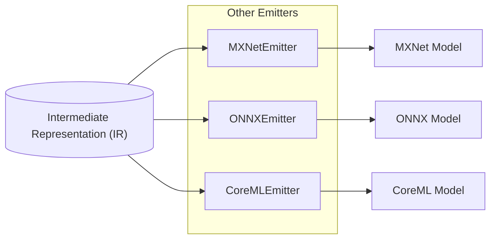
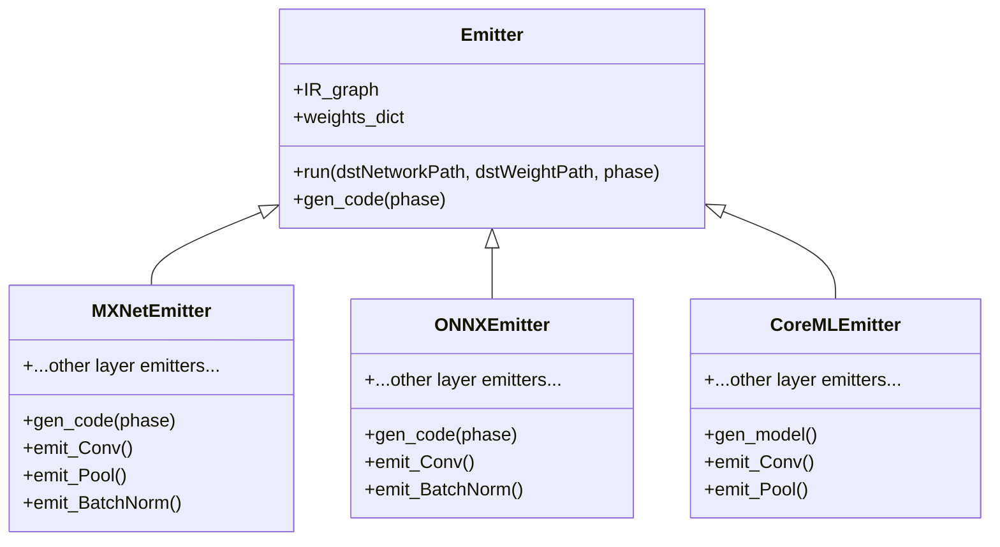
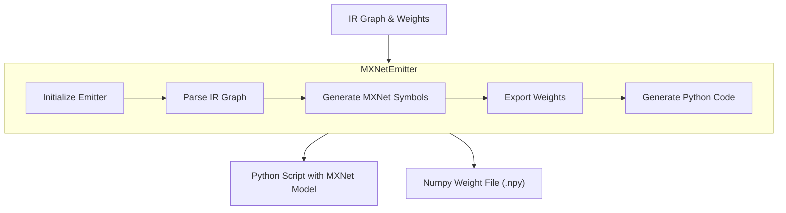
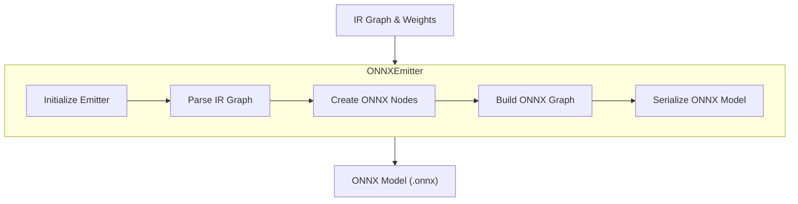
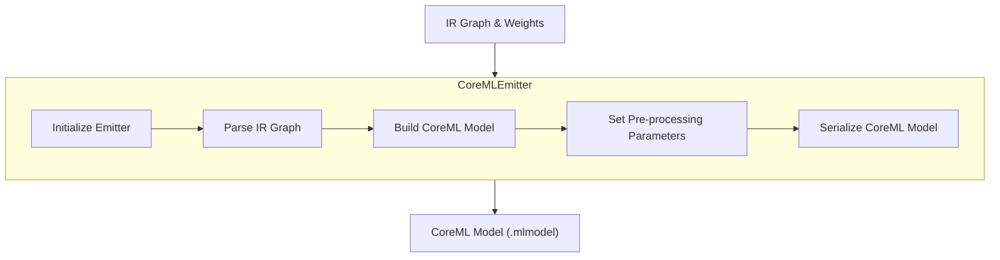

<!-- source: DeepWiki mcp.deepwiki.com · repo microsoft/MMdnn · page 4.6 Other Emitters · fetched 2026-10-26 -->

# Other Emitters

<details>
<summary>Relevant source files</summary>

The following files were used as context for generating this wiki page:

- [mmdnn/conversion/_script/IRToModel.py](mmdnn/conversion/_script/IRToModel.py)
- [mmdnn/conversion/caffe/caffe_emitter.py](mmdnn/conversion/caffe/caffe_emitter.py)
- [mmdnn/conversion/cntk/cntk_emitter.py](mmdnn/conversion/cntk/cntk_emitter.py)
- [mmdnn/conversion/coreml/coreml_emitter.py](mmdnn/conversion/coreml/coreml_emitter.py)
- [mmdnn/conversion/examples/coreml/__init__.py](mmdnn/conversion/examples/coreml/__init__.py)
- [mmdnn/conversion/examples/coreml/imagenet_test.py](mmdnn/conversion/examples/coreml/imagenet_test.py)
- [mmdnn/conversion/examples/tensorflow/vis_meta.py](mmdnn/conversion/examples/tensorflow/vis_meta.py)
- [mmdnn/conversion/mxnet/mxnet_emitter.py](mmdnn/conversion/mxnet/mxnet_emitter.py)
- [mmdnn/conversion/mxnet/mxnet_parser.py](mmdnn/conversion/mxnet/mxnet_parser.py)
- [mmdnn/conversion/onnx/onnx_emitter.py](mmdnn/conversion/onnx/onnx_emitter.py)

</details>


This page documents the "other emitters" in MMdnn that are not covered in the main emitter pages. These include the MXNet, ONNX, and CoreML emitters, which convert from MMdnn's Intermediate Representation (IR) to their respective target model formats. For information about the primary emitters (TensorFlow, Keras, Caffe, PyTorch, CNTK), please refer to their dedicated wiki pages ([4.1](#4.1) through [4.5](#4.5)).

## Overview of Emitters

Emitters represent the second half of the model conversion process in MMdnn. After a parser converts a source model to the IR format, an emitter translates that IR into a target framework format. The emitters covered in this page follow the same general architecture as the main emitters but target different frameworks.



Sources: [mmdnn/conversion/mxnet/mxnet_emitter.py](https://github.com/microsoft/MMdnn/blob/master/mmdnn/conversion/mxnet/mxnet_emitter.py), [mmdnn/conversion/onnx/onnx_emitter.py](https://github.com/microsoft/MMdnn/blob/master/mmdnn/conversion/onnx/onnx_emitter.py), [mmdnn/conversion/coreml/coreml_emitter.py](https://github.com/microsoft/MMdnn/blob/master/mmdnn/conversion/coreml/coreml_emitter.py)

## Common Emitter Architecture

All emitters in MMdnn share a similar structure derived from the base `Emitter` class. Here's the general architecture of an emitter:



Sources: [mmdnn/conversion/mxnet/mxnet_emitter.py:18-80](https://github.com/microsoft/MMdnn/blob/master/mmdnn/conversion/mxnet/mxnet_emitter.py), [mmdnn/conversion/onnx/onnx_emitter.py:9-57](https://github.com/microsoft/MMdnn/blob/master/mmdnn/conversion/onnx/onnx_emitter.py), [mmdnn/conversion/coreml/coreml_emitter.py:24-78](https://github.com/microsoft/MMdnn/blob/master/mmdnn/conversion/coreml/coreml_emitter.py)

## MXNet Emitter

The MXNet emitter converts the IR format to MXNet models using MXNet's symbolic API.

### Key Features

- Generates Python code for MXNet models
- Preserves architecture and weights from the source model
- Supports both inference and training modes
- Handles complex layer mappings from IR to MXNet

### Workflow



Sources: [mmdnn/conversion/mxnet/mxnet_emitter.py:80-225](https://github.com/microsoft/MMdnn/blob/master/mmdnn/conversion/mxnet/mxnet_emitter.py)

### Layer Conversion

The MXNet emitter includes specialized conversion methods for different layer types. The table below shows some of the key layer conversions:

| IR Layer Type | MXNet Implementation | Function |
|---------------|----------------------|----------|
| Conv | mx.sym.Convolution | emit_Conv |
| DepthwiseConv | mx.sym.Convolution with groups | emit_DepthwiseConv |
| Pool | mx.sym.Pooling | emit_Pool |
| BatchNorm | mx.sym.BatchNorm | emit_BatchNorm |
| FullyConnected | mx.sym.FullyConnected | emit_FullyConnected |
| Activation | mx.sym.Activation | emit_Activation |
| Concat | mx.sym.concat | emit_Concat |

Sources: [mmdnn/conversion/mxnet/mxnet_emitter.py:465-476](https://github.com/microsoft/MMdnn/blob/master/mmdnn/conversion/mxnet/mxnet_emitter.py), [mmdnn/conversion/mxnet/mxnet_emitter.py:616-648](https://github.com/microsoft/MMdnn/blob/master/mmdnn/conversion/mxnet/mxnet_emitter.py)

## ONNX Emitter

The ONNX emitter converts the IR format to the Open Neural Network Exchange (ONNX) format, which is a framework-agnostic standard for deep learning models.

### Key Features

- Creates ONNX protobuf models
- Preserves model weights and topology
- Focuses on inference rather than training
- Generates models compatible with any ONNX-supported framework

### Workflow



Sources: [mmdnn/conversion/onnx/onnx_emitter.py:59-88](https://github.com/microsoft/MMdnn/blob/master/mmdnn/conversion/onnx/onnx_emitter.py)

### Layer Conversion

The ONNX emitter maps IR layers to ONNX operators:

| IR Layer Type | ONNX Operator | Function |
|---------------|---------------|----------|
| Conv | Conv | emit_Conv |
| Pool | MaxPool/AveragePool | emit_Pool |
| BatchNorm | BatchNormalization | emit_BatchNorm |
| FullyConnected | Gemm | emit_FullyConnected |
| Relu | Relu | emit_Relu |
| Add | Add | emit_Add |
| Concat | Concat | emit_Concat |
| Flatten | Flatten | emit_Flatten |

Sources: [mmdnn/conversion/onnx/onnx_emitter.py:146-225](https://github.com/microsoft/MMdnn/blob/master/mmdnn/conversion/onnx/onnx_emitter.py), [mmdnn/conversion/onnx/onnx_emitter.py:414-420](https://github.com/microsoft/MMdnn/blob/master/mmdnn/conversion/onnx/onnx_emitter.py)

## CoreML Emitter

The CoreML emitter converts the IR format to Apple's CoreML format, which is optimized for iOS and macOS applications.

### Key Features

- Creates CoreML model files (.mlmodel)
- Supports image preprocessing capabilities
- Preserves model metadata
- Optimized for mobile deployment
- Can generate classifier models with class labels

### Workflow



Sources: [mmdnn/conversion/coreml/coreml_emitter.py:79-146](https://github.com/microsoft/MMdnn/blob/master/mmdnn/conversion/coreml/coreml_emitter.py)

### Layer Conversion

The CoreML emitter maps IR layers to CoreML layers:

| IR Layer Type | CoreML Layer | Function |
|---------------|--------------|----------|
| Conv | Convolution | emit_Conv |
| DepthwiseConv | Convolution with groups | emit_DepthwiseConv |
| Pool | Pooling | emit_Pool |
| BatchNorm | BatchNorm | emit_BatchNorm |
| FullyConnected | InnerProduct | emit_FullyConnected |
| Activation (Relu, etc.) | Activation | emit_* (various activation functions) |
| Reshape | Reshape | emit_Reshape |
| Flatten | Flatten | emit_Flatten |

Sources: [mmdnn/conversion/coreml/coreml_emitter.py:184-253](https://github.com/microsoft/MMdnn/blob/master/mmdnn/conversion/coreml/coreml_emitter.py), [mmdnn/conversion/coreml/coreml_emitter.py:396-481](https://github.com/microsoft/MMdnn/blob/master/mmdnn/conversion/coreml/coreml_emitter.py)

## Usage Examples

The other emitters follow the same general usage pattern as the main emitters but with some framework-specific options.

### Using MXNet Emitter

```python
from mmdnn.conversion.mxnet.mxnet_emitter import MXNetEmitter

# For inference mode
emitter = MXNetEmitter("path/to/ir_model.json")
emitter.run("converted_model.py", phase="test")

# For training mode with weights
emitter = MXNetEmitter(["path/to/ir_model.json", "path/to/ir_weights.npy", "output_weights.npy"])
emitter.run("converted_model.py", phase="train")
```

Sources: [mmdnn/conversion/mxnet/mxnet_emitter.py:45-66](https://github.com/microsoft/MMdnn/blob/master/mmdnn/conversion/mxnet/mxnet_emitter.py), [mmdnn/conversion/_script/IRToModel.py:57-62](https://github.com/microsoft/MMdnn/blob/master/mmdnn/conversion/_script/IRToModel.py)

### Using ONNX Emitter

```python
from mmdnn.conversion.onnx.onnx_emitter import ONNXEmitter

emitter = ONNXEmitter("path/to/ir_model.json", "path/to/ir_weights.npy")
emitter.run("converted_model.onnx")
```

Sources: [mmdnn/conversion/onnx/onnx_emitter.py:20-32](https://github.com/microsoft/MMdnn/blob/master/mmdnn/conversion/onnx/onnx_emitter.py), [mmdnn/conversion/onnx/onnx_emitter.py:90-92](https://github.com/microsoft/MMdnn/blob/master/mmdnn/conversion/onnx/onnx_emitter.py)

### Using CoreML Emitter

```python
from mmdnn.conversion.coreml.coreml_emitter import CoreMLEmitter

emitter = CoreMLEmitter("path/to/ir_model.json", "path/to/ir_weights.npy")
model, inputs, outputs = emitter.gen_model(
    image_input_names=["input_1"],
    is_bgr=True,
    red_bias=0.0,
    green_bias=0.0,
    blue_bias=0.0,
    image_scale=1.0
)

# Save the model
with open("converted_model.mlmodel", "wb") as f:
    f.write(model.SerializeToString())
```

Sources: [mmdnn/conversion/coreml/coreml_emitter.py:26-37](https://github.com/microsoft/MMdnn/blob/master/mmdnn/conversion/coreml/coreml_emitter.py), [mmdnn/conversion/_script/IRToModel.py:20-47](https://github.com/microsoft/MMdnn/blob/master/mmdnn/conversion/_script/IRToModel.py)

## Testing and Validation

After converting models using these emitters, you may want to validate the conversions. MMdnn provides utilities for this purpose, especially for CoreML models:

```python
from mmdnn.conversion.examples.coreml.imagenet_test import TestCoreML

# Create a tester instance
tester = TestCoreML()

# Run inference on an image
tester.inference("path/to/image.jpg")
```

Sources: [mmdnn/conversion/examples/coreml/imagenet_test.py:13-77](https://github.com/microsoft/MMdnn/blob/master/mmdnn/conversion/examples/coreml/imagenet_test.py)

## Limitations and Considerations

When using the "other emitters," keep these considerations in mind:

1. **Framework Version Compatibility**: Each target framework has specific version requirements.
   
2. **Layer Support**: Not all IR layers may be supported by all emitters. Unsupported layers will raise exceptions during conversion.
   
3. **Operator Mapping**: Some operators may be approximated or have slight behavioral differences across frameworks.
   
4. **Weight Format**: Weight data may need to be transposed or reshaped when converting between formats with different tensor layouts.
   
5. **Framework-Specific Features**: Some advanced features of target frameworks may not be accessible through the conversion process.

## Extending Emitters

If you need to extend an emitter to support new layer types or optimize existing conversions, you typically need to:

1. Add a new `emit_X` method for the layer type
2. Handle any necessary weight transformations
3. Update the layer mapping in the emitter

This follows the same pattern as the primary emitters, with adjustments for the specific framework's API.

Sources: [mmdnn/conversion/mxnet/mxnet_emitter.py:85-107](https://github.com/microsoft/MMdnn/blob/master/mmdnn/conversion/mxnet/mxnet_emitter.py), [mmdnn/conversion/onnx/onnx_emitter.py:68-77](https://github.com/microsoft/MMdnn/blob/master/mmdnn/conversion/onnx/onnx_emitter.py), [mmdnn/conversion/coreml/coreml_emitter.py:98-107](https://github.com/microsoft/MMdnn/blob/master/mmdnn/conversion/coreml/coreml_emitter.py)

---

