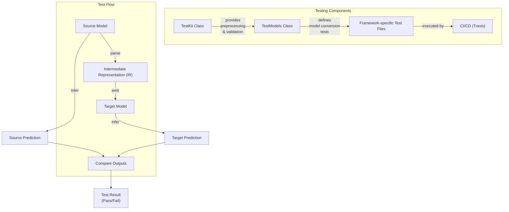
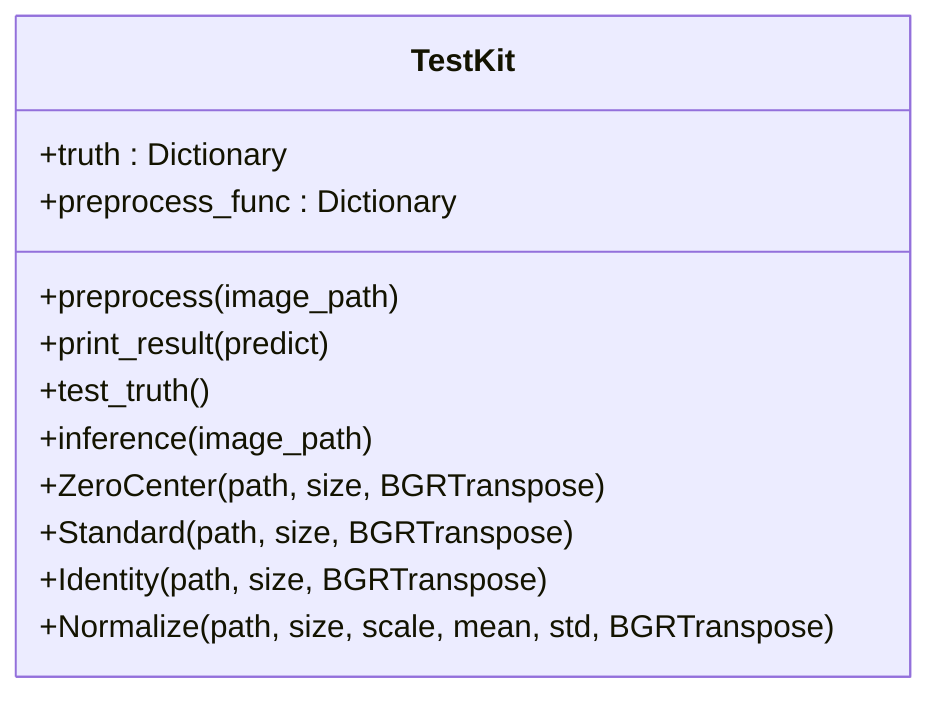
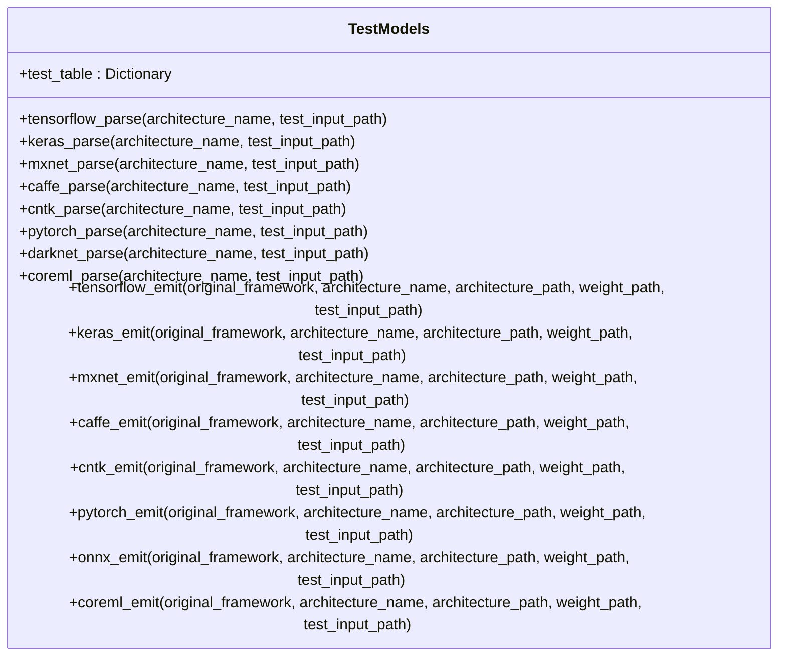
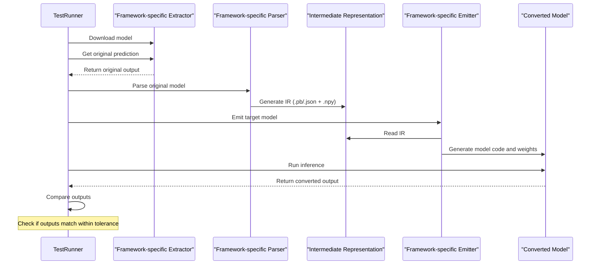
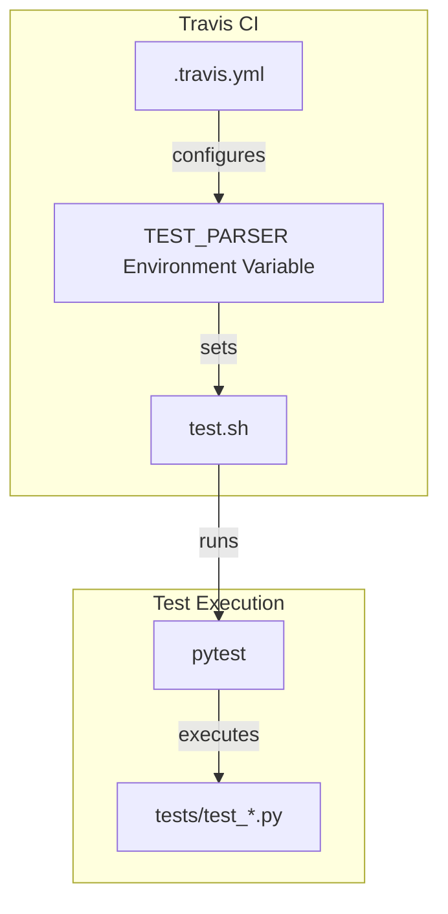

<!-- source: DeepWiki mcp.deepwiki.com · repo microsoft/MMdnn · page 5 Testing and Validation · fetched 2026-10-26 -->

# Testing and Validation

<details>
<summary>Relevant source files</summary>

The following files were used as context for generating this wiki page:

- [.travis.yml](.travis.yml)
- [mmdnn/conversion/examples/imagenet_test.py](mmdnn/conversion/examples/imagenet_test.py)
- [mmdnn/conversion/examples/tensorflow/extractor.py](mmdnn/conversion/examples/tensorflow/extractor.py)
- [test.sh](test.sh)
- [tests/conversion_imagenet.py](tests/conversion_imagenet.py)
- [tests/test_caffe.py](tests/test_caffe.py)

</details>


This page documents the testing and validation infrastructure used in MMdnn to ensure the accuracy and correctness of model conversions between different deep learning frameworks. The testing system verifies that models converted through the MMdnn pipeline produce the same or very similar results as the original models when presented with the same input.

For information about the overall architecture of MMdnn, see [System Architecture](#1.1).

## 1. Testing Architecture Overview

The MMdnn project includes a comprehensive testing framework that validates model conversions by comparing the predictions of original models with their converted counterparts. This ensures that the semantics of neural networks are preserved during conversion.



Sources: [tests/conversion_imagenet.py:47-715](), [mmdnn/conversion/examples/imagenet_test.py:14-380]()

## 2. Core Testing Components

### 2.1 TestKit Class

The `TestKit` class is responsible for providing core testing utilities, including:

1. Ground truth dictionaries with expected model outputs
2. Preprocessing functions tailored to each model and framework
3. Methods to compare model predictions



The `TestKit` class maintains reference outputs (ground truth values) for various models across frameworks, allowing it to verify that converted models produce similar outputs to the originals. It also provides specialized preprocessing functions to prepare input data for different models.

#### 2.1.1 Preprocessing Functions

The class implements several standard preprocessing techniques used by different frameworks:

- **ZeroCenter**: Subtracts mean values [123.68, 116.779, 103.939] from RGB channels
- **Standard**: Normalizes to range [-1, 1] by dividing by 255 and then applying scale and shift
- **Identity**: Simple resizing without normalization
- **Normalize**: Custom normalization with configurable scale, mean, and standard deviation

Sources: [mmdnn/conversion/examples/imagenet_test.py:14-198](), [mmdnn/conversion/examples/imagenet_test.py:247-312]()

### 2.2 TestModels Class

The `TestModels` class is the central component of the testing infrastructure, providing:

1. Methods to parse source models to IR
2. Methods to emit IR to target frameworks
3. Validation workflows to test conversions end-to-end



The class follows a standard pattern for testing model conversions:

1. **Parse methods**: Convert source models to IR format
2. **Emit methods**: Generate code from IR to target frameworks
3. **Compare outputs**: Validate conversion accuracy

Sources: [tests/conversion_imagenet.py:47-307](), [tests/conversion_imagenet.py:327-706]()

## 3. Testing Workflow

The testing process follows a systematic approach to validate model conversions:

1. **Model Download**: The testing framework downloads pre-trained models from their respective repositories
2. **Original Prediction**: Runs inference on the original model with a test image
3. **Conversion to IR**: Converts the original model to MMdnn's intermediate representation
4. **Target Model Generation**: Generates a model in the target framework from the IR
5. **Converted Prediction**: Runs inference on the converted model with the same test image
6. **Validation**: Compares outputs between original and converted models



Sources: [tests/conversion_imagenet.py:62-323](), [mmdnn/conversion/examples/tensorflow/extractor.py:266-323]()

## 4. Test Table Configuration

The testing system uses test tables to define which models from each framework should be tested with which target frameworks. These tables are configured in framework-specific test files.

Example test table from the Caffe test file:

```python
{
    'caffe': {
        'alexnet': [
            TestModels.onnx_emit,
            TestModels.caffe_emit,
            TestModels.cntk_emit,
            TestModels.coreml_emit,
            TestModels.mxnet_emit,
            TestModels.pytorch_emit,
            TestModels.tensorflow_emit
        ],
        'inception_v1': [
            TestModels.onnx_emit,
            TestModels.caffe_emit,
            TestModels.cntk_emit,
            TestModels.coreml_emit,
            TestModels.keras_emit,
            TestModels.mxnet_emit,
            TestModels.pytorch_emit,
            TestModels.tensorflow_emit
        ]
    }
}
```

This configuration specifies which emitters to test for each model in the Caffe framework. The testing infrastructure will automatically download the specified models, convert them to each target framework, and validate the conversions.

Sources: [tests/test_caffe.py:10-33]()

## 5. Continuous Integration

MMdnn uses Travis CI to run tests automatically on code changes. The CI configuration is defined in `.travis.yml` and splits testing across multiple jobs, each testing a specific parser configuration.



The Travis configuration defines multiple test environments, each focused on testing a specific parser:

| Environment | Description |
|-------------|-------------|
| TEST_PARSER=tensorflow | Test TensorFlow parser/emitter |
| TEST_PARSER=keras | Test Keras parser/emitter |
| TEST_PARSER=caffe | Test Caffe parser/emitter |
| TEST_PARSER=pytorch | Test PyTorch parser/emitter |
| TEST_PARSER=mxnet | Test MXNet parser/emitter |
| TEST_PARSER=cntk | Test CNTK parser/emitter |
| TEST_PARSER=coreml | Test CoreML parser/emitter |
| TEST_PARSER=darknet | Test Darknet parser/emitter |

This division allows parallel testing and helps isolate failures to specific framework components.

Sources: [.travis.yml:14-46](), [test.sh:30]()

## 6. Validation Methodology

### 6.1 Ground Truth Comparison

The testing system maintains expected outputs ("ground truth") for various models in the `TestKit.truth` dictionary, which is used to validate that conversions are working correctly. When a model is converted and run, its output is compared against these reference values.

```python
def test_truth(self):
    this_truth = self.truth[self.args.s][self.args.preprocess]
    for index, i in enumerate(self.result):
        assert this_truth[index][0] == i[0]
        assert np.isclose(this_truth[index][1], i[1], atol = 1e-6)

    print ("Test model [{}] from [{}] passed.".format(
        self.args.preprocess,
        self.args.s
    ))
```

This method compares the top predictions of the converted model with the expected values, ensuring that both the predicted classes and their confidence scores are within an acceptable tolerance.

Sources: [mmdnn/conversion/examples/imagenet_test.py:360-369]()

### 6.2 Exception Handling

The testing framework includes an exception table to handle known differences between frameworks that don't affect the correctness of the conversion. These exceptions typically relate to differences in padding implementations, activation functions, or minor numerical discrepancies:

```python
exception_tabel = {
    'cntk_keras_resnet18',                      # Cntk Padding is SAME_LOWER, but Keras Padding is SAME_UPPER, in first convolution layer.
    'cntk_keras_resnet152',                     # Cntk Padding is SAME_LOWER, but Keras Padding is SAME_UPPER, in first convolution layer.
    'tensorflow_caffe_mobilenet_v1_1.0',        # Caffe No Relu6
    'tensorflow_caffe_mobilenet_v2_1.0_224',    # Caffe No Relu6
    'darknet_keras_yolov2',                     # accumulation of small difference
    'darknet_keras_yolov3',                     # accumulation of small difference
}
```

Sources: [tests/conversion_imagenet.py:711-729]()

## 7. Adding New Tests

To add a new model to the testing framework:

1. Add the model's reference outputs to the `TestKit.truth` dictionary
2. Define appropriate preprocessing functions in `TestKit.preprocess_func`
3. Implement the parsing logic in the respective framework's parse method
4. Add the model to the test table in the appropriate framework test file

This modular approach allows the testing framework to be easily extended with new models and frameworks.

Sources: [mmdnn/conversion/examples/imagenet_test.py:16-197](), [tests/test_caffe.py:10-33]()

## 8. Usage Example

To manually run tests for a specific framework, you can use the test script:

```bash
./test.sh tensorflow
```

This will run all TensorFlow-related tests defined in `tests/test_tensorflow.py`.

For more granular testing, you can use pytest directly:

```bash
python -m pytest -s -q tests/test_tensorflow.py::test_tensorflow_2
```

Sources: [test.sh:30]()

---

