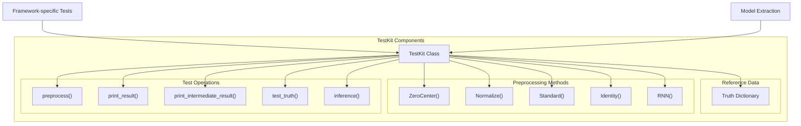
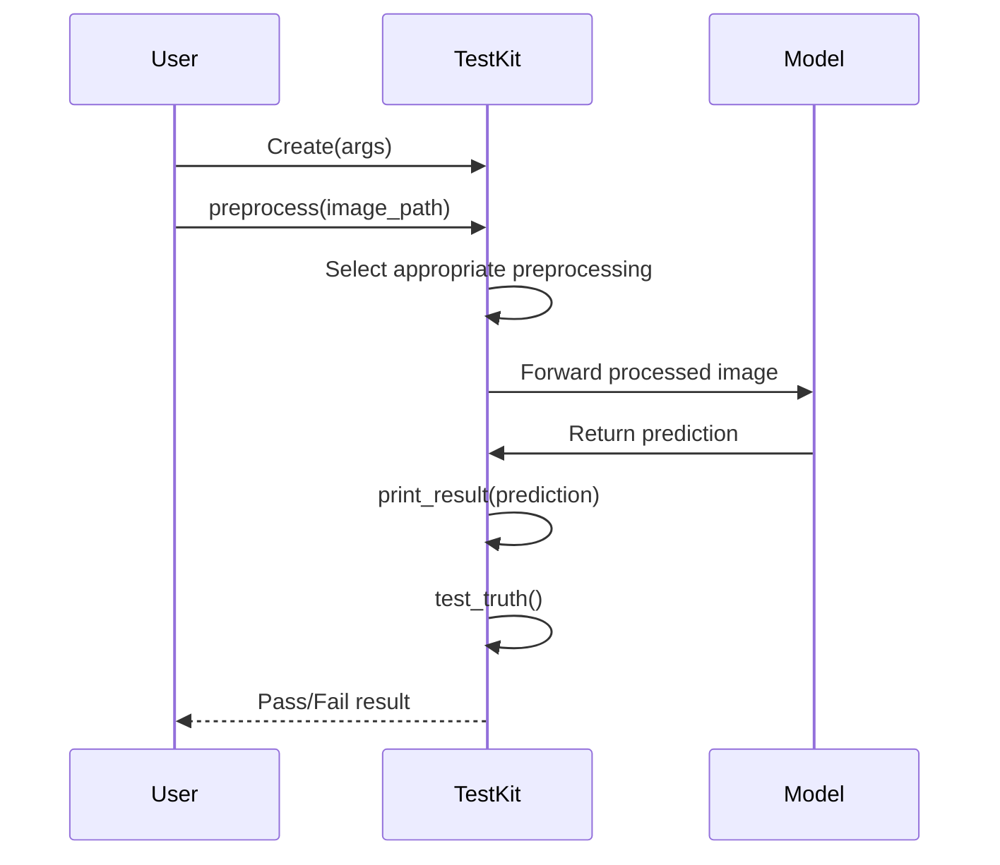
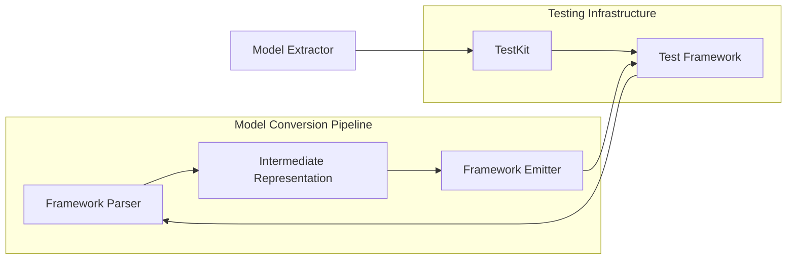

<!-- source: DeepWiki mcp.deepwiki.com · repo microsoft/MMdnn · page 5.1 TestKit · fetched 2026-10-26 -->

# TestKit

<details>
<summary>Relevant source files</summary>

The following files were used as context for generating this wiki page:

- [mmdnn/conversion/examples/imagenet_test.py](mmdnn/conversion/examples/imagenet_test.py)
- [mmdnn/conversion/examples/tensorflow/extractor.py](mmdnn/conversion/examples/tensorflow/extractor.py)

</details>


## Purpose and Overview

TestKit is a core utility class within MMdnn's validation infrastructure that provides standardized tools for testing model conversion accuracy across different deep learning frameworks. It handles image preprocessing, inference result validation, and output comparison between original and converted models.

The TestKit serves as a central component in MMdnn's testing framework, ensuring that models converted between frameworks (such as TensorFlow, Keras, PyTorch, MXNet, etc.) maintain their predictive capabilities. For information about the broader testing framework, see [Test Framework](#5.2).

Sources: [mmdnn/conversion/examples/imagenet_test.py:14-14]()

## TestKit Architecture

TestKit is designed to provide a consistent testing interface for validating model conversions. It bridges the gap between different frameworks by standardizing the preprocessing and validation process.



Sources: [mmdnn/conversion/examples/imagenet_test.py:14-14](), [mmdnn/conversion/examples/imagenet_test.py:200-245]()

## Key Components

### 1. Truth Dictionary

The TestKit maintains a reference dictionary of expected model outputs for various frameworks and models. This serves as the "ground truth" to validate conversion accuracy.

```mermaid
classDiagram
    class "TestKit" {
        +truth: dict
        +preprocess_func: dict
        +args: ArgumentParser
        +MainModel: ModuleType
        +__init__()
        +test_truth()
    }
    
    class "Truth Dictionary" {
        +caffe: dict
        +tensorflow: dict
        +keras: dict 
        +mxnet: dict
        +pytorch: dict
        +cntk: dict
        +coreml: dict
        +darknet: dict
    }
    
    "TestKit" -- "Truth Dictionary" : contains
```

The truth dictionary organizes expected top-5 prediction results by framework and model name. Each entry contains tuples of class indices and confidence scores. For example:

```
'tensorflow': {
    'vgg19': [(21, 11.285443), (144, 10.240093), (23, 9.1792336), (22, 8.1113129), (128, 8.1065922)],
    ...
}
```

Sources: [mmdnn/conversion/examples/imagenet_test.py:16-76]()

### 2. Preprocessing Functions

TestKit provides standardized preprocessing functions for different model types and frameworks. These ensure that input data is formatted correctly for each specific model:

| Preprocessing Method | Description | Parameters |
|----------------------|-------------|------------|
| `ZeroCenter` | Subtracts mean values (123.68, 116.779, 103.939) from RGB channels | `path`, `size`, `BGRTranspose` |
| `Normalize` | Applies scaling, mean subtraction, and std division | `path`, `size`, `scale`, `mean`, `std`, `BGRTranspose` |
| `Standard` | Standardizes to range [-1, 1] | `path`, `size`, `BGRTranspose` |
| `Identity` | Simple resizing without normalization | `path`, `size`, `BGRTranspose` |
| `RNN` | Loads numpy array for RNN inputs | `path` |

The preprocessing functions are mapped to specific models in a framework-specific dictionary:

```python
preprocess_func = {
    'tensorflow': {
        'vgg19': lambda path: TestKit.ZeroCenter(path, 224),
        'inception_v3': lambda path: TestKit.Standard(path, 299),
        ...
    },
    'keras': {
        'vgg16': lambda path: TestKit.ZeroCenter(path, 224, True),
        ...
    },
    ...
}
```

Sources: [mmdnn/conversion/examples/imagenet_test.py:79-198](), [mmdnn/conversion/examples/imagenet_test.py:247-312]()

### 3. Test Utilities

TestKit provides several methods for test execution and result validation:

1. **preprocess** - Applies the appropriate preprocessing function based on source framework and model
2. **print_result** - Formats and displays prediction results
3. **print_intermediate_result** - Displays intermediate layer outputs for debugging
4. **test_truth** - Validates model outputs against expected values
5. **inference** - Runs the complete inference pipeline



Sources: [mmdnn/conversion/examples/imagenet_test.py:314-378]()

## Command Line Interface

TestKit implements a command-line interface for easy testing of model conversions:

| Argument | Description | Default |
|----------|-------------|---------|
| `-p`, `--preprocess` | Model preprocess type | None |
| `-n` | Network structure file name | "kit_imagenet" |
| `-s` | Source framework type | None |
| `-w` | Network weights file name | Required |
| `-i`, `--image` | Test image path | "mmdnn/conversion/examples/data/seagull.jpg" |
| `-l`, `--label` | Path to labels file | "mmdnn/conversion/examples/data/imagenet_1000.txt" |
| `--dump` | Target model path | None |
| `--detect` | Model detection result path | None |
| `--dump_tag` | TensorFlow model dump type | None |

Sources: [mmdnn/conversion/examples/imagenet_test.py:200-242]()

## Integration with MMdnn System

TestKit is integrated with the model extraction and testing framework. It's used by the `tensorflow_extractor` and other framework extractors to validate model conversions:



In practical usage, TestKit is employed to:

1. Preprocess images for model input
2. Run inference on original and converted models
3. Compare outputs to ensure conversion accuracy
4. Validate results against known reference values

Sources: [mmdnn/conversion/examples/tensorflow/extractor.py:22-22](), [mmdnn/conversion/examples/tensorflow/extractor.py:275-276]()

## Example Usage

A typical usage of TestKit for testing a model conversion would involve:

1. Instantiate the TestKit
2. Preprocess an input image using the appropriate function
3. Run inference on the model
4. Print and validate the results against expected values

```python
# Example pseudocode
tester = TestKit()
preprocessed_img = tester.preprocess("path/to/image.jpg")
predictions = model.predict(preprocessed_img)
tester.print_result(predictions)
tester.test_truth()  # Validates against reference values
```

Sources: [mmdnn/conversion/examples/imagenet_test.py:381-384]()

---

