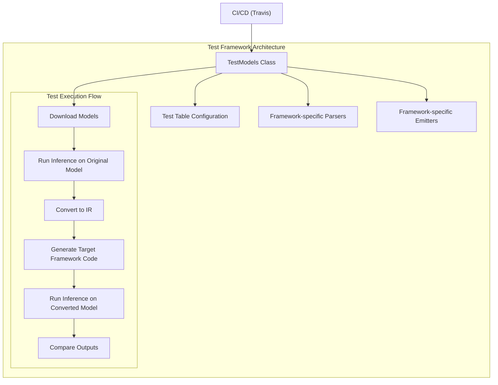
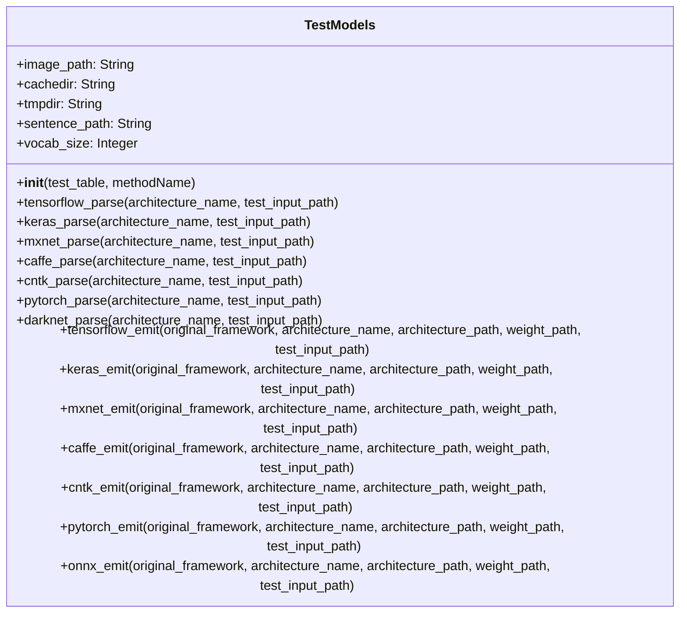
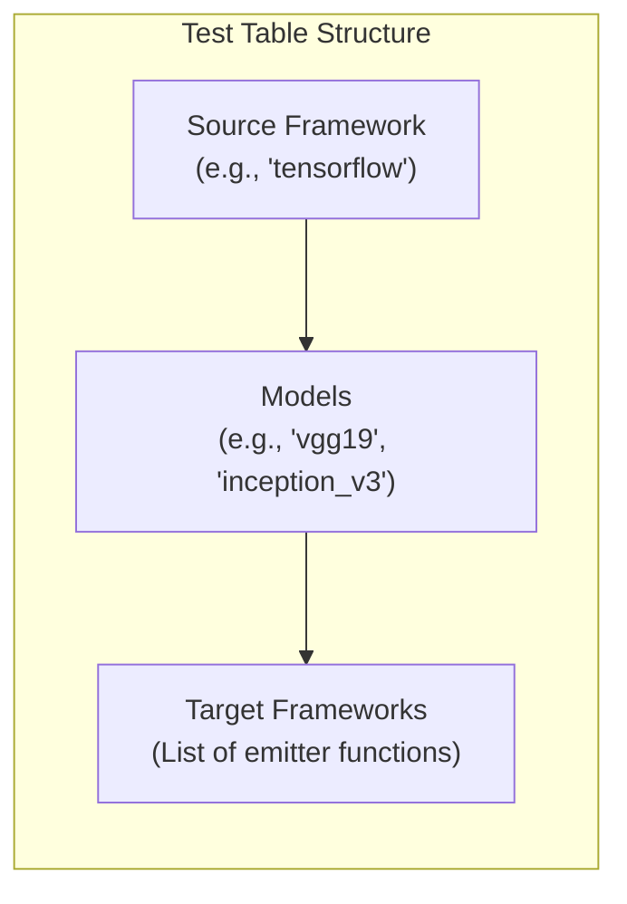
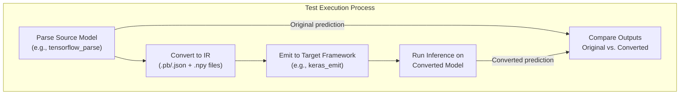
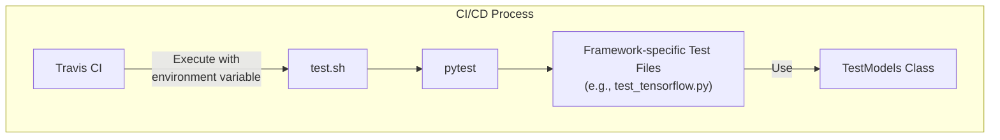

<!-- source: DeepWiki mcp.deepwiki.com · repo microsoft/MMdnn · page 5.2 Test Framework · fetched 2026-10-26 -->

# Test Framework

<details>
<summary>Relevant source files</summary>

The following files were used as context for generating this wiki page:

- [.travis.yml](.travis.yml)
- [test.sh](test.sh)
- [tests/conversion_imagenet.py](tests/conversion_imagenet.py)
- [tests/test_caffe.py](tests/test_caffe.py)
- [tests/test_keras.py](tests/test_keras.py)
- [tests/test_mxnet.py](tests/test_mxnet.py)
- [tests/test_pytorch.py](tests/test_pytorch.py)
- [tests/test_tensorflow.py](tests/test_tensorflow.py)

</details>


The MMdnn Test Framework provides a comprehensive system for validating model conversions between different deep learning frameworks. This page documents the architecture, workflow, and components of the test framework used to ensure accurate model conversions in the MMdnn project. For information about the TestKit class specifically, see [TestKit](#5.1).

## Overview

The Test Framework is designed to validate that models converted from one framework to another maintain their predictive accuracy. It does this by running inference on both the original model and the converted model using the same input data, then comparing the outputs to ensure they are sufficiently similar.



Sources: [tests/conversion_imagenet.py:47-57](), [test.sh:29-30]()

## Core Components

### TestModels Class

The `TestModels` class is the central component of the test framework, inheriting from `CorrectnessTest`. It provides methods for:

1. Parsing models from source frameworks into IR
2. Emitting IR models to target frameworks
3. Running inference on both original and converted models
4. Comparing outputs to validate conversions



Sources: [tests/conversion_imagenet.py:47-47](), [tests/conversion_imagenet.py:55-61]()

### Test Configuration

The test framework uses a test table to define which source frameworks, models, and target frameworks should be tested. Each framework-specific test file defines its own test table.



Sources: [tests/test_tensorflow.py:8-22](), [tests/test_keras.py:9-25](), [tests/test_mxnet.py:9-42](), [tests/test_caffe.py:9-33](), [tests/test_pytorch.py:8-22]()

## Test Workflow

### 1. Model Parsing

For each source framework, the test framework provides a parser method that:
- Downloads or loads a pre-trained model
- Runs inference on the original model to get reference outputs
- Converts the model to the MMdnn Intermediate Representation (IR)

Example parser methods include:
- `tensorflow_parse`
- `keras_parse`
- `mxnet_parse`
- `caffe_parse`
- `cntk_parse`
- `pytorch_parse`
- `darknet_parse`

Sources: [tests/conversion_imagenet.py:62-323]()

### 2. Model Emission

For each target framework, the test framework provides an emitter method that:
- Takes the IR model (architecture and weights)
- Generates target framework code
- Loads the converted model in the target framework
- Runs inference on the converted model

Example emitter methods include:
- `tensorflow_emit`
- `keras_emit`
- `mxnet_emit`
- `caffe_emit`
- `cntk_emit`
- `pytorch_emit`
- `onnx_emit`

Sources: [tests/conversion_imagenet.py:326-706]()

### 3. Output Comparison

After getting predictions from both the original and converted models, the framework compares them to ensure they are sufficiently similar, validating the correctness of the conversion process.



Sources: [tests/conversion_imagenet.py:709-729](), [tests/conversion_imagenet.py:47-53]()

## Framework Support Matrix

The test framework maintains an exception table for known conversion issues or differences between frameworks, and a test table that defines which conversions should be tested.

```
exception_tabel = {
    'cntk_keras_resnet18',
    'cntk_keras_resnet152',
    ...
}
```

The test table can be configured differently for each test, allowing fine-grained control over which framework conversions are tested. Below is a sample visualization of the test matrix:

| Source Framework | Source Model | Target Frameworks |
|-----------------|--------------|-------------------|
| TensorFlow      | vgg19        | ONNX, Caffe, CNTK, CoreML, Keras, MXNet, PyTorch, TensorFlow |
| Keras           | vgg19        | ONNX, Caffe, CNTK, CoreML, Keras, MXNet, PyTorch, TensorFlow |
| MXNet           | vgg19        | ONNX, Caffe, CNTK, CoreML, Keras, MXNet, PyTorch, TensorFlow |
| Caffe           | alexnet      | ONNX, Caffe, CNTK, CoreML, MXNet, PyTorch, TensorFlow |
| PyTorch         | densenet201  | Caffe, CoreML, Keras, MXNet, PyTorch, TensorFlow |

Sources: [tests/conversion_imagenet.py:711-816](), [tests/test_tensorflow.py:8-22](), [tests/test_keras.py:9-25](), [tests/test_mxnet.py:9-42](), [tests/test_caffe.py:9-33](), [tests/test_pytorch.py:8-22]()

## CI/CD Integration

The test framework is integrated with Travis CI for continuous testing. The `.travis.yml` file defines multiple test jobs, each testing a specific framework.



Sources: [.travis.yml:13-46](), [test.sh:29-30]()

## Usage Example

To create a new test for a specific framework conversion, you need to:

1. Create a test file (e.g., `test_new_framework.py`)
2. Define a test table with source models and target frameworks
3. Create an instance of `TestModels` with the test table
4. Call the appropriate test method

Example based on existing test files:

```python
def get_test_table():
    return { 'new_framework' :
        {
            'model_name' : [
                TestModels.onnx_emit,
                TestModels.tensorflow_emit,
                TestModels.keras_emit,
                # Add other target frameworks
            ]
        }
    }

def test_new_framework():
    test_table = get_test_table()
    tester = TestModels(test_table)
    tester._test_function('new_framework', tester.new_framework_parse)
```

Sources: [tests/test_tensorflow.py:8-31](), [tests/test_keras.py:9-35](), [tests/test_mxnet.py:9-52](), [tests/test_caffe.py:9-38](), [tests/test_pytorch.py:8-31]()

## Cached Models and Test Data

The test framework uses cached model files to avoid downloading them repeatedly, and standard test images for inference:

- Model cache directory: `tests/cache/`
- Temporary directory for converted models: `tests/tmp/`
- Test image path: `mmdnn/conversion/examples/data/seagull.jpg`
- Test sentence for RNN models: `mmdnn/conversion/examples/data/one_imdb.npy`

Sources: [tests/conversion_imagenet.py:49-53]()

## Environment Checking

The test framework includes functions to check if the environment supports specific frameworks like PaddlePaddle and CoreML, as these have platform-specific requirements.

Sources: [tests/conversion_imagenet.py:15-44]()

---

