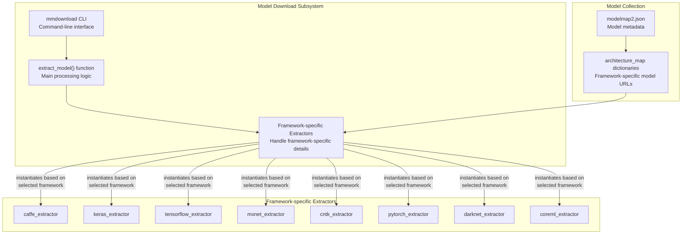
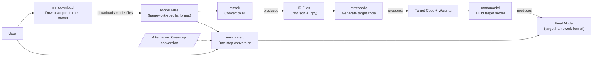
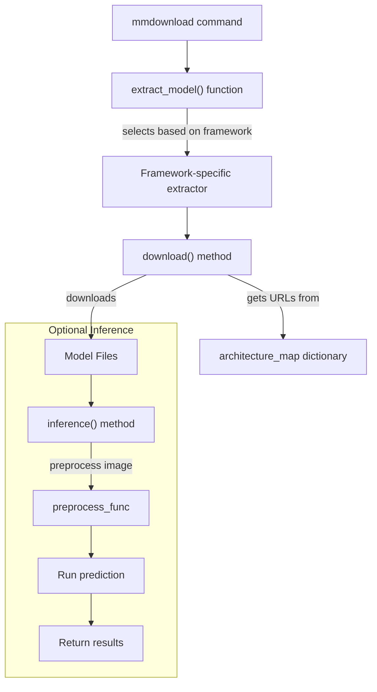
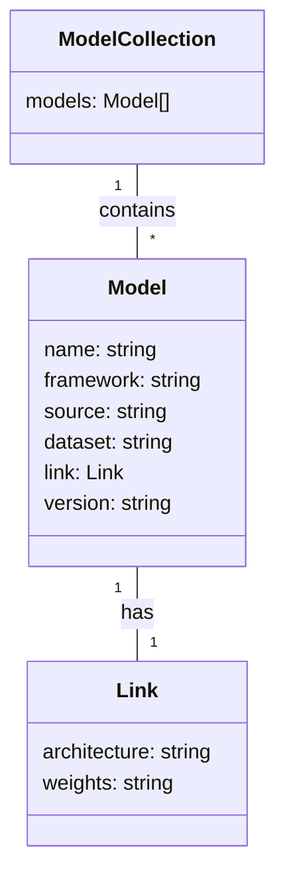

<!-- source: DeepWiki mcp.deepwiki.com · repo microsoft/MMdnn · page 6 Pre-trained Models · fetched 2026-10-26 -->

# Pre-trained Models

<details>
<summary>Relevant source files</summary>

The following files were used as context for generating this wiki page:

- [mmdnn/conversion/_script/extractModel.py](mmdnn/conversion/_script/extractModel.py)
- [mmdnn/conversion/examples/caffe/extractor.py](mmdnn/conversion/examples/caffe/extractor.py)
- [mmdnn/conversion/examples/keras/extractor.py](mmdnn/conversion/examples/keras/extractor.py)
- [mmdnn/models/GenerateMdByDataset.py](mmdnn/models/GenerateMdByDataset.py)
- [mmdnn/models/GenerateMdFromJson.py](mmdnn/models/GenerateMdFromJson.py)
- [mmdnn/models/README.md](mmdnn/models/README.md)
- [mmdnn/models/modelmap2.json](mmdnn/models/modelmap2.json)

</details>


## Overview

This document provides comprehensive information about the pre-trained models available in MMdnn, how to access them, and how to utilize them for model conversion between different deep learning frameworks. For information about the model conversion process itself, see [Intermediate Representation](#2).

Pre-trained models serve as the starting point for the MMdnn conversion workflow, allowing users to easily obtain models from various frameworks and then convert them to other target frameworks.

## Pre-trained Model Collection Architecture

The pre-trained model collection in MMdnn provides a unified interface for accessing models from different frameworks. The system handles downloading model files from their respective sources and preparing them for use with the conversion tools.



Sources: [mmdnn/conversion/_script/extractModel.py](), [mmdnn/conversion/examples/caffe/extractor.py](), [mmdnn/conversion/examples/keras/extractor.py]()

## Model Download and Conversion Workflow

The following diagram illustrates how the pre-trained models fit into the overall MMdnn workflow:



Sources: [mmdnn/models/README.md:11-56]()

## Using the Model Download Tool

The MMdnn toolkit provides the `mmdownload` command-line tool for downloading pre-trained models. This tool supports downloading models from all major deep learning frameworks.

### Command-Line Usage

```
mmdownload -f <framework> -n <model_name> [-o <output_path>]
```

Parameters:
- `-f, --framework`: The source framework (caffe, cntk, mxnet, keras, tensorflow, pytorch, darknet, coreml)
- `-n, --network`: The model name as it appears in the model collection
- `-p, --path, -o`: Optional path to save the downloaded model files (default: current directory)

### Example Usage

```bash
# Download VGG19 from TensorFlow
mmdownload -f tensorflow -n vgg19

# Download ResNet50 from Caffe to a specific directory
mmdownload -f caffe -n resnet50 -o ./models/
```

Sources: [mmdnn/conversion/_script/extractModel.py:87-125]()

## Model Extraction Process

When you download a pre-trained model, MMdnn handles the extraction process through framework-specific extractors. The extraction process includes:

1. Identifying the correct URLs for model architecture and weights
2. Downloading the files to the specified location
3. Optionally performing inference on a test image to verify the model



Sources: [mmdnn/conversion/_script/extractModel.py:24-82](), [mmdnn/conversion/examples/caffe/extractor.py:52-90]()

## Supported Pre-trained Models

MMdnn supports a wide range of pre-trained models across different frameworks. These models are primarily organized by task (image classification, object detection) and dataset (ImageNet, Pascal VOC, etc.).

### Models by Framework

The following table summarizes the supported frameworks and the number of pre-trained models available:

| Framework | Description | Number of Models |
|-----------|-------------|------------------|
| Caffe | Models from Caffe Model Zoo and other sources | 14+ |
| CNTK | Models from Microsoft Cognitive Toolkit | 8+ |
| CoreML | Models from Apple's CoreML | 5+ |
| Darknet | YOLO models for object detection | 2+ |
| MXNet | Models from MXNet Model Zoo | 15+ |
| PyTorch | Models from PyTorch torchvision | 20+ |
| TensorFlow | Models from TensorFlow-Slim | 15+ |

Sources: [mmdnn/models/README.md:59-90](), [mmdnn/models/modelmap2.json]()

### Models by Task

#### Image Classification

The majority of pre-trained models are for image classification, primarily trained on the ImageNet dataset. These include popular architectures such as:

- AlexNet
- VGG (16, 19)
- ResNet (18, 34, 50, 101, 152)
- Inception (v1, v3, v4)
- MobileNet
- SqueezeNet
- Xception
- DenseNet
- NASNet

#### Object Detection

MMdnn also includes pre-trained models for object detection:

- YOLO (v2, v3) from Darknet
- FCN (8s, 16s, 32s) from Caffe
- Fast-RCNN for Pascal VOC and Grocery100 datasets

Sources: [mmdnn/models/README.md:59-111]()

## Model Data Organization

Pre-trained model information is stored in a structured JSON format that includes:

- Model name
- Framework
- Dataset
- Download links (architecture and weights)
- Source reference



Sources: [mmdnn/models/modelmap2.json](), [mmdnn/models/GenerateMdFromJson.py:17-73]()

## Framework-Specific Model Access

Each supported framework has its own extractor class that handles the specifics of downloading and preparing models for that framework. The extractors implement a common interface with two main methods:

- `download(architecture, path)`: Downloads model files for a given architecture
- `inference(architecture_name, architecture, path, image_path)`: Runs inference on a given image using the downloaded model

### Example: Caffe Extractor

The Caffe extractor handles models in `.prototxt` (architecture) and `.caffemodel` (weights) format:

```python
# Usage example
from mmdnn.conversion.examples.caffe.extractor import caffe_extractor

# Download AlexNet
model_files = caffe_extractor.download('alexnet', './models/')

# Run inference
if model_files:
    prediction = caffe_extractor.inference('alexnet', model_files, './models/', 'test_image.jpg')
```

Sources: [mmdnn/conversion/examples/caffe/extractor.py:13-90]()

### Example: TensorFlow Extractor

TensorFlow models typically come in `.tar.gz` format and need to be extracted before use:

```python
# Usage example
from mmdnn.conversion.examples.tensorflow.extractor import tensorflow_extractor

# Download VGG19
model_files = tensorflow_extractor.download('vgg19', './models/')

# Run inference
if model_files:
    prediction = tensorflow_extractor.inference('vgg19', model_files, './models/', 'test_image.jpg')
```

## Integration with Model Conversion

After downloading a pre-trained model, you can use the MMdnn conversion tools to convert it to other frameworks. The typical workflow involves:

1. Download the model using `mmdownload`
2. Convert the model to IR format using `mmtoir`
3. Generate code for the target framework using `mmtocode`
4. Build the final model using `mmtomodel`

Alternatively, you can use the `mmconvert` command for one-step conversion:

```bash
# Convert VGG19 from TensorFlow to PyTorch
mmconvert -sf tensorflow -in imagenet_vgg19.ckpt.meta -iw imagenet_vgg19.ckpt --dstNodeName MMdnn_Output -df pytorch -om pytorch_vgg19.pth
```

Sources: [mmdnn/models/README.md:11-56]()

## Preprocessing and Inference

When using pre-trained models for inference, MMdnn provides preprocessing functions specific to each model. These functions handle tasks such as:

- Image resizing
- Mean subtraction
- Normalization
- Channel reordering (RGB to BGR or vice versa)

The preprocessing functions are accessible through the `TestKit` class, which is used by the model extractors for validation.

Sources: [mmdnn/conversion/examples/caffe/extractor.py:80-87](), [mmdnn/conversion/examples/keras/extractor.py:89-93]()

## Summary

The pre-trained model collection in MMdnn provides a unified interface for accessing and using models from various deep learning frameworks. By using the `mmdownload` tool, you can easily obtain pre-trained models and convert them to other frameworks using the MMdnn conversion pipeline.

The collection is continuously updated to include new models and frameworks, making it a valuable resource for deep learning practitioners who work with multiple frameworks.

---

