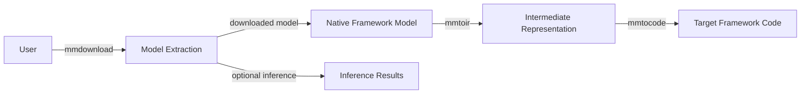
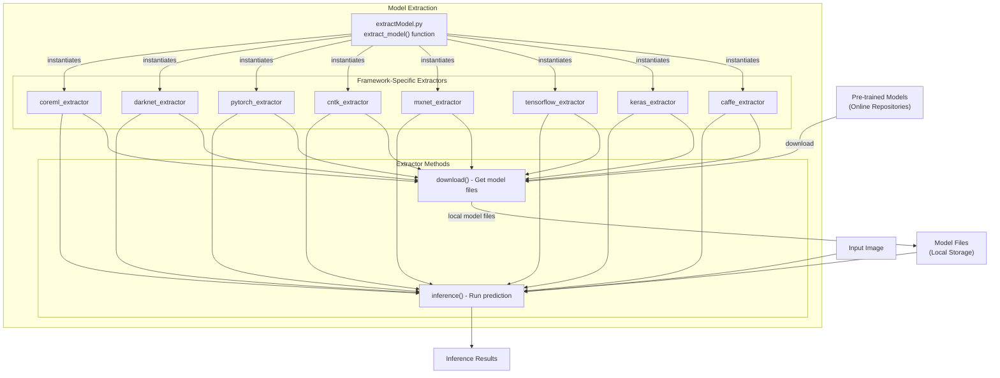
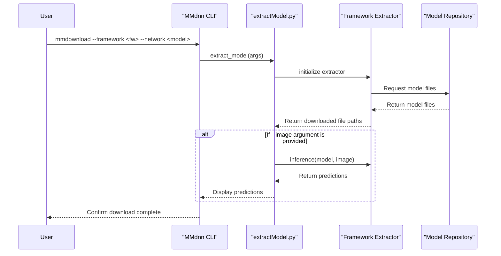
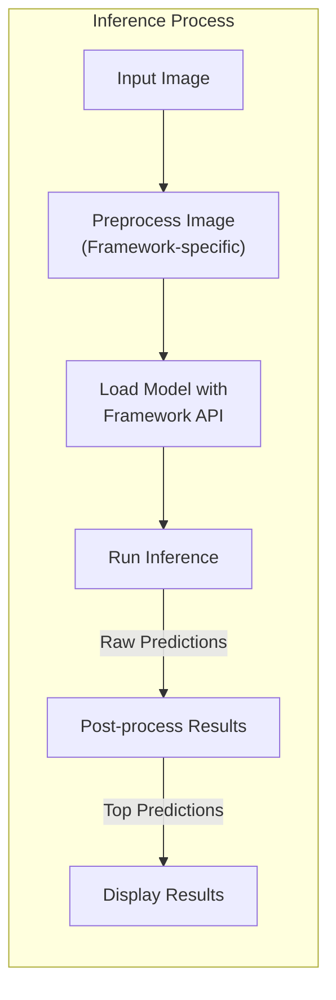
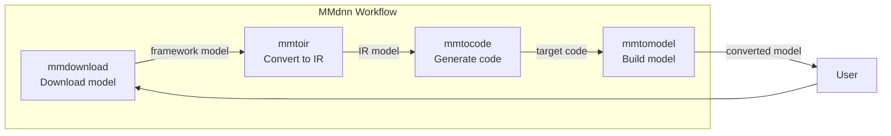

<!-- source: DeepWiki mcp.deepwiki.com · repo microsoft/MMdnn · page 6.1 Model Extraction · fetched 2026-10-26 -->

# Model Extraction

<details>
<summary>Relevant source files</summary>

The following files were used as context for generating this wiki page:

- [mmdnn/conversion/_script/extractModel.py](mmdnn/conversion/_script/extractModel.py)
- [mmdnn/conversion/darknet/darknet_graph.py](mmdnn/conversion/darknet/darknet_graph.py)
- [mmdnn/conversion/darknet/darknet_parser.py](mmdnn/conversion/darknet/darknet_parser.py)
- [mmdnn/conversion/examples/caffe/extractor.py](mmdnn/conversion/examples/caffe/extractor.py)
- [mmdnn/conversion/examples/keras/extractor.py](mmdnn/conversion/examples/keras/extractor.py)
- [mmdnn/conversion/examples/keras/imagenet_test.py](mmdnn/conversion/examples/keras/imagenet_test.py)

</details>


Model Extraction in MMdnn is a utility that enables users to download and use pre-trained models from various deep learning frameworks. This document describes the model extraction functionality, its architecture, supported frameworks, and usage patterns. For information about converting models between frameworks, see [Intermediate Representation](#2).

## 1. Overview

Model extraction in MMdnn provides a unified interface to:

1. Download pre-trained models from various deep learning frameworks
2. Extract model architectures and weights
3. Perform inference using the extracted models
4. Prepare models for conversion between frameworks

The extraction functionality is implemented as a set of framework-specific extractors that handle the intricacies of downloading and loading models in their respective frameworks.

## 2. Architecture

### Model Extraction in MMdnn Pipeline



The model extraction component sits at the beginning of the MMdnn conversion pipeline, providing pre-trained models that can be converted to the Intermediate Representation (IR) and subsequently to other frameworks.

### Model Extraction Components



Sources: [mmdnn/conversion/_script/extractModel.py:24-83](), [mmdnn/conversion/examples/caffe/extractor.py:13-90](), [mmdnn/conversion/examples/keras/extractor.py:15-99]()

## 3. Supported Frameworks and Models

MMdnn supports model extraction from the following frameworks:

| Framework | Command Argument | Example Models |
|-----------|------------------|----------------|
| Caffe | `caffe` | AlexNet, VGG16/19, Inception v1/v4, ResNet, SqueezeNet |
| Keras | `keras` | VGG16/19, ResNet50, MobileNet, Xception, InceptionV3, DenseNet |
| TensorFlow | `tensorflow` or `tf` | Inception, ResNet, MobileNet, VGG |
| MXNet | `mxnet` | ResNet, VGG, Inception, DenseNet |
| CNTK | `cntk` | ResNet, AlexNet |
| PyTorch | `pytorch` | AlexNet, ResNet, VGG, Inception |
| Darknet | `darknet` | YOLOv2, YOLOv3 |
| CoreML | `coreml` | Various converted models |

Each framework-specific extractor defines a mapping of model architectures to their online locations or constructor functions.

Example from Caffe extractor:

```python
architecture_map = {
    'alexnet': {'prototxt': 'https://raw.githubusercontent.com/BVLC/caffe/master/models/bvlc_alexnet/deploy.prototxt',
                'caffemodel': 'http://dl.caffe.berkeleyvision.org/bvlc_alexnet.caffemodel'},
    'vgg16': {'prototxt': '...',
              'caffemodel': '...'},
    # More models...
}
```

Sources: [mmdnn/conversion/examples/caffe/extractor.py:18-48](), [mmdnn/conversion/examples/keras/extractor.py:19-33]()

## 4. Extraction Process Flow



The model extraction process follows these steps:

1. The user invokes the `mmdownload` command with the desired framework and model
2. The command is routed to the `extract_model` function in `extractModel.py`
3. Based on the framework argument, a framework-specific extractor is instantiated
4. The extractor downloads the model files using its `download` method
5. If an image is provided, the extractor performs inference on the image
6. The results are returned to the user

Sources: [mmdnn/conversion/_script/extractModel.py:24-82]()

## 5. Using Model Extraction

### Basic Command-Line Usage

The model extraction functionality is available through the `mmdownload` command-line tool:

```bash
mmdownload --framework <framework> --network <model> [--path <output_path>]
```

To perform inference with the downloaded model:

```bash
mmdownload --framework <framework> --network <model> --image <image_path> [--label <label_file>]
```

### Example Usage

```bash
# Download VGG16 Caffe model
mmdownload --framework caffe --network vgg16 --path ./models

# Download and run inference with ResNet50 Keras model
mmdownload --framework keras --network resnet50 --image ./cat.jpg
```

Sources: [mmdnn/conversion/_script/extractModel.py:86-126]()

## 6. Framework-Specific Extraction Details

### Caffe Extractor

The Caffe extractor downloads models defined by prototxt (model definition) and caffemodel (weights) files. It supports common image classification models like AlexNet, VGG, and ResNet, as well as semantic segmentation models like FCN.

### Keras Extractor

The Keras extractor either:
1. Instantiates built-in Keras models (`keras.applications`) and saves them to disk, or
2. Downloads third-party models from online sources

Inference is performed using the Keras API, with appropriate preprocessing for each model architecture.

### Darknet Extractor

The Darknet extractor works specifically with YOLO object detection models, parsing the specialized Darknet format which includes:
1. Configuration file (.cfg)
2. Weight file (.weights)

### Other Extractors

Each framework extractor implements similar functionality for its respective framework, handling the specifics of model loading, weight extraction, and inference.

Sources: [mmdnn/conversion/examples/caffe/extractor.py:13-90](), [mmdnn/conversion/examples/keras/extractor.py:15-99](), [mmdnn/conversion/darknet/darknet_parser.py:14-354]()

## 7. Inference with Extracted Models

When the `--image` argument is provided, the model extraction process also performs inference:



The inference process:
1. Preprocesses the image according to the requirements of the specific model
2. Loads the model using the framework's native API
3. Runs inference to generate predictions
4. Post-processes the results (e.g., applies softmax, finds top-k predictions)
5. If a label file is provided, maps numeric predictions to human-readable labels

Example output for an image classification model:
```
('tiger cat', 282, 0.70125)
('tabby cat', 281, 0.22327)
('Egyptian cat', 285, 0.05967)
('lynx', 287, 0.00856)
('Persian cat', 283, 0.00286)
```

Sources: [mmdnn/conversion/_script/extractModel.py:62-82](), [mmdnn/conversion/examples/keras/imagenet_test.py:33-41]()

## 8. Integration with Model Conversion

The model extraction functionality is designed to work seamlessly with the model conversion process:



After extracting a model with `mmdownload`, it can be converted to other frameworks using:
1. `mmtoir` to convert to the Intermediate Representation
2. `mmtocode` to generate code for the target framework
3. `mmtomodel` to finalize the model in the target framework

This provides a complete pipeline from downloading pre-trained models to converting them for use in different frameworks.

Sources: [mmdnn/conversion/_script/extractModel.py:24-82]()

---

